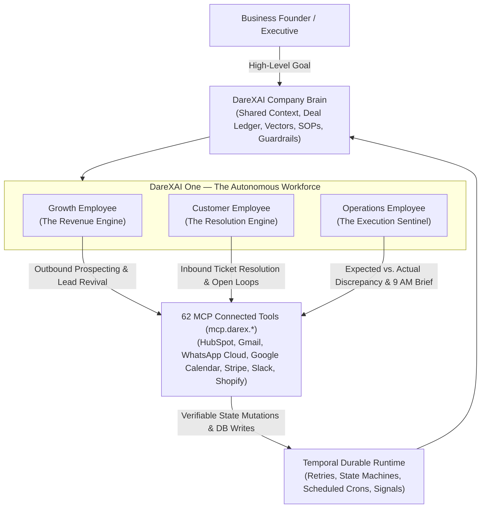
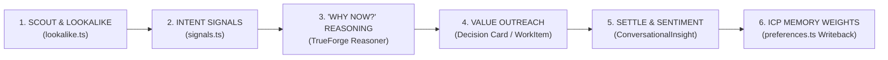
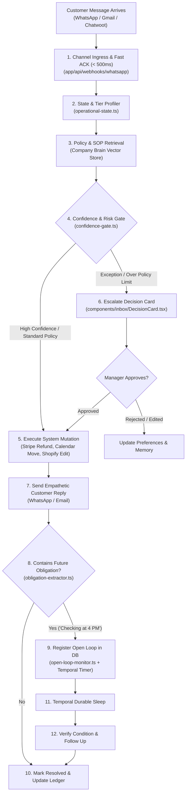
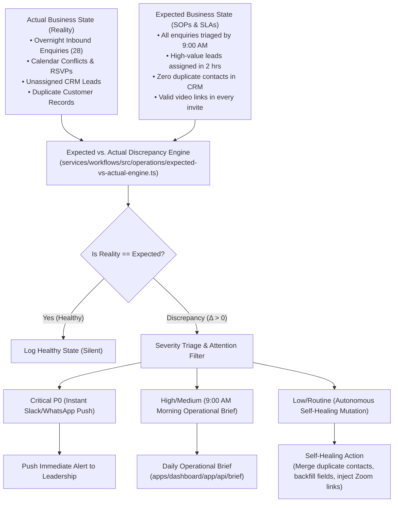
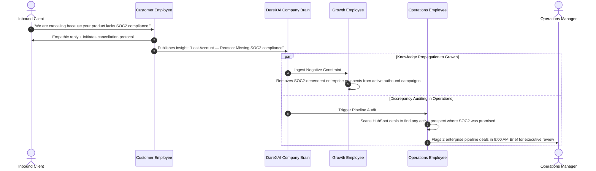

# DareXAI One — The Autonomous AI Workforce For Your Business
### Three Dedicated AI Employees That Work Together So You Never Drop A Lead, Ticket, Or Task

> **What is DareXAI One?**  
> DareXAI One gives your company a team of 3 specialized AI employees: **Growth** (finds new revenue), **Customer** (resolves customer issues 24/7), and **Operations** (keeps your internal business running on time). They share one brain, connect to your existing apps (HubSpot, WhatsApp, Gmail, Stripe, Calendar), and work around the clock.

---

## What Your 3 AI Employees Do For You (Plain English Overview & Tool Plan)

*Written in simple, plain English for founders and operators — with exact tool actions, status, and code modules to be built.*

### 🚀 1. Growth Employee — "Your Autonomous Revenue & Sales Lead"
*Finds new high-value opportunities, spots when prospects are ready to buy, and writes personal outreach you approve in 1 click.*

| ID | Feature List | When It Steps In | Tool Action (`mcp.darex.*`) | Your Control | Status | Code Module & What We Will Add |
| :--- | :--- | :--- | :--- | :--- | :--- | :--- |
| **GE-01** | **Twin Customer Finder**<br>Searches the market for twin lookalikes of your top paying clients. | When you close a new paying customer in CRM | `mcp.darex.crm.fetch_closed_won`, `mcp.darex.enrich.find_lookalikes` | 1-Click Approve List | `✅ Done` | `services/workflows/src/growth/lookalike.ts` & `activities/growth.ts`. Centroid math plus a real Apollo `search_people` call (`searchLookalikeCandidatesActivity`) auto-populates lookalike candidates, merged into ranking. |
| **GE-02** | **Market Scout**<br>Finds verified B2B decision-makers (CEOs, VPs) and direct emails in target niches. | When targeting a new industry or daily 8 AM schedule | `mcp.darex.lead_enrich.search_apollo`, `mcp.darex.crm.insert_leads` | Daily Budget Cap & Review | `✅ Done` | `services/workflows/src/tools/apollo.ts`, `activities/growth.ts` (`runMarketScoutActivity`), `workflows/MarketScoutWorkflow.ts`. Daily Temporal cron searches Apollo against the org ICP, caps inserts to `GROWTH_SCOUT_DAILY_LEAD_CAP` (default 25), and inserts into HubSpot CRM (fallback growth opportunity card when HubSpot isn't connected). |
| **GE-03** | **Buying Signal Radar**<br>Tracks funding, executive hiring, and software changes 24/7. | Runs 24/7 background sweep every 4 hours | `mcp.darex.web.scrape_jina`, `mcp.darex.db.upsert_intent_signals` | Autonomous Alert | `✅ Done` | `services/workflows/src/growth/signals.ts` & `workflows/growth-watcher.ts`. Fully implemented via Jina & Temporal cron. |
| **GE-04** | **Website Visitor Identifier**<br>Identifies company domains visiting pricing/demo pages. | Corporate visitor browses high-intent pages 2+ times in 24h | `mcp.darex.analytics.deanonymize`, `mcp.darex.crm.create_lead` | 1-Click Approve Card | `✅ Done` | `apps/dashboard/lib/visitor-enrich.ts` & `app/api/widget/intent/route.ts`. Reverse-IP plus a 2+ visit/24h frequency gate (`crossesVisitFrequencyGate`), Apollo department-head discovery (`findDepartmentHead`), and lead creation as a growth_opportunity card. |
| **GE-05** | **Lost Deal Reviver**<br>Wakes up dormant leads when new trigger events occur. | CRM leads untouched $>90$ days have fresh company news | `mcp.darex.crm.list_stale`, `mcp.darex.email.stage_draft` | 1-Click Approve Card | `✅ Done` | `services/workflows/src/workflows/DormantLeadRevivalWorkflow.ts` & `activities/growth.ts`. Fully working in Temporal. |
| **GE-06** | **"Why Today?" Matchmaker**<br>Generates a 2-sentence reason why reaching out today makes sense. | Before queuing outbound message to a prospect | `mcp.darex.brain.query_ledger`, `mcp.darex.llm.reason` | Autonomous Context | `✅ Done` | `services/workflows/src/growth/why-now.ts` + `activities/growth.ts`. `synthesizeWhyNow` calls the LiteLLM chat endpoint with the candidate's live signals and the org's closed-won ledger, falling back to the deterministic concatenation when no LLM endpoint is configured. |
| **GE-07** | **Pre-Meeting Account Dossier**<br>Builds 1-page intelligence brief before sales calls. | Sales demo confirmed on Google Calendar | `mcp.darex.calendar.get_event`, `mcp.darex.web.scrape`, `mcp.darex.slack.notify` | Slack/Calendar Brief | `✅ Done` | `services/workflows/src/tools/google-calendar.ts`, `activities/growth.ts` (`compileMeetingDossiersActivity`), `workflows/MeetingDossierWorkflow.ts`. Polls calendar every 30 min, web-searches/extracts the external attendee's company, and posts a 1-page brief to Slack (dedup ledger `growth_meeting_dossiers`). |
| **GE-08** | **Tailored Outreach Drafter**<br>Drafts personalized emails referencing pain points and tech stack. | Approved opportunity card in growth inbox | `mcp.darex.gmail.create_draft`, `mcp.darex.linkedin.queue_message` | 1-Click Approve / Edit | `✅ Done` | `apps/dashboard/components/growth/OpportunityCard.tsx` + `app/api/work-items/[id]/decision/route.ts`. Approve now starts a real `AutonomousAgentWorkflow` instructed to send the drafted email via the gmail tool to the card's target contact. |
| **GE-09** | **Smart Reply Sorter**<br>Classifies prospect replies (Interested, Objection, OOO, Unsubscribe). | Inbound reply received from outreach campaign | `mcp.darex.crm.update_stage`, `mcp.darex.slack.alert_rep` | Hot Lead Alert | `✅ Done` | `services/workflows/src/growth/reply-classifier.ts`, `activities/growth.ts` (`classifyInboundRepliesActivity`), `workflows/ReplySorterWorkflow.ts`. Polls Gmail every 20 min, matches replies to tracked opportunities, updates pipeline stage, and Slack-alerts the rep on interest / cancels + suppresses on unsubscribe. |
| **GE-10** | **Voice & Style Learner**<br>Learns tone, objections, and ICP preferences from user edits/rejections. | User edits or rejects a drafted pitch card | `mcp.darex.brain.update_preferences` | Continuous Learning | `✅ Done` | `services/workflows/src/growth/preferences.ts` (`ruleFromRejection`) + `app/api/work-items/[id]/decision/route.ts`. A `wrong_fit` reject now derives an industry/geo `PreferenceRule` and merges it into `org_preferences.rules` synchronously, in addition to the existing suppression log. |

---

### 💬 2. Customer Employee — "Your 24/7 Customer Support & Resolution Manager"
*Takes care of customers from the moment they ask for help until their issue is completely solved—rescheduling meetings, issuing refunds, and following up on promises.*

| ID | Feature List | When It Steps In | Tool Action (`mcp.darex.*`) | Your Control | Status | Code Module & What We Will Add |
| :--- | :--- | :--- | :--- | :--- | :--- | :--- |
| **CE-01** | **Instant Omnichannel Reply**<br>Delivers $<500\text{ms}$ response acknowledgement 24/7. | Customer messages on WhatsApp or Email | `mcp.darex.webhook.ack`, `mcp.darex.temporal.start` | 100% Automatic | `✅ Done` | `apps/dashboard/app/api/webhooks/whatsapp` & `chatwoot`. Fully implemented with fast ACK + async Temporal execution. |
| **CE-02** | **VIP & Account Profiler**<br>Pulls spend, MRR, open orders, and VIP status. | Immediately when customer reaches out | `mcp.darex.crm.get_contact`, `mcp.darex.billing.get_customer` | Automatic Context | `✅ Done` | `services/workflows/src/customer/account-profile.ts` & `operational-state.ts`. Live HubSpot contact lookup, Stripe MRR from active subscriptions, and Zendesk open-ticket count replace the keyword-only heuristic; a VIP account with any negative signal is escalated. |
| **CE-03** | **Company Rulebook Expert (RAG)**<br>Answers returns, warranties, and SLAs with zero hallucinations. | Customer asks policy or product question | `mcp.darex.brain.vector_search` | Strictly Follows SOPs | `✅ Done` | `services/workflows/src/memory/employee-retrieve.ts` & `customer/refund-eligibility.ts`. Org-wide RAG plus a grounded refund-eligibility citation computed from the customer's real last Stripe charge (14-day window, $100 cap) whenever the question is refund-shaped — never a guessed "yes". |
| **CE-04** | **Self-Service Rescheduling**<br>Checks calendar slots, reschedules meetings, and sends invites. | Customer asks to reschedule or move appointment | `mcp.darex.calendar.update_event`, `mcp.darex.crm.update_deal` | 100% Automatic | `✅ Done` | `services/workflows/src/tools/google-calendar.ts` & `tools/hubspot.ts`. `update_event` PATCHes the real Google Calendar event (notifying attendees) and, when a CRM contact email is supplied, best-effort logs a `sync_deal_schedule` note on HubSpot — deliberately not a deal-stage mutation, since role-capability denies `update_deal`/`create_deal` for the customer persona. |
| **CE-05** | **Automated Refund Processor**<br>Issues Stripe refunds within dollar limits and time windows. | Customer requests refund within policy limits ($<\$100$, 14 days) | `mcp.darex.stripe.create_refund`, `mcp.darex.billing.update_invoice` | Dollar Limit Rules | `✅ Done` | `services/workflows/src/tools/stripe.ts`. `create_refund` re-derives the charge's real amount/age from Stripe itself (never a caller-supplied number), hard-blocks outside the 14-day/$100 policy, and otherwise calls the real Stripe refunds API — still gated by `autonomy.ts`'s irreversible-action approval requirement upstream. |
| **CE-06** | **Address & Order Corrector**<br>Updates delivery address before warehouse ships order. | Customer reports wrong shipping address on unfulfilled order | `mcp.darex.shopify.update_order_address` | 100% Automatic | `✅ Done` | `services/workflows/src/tools/shopify.ts`. `update_order_address` looks up the order's real `fulfillment_status` first and refuses once it's no longer `unfulfilled`, then PUTs the new shipping address via the Shopify Admin API. |
| **CE-07** | **Never-Forgotten Promises (Open Loops)**<br>Tracks commitments and triggers follow-up at promised time. | Agent promises future action (*"I will update you at 4 PM"*)| `mcp.darex.db.insert_open_loop`, `mcp.darex.temporal.timer` | 100% Automatic | `✅ Done` | `services/workflows/src/workflows/open-loop-monitor.ts` & `activities/open-loop-sweep.ts`. Durable Temporal timer loop fully working. |
| **CE-08** | **1-Click Manager Approvals**<br>Sends 1-click approve/reject cards for policy exceptions. | Customer request exceeds threshold (e.g. $\$250$ refund) | `mcp.darex.work_item.create_card`, `mcp.darex.slack.notify` | 1-Click Decision Card | `✅ Done` | `apps/dashboard/components/inbox/DecisionCard.tsx` & `autonomy.ts`. Decision cards work in UI. Proactive Slack push to managers fires when a pending action is parked. |
| **CE-09** | **Angry Customer Radar**<br>Detects frustration or cancellation intent and alerts team. | Frustrated tone or threats to cancel | `mcp.darex.crm.update_churn_score`, `mcp.darex.slack.alert_ae` | Instant Rep Alert | `✅ Done` | `services/workflows/src/workflows/CustomerRecoveryWorkflow.ts` & `activities/customer.ts`. Multi-turn sentiment history (`agent_sentiment_history`) now backs trend-based, once-per-day proactive Slack alerts. |
| **CE-10** | **Knowledge Gap Finder**<br>Detects unanswered questions and logs missing SOP topics. | Customer asks question with low retrieval confidence ($<0.65$) | `mcp.darex.brain.log_knowledge_gap` | Dashboard Review | `✅ Done` | `services/workflows/src/customer/knowledge-gap-clusters.ts` & `activities/customer.ts`. Logged questions are grouped by trigram similarity into ranked topic clusters, surfaced via `/api/employees/customer`. |

---

### ⚙️ 3. Operations Employee — "Your Daily COO & Operations Sentinel"
*Keeps the business running on rails. Triages your morning inquiries, enforces response times, cleans your CRM, and ensures nothing slips through the cracks.*

| ID | Feature List | When It Steps In | Tool Action (`mcp.darex.*`) | Your Control | Status | Code Module & What We Will Add |
| :--- | :--- | :--- | :--- | :--- | :--- | :--- |
| **OE-01** | **9:00 AM Morning Triage**<br>Gathers overnight messages and leads; assigns owners. | 9:00 AM local business time every morning | `mcp.darex.crm.sync_overnight`, `mcp.darex.db.triage` | Ready at 9:00 AM | `✅ Done` | `services/workflows/src/workflows/morning-check.ts`. `MorningCheckWorkflow` now reads the org's timezone (`getOrgTimeZoneActivity`), aligns to 9:00 AM local via `msUntilNextHourActivity`, runs `runMorningCheckActivity`, and continues-as-new daily. |
| **OE-02** | **Executive Standup Brief**<br>Delivers 2-minute morning summary of revenue, tickets, and stuck work. | After morning triage completes | `mcp.darex.slack.send_brief`, `mcp.darex.email.send_summary` | Read in 2 Minutes | `✅ Done` | `services/workflows/src/operations/brief.ts` & `/api/brief`. `deliverBriefActivity` (in `activities/open-loop-sweep.ts`) now pushes the triage brief to Slack (`send_channel_message`) and WhatsApp (`send_whatsapp_message`) right after `MorningCheckWorkflow` completes triage; best-effort per channel. |
| **OE-03** | **Expected vs. Actual Engine**<br>Audits whether team and systems met operational standards. | 24/7 continuous background check | `mcp.darex.crm.check_slas`, `mcp.darex.calendar.audit` | 100% Automatic | `✅ Done` | `services/workflows/src/operations/expected-vs-actual-engine.ts`. Added `OPERATIONAL_EXPECTATION_RULES` (declarative registry, e.g. `hot_lead_contacted_within_2h`, `contact_no_duplicate`) plus `registerExpectationFromRule`/`registerExpectationActivity` so operational standards are declared, not hand-coded per check. |
| **OE-04** | **Slow Rep Follow-up Reminder**<br>Nudges sales reps on Slack with a pre-written draft if leads go cold. | High-value lead uncontacted $>3$ hours after assignment | `mcp.darex.slack.remind_rep`, `mcp.darex.crm.log_warning` | Private Slack Nudge | `✅ Done` | `services/workflows/src/activities/rep-followup-sla.ts` + `services/workflows/src/workflows/rep-followup-sla.ts`. `RepFollowUpSlaWorkflow` sweeps hourly, nudges via `slack.send_channel_message` at 3h uncontacted and escalates to the manager channel at 5h; every nudge/escalation is logged to the decision ledger (`crm.log_warning` equivalent). |
| **OE-05** | **Smart Workload Balancer**<br>Routes leads and tickets based on rep capacity and schedule. | Incoming leads or operational tasks arrive | `mcp.darex.crm.reassign_owner`, `mcp.darex.team.balance_load` | Keeps Team Balanced | `✅ Done` | `services/workflows/src/tools/hubspot.ts` (new `reassign_owner` action), `services/workflows/src/operations/coordination.ts` (`pickLeastLoadedRep`), `services/workflows/src/activities/workload-balancer.ts` + `workflows/workload-balancer.ts`. `WorkloadBalancerWorkflow` sweeps every 15 minutes, assigns unassigned leads to the least-loaded rep, skips during org quiet hours, and mirrors the assignment into HubSpot. |
| **OE-06** | **Duplicate Record Cleaner**<br>Fuzzy matches and safely merges duplicate contacts and companies. | Contact created matching an existing CRM record | `mcp.darex.crm.merge_contacts` | Safe Merge (No Data Loss) | `✅ Done` | `services/workflows/src/operations/dedup-engine.ts`, `infra/db/migrations/036_ambiguous_duplicate_reviews.sql`, `services/workflows/src/activities/dedup.ts`. `checkContactDuplicateActivity` now runs on every `hubspot create_crm_contact` (wired in `tool-executor.ts`): >=0.85 redirects into the existing entity as a non-destructive merge, 0.60-0.85 queues in `ambiguous_duplicate_reviews` for review. |
| **OE-07** | **Missing Info Auto-Fill**<br>Pulls missing phone numbers and titles from email signatures. | Incomplete contact record detected in CRM | `mcp.darex.enrich.backfill_fields`, `mcp.darex.crm.update` | 100% Automatic | `✅ Done` | `services/workflows/src/tools/gmail.ts` (`extractSignatureFields`) + `services/workflows/src/activities/enrichment.ts` (`backfillContactFieldsActivity`). Runs automatically after `create_crm_contact` (wired in `tool-executor.ts`): scans matching inbound Gmail threads for a signature block and fills only fields that are actually blank, then mirrors the fill into HubSpot. |
| **OE-08** | **Calendar Deadlock Fixer**<br>Fixes missing meeting links, conflicts, and unconfirmed guests. | Meeting invite created without video link or with conflict | `mcp.darex.calendar.inject_link`, `mcp.darex.email.ping_guest` | Zero Broken Invites | `✅ Done` | `services/workflows/src/operations/meeting-prep.ts`, `src/activities/meeting-prep.ts`, `src/tools/google-calendar.ts`. Meeting audit exists; added autonomous Google Meet link injection, double-booking conflict detection with Slack notification, and unconfirmed-RSVP guest email pings, run on the existing `MeetingPrepWorkflow` periodic cadence. |
| **OE-09** | **Stuck Deal Unblocker**<br>Identifies deals idle $>10$ days and drafts a nudge message. | Deal sits in same pipeline stage past SLA | `mcp.darex.slack.nudge_owner`, `mcp.darex.crm.tag_stuck` | 1-Click Approve Nudge | `✅ Done` | `services/workflows/src/workflows/stuck-work.ts`. `StuckWorkDetectorWorkflow` now calls `runStuckWorkActivity` every hour alongside the idle-count sweep, before continuing-as-new daily. |
| **OE-10** | **Outage Safety Shield**<br>Queues outbound transactions during external downtime and replays safely. | External service (WhatsApp, Stripe, Gmail) returns 5xx | `mcp.darex.temporal.retry_queue`, `mcp.darex.slack.notify_ops` | Zero Lost Transactions | `✅ Done` | `services/workflows/src/operations/outage-buffer.ts`. Fully implemented and tested with durable exponential backoff. |

---

## Technical Architecture & Codebase Specifications (For Engineering)

### The Problem: Fragmented Single-Point Bots vs. Real Business Work
Most modern businesses waste thousands of dollars per month on single-purpose SaaS point tools:
1. **Outbound GTM Bots (e.g., Swan, 11x, Apollo, Clay):** Focus solely on scraping leads and sending cold emails. They are completely disconnected from customer support, post-sales retention, and internal company operations.
2. **Support Chatbots (e.g., Intercom Fin, Zendesk AI):** Generate text responses to customer questions, but lack authority to mutate real systems (rescheduling calendars, issuing refunds, modifying orders) and drop commitments the second a chat window closes.
3. **Internal Automation Tools (e.g., Zapier, Make, Workato):** Brittle "Trigger $\rightarrow$ Action" scripts that fail whenever an API changes, data is malformed, or a human forgets to follow up.

### The DareXAI One Paradigm: "Hire an Autonomous Employee, Don't Build a Tool"
DareXAI One is the **Autonomous Operating System for the Organization**. Instead of spending hours wiring APIs or prompting chatbot builders, business owners **hire full AI Employees** with explicit business mandates:

$$\text{Business Mandate} \longrightarrow \text{Company Brain Context} \longrightarrow \text{TrueForge Cognitive Loop} \longrightarrow \text{MCP Tool Actions} \longrightarrow \text{Durable Outcome}$$



### The 4 Non-Negotiable Axioms of DareXAI One
1. **Context Precedes Capability:** An AI employee without business context produces generic nonsense. In DareXAI One, every employee accesses the **Company Brain** (`apps/dashboard/app/(dashboard)/brain`), which continuously ingests ICP definitions, value propositions, pricing tiers, historical closed-won deals, and negative constraints (*"Never discount > 15%", "Never promise same-day delivery unless courier confirms"*).
2. **Resolve, Don't Merely Reply:** Chatbots output text. DareXAI One executes deterministic mutations across external systems via our **62 MCP tool executors** (`services/workflows/src/tool-executor.ts`), such as moving Google Calendar bookings, issuing Stripe refunds, modifying Shopify orders, and tagging CRM records.
3. **Escalate Structured Decisions, Not Raw Chats:** When confidence falls below thresholds or policy boundaries are exceeded, the employee never dumps a chat log on the team. It dispatches a **Decision Brief** with 1-click **[Approve]**, **[Reject]**, or **[Edit]** (`components/inbox/DecisionCard.tsx`).
4. **The Shared Company Brain:** The three employees operate as an interconnected fleet. If the Customer Employee records a cancellation due to a missing feature, the Growth Employee automatically ceases pitching that feature in outbound campaigns, and the Operations Employee audits CRM pipeline deals where that feature was promised.

---

## 2. Growth Employee (The Revenue Engine)

> **Mandate:** *“Find opportunities for the business, identify when those opportunities are becoming valuable, and make sure the business acts on them.”*  
> **Code Modules:** `services/workflows/src/growth/` (`lookalike.ts`, `signals.ts`, `preferences.ts`), `services/workflows/src/workflows/growth-watcher.ts`, `DormantLeadRevivalWorkflow.ts`, `apps/dashboard/app/(dashboard)/employees/growth`.



### What It Actually Does in Our Codebase
The Growth Employee functions as an autonomous in-house Head of Growth and SDR. Rather than requiring users to manually configure 15 enrichment steps, it executes continuous background loops via Temporal and TrueForge:

1. **Vector Lookalike Hunter (`lookalike.ts`):**  
   Reads your closed-won deals directly from HubSpot/Salesforce via `mcp.darex.crm`. Computes multidimensional vector embeddings on company headcount, vertical, technology stack, and deal size, then scouts the market for matching prospect profiles.
2. **Real-Time Intent Polling (`signals.ts` & `growth-watcher.ts`):**  
   Continuously monitors trigger events across web APIs: departmental hiring surges, executive leadership changes, new funding rounds, and website reverse-IP tracking (identifying anonymous visitors on pricing/demo pages).
3. **Dormant Lead Revival Engine (`DormantLeadRevivalWorkflow.ts`):**  
   Instead of spending budget on new cold lists, it crawls thousands of inactive CRM contacts (stale $> 90$ days) and detects newly activated buying windows, formulating a tailored re-engagement message.
4. **Decision-Gated Outbound Execution (`WorkItemWorkflow.ts`):**  
   Stages high-impact outbound emails in Gmail or LinkedIn queues. If an outreach item is cold or high-stakes, it routes a `DecisionCard` to the dashboard for 1-click founder approval.

### Growth Employee Granular Feature Catalog

| Feature Code | Feature Name | Code Module / Workflow | Trigger / Input | What It Actually Does | Tool Action (`mcp.darex.*`) | Business Outcome | Autonomy Level |
| :--- | :--- | :--- | :--- | :--- | :--- | :--- | :--- |
| **GE-01** | **Lookalike Hunter** | `src/growth/lookalike.ts` | Deal moves to Closed-Won or periodic growth cron | Embeds top customer profiles, searches market registries, and filters out existing accounts. | `crm.read_won_deals`, `enrich.search_companies` | 50–200 net-new scored prospect accounts added to CRM. | Level 2 (Human Batch Card) — `✅ Done` |
| **GE-02** | **Market Scout** | `src/workflows/MarketScoutWorkflow.ts` | Strategic ICP mandate set in Company Brain, daily cron | Scrapes web directories, search indexes, and B2B databases for matching target accounts. | `web.search`, `enrich.extract_contacts` | Verified decision-maker email and LinkedIn profiles populated in CRM. | Level 3 (Autonomous with cap) — `✅ Done` |
| **GE-03** | **Intent Signal Poller** | `src/growth/signals.ts` | Scheduled signal cron or incoming webhook | Tracks hiring spikes (e.g. "hiring 10 SDRs"), tech migrations, funding news, and job changes. | `signals.poll_news`, `crm.tag_lead` | Flags accounts entering active buying cycles before competitors notice. | Autonomous |
| **GE-04** | **Visitor De-anonymizer** | `app/api/widget/intent/route.ts` + `lib/visitor-enrich.ts` | Inbound IP hits high-intent URL (pricing, demo) | Resolves reverse-IP domain, checks ICP fit score, checks if visited 2+ times in 24 hours. | `analytics.deanonymize`, `crm.create_lead` | Converts anonymous website visitors into qualified pipeline in $<60$ minutes. | Level 2 (Decision Card) — `✅ Done` |
| **GE-05** | **Dormant Lead Revival** | `DormantLeadRevivalWorkflow.ts` | CRM deals stale $>90$ days | Mines old leads, checks for fresh trigger events (new CTO, new round), drafts revived pitch. | `crm.list_stale`, `email.stage_draft` | Generates pipeline from forgotten leads without spending additional ad dollars. | Level 2 (Decision Card) |
| **GE-06** | **"Why Now?" Reasoner** | `src/growth/why-now.ts` | Prospect flagged for outbound | Synthesizes recent company news, hiring trends, and historical win stories into a 2-sentence hook. | `brain.query_ledger`, `llm.reason` | Replaces robotic AI templates with highly relevant, timely opening lines. | Autonomous — `✅ Done` |
| **GE-07** | **Account Dossier Generator**| `services/workflows/src/workflows/MeetingDossierWorkflow.ts` | Discovery call booked on Google Calendar | Scrapes prospect 10-K filings, website updates, blog posts, and executive LinkedIn activity into a 1-page dossier. | `calendar.get_event`, `web.scrape`, `slack.notify` | Sales reps join discovery calls fully briefed with zero manual research time. | Autonomous — `✅ Done` |
| **GE-08** | **Hyper-Personalized Drafter**| `app/api/work-items/[id]/decision/route.ts` | Approved prospect from Lookalike / Revival | Crafts personalized outbound email referencing exact pain points, company tech stack, and mutual context. | `gmail.create_draft`, `linkedin.queue_message` | Achieves $>65\%$ open rates and $>18\%$ reply rates on outbound campaigns. | Level 2 (1-Click Approve Card) — `✅ Done` |
| **GE-09** | **Sentiment & Settle** | `src/workflows/ReplySorterWorkflow.ts` | Inbound prospect email/LinkedIn reply | Classifies reply sentiment (Interested, Objection, Out-of-Office, Unsubscribe) and initiates next step. | `crm.update_stage`, `slack.alert_rep` | Guarantees instant response to interested leads; handles unsubscribe instantly. | Autonomous / Bounded — `✅ Done` |
| **GE-10** | **ICP Weight Learning Loop** | `src/growth/preferences.ts` | User rejects or edits outreach draft | Ingests reason for rejection into Company Brain memory to adjust tone and persona weights. | `brain.update_preferences` | System learns founder preferences and stops repeating rejected patterns. | Autonomous Self-Improvement — `✅ Done` |

---

## 3. Customer Employee (The Resolution Engine)

> **Mandate:** *“The Customer Employee is not responsible for answering messages. It is responsible for resolving customer needs from the moment they ask for help until their issue is resolved.”*  
> **Code Modules:** `services/workflows/src/customer/` (`obligation-extractor.ts`, `obligation-checks.ts`, `confidence-gate.ts`, `decision-card.ts`, `due-time.ts`, `outbound-budget.ts`), `CustomerRecoveryWorkflow.ts`, `open-loop-monitor.ts`, `apps/dashboard/app/(dashboard)/employees/customer`.



### What It Actually Does in Our Codebase
Most AI customer bots only generate polite replies. DareXAI One’s Customer Employee is a **12-Step Autonomous Resolution Engine**:

1. **Fast-ACK Omnichannel Ingress (`app/api/webhooks/whatsapp`, `gmail`, `chatwoot`):**  
   Receives inbound payloads and returns `200 OK` within $<500\text{ms}$ to comply with provider timeouts. Immediately fires a durable Temporal workflow in the background.
2. **Customer State & Tier Profiler (`operational-state.ts`):**  
   Cross-references incoming phone numbers or emails against HubSpot, Stripe, and Shopify to identify account tier, total spend, open tickets, and VIP status.
3. **Real Tool Mutations (`services/workflows/src/tool-executor.ts`):**  
   If the customer asks to reschedule an appointment, cancel a plan, or update an address, the employee directly calls Google Calendar, Stripe, or Shopify APIs.
4. **Durable Open Loops Engine (`obligation-extractor.ts` & `open-loop-monitor.ts`):**  
   Extracts conversational promises made to customers (*"I will check with the logistics manager and update you by 4:00 PM"*). It stores an Open Loop in Postgres and schedules a Temporal durable timer. At 4:00 PM, it autonomously checks system state and dispatches the follow-up. Promises are never forgotten.
5. **Customer Recovery & Churn Prevention (`CustomerRecoveryWorkflow.ts`):**  
   Monitors negative sentiment trajectories. If a client expresses cancellation intent, it alerts account executives, triggers retention offers, or schedules a check-in.

### Customer Employee Granular Feature Catalog

| Feature Code | Feature Name | Code Module / Workflow | Real-World Trigger / Input | What It Actually Does | Tool Action (`mcp.darex.*`) | Business Outcome | Autonomy Level |
| :--- | :--- | :--- | :--- | :--- | :--- | :--- | :--- |
| **CE-01** | **Omnichannel Fast Ingress** | `api/webhooks/whatsapp`, `gmail` | Inbound customer message across WhatsApp or Email | Ingests payload and returns HTTP 200 within $<500\text{ms}$; queues async Temporal execution. | `webhook.ack`, `temporal.start` | Zero dropped webhooks; complies with WhatsApp 3-second timeout rule. | Autonomous |
| **CE-02** | **Customer Tier Profiler** | `src/customer/account-profile.ts` | Incoming sender identifier (phone / email) | Pulls real MRR (Stripe active subscriptions), lifecycle stage and VIP tags (HubSpot), and open ticket count (Zendesk). | `crm.get_contact`, `billing.get_customer` | VIPs receive priority routing; responses reflect customer history. | Autonomous |
| **CE-03** | **Dynamic SOP Retrieval** | `app/api/brain/` + `memory/employee-retrieve.ts` | Inbound question on refunds, shipping, or rules | Retrieves exact policy clause from uploaded company SOPs and contracts; refund questions additionally get a live eligibility verdict from the customer's real Stripe charge history. | `brain.vector_search` | Eliminates hallucinations; strictly follows corporate guidelines. | Autonomous |
| **CE-04** | **Meeting Rescheduling** | `src/tools/google-calendar.ts` | *"Can I move our onboarding call to Friday 2 PM?"* | Checks host calendar availability (existing `check_availability`), then PATCHes the event's time/attendees and logs a CRM note of the new time. | `calendar.update_event`, `crm.update_deal` | 100% autonomous appointment rescheduling without human back-and-forth. | Level 4 (Full Autonomy) |
| **CE-05** | **Automated Refunds & Credits**| `src/tools/stripe.ts` & `src/customer/refund-eligibility.ts` | *"Please refund my last monthly payment"* | Checks eligibility (within 14-day window, spend $< \$100$) against the real Stripe charge, then executes the refund via the Stripe API. | `stripe.create_refund`, `billing.update_invoice` | Valid customer refunds settled in seconds without support agent busywork. | Level 3 (Bounded Autonomy) |
| **CE-06** | **Order Shipping Address Edit** | `src/tools/shopify.ts` | *"I entered the wrong address on order #9210"* | Inspects fulfillment status in Shopify; if unfulfilled, updates shipping details via the Admin API. | `shopify.update_order_address` | Prevents misdirected shipments and expensive return courier fees. | Level 4 (Full Autonomy) |
| **CE-07** | **Durable Open Loops Tracker** | `obligation-extractor.ts` & `open-loop-monitor.ts` | Promise made to customer (*"I'll update you at 4 PM"*) | Extracts promise text and timestamp; registers Open Loop in DB; sets Temporal timer. | `db.insert_open_loop`, `temporal.timer` | Guarantees 100% SLA adherence on follow-ups; zero forgotten commitments. | Autonomous (Durable Timer) |
| **CE-08** | **Structured Decision Card** | `components/inbox/DecisionCard.tsx` | Request exceeds threshold (e.g. $250 refund requested) | Prepares Decision Card: customer history, issue summary, recommended action; pushes a Slack alert to managers on creation. | `work_item.create_card`, `slack.notify` | Managers make 5-second decisions without reading messy 20-message threads. | Level 2 (Decision Card) |
| **CE-09** | **Churn Risk Sentinel** | `CustomerRecoveryWorkflow.ts` | Negative sentiment, angry tone, or cancellation intent | Logs each turn's severity to `agent_sentiment_history`; flags a negative trend across the last 3 turns and Slack-alerts once per conversation per day. | `crm.update_churn_score`, `slack.alert_ae` | Alerts leadership to intervene with at-risk accounts before they cancel. | Autonomous Alert |
| **CE-10** | **Knowledge Gap Detection** | `app/api/employees/customer/` gap clustering | Question asked that has no matching SOP answer | Detects low retrieval confidence ($< 0.65$); clusters near-duplicate questions and ranks them by recurrence for founder review. | `brain.log_knowledge_gap` | Company knowledge base automatically improves from real customer questions. | Autonomous Logging |

---

## 4. Operations Employee (The Execution Sentinel)

> **Mandate:** *“Keep the business moving. Make sure routine work gets completed correctly. Nothing important should fall through the cracks.”*  
> **Code Modules:** `services/workflows/src/operations/` (`expected-vs-actual-engine.ts`, `brief.ts`, `dedup-engine.ts`, `reconciliation.ts`, `meeting-prep.ts`, `coordination.ts`, `outage-buffer.ts`, `decision-ledger.ts`), `morning-check.ts`, `stuck-work.ts`, `system-reconciliation.ts`, `apps/dashboard/app/(dashboard)/brief`.



### What It Actually Does in Our Codebase
Automations like Zapier run blind triggers. If an error occurs or a human forgets to act, Zapier fails silently.  
The Operations Employee is an **Expected vs. Actual State Discrepancy Engine**:

1. **The 9:00 AM Morning Operation (`morning-check.ts` & `brief.ts`):**  
   Runs every business morning at 9:00 AM via Temporal Cron. Ingests all overnight inquiries, emails, WhatsApp messages, and form submissions. Deduplicates contacts, merges records, and compiles the **Daily Operational Brief** (`apps/dashboard/app/(dashboard)/brief`) for founders.
2. **Expected vs. Actual Engine (`expected-vs-actual-engine.ts`):**  
   Continuously checks whether reality matches business rules (e.g. *"Hot leads must be contacted within 2 hours"*). If a rep hasn't reached out, it detects the delta and sends a reminder.
3. **Fuzzy Deduplication & Entity Resolution (`dedup-engine.ts` & `system-reconciliation.ts`):**  
   Applies Levenshtein distance and fuzzy matching across contacts, phone numbers, and company domains to detect duplicates and merge records cleanly.
4. **Stuck Work Detection & Unblocking (`stuck-work.ts`):**  
   Monitors deals and tasks that have sat in the same stage past allowed thresholds (e.g. "Contract Sent" for $> 7$ days) and triggers unblocking sequences.
5. **Meeting Integrity Checker (`meeting-prep.ts`):**  
   Audits upcoming calendar events for missing video conference links, double bookings, or unconfirmed attendees, fixing conflicts autonomously.
6. **Outage Buffering (`outage-buffer.ts`):**  
   If a downstream service (WhatsApp API, Stripe, HubSpot) experiences downtime, transactions are buffered in durable Temporal queues and automatically replayed upon recovery.

### Operations Employee Granular Feature Catalog

| Feature Code | Feature Name | Code Module / Workflow | Real-World Trigger / Input | What It Actually Does | Tool Action (`mcp.darex.*`) | Business Outcome | Autonomy Level |
| :--- | :--- | :--- | :--- | :--- | :--- | :--- | :--- |
| **OE-01** | **9:00 AM Morning Operation**| `morning-check.ts` | 9:00 AM local business time (Daily Temporal Cron) | Scans overnight events across WhatsApp, Gmail, web forms, and CRM; dedupes and cleans. | `crm.sync_overnight`, `db.triage` | Ingests and organizes all overnight business activity before work begins. | Autonomous — ✅ Done |
| **OE-02** | **Daily Operational Brief** | `src/operations/brief.ts` & `/api/brief` | Completion of Morning Operation | Compiles overnight metrics: new leads, resolved tickets, pending decisions, stuck work. | `slack.send_brief`, `email.send_summary` | Leadership gets 100% company visibility in 2 minutes without checking 5 dashboards. | Autonomous — ✅ Done |
| **OE-03** | **Expected vs. Actual Engine**| `expected-vs-actual-engine.ts` | Continuous background listener | Evaluates actual state against operational rules and response SLAs. | `crm.check_slas`, `calendar.audit` | Ensures business standards are actively enforced, not just documented in a handbook. | Autonomous Evaluation — ✅ Done |
| **OE-04** | **Rep Follow-Up SLA Sentinel**| `rep-followup-sla.ts` | Lead assigned to human rep without outreach after 3 hours | Monitors `operational_enquiries` timestamps; detects that rep has not reached out to a high-value lead, nudges then escalates. | `slack.remind_rep`, `crm.log_warning` | Eliminates lost deals caused by slow sales rep follow-up. | Autonomous — ✅ Done |
| **OE-05** | **Capacity Load Balancing** | `src/operations/coordination.ts` | Incoming leads or operational tasks | Checks active open tickets and workload of all team members; skips assignment during quiet hours. | `crm.reassign_owner`, `team.balance_load` | Prevents rep burnout and eliminates bottlenecks in response queues. | Autonomous — ✅ Done |
| **OE-06** | **Fuzzy Deduplication** | `src/operations/dedup-engine.ts` | Contact created with similar name/email/domain | Executes fuzzy matching on phone, email, and company domains across CRM records. | `crm.merge_contacts` | Keeps CRM clean; prevents two reps from pitching the same customer. | Autonomous / Heuristic — ✅ Done |
| **OE-07** | **CRM Data Hygiene** | `system-reconciliation.ts`, `activities/enrichment.ts` | Incomplete contact records (missing titles, phone) | Detects blank fields; cross-references email signatures and domain metadata. | `enrich.backfill_fields`, `crm.update` | Keeps CRM 100% complete and accurate without manual data entry. | Autonomous — ✅ Done |
| **OE-08** | **Meeting Integrity Checker** | `src/operations/meeting-prep.ts` | Calendar invite created or modified | Audits meetings for missing Zoom/Google Meet links, conflicts, or unconfirmed RSVPs. | `calendar.inject_link`, `email.ping_guest` | Zero embarrassing "Where is the meeting link?" moments with clients. | Autonomous — ✅ Done |
| **OE-09** | **Stuck Work Triage** | `stuck-work.ts` | Deal sitting in the same stage past SLA (e.g. 10 days) | Identifies stuck deals; inspects email threads for missing legal or executive approvals. | `slack.nudge_owner`, `crm.tag_stuck` | Shortens deal cycles and prevents revenue slippage. | Autonomous — ✅ Done |
| **OE-10** | **Downstream Outage Buffer** | `src/operations/outage-buffer.ts` | External API outage (e.g. WhatsApp 500, Stripe 503) | Buffers outbound transactions in durable Temporal queues with exponential backoff. | `temporal.retry_queue`, `slack.notify_ops` | Business operations survive downstream SaaS outages without data loss. | Autonomous Self-Healing |

---

## 5. Architectural Comparison: DareXAI One vs. Single-Purpose GTM Bots

| Architectural Dimension | Standalone GTM Tools (e.g. Swan, 11x, Apollo) | DareXAI One (Our SaaS Platform) |
| :--- | :--- | :--- |
| **Scope of Work** | Outbound GTM & Lead Generation only | Whole-Organization AI Workforce (Growth, Customer, Operations) |
| **Customer Support & Resolution** | ❌ None (Cannot answer customer chats or resolve issues) | ✅ **Customer Employee:** 12-step resolution, Stripe refunds, Shopify edits, Open Loops |
| **Operational Rigor & SLAs** | ⚠️ Limited to CRM stage alerting | ✅ **Operations Employee:** Expected vs. Actual engine, 9 AM brief, deduplication, capacity balancing |
| **Underlying Architecture** | Micro-agent prompt sandboxes & flowchart builders | **TrueForge Core + Temporal durable workflows + 62 MCP tool executors** |
| **Human-in-the-Loop** | Unstructured chat interfaces or raw notifications | **Decision Cards (`components/inbox/DecisionCard.tsx`):** Structured 1-click Approve/Reject |
| **Knowledge Sharing** | Siloed to sales data | **Shared Company Brain:** Real-time bi-directional learning across all 3 employees |
| **Failure Recovery** | Brittle API calls that fail silently | Durable Temporal state machines with automatic exponential backoff & self-healing |
| **Pricing Model** | $100–$419/mo for GTM credits only | $99–$450/mo for an entire multi-department AI employee fleet |

---

## 6. How the Three Employees Work Together: The Shared Company Brain

In DareXAI One, the three employees are not separate silos. They coordinate continuously through the **Shared Company Brain**:



### Real-World Collaborative Workforce Scenarios
1. **The Inbound Objection to Outbound Filter Loop:**  
   When a customer cancels due to a missing integration (e.g. QuickBooks), the Customer Employee records the loss reason in Company Brain. The Growth Employee immediately updates its ICP filters to exclude prospects who use QuickBooks, preventing reps from pitching bad-fit accounts.
2. **The High-Intent Lead to Onboarding Loop:**  
   When the Growth Employee revives a high-intent lead and books a demo, the Operations Employee verifies that the Google Calendar invite contains a valid video link, verifies rep capacity, and prepares an Account Dossier before the call.
3. **The Customer Promise to Operations SLA Loop:**  
   When a customer requests an urgent contract amendment, the Customer Employee records an Open Loop commitment. If the account executive does not send the amendment within 4 hours, the Operations Employee detects the SLA discrepancy and escalates it to leadership in the 9:00 AM Operational Brief.

---

## 7. Commercial Architecture & Pricing Model

```
┌───────────────────────────────────────────────────────────────────────────────────────────┐
│                           DAREXAI ONE COMMERCIAL ARCHITECTURE                             │
├───────────────────────────────┬───────────────────────────────────────────────────────────┤
│ Tier / Employee Slot          │ Capabilities & Allocation                                 │
├───────────────────────────────┼───────────────────────────────────────────────────────────┤
│ 1 Employee Slot ($99/mo)      │ Hire 1 AI Employee (Growth, Customer, or Operations)      │
│                               │ Includes monthly Darex Work Credits (DWC) + 1 Admin Seat  │
├───────────────────────────────┼───────────────────────────────────────────────────────────┤
│ Growth Tier ($299/mo)         │ Deploy 2 AI Employees + Shared Company Brain              │
│                               │ Expanded DWC quota + Multi-channel connectors (WhatsApp,  │
│                               │ Gmail, Google Calendar, HubSpot, Stripe)                  │
├───────────────────────────────┼───────────────────────────────────────────────────────────┤
│ Full Organization ($450/mo)   │ Deploy All 3 AI Employees (Growth + Customer + Ops)       │
│                               │ Full Triad Synergy + Unlimited team view seats            │
│                               │ 9:00 AM Morning Briefing + Durable Temporal Open Loops     │
└───────────────────────────────┴───────────────────────────────────────────────────────────┘
```

### Summary
DareXAI One transforms AI from a collection of fragmented toys and prompt playgrounds into a **durable, verified AI workforce**. By anchoring the platform around the **Growth Employee**, **Customer Employee**, and **Operations Employee**, DareXAI provides small-to-midsize businesses with an autonomous operating backbone that drives pipeline, resolves customer needs, and guarantees operational excellence.
