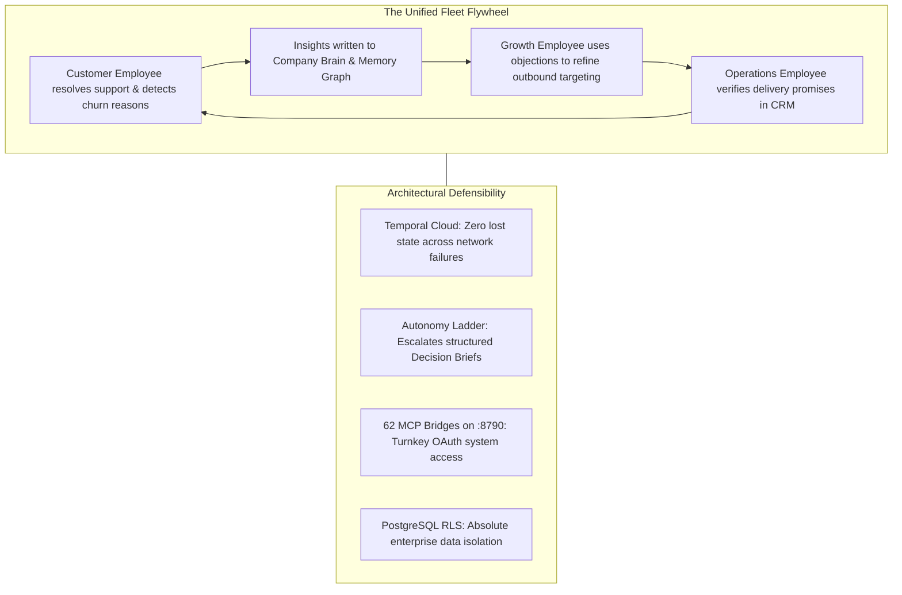

# DareXAI One — The Definitive Competitor Intelligence & Market Benchmark Report (20+ Companies)

> **Document Location:** `docs/new-109-pg-plan/competitors/competitor-analysis.md`  
> **Source Synthesis:** 2026 Live Web Intelligence, SEC/Procurement Disclosures, Third-Party SaaS Pricing Audits (G2, Capterra, Vendr, Capiche), and DareXAI One Production Architecture (Phases 0–5.2: Temporal Cloud, Atomic-Agent v0.1.72, 62 MCP Tool Server on `:8790`, RLS pgvector Company Brain, `017_billing.sql`).  
> **Audience:** Executive Leadership, Founders, Board of Directors, Product Architects, GTM Leads, and Sales Engineering.  
> **Core Objective:** Provide the definitive, ranked competitive benchmark of **20+ platforms** across the AI Employee, AI Workforce, Autonomous Sales, Customer Resolution, and Enterprise Agentic Orchestration landscapes—detailing exact 2026 pricing, architectural limitations, total cost of ownership (TCO), and DareXAI's asymmetric winning battlecards.

---

## Table of Contents

1. [Executive Summary & Similarity Ranking Methodology](#1-executive-summary--similarity-ranking-methodology)
2. [Master Benchmark Matrix: 20+ Competitors Ranked by Product Similarity](#2-master-benchmark-matrix-20-competitors-ranked-by-product-similarity)
3. [Tier 1: Direct Autonomous AI Employee & Digital Worker Platforms (Ranks 1–4)](#3-tier-1-direct-autonomous-ai-employee--digital-worker-platforms-ranks-14)
   - [Rank 1: 11x.ai (Alice, Julian, Jordan)](#rank-1-11xai-alice-julian-jordan)
   - [Rank 2: Artisan AI (Ava, Liam, James)](#rank-2-artisan-ai-ava-liam-james)
   - [Rank 3: Lindy.ai](#rank-3-lindyai)
   - [Rank 4: Salesforce Agentforce](#rank-4-salesforce-agentforce)
4. [Tier 2: High-End Enterprise Customer Service AI Agents (Ranks 5–8)](#4-tier-2-high-end-enterprise-customer-service-ai-agents-ranks-58)
   - [Rank 5: Sierra.ai (Bret Taylor)](#rank-5-sierraai-bret-taylor)
   - [Rank 6: Decagon.ai](#rank-6-decagonai)
   - [Rank 7: Ada.cx](#rank-7-adacx)
   - [Rank 8: Yellow.ai](#rank-8-yellowai)
5. [Tier 3: Helpdesk & Internal Employee Service Agents (Ranks 9–12)](#5-tier-3-helpdesk--internal-employee-service-agents-ranks-912)
   - [Rank 9: Intercom Fin 2](#rank-9-intercom-fin-2)
   - [Rank 10: Moveworks (ServiceNow)](#rank-10-moveworks-servicenow)
   - [Rank 11: Eesel.ai](#rank-11-eeselai)
   - [Rank 12: Cassidy.ai](#rank-12-cassidyai)
6. [Tier 4: Specialized Outbound Sales, Enrichment & Voice Agents (Ranks 13–17)](#6-tier-4-specialized-outbound-sales-enrichment--voice-agents-ranks-1317)
   - [Rank 13: Regie.ai](#rank-13-regieai)
   - [Rank 14: Sybill.ai](#rank-14-sybillai)
   - [Rank 15: Attention.tech](#rank-15-attentiontech)
   - [Rank 16: Bland.ai](#rank-16-blandai)
   - [Rank 17: Clay.com](#rank-17-claycom)
7. [Tier 5: Multi-Agent Frameworks, Workflows & Specialized Benchmarks (Ranks 18–20)](#7-tier-5-multi-agent-frameworks-workflows--specialized-benchmarks-ranks-1820)
   - [Rank 18: CrewAI Enterprise](#rank-18-crewai-enterprise)
   - [Rank 19: Zapier Central / Zapier AI](#rank-19-zapier-central--zapier-ai)
   - [Rank 20: Cognition AI (Devin)](#rank-20-cognition-ai-devin)
8. [Macro Pricing & Monetization Teardown (2026 Industry Standards)](#8-macro-pricing--monetization-teardown-2026-industry-standards)
9. [12-Month Total Cost of Ownership (TCO) Financial Model](#9-12-month-total-cost-of-ownership-tco-financial-model)
10. [Comprehensive 20-Point Technical Capability & Architecture Matrix](#10-comprehensive-20-point-technical-capability--architecture-matrix)
11. [DareXAI's Asymmetric Competitive Moats](#11-darexais-asymmetric-competitive-moats)
12. [Field Sales Battlecards & Objection Handling Scripts](#12-field-sales-battlecards--objection-handling-scripts)
13. [Strategic GTM Takeaway: How DareXAI Wins in the Field](#13-strategic-gtm-takeaway-how-darexai-wins-in-the-field)

---

## 1. Executive Summary & Similarity Ranking Methodology

The corporate AI landscape in 2026 is divided between **extractive legacy incumbents** attempting to preserve per-seat software taxes and **niche point-solution startups** charging six-figure ransoms for single-role bots. 

DareXAI One occupies the high-leverage whitespace: an integrated **Agentic Operating System** that delivers an entire autonomous workforce (Growth, Customer, Operations) powered by a shared Company Brain, 62 real external MCP tools, and a 4-level Autonomy Ladder—at a predictable, accessible monthly price point ($99–$799/mo).

### The 5 Dimensions of Product Similarity to DareXAI One

Each competitor is evaluated across 5 core structural dimensions (0 to 2.0 points each, Maximum Score = 10.0 / 10):

```
┌────────────────────────────────────────────────────────────────────────────────────────┐
│                              SIMILARITY SCORING DIMENSIONS                             │
├──────────────────────────────┬─────────────────────────────────────────────────────────┤
│ Dimension                    │ What DareXAI One Delivers                               │
├──────────────────────────────┼─────────────────────────────────────────────────────────┤
│ 1. AI Employee Abstraction   │ Pre-built personas owning whole business mandates       │
│                              │ (Growth, Customer, Ops) rather than raw prompt inputs.  │
├──────────────────────────────┼─────────────────────────────────────────────────────────┤
│ 2. Cross-System Execution    │ 62 real MCP tool bridges mutating CRM, WhatsApp, Email, │
│                              │ Google Calendar, Stripe, Postgres, and web scrapers.   │
├──────────────────────────────┼─────────────────────────────────────────────────────────┤
│ 3. Persistent Shared Brain   │ Unified RLS vector memory (pgvector) + temporal         │
│                              │ grounding + contradiction detection across all roles.   │
├──────────────────────────────┼─────────────────────────────────────────────────────────┤
│ 4. Governance & Safety       │ Autonomy Ladder (L1–L4) + Structured Decision Briefs    │
│                              │ (escalating decisions, not chat logs) + Spend Guard.   │
├──────────────────────────────┼─────────────────────────────────────────────────────────┤
│ 5. Multi-Channel Ingress     │ Native WhatsApp Cloud API (<500ms), Chatwoot, Email,     │
│                              │ Webhooks, and Scheduled Crons (Morning Briefing).       │
└──────────────────────────────┴─────────────────────────────────────────────────────────┘
```

---

## 2. Master Benchmark Matrix: 20+ Competitors Ranked by Product Similarity

```
┌──────────────────────────────────────────────────────────────────────────────────────────────────────────────────────────────────────┐
│                                                 MASTER COMPETITIVE BENCHMARK MATRIX                                                  │
├────┬────────────────────┬───────────┬──────────────┬──────────────────────────────┬─────────────────────────┬────────────────────────┤
│Rank│ Competitor         │ Similarity│ Primary Role │ Pricing Model                │ Actual 2026 Market Cost │ Critical Flaw          │
│    │                    │ Score /10 │ Focus        │                              │ (Procurement Verified)  │ vs. DareXAI One        │
├────┼────────────────────┼───────────┼──────────────┼──────────────────────────────┼─────────────────────────┼────────────────────────┤
│ 1  │ 11x.ai             │ 9.0 / 10  │ Outbound SDR │ High-ticket annual license   │ $3,750 – $5,000 / mo    │ Siloed per worker;     │
│    │ (Alice / Julian)   │           │ & Inbound Rep│ ($40k – $60k/yr minimum)     │ ($45,000 – $60,000/yr)  │ $50k lock-in; no Ops   │
├────┼────────────────────┼───────────┼──────────────┼──────────────────────────────┼─────────────────────────┼────────────────────────┤
│ 2  │ Artisan AI         │ 8.5 / 10  │ Outbound BDR │ Usage credits + base tiers   │ $250 – $600/mo (Entry)  │ Sales outbound focus   │
│    │ (Ava / Liam)       │           │ (Ava)        │ Billed annually              │ $2,000+/mo (Standard)   │ only; no WhatsApp/Ops  │
├────┼────────────────────┼───────────┼──────────────┼──────────────────────────────┼─────────────────────────┼────────────────────────┤
│ 3  │ Lindy.ai           │ 8.0 / 10  │ Generalist AI│ Per-user seat subscription   │ Plus: $29.99 / user / mo│ Shallow execution;     │
│    │                    │           │ Assistant    │ + task credit consumption    │ Pro: $99.99 / user / mo │ consumer/SMB feel; no  │
│    │                    │           │              │                              │ Max: $199.99 / user / mo│ enterprise Autonomy L. │
├────┼────────────────────┼───────────┼──────────────┼──────────────────────────────┼─────────────────────────┼────────────────────────┤
│ 4  │ Salesforce         │ 7.8 / 10  │ Enterprise   │ Hybrid: $2/conversation OR   │ $2.00 / conversation OR │ Locked to Salesforce;  │
│    │ Agentforce         │           │ CRM Agent    │ Flex Credits ($500/100k cred)│ $125/user/mo add-on to  │ exorbitant TCO;        │
│    │                    │           │              │ OR $125/user/mo add-on       │ $165-$330/seat edition  │ rigid setup.           │
├────┼────────────────────┼───────────┼──────────────┼──────────────────────────────┼─────────────────────────┼────────────────────────┤
│ 5  │ Sierra.ai          │ 7.5 / 10  │ Enterprise   │ Pure Outcome-based           │ $150,000 – $350,000/yr  │ Fortune 50 only;       │
│    │ (Bret Taylor)      │           │ Customer Exp │ resolution contracts         │ + $50k – $200k setup fee│ massive setup fee;     │
│    │                    │           │              │ (Charges only on success)    │ (No self-serve/SMB)     │ no Growth or Ops roles.│
├────┼────────────────────┼───────────┼──────────────┼──────────────────────────────┼─────────────────────────┼────────────────────────┤
│ 6  │ Decagon.ai         │ 7.0 / 10  │ Enterprise CX│ Annual platform baseline fee │ $50,000 platform fee    │ Ticket support silo;   │
│    │                    │           │ Support      │ + Per-conversation/resolution│ Median contract:        │ no outbound growth or  │
│    │                    │           │              │ fee structure                │ $432,750 / year         │ internal ops triage.   │
├────┼────────────────────┼───────────┼──────────────┼──────────────────────────────┼─────────────────────────┼────────────────────────┤
│ 7  │ Ada.cx             │ 6.8 / 10  │ Enterprise CX│ Consumption / Conversation   │ Median contract:        │ Enterprise only ($70k);│
│    │                    │           │ Support      │ ($1.00 – $3.50/interaction)  │ $70,000 / year          │ no CRM operations or   │
│    │                    │           │              │ Custom annual commit         │ ($30k – $300k+ range)   │ sales outbound fleet.  │
├────┼────────────────────┼───────────┼──────────────┼──────────────────────────────┼─────────────────────────┼────────────────────────┤
│ 8  │ Yellow.ai          │ 6.7 / 10  │ Omnichannel  │ Hybrid: Free tier (500 sess) │ Enterprise floor:       │ Complex configuration; │
│    │                    │           │ Bot & Voice  │ + $0.99/resolution usage     │ $50,000+ / year         │ legacy bot architecture│
│    │                    │           │              │ + custom enterprise quote    │                         │ with LLM add-ons.      │
├────┼────────────────────┼───────────┼──────────────┼──────────────────────────────┼─────────────────────────┼────────────────────────┤
│ 9  │ Intercom Fin 2     │ 6.5 / 10  │ Support Help │ Intercom base per-seat fee   │ Base: $29 – $132 / seat │ Point solution bot;    │
│    │                    │           │ Desk Agent   │ + $0.99 / billable outcome   │ + $0.99 / resolved turn │ cannot mutate external │
│    │                    │           │              │ + $35/mo Copilot add-on      │ Total: $800 – $4,500/mo │ CRMs or run sales ops. │
├────┼────────────────────┼───────────┼──────────────┼──────────────────────────────┼─────────────────────────┼────────────────────────┤
│ 10 │ Moveworks          │ 6.2 / 10  │ Internal IT  │ Headcount-based licensing    │ Median contract:        │ Internal IT/HR only;   │
│    │ (ServiceNow)       │           │ & HR Support │ ($15 – $45 / employee / year)│ $130,000 / year         │ zero external customer │
│    │                    │           │              │ via enterprise SOW           │ ($90k – $270k range)    │ or sales pipeline capability│
├────┼────────────────────┼───────────┼──────────────┼──────────────────────────────┼─────────────────────────┼────────────────────────┤
│ 11 │ Eesel.ai           │ 6.0 / 10  │ Helpdesk AI  │ Flat usage fee: $0.40/ticket │ Team: $239 – $299 / mo  │ Overlay widget only;   │
│    │                    │           │ Knowledge Lay│ OR Team/Enterprise plan      │ Enterprise: $1,000 / mo │ lacks native database  │
│    │                    │           │              │                              │ + $0.40 / ticket        │ mutation and crons.    │
├────┼────────────────────┼───────────┼──────────────┼──────────────────────────────┼─────────────────────────┼────────────────────────┤
│ 12 │ Cassidy.ai         │ 5.8 / 10  │ Internal AI  │ Credit-based subscription    │ Custom quote            │ DIY prompt builder;    │
│    │                    │           │ Workflows    │ across LLMs (OpenAI/Claude)  │ Estimated: $500 –       │ no proactive cron      │
│    │                    │           │              │ with 14-day trial            │ $2,500 / month          │ execution or WhatsApp. │
├────┼────────────────────┼───────────┼──────────────┼──────────────────────────────┼─────────────────────────┼────────────────────────┤
│ 13 │ Regie.ai           │ 5.6 / 10  │ Autonomous   │ Per-user seat subscription   │ $180 / user / mo        │ High seat minimums;    │
│    │                    │           │ Sales Engage │ with 10-seat annual minimums │ Min annual: $21,600/yr  │ purely email & dialer; │
│    │                    │           │              │ (Force Multiplier: $499/mo)  │ Force: $499/user/mo     │ zero post-sale ops.    │
├────┼────────────────────┼───────────┼──────────────┼──────────────────────────────┼─────────────────────────┼────────────────────────┤
│ 14 │ Sybill.ai          │ 5.4 / 10  │ Sales Deal & │ Transparent per-user tier:   │ Pro: $30 – $49 / mo     │ Post-call summarizer;  │
│    │                    │           │ CRM Auto     │ Pro / Business / Enterprise  │ Business: $79 – $108/mo │ not an autonomous      │
│    │                    │           │              │ (Free plan available)        │                         │ operational employee.  │
├────┼────────────────────┼───────────┼──────────────┼──────────────────────────────┼─────────────────────────┼────────────────────────┤
│ 15 │ Attention.tech     │ 5.2 / 10  │ Live Sales   │ Sales-led custom quote       │ Estimated: $1,200 –     │ Real-time call coach;  │
│    │                    │           │ Coaching     │ annual contracts             │ $3,000 / rep / year     │ no async support or    │
│    │                    │           │              │                              │                         │ operations execution.  │
├────┼────────────────────┼───────────┼──────────────┼──────────────────────────────┼─────────────────────────┼────────────────────────┤
│ 16 │ Bland.ai           │ 5.0 / 10  │ Autonomous   │ Base platform fee +          │ Start: $0.14 / min      │ Voice calling only;    │
│    │                    │           │ Phone Calls  │ Per-connected-minute rate    │ Build: $299/mo + $0.12/m│ no unified company     │
│    │                    │           │              │ + transfer charges           │ Scale: $499/mo + $0.11/m│ brain or CRM hygiene.  │
├────┼────────────────────┼───────────┼──────────────┼──────────────────────────────┼─────────────────────────┼────────────────────────┤
│ 17 │ Clay.com           │ 4.8 / 10  │ Data Enrich  │ Dual-currency: Data Credits  │ Launch: $185 / mo       │ Spreadsheet tool;      │
│    │                    │           │ & Outbound   │ + Actions (March 2026 model) │ Growth: $495 / mo       │ user must build logic; │
│    │                    │           │              │ Unlimited user seats         │ Enterprise: Custom      │ zero conversational AI.│
├────┼────────────────────┼───────────┼──────────────┼──────────────────────────────┼─────────────────────────┼────────────────────────┤
│ 18 │ CrewAI Enterprise  │ 4.5 / 10  │ Multi-Agent  │ Cloud / VPC deployment fee   │ Custom enterprise quote │ Developer code library;│
│    │                    │           │ Framework    │ (Basic tier free for 50 runs)│ Estimated: $20k – $80k  │ not a finished SaaS;   │
│    │                    │           │              │                              │ per year for enterprise │ requires engineers.    │
├────┼────────────────────┼───────────┼──────────────┼──────────────────────────────┼─────────────────────────┼────────────────────────┤
│ 19 │ Zapier Central /   │ 4.0 / 10  │ Workflow     │ Task-based consumption       │ $19.99 – $103.50 / mo   │ Brittle trigger-action;│
│    │ Zapier AI          │           │ Automation   │ + Model-based multipliers    │ Scales to $1,500+/mo for│ breaks on ambiguity;   │
│    │                    │           │              │ introduced mid-2026          │ high-volume task usage  │ zero persistent memory.│
├────┼────────────────────┼───────────┼──────────────┼──────────────────────────────┼─────────────────────────┼────────────────────────┤
│ 20 │ Cognition (Devin)  │ 3.5 / 10  │ Software     │ ACU (Agent Compute Units)    │ $500 / mo base          │ Dedicated to code PRs; │
│    │                    │           │ Engineer     │ consumption model            │ (Scales with compute)   │ no sales, CRM, or Ops. │
└────┴────────────────────┴───────────┴──────────────┴──────────────────────────────┴─────────────────────────┴────────────────────────┘
```

---

## 3. Tier 1: Direct Autonomous AI Employee & Digital Worker Platforms (Ranks 1–4)

These platforms share DareXAI One's core philosophical premise: software should take the form of an autonomous digital employee owning an entire business mandate.

---

### Rank 1: 11x.ai (Alice, Julian, Jordan)
* **Similarity Score:** 9.0 / 10
* **Company Profile:** London / San Francisco, backed by a16z ($50M+ raised). Benchmark pioneer of the "Digital Worker" narrative.

#### Product Architecture & Capabilities
- **Alice (Outbound SDR):** Autonomous pipeline generation. Scrapes LinkedIn/Apollo, enriches contact data, crafts hyper-personalized email sequences, monitors replies, and books meetings on sales reps' calendars.
- **Julian (Inbound Rep):** 24/7 web chat and inbound lead qualifier. Answers inbound questions, evaluates buying intent, and routes qualified prospects.
- **Jordan (Phone Calling Agent):** Autonomous voice caller for qualifying and reviving leads over the phone.

#### Exact 2026 Pricing & Commercial Terms
- **Base Pricing:** Starts at **$3,750 to $5,000 / month** for Alice alone.
- **Contract Structure:** Strictly billed annually. Minimum contract entry: **$45,000 to $60,000 / year**.
- **Multi-Worker Expansion:** Julian and Jordan are licensed separately as independent workers, frequently driving annual contract values (ACVs) to **$120,000 – $180,000 / year**.
- **Hidden Customer Costs:** Customers must purchase auxiliary secondary sending domains ($500/yr), email warmup/inbox infrastructure ($200–$500/mo), and often allocate 10–15 hours/week of internal RevOps time to manage Alice's prompts.
- **Self-Serve:** None. 100% sales-led demo and procurement process.

#### Critical Architectural Flaws vs. DareXAI One
1. **Disconnected Siloed Workers:** Alice does not speak to Julian. If a customer complains to Julian on chat, Alice still sends aggressive cold emails to their colleagues. In DareXAI, **Growth, Customer, and Operations share the same Company Brain and Memory Graph**.
2. **Missing Operational Backbone:** 11x has no concept of internal operations—no morning CEO brief, no expected vs. actual SLA reconciliation, no CRM data hygiene, and no deduplication engine.
3. **Severe Capital Hostage:** Forcing mid-market companies to risk $50,000 upfront creates massive friction. DareXAI offers a complete fleet starting at **$299/month** with a 14-day outcome-guaranteed pilot.

---

### Rank 2: Artisan AI (Ava, Liam, James)
* **Similarity Score:** 8.5 / 10
* **Company Profile:** San Francisco, Y Combinator alumni, backed by Oliver Rhodes and high-profile angel investors.

#### Product Architecture & Capabilities
- **Ava (The AI BDR):** Outbound sales development rep. Integrates a proprietary B2B contact database (300M+ contacts), automated email deliverability/warmup, and AI lead research.
- **Liam (Inbound SDR) & James (Support Agent):** Added to expand beyond pure outbound prospecting.

#### Exact 2026 Pricing & Commercial Terms
- **Entry-Level Tier:** Reported starting at **$250 to $600 / month**, but heavily throttled by monthly credits.
- **Production Standard Tier:** Base operational deployments typically require **$2,000+ / month ($24,000 / year billed annually)**.
- **Credit Metering:** Usage credits govern work (lead enrichment = 1–3 credits; personalized email draft = 5 credits). High-volume campaigns cause rapid credit exhaustion and overage invoices.
- **Trial:** 14-day free trial with ~300 test credits.

#### Critical Architectural Flaws vs. DareXAI One
1. **Outbound Email Monoculture:** Artisan is fundamentally an outbound email automation engine dressed up as an employee. It lacks native WhatsApp Cloud API integration, financial refund actions (Stripe), or calendar clash resolution.
2. **No Temporal Cloud Durability:** Artisan relies on typical HTTP request chains. DareXAI’s **Temporal runtime** guarantees that multi-step operations never drop state or fail silently during external API outages.
3. **Absence of Governance Ladder:** Artisan sends emails without multi-tier safety controls. DareXAI provides an **Autonomy Ladder (L1–L4)** and surfaces structured **Decision Briefs** for high-risk mutations.

---

### Rank 3: Lindy.ai
* **Similarity Score:** 8.0 / 10
* **Company Profile:** San Francisco, backed by Menlo Ventures and Coatue ($60M+ raised). High-velocity generalist AI assistant workspace.

#### Product Architecture & Capabilities
- Allows users to configure custom "Lindies" (autonomous agents) for executive assistance, candidate recruiting, email inbox triage, and CRM updates.
- 3,000+ integrations via third-party webhooks and native API actions.

#### Exact 2026 Pricing & Commercial Terms
- **Retired Free Tier:** In early 2026, Lindy retired its permanent free plan.
- **Plus Plan:** **$29.99 / user / month** (3,000 pooled credits).
- **Pro Plan:** **$99.99 / user / month** (15,000 pooled credits).
- **Max Plan:** **$199.99 / user / month** (35,000 pooled credits).
- **Enterprise Plan:** Custom quote (includes HIPAA BAA, SSO, SCIM).
- **Credit Burn:** Everyday tasks (summaries, drafts) consume 2–250 credits; deep research consumes 250–1,000 credits; complex builds consume 1,000–2,500 credits. Unused credits expire monthly.

#### Critical Architectural Flaws vs. DareXAI One
1. **Personal Co-Pilot vs. Enterprise Operating System:** Lindy is designed as a personal productivity assistant for an individual employee's inbox. DareXAI is an **organizational operating backbone** with strict PostgreSQL Row-Level Security (RLS) isolating enterprise tenants.
2. **Lack of High-Velocity Ingress:** Lindy cannot handle enterprise-scale sub-500ms WhatsApp Cloud API ingress with interim acknowledgements and async Temporal dispatch.
3. **No Structured Decision Escalation:** Lindy either acts or asks in an unstructured chat bubble. DareXAI generates structured **Decision Briefs** with formal policy constraints and audit trails.

---

### Rank 4: Salesforce Agentforce
* **Similarity Score:** 7.8 / 10
* **Company Profile:** San Francisco, Salesforce's massive flagship autonomous AI platform launched in late 2024 and expanded throughout 2025–2026.

#### Product Architecture & Capabilities
- Autonomous agents embedded deeply into Salesforce Service Cloud, Sales Cloud, and Data Cloud.
- Utilizes the Atlas Reasoning Engine to evaluate CRM context, formulate action plans, and execute operations across Salesforce objects.

#### Exact 2026 Pricing & Commercial Terms
Salesforce offers three distinct, non-mixable pricing structures for Agentforce:
1. **Per-Conversation Model:** **$2.00 USD per customer-facing conversation**.
2. **Flex Credits Model (Action-Based):** **$500 USD per 100,000 credits**. A standard agent action (updating a record, drafting a summary) consumes 20 credits (~**$0.10 per action**).
3. **Per-User Licensing:** **$125 per user / month** add-on for Sales/Service Cloud (requires underlying Enterprise or Unlimited edition costing **$165 to $330 / user / month**).
4. **Hidden Enterprise Costs:** Implementation requires Data Cloud credits ($1,000s/mo), Salesforce professional services or SI consulting ($25k–$100k+), and locks all data inside the proprietary Salesforce ecosystem.

#### Critical Architectural Flaws vs. DareXAI One
1. **Salesforce Walled Garden:** Agentforce is virtually useless unless the customer runs their entire company on Salesforce. DareXAI connects agnostically across **HubSpot, Zoho CRM, PostgreSQL, Google Workspace, Slack, and WhatsApp**.
2. **Exorbitant Total Cost of Ownership:** A 25-person team handling 5,000 customer conversations per month pays **$10,000/month ($120k/yr)** just in Agentforce conversation fees on top of $50k+ in underlying Salesforce seat licenses. DareXAI handles that workload for **$799/month**.
3. **Complexity Barrier:** Agentforce requires certified Salesforce administrators and months of implementation. DareXAI deploys via pre-authenticated MCP bridges in **under 45 minutes**.

---

## 4. Tier 2: High-End Enterprise Customer Service AI Agents (Ranks 5–8)

These enterprise point solutions specialize in high-volume, autonomous resolution of customer service inquiries.

---

### Rank 5: Sierra.ai (Bret Taylor)
* **Similarity Score:** 7.5 / 10
* **Company Profile:** San Francisco, co-founded by Bret Taylor (ex-Salesforce co-CEO, OpenAI Chairman) and Clay Bavor (ex-Google VP). Valued at $4.5B+.

#### Product Architecture & Capabilities
- High-end conversational AI platform for global consumer enterprises (WeightWatchers, SiriusXM, Sonos, ADT).
- Deeply integrates with proprietary enterprise order systems, ERPs, and CRMs to execute end-to-end customer resolutions (refunds, subscription modifications, warranty claims).

#### Exact 2026 Pricing & Commercial Terms
- **Business Model:** **Pure Outcome-Based Pricing**. Customers pay only when Sierra successfully resolves an inquiry without human escalation.
- **Contract Size:** Minimum annual commitments begin at **$150,000 / year**, with standard contracts ranging between **$250,000 and $500,000+ / year**.
- **Setup & Implementation Fees:** Upfront professional engineering fee of **$50,000 to $200,000**.
- **Self-Serve:** None. Exclusively Fortune 50 enterprise sales.

#### Critical Architectural Flaws vs. DareXAI One
1. **SMB & Mid-Market Exclusion:** Sierra will not take a meeting with a $10M ARR company. DareXAI delivers enterprise-grade autonomous resolution directly to mid-market businesses.
2. **Single-Function Scope:** Sierra strictly handles customer service. It cannot find outbound leads (Growth) or reconcile internal operations (Operations).
3. **Protracted Deployment Cycles:** Sierra requires 3 to 6 months of bespoke forward-deployed engineering. DareXAI configures in 45 minutes.

---

### Rank 6: Decagon.ai
* **Similarity Score:** 7.0 / 10
* **Company Profile:** San Francisco, backed by Accel and a16z ($100M+ raised). Premier AI customer support engine for modern tech scaleups (Substack, Bilt Rewards, Eventbrite, ClassPass).

#### Product Architecture & Capabilities
- Acts as a Tier-1 customer support agent across chat, email, and tickets.
- Synthesizes past Zendesk/Salesforce tickets, generates automated business logic, and executes mutating actions via internal APIs.

#### Exact 2026 Pricing & Commercial Terms
- **Platform Fee:** **$50,000 / year baseline** platform access fee.
- **Usage Fee:** Charged either per conversation ($0.50–$1.20) or per verified resolution ($1.50–$3.50).
- **Annual Contract Value (ACV):** Procurement data confirms contracts range from **$95,000 to $590,000+ / year**, with a median ACV of **$432,750**.

#### Critical Architectural Flaws vs. DareXAI One
1. **Astronomical Entry Cost:** Decagon's $50,000 baseline fee eliminates 95% of businesses. DareXAI’s Customer Employee is available at **$99 to $299/mo**.
2. **Legacy Ticket Desk Bias:** Decagon is engineered primarily for traditional ticket queues (Zendesk, Freshdesk). DareXAI is optimized for modern real-time ingress: WhatsApp Cloud API, Chatwoot, and Gmail with sub-60s SLAs.
3. **No Revenue Generation:** Decagon is a pure cost-center tool. DareXAI includes a Growth Employee that actively drives pipeline and revives dormant CRM deals.

---

### Rank 7: Ada.cx
* **Similarity Score:** 6.8 / 10
* **Company Profile:** Toronto, enterprise customer service automation platform serving global enterprises (Meta, Mailchimp, Pinterest).

#### Product Architecture & Capabilities
- Automated customer service platform resolving omnichannel inquiries across web chat, SMS, and social messaging.
- Deep integrations into Salesforce Service Cloud, Zendesk, and Oracle.

#### Exact 2026 Pricing & Commercial Terms
- **Pricing Model:** Consumption-based model charging per conversation/interaction.
- **Contract Size:** Custom enterprise contracts with a median annual contract value of **$70,000 / year** (ranging from **$30,000 to $300,000+ / year**).
- **Per-Interaction Cost:** Calculated between **$1.00 and $3.50 per interaction**, depending on volume commitments.

#### Critical Architectural Flaws vs. DareXAI One
1. **No Shared Organizational Intelligence:** Ada functions strictly inside the customer support department. It cannot update sales pipelines or perform internal operations audits.
2. **Opaque Pricing & High Minimums:** Ada targets enterprises with >300,000 annual interactions, pricing out growing SMBs and mid-market teams.

---

### Rank 8: Yellow.ai
* **Similarity Score:** 6.7 / 10
* **Company Profile:** San Mateo / Bangalore, backed by Lightspeed Venture Partners. Enterprise conversational AI platform with strong presence across APAC, the Middle East, and North America.

#### Product Architecture & Capabilities
- Dynamic Conversation Designer powering omnichannel agents across WhatsApp, voice, web chat, and email in 135+ languages.
- Provides customer support automation and employee experience (EX) automation.

#### Exact 2026 Pricing & Commercial Terms
- **Free Tier:** Limited tier including 1 AI agent and 500 chat sessions per month.
- **Pay-As-You-Go / Resolution Fee:** **$0.99 per resolution** for standard tiers.
- **Enterprise Contracts:** Baseline annual platform fees starting at **$50,000+ / year** for multi-channel and voice capabilities.

#### Critical Architectural Flaws vs. DareXAI One
1. **Legacy NLU Heritage:** Yellow.ai was originally built on traditional intent-matching rule trees and retrofitted with LLMs. DareXAI was built ground-up on modern agentic loops, Temporal durable execution, and MCP tool protocols.
2. **Complex Setup Overhead:** Deploying Yellow.ai often requires specialized implementation partners and weeks of configuration. DareXAI connects out-of-the-box in under an hour.

---

## 5. Tier 3: Helpdesk & Internal Employee Service Agents (Ranks 9–12)

These platforms provide conversational assistance for support helpdesks or internal company knowledge bases.

---

### Rank 9: Intercom Fin 2
* **Similarity Score:** 6.5 / 10
* **Company Profile:** San Francisco / Dublin, market incumbent in customer support messaging.

#### Product Architecture & Capabilities
- Ingests help center documentation and resolves customer queries inside the Intercom messenger.
- Fin 2 introduces multi-step workflows, basic API integrations, and human handoff routing.

#### Exact 2026 Pricing & Commercial Terms
- **Intercom Base Subscription:** Essential (**$29/seat/mo**), Advanced (**$85/seat/mo**), or Expert (**$132/seat/mo**).
- **Fin AI Agent Fee:** **$0.99 per billable outcome** (every resolution or automated lead qualification). Minimum 50 outcomes/month.
- **Copilot Fee:** Extra **$35 / agent seat / month** for internal team assistance.
- **Real-World TCO for a 10-person support team handling 2,500 tickets/mo:**
  - Base Seats: 10 × $85 = $850/mo
  - Fin Outcomes: 1,800 resolutions × $0.99 = $1,782/mo
  - Total Monthly Invoice: **$2,632 / month ($31,584 / year)**.

#### Critical Architectural Flaws vs. DareXAI One
1. **Double-Dip Pricing Penalty:** Intercom charges steep per-seat licenses *plus* $0.99 for every successful resolution. DareXAI charges a flat monthly capacity fee with generous included work credits (DWC).
2. **Walled Garden Limitation:** Fin cannot orchestrate actions across external CRMs, team calendars, internal databases, and Slack. It lives exclusively inside Intercom.
3. **Passive Inbound Only:** Fin waits for messages. DareXAI’s Growth Employee actively mines dormant contacts and initiates outreach.

---

### Rank 10: Moveworks (ServiceNow)
* **Similarity Score:** 6.2 / 10
* **Company Profile:** Mountain View, acquired by ServiceNow in late 2025. Enterprise AI platform resolving internal employee IT, HR, and facilities requests.

#### Product Architecture & Capabilities
- Connects to Jira, ServiceNow, Workday, and Active Directory to autonomously resolve employee IT issues (password resets, software provisioning, leave balances).

#### Exact 2026 Pricing & Commercial Terms
- **Pricing Model:** Billed on **total enterprise employee headcount** rather than active users.
- **Market Rates:** Procurement data from Vendr indicates a **median annual contract of $130,000 / year** (ranging from **$90,000 to $270,000 / year**).
- **Per-Employee Cost:** Estimated between **$15 and $45 per employee / year** (AWS Marketplace lists $150/employee/yr for 1,000–2,500 user bands).

#### Critical Architectural Flaws vs. DareXAI One
1. **Internal IT Silo Only:** Moveworks cannot speak to external customers, resolve WhatsApp inquiries, or generate sales pipeline.
2. **Massive Enterprise Lock-in:** Moveworks is designed for 2,000+ employee corporations using ServiceNow. DareXAI is built for fast-moving mid-market companies.

---

### Rank 11: Eesel.ai
* **Similarity Score:** 6.0 / 10
* **Company Profile:** London, AI knowledge and automation layer built as an add-on for existing helpdesks.

#### Product Architecture & Capabilities
- Connects to Confluence, Notion, Google Docs, and past tickets to draft responses and automate triage inside Zendesk, Freshdesk, Intercom, and Slack.

#### Exact 2026 Pricing & Commercial Terms
- **Per-Ticket Fee:** Flat rate of **$0.40 per ticket/chat handled**.
- **Team Plan:** **$239 / month** (billed annually) or **$299 / month** (billed monthly).
- **Enterprise Plan:** **$1,000 / month** base platform fee + usage.
- **Trial:** 7-day free trial.

#### Critical Architectural Flaws vs. DareXAI One
1. **Passive Knowledge Overlay:** Eesel is a retrieval layer that drafts answers. It cannot autonomously mutate external business records, execute database writes, or manage calendar invites.
2. **No Growth or Proactive Operations:** Eesel has no pipeline generation, outbound prospecting, or morning executive briefing features.

---

### Rank 12: Cassidy.ai
* **Similarity Score:** 5.8 / 10
* **Company Profile:** New York, no-code AI workflow and knowledge assistant platform.

#### Product Architecture & Capabilities
- Allows internal business teams to build custom prompt workflows grounded in company knowledge (Notion, Google Drive, Slack).

#### Exact 2026 Pricing & Commercial Terms
- **Pricing Model:** Custom quote-based credit model.
- **Estimated Pricing:** **$500 to $2,500 / month** based on team size and credit consumption.
- **Trial:** 14-day trial.

#### Critical Architectural Flaws vs. DareXAI One
1. **DIY Construction Burden:** Cassidy forces non-technical users to build and test prompt pipelines from scratch. DareXAI ships **turnkey, pre-trained AI Employees** that know their roles on Day 1.
2. **Fragile Webhook Architecture:** Cassidy lacks Temporal durable execution; if an API times out, the workflow fails silently without automatic state recovery.

---

## 6. Tier 4: Specialized Outbound Sales, Enrichment & Voice Agents (Ranks 13–17)

These platforms excel in single tactical slices of the revenue and communications funnel.

---

### Rank 13: Regie.ai
* **Similarity Score:** 5.6 / 10
* **Company Profile:** Austin, backed by Scale Venture Partners and Foundation Capital ($45M+ raised).

#### Product Architecture & Capabilities
- Autonomous sales engagement platform. Automatically writes prospecting sequences, manages multi-touch email cadences, and prioritizes sales tasks.

#### Exact 2026 Pricing & Commercial Terms
- **AI SEP Tier:** Starts at **$180 / user / month** with a mandatory **10-seat minimum ($21,600 / year commitment)**.
- **Force Multiplier Rep Tier:** **$499 / user / month** with a 5-seat minimum (**$29,940 / year commitment**).
- **RegieGO:** Free individual tier limited to 250 lifetime credits.

#### Critical Architectural Flaws vs. DareXAI One
1. **Extractive Seat Minimums:** Mandating 10 seats at $180/mo locks out lean teams. DareXAI charges $299/mo total for an entire 3-employee fleet with 10 human seats included.
2. **Stops at Email Outbound:** Regie does not manage customer support, WhatsApp communication, or internal operational hygiene.

---

### Rank 14: Sybill.ai
* **Similarity Score:** 5.4 / 10
* **Company Profile:** San Francisco, AI sales assistant focusing on call intelligence, emotional analysis, and CRM automation.

#### Product Architecture & Capabilities
- Records customer sales calls, analyzes verbal and non-verbal buyer sentiment, generates summaries, and automatically updates HubSpot/Salesforce deal fields.

#### Exact 2026 Pricing & Commercial Terms
- **Free Tier:** $0 / user / month (basic call summaries).
- **Pro Tier:** **$30 to $49 / user / month**.
- **Business Tier:** **$79 to $108 / user / month** (full CRM integration and automated updates).
- **Enterprise:** Custom pricing.

#### Critical Architectural Flaws vs. DareXAI One
1. **Post-Call Logger vs. Autonomous Worker:** Sybill is a passive meeting assistant that logs notes. DareXAI actively finds new accounts, resolves inbound inquiries, and executes cross-system operations.

---

### Rank 15: Attention.tech
* **Similarity Score:** 5.2 / 10
* **Company Profile:** New York, backed by Eniac Ventures and Frst ($14M+ raised). Real-time sales coaching and deal execution platform.

#### Product Architecture & Capabilities
- Provides live battlecards and coaching cards to sales reps during Zoom/Google Meet calls, scores calls against MEDDIC/BANT, and writes CRM updates.

#### Exact 2026 Pricing & Commercial Terms
- **Pricing:** 100% sales-led custom quotes.
- **Estimated Pricing:** **$1,200 to $3,000 / rep / year** depending on volume and CRM configuration.

#### Critical Architectural Flaws vs. DareXAI One
- Attention assists human sales reps while they are on the phone; DareXAI **replaces the manual operational labor** entirely by executing pipeline discovery, customer resolution, and data hygiene autonomously.

---

### Rank 16: Bland.ai
* **Similarity Score:** 5.0 / 10
* **Company Profile:** San Francisco, high-velocity infrastructure platform for building autonomous voice calling agents.

#### Product Architecture & Capabilities
- Low-latency voice AI engine that dials and receives phone calls, responds in natural voice (<800ms latency), and executes API calls mid-conversation.

#### Exact 2026 Pricing & Commercial Terms
- **Start Plan:** Free platform fee + **$0.14 per connected minute**.
- **Build Plan:** **$299 / month** platform fee + **$0.12 per connected minute**.
- **Scale Plan:** **$499 / month** platform fee + **$0.11 per connected minute**.
- **Transfer Fees:** $0.03 to $0.05 per minute when transferring calls to a human agent.
- **Typical Monthly Outlay:** Active business users typically spend **$350 to $2,000+ / month** based on calling volume.

#### Critical Architectural Flaws vs. DareXAI One
1. **Single-Modal Voice Silo:** Bland is a voice infrastructure API. It has no persistent company memory, no vector grounding, no WhatsApp Cloud API ingress, and no multi-system CRM hygiene workflows.
2. **Developer Tool vs. Finished SaaS:** Bland requires extensive developer integration to connect to business backends; DareXAI is an end-to-end SaaS ready for business operators.

---

### Rank 17: Clay.com
* **Similarity Score:** 4.8 / 10
* **Company Profile:** New York, premier data enrichment and outbound prospecting spreadsheet platform.

#### Product Architecture & Capabilities
- Connects 50+ data providers (Apollo, Clearbit, Hunter, LinkedIn) into a dynamic spreadsheet interface to enrich prospect lists and generate customized AI outreach copy.

#### Exact 2026 Pricing & Commercial Terms
Updated **March 11, 2026** to a dual-currency model with **unlimited seats** on all paid plans:
- **Free Plan:** 100 Data Credits + 500 Actions / month.
- **Launch Plan:** **$185 / month** (or ~$167/mo billed annually).
- **Growth Plan:** **$495 / month** (or ~$446/mo billed annually; required for direct CRM sync to HubSpot/Salesforce).
- **Enterprise Plan:** Custom annual contracts.

#### Critical Architectural Flaws vs. DareXAI One
1. **Spreadsheet Tool vs. Autonomous Employee:** Clay is an advanced spreadsheet. The user must manually build waterfall formulas, configure columns, and manage webhooks. DareXAI is an **autonomous employee** that proactively hunts leads and executes outreach without manual spreadsheet maintenance.
2. **Zero Inbound or Operational Scope:** Clay cannot answer an incoming WhatsApp customer inquiry, process a refund, or resolve calendar conflicts.

---

## 7. Tier 5: Multi-Agent Frameworks, Workflows & Specialized Benchmarks (Ranks 18–20)

---

### Rank 18: CrewAI Enterprise
* **Similarity Score:** 4.5 / 10
* **Company Profile:** Commercial cloud/enterprise platform behind the open-source CrewAI Python framework.

#### Product Architecture & Capabilities
- Provides cloud hosting, VPC deployment, enterprise security (SSO, RBAC), and observability for Python-based multi-agent teams.

#### Exact 2026 Pricing & Commercial Terms
- **Basic / Cloud:** Free for up to 50 workflow executions / month.
- **Enterprise:** Custom annual contracts starting at **$20,000 to $80,000 / year**.

#### Critical Architectural Flaws vs. DareXAI One
1. **Developer SDK vs. Finished Business Application:** CrewAI requires software engineers to code agent personas in Python, manage LLM API keys, and debug prompt loops. DareXAI is a turnkey SaaS used directly by business operators.
2. **Missing Out-of-the-Box Integrations:** CrewAI users must write custom tool wrappers. DareXAI provides **62 pre-authenticated MCP tools** out of the box.

---

### Rank 19: Zapier Central / Zapier AI
* **Similarity Score:** 4.0 / 10
* **Company Profile:** Silicon Valley, incumbent leader in no-code integration and automation.

#### Product Architecture & Capabilities
- Extends Zapier’s trigger-action automation engine with AI-driven bots that listen for data events and trigger Zapier actions.

#### Exact 2026 Pricing & Commercial Terms
- **Professional:** **$19.99 to $29.99 / month** (750 tasks).
- **Team:** **$69 to $103.50 / month** (2,000 tasks).
- **Model Task Multipliers:** Introduced mid-2026. A single AI reasoning step consumes 5–20 standard tasks, driving high-volume bills to **$500 – $1,500+ / month**.

#### Critical Architectural Flaws vs. DareXAI One
1. **Deterministic Fragility:** Zapier operates on rigid "If This, Then That" logic. If a customer provides ambiguous input, Zapier fails. DareXAI reasons across ambiguity, checks confidence, and generates dynamic multi-step plans.
2. **Zero Organizational Memory:** Zapier does not maintain a vector memory graph or temporal grounding.

---

### Rank 20: Cognition AI (Devin)
* **Similarity Score:** 3.5 / 10
* **Company Profile:** San Francisco, benchmark for autonomous single-domain agents ($2B+ valuation).

#### Product Architecture & Capabilities
- Autonomous AI software engineer that reads codebases, plans multi-file refactors, runs terminal commands, executes tests, and submits Pull Requests.

#### Exact 2026 Pricing & Commercial Terms
- **Base Subscription:** **$500 / month** base platform access.
- **Consumption:** Metered via Agent Compute Units (ACUs); intense code synthesis scales invoices with usage.

#### Strategic Relevance to DareXAI One
- Devin validated that the enterprise market is eager to pay **$500/month** for software structured as an autonomous employee rather than a co-pilot autocomplete. DareXAI applies this exact proven abstraction to the much larger, non-technical business market: **Growth, Customer Resolution, and Operations**.

---

## 8. Macro Pricing & Monetization Teardown (2026 Industry Standards)

```
┌────────────────────────────────────────────────────────────────────────────────────────┐
│                              THE 5 INDUSTRY PRICING MODELS                             │
├──────────────────────┬──────────────────────┬──────────────────────┬───────────────────┤
│ Model                │ Representative Tools │ Customer Advantage   │ The Fatal Catch   │
├──────────────────────┼──────────────────────┼──────────────────────┼───────────────────┤
│ 1. Legacy Per-Seat   │ Intercom ($85/seat), │ Familiar budgeting   │ Discourages       │
│    SaaS              │ Regie ($180/seat)    │ for IT departments.  │ automation; bills │
│                      │                      │                      │ humans, not AI.   │
├──────────────────────┼──────────────────────┼──────────────────────┼───────────────────┤
│ 2. Outcome-Based     │ Sierra ($150k min),  │ Zero cost if agent   │ Massive setup fees│
│    Enterprise        │ Decagon ($95k min)   │ fails to resolve.    │ ($50k–$200k);     │
│                      │                      │                      │ contract disputes.│
├──────────────────────┼──────────────────────┼──────────────────────┼───────────────────┤
│ 3. Astronomical BDR  │ 11x.ai ($45k min),   │ Replaces an $80k     │ Massive upfront   │
│    Annual Lock-in    │ Artisan ($24k min)   │ human SDR hire.      │ capital risk; zero│
│                      │                      │                      │ flexibility.      │
├──────────────────────┼──────────────────────┼──────────────────────┼───────────────────┤
│ 4. Usage / Minute    │ Bland ($0.12/min),   │ Pay only for what    │ Runaway billing   │
│    or Flex Credits   │ Salesforce ($2/conv) │ you use.             │ anxiety; CFOs fear│
│                      │                      │                      │ traffic spikes.   │
├──────────────────────┼──────────────────────┼──────────────────────┼───────────────────┤
│ 5. DareXAI Hybrid    │ DareXAI One          │ Highly accessible;   │ Controlled usage; │
│    Fleet + DWC (★)   │ ($99 – $799 / mo)    │ 100% predictable;    │ protected gross   │
│                      │                      │ CFO Spend Guard caps.│ margins (>82%).   │
└──────────────────────┴──────────────────────┴──────────────────────┴───────────────────┘
```

---

## 9. 12-Month Total Cost of Ownership (TCO) Financial Model

Consider a **50-person mid-market B2B company** handling 2,000 inbound customer inquiries/month, 250 outbound prospect engagements/month, and daily CRM operations:

```
┌────────────────────────────────────────────────────────────────────────────────────────┐
│                         12-MONTH TOTAL COST OF OWNERSHIP (TCO)                         │
├──────────────────────────┬───────────────────────────┬─────────────────────────────────┤
│ Solution Option          │ 12-Month Direct Cash      │ Hidden Operational Burden       │
├──────────────────────────┼───────────────────────────┼─────────────────────────────────┤
│ Option 1: Human Staff    │ $162,000                  │ • $24,000 recruiting fees       │
│ (1 SDR + 1 Support Rep + │ ($55k + $48k + $59k       │ • $18,000 benefits & equipment  │
│  1 Ops Coordinator)      │  base salaries)           │ • 45% annual employee turnover  │
├──────────────────────────┼───────────────────────────┼─────────────────────────────────┤
│ Option 2: Enterprise AI  │ $137,500                  │ • $25,000 consulting setup fees │
│ Stack (11x.ai Alice +    │ ($50,000 11x.ai +         │ • $6,000 email warmup tools     │
│  Intercom Fin + Zapier)  │  $31,500 Intercom +       │ • 15 hrs/week ongoing prompt    │
│                          │  $6,000 Zapier tasks +    │   maintenance                   │
│                          │  $50,000 Decagon setup)   │                                 │
├──────────────────────────┼───────────────────────────┼─────────────────────────────────┤
│ Option 3: Salesforce     │ $148,000                  │ • $35,000 Salesforce SI setup   │
│ Agentforce Stack         │ ($48,000 conversations +  │ • Data Cloud consumption bills  │
│                          │  $100,000 underlying CRM) │ • Dedicated admin required      │
├──────────────────────────┼───────────────────────────┼─────────────────────────────────┤
│ Option 4: DareXAI One    │ $3,588                    │ • Zero hidden software fees     │
│ Growth Plan ($299/mo)    │ (Growth + Customer + Ops  │ • 1-click OAuth integrations    │
│                          │  + 25k monthly credits)   │ • Built-in Spend Guard caps     │
├──────────────────────────┼───────────────────────────┼─────────────────────────────────┤
│ DAREXAI NET SAVINGS      │ $133,912 vs. AI Stack     │ 97.4% Cash Reduction            │
│                          │ $158,412 vs. Human Hires  │ 97.8% Labor Budget Reduction    │
└──────────────────────────┴───────────────────────────┴─────────────────────────────────┘
```

---

## 10. Comprehensive 20-Point Technical Capability & Architecture Matrix

```
┌──────────────────────────────────────┬─────────┬────────┬────────┬────────┬──────────┬────────┬──────────┐
│ Architectural Dimension              │ DareXAI │ 11x.ai │Artisan │ Lindy  │ Intercom │ Sierra │ Agentf.  │
├──────────────────────────────────────┼─────────┼────────┼────────┼────────┼──────────┼────────┼──────────┤
│ 1. Unified 3-Employee Fleet (G/C/O)  │   YES   │   NO   │   NO   │ PARTIAL│    NO    │   NO   │ PARTIAL  │
│ 2. Shared Multi-Tenant Brain (RLS)   │   YES   │   NO   │   NO   │   NO   │    NO    │ PROPRIE│   YES    │
│ 3. Temporal Cloud Durable Workflows  │   YES   │   NO   │   NO   │   NO   │    NO    │ PROPRIE│    NO    │
│ 4. 62 External MCP Tool Bridges      │   YES   │   NO   │   NO   │ PARTIAL│    NO    │ PARTIAL│ PARTIAL  │
│ 5. Autonomy Ladder (L1 to L4 Safety) │   YES   │   NO   │   NO   │   NO   │    NO    │ PARTIAL│ PARTIAL  │
│ 6. Structured Decision Escalation    │   YES   │   NO   │   NO   │   NO   │    NO    │   NO   │    NO    │
│ 7. Native WhatsApp Cloud API Ingress │   YES   │   NO   │   NO   │   NO   │ PARTIAL  │ PARTIAL│ PARTIAL  │
│ 8. Expected vs. Actual Engine        │   YES   │   NO   │   NO   │   NO   │    NO    │   NO   │    NO    │
│ 9. 8:00 AM CEO Operational Brief     │   YES   │   NO   │   NO   │   NO   │    NO    │   NO   │    NO    │
│ 10. Dormant Deal CRM Reviver         │   YES   │   NO   │   NO   │   NO   │    NO    │   NO   │ PARTIAL  │
│ 11. Sub-60s Inbound Response SLA     │   YES   │ PARTIAL│  WEAK  │  WEAK  │   YES    │   YES  │   YES    │
│ 12. Cross-Calendar Conflict Solver   │   YES   │   NO   │   NO   │ PARTIAL│    NO    │   NO   │    NO    │
│ 13. Reversible Mutations & Rollbacks │   YES   │   NO   │   NO   │   NO   │    NO    │ PROPRIE│    NO    │
│ 14. Dual-Currency Billing (USD/INR)  │   YES   │   NO   │   NO   │   NO   │    NO    │   NO   │    NO    │
│ 15. CFO Spend Guard Hard Caps        │   YES   │   NO   │   NO   │   NO   │    NO    │   NO   │ PARTIAL  │
│ 16. Multi-Agent Parallel Stage Exec  │   YES   │   NO   │   NO   │   NO   │    NO    │ PROPRIE│ PARTIAL  │
│ 17. Contradiction Detection Engine   │   YES   │   NO   │   NO   │   NO   │    NO    │   YES  │    NO    │
│ 18. Self-Serve Onboarding (<45 mins) │   YES   │   NO   │ PARTIAL│   YES  │   YES    │   NO   │    NO    │
│ 19. Outcome-Guaranteed 14-Day Pilot  │   YES   │   NO   │   NO   │   NO   │    NO    │   NO   │    NO    │
│ 20. Entry Price Under $350 / Month   │   YES   │   NO   │   NO   │   YES  │    NO    │   NO   │    NO    │
└──────────────────────────────────────┴─────────┴────────┴────────┴────────┴──────────┴────────┴──────────┘
```

---

## 11. DareXAI's Asymmetric Competitive Moats



1. **The Shared Context Flywheel (Multi-Role Synergies):**  
   Every competitor is a single-department point solution (11x does outbound, Intercom does support, Sybill does meeting notes). In DareXAI, **all employees share the same Company Brain**. If the Customer Employee discovers that clients are cancelling because of a lack of a specific feature, the Growth Employee immediately stops pitching that feature to new prospects, and the Operations Employee flags all open deals where that feature was promised.
2. **Temporal Cloud Durable Execution:**  
   When third-party APIs (HubSpot, WhatsApp, Stripe) experience rate limits or outages, generic competitors fail mid-workflow. DareXAI’s **Temporal runtime** pauses, retries with exponential backoff, and resumes execution without human intervention.
3. **The Autonomy Ladder & Decision Briefs:**  
   Enterprise buyers refuse to give autonomous write access to black-box bots. DareXAI solves the trust paradox through the **Autonomy Ladder**: Level 1 (Read-Only) $\rightarrow$ Level 2 (Plan & Confirm) $\rightarrow$ Level 3 (Safe Autonomous Mutation). When human approval is needed, the system generates a concise **Decision Brief** with one-click approve/reject actions, avoiding raw transcript noise.

---

## 12. Field Sales Battlecards & Objection Handling Scripts

---

### Battlecard 1: When the Prospect Says: *"We are evaluating 11x.ai (Alice) for outbound pipeline."*
* **The Trap:** The prospect is seduced by the promise of an autonomous SDR, unaware of 11x's $50,000 annual lock-in and high churn rates.
* **Our Response:**
  > *"11x has pioneered great marketing for Alice, but look closely at the operational reality before committing $50,000 upfront:*  
  > *First, Alice is completely isolated from the rest of your business. If an outbound prospect replies with a nuanced technical question or asks about your SLAs, Alice has zero visibility into your customer support history or operational capacity.*  
  > *Second, why risk $50,000 on an annual contract when DareXAI provides a dedicated Growth Employee, a Customer Employee, and an Operations Employee for $299/month? We connect to your HubSpot and Google Workspace in 45 minutes, back it with a 14-day outcome guarantee, and prove pipeline revival before you spend enterprise dollars."*

---

### Battlecard 2: When the Prospect Says: *"Salesforce is rolling out Agentforce. Won't they own this space?"*
* **The Trap:** The prospect assumes their existing CRM vendor will solve AI for free.
* **Our Response:**
  > *"Agentforce is great for global enterprises spending millions on Salesforce Enterprise editions and systems integrators. But calculate the real cost: Salesforce charges $2.00 per conversation or $125/user/month on top of your expensive CRM seats. If you handle 3,000 customer inquiries a month, Agentforce alone will add $6,000/month to your invoice.*  
  > *More importantly, Agentforce locks you permanently inside Salesforce. It cannot manage your WhatsApp Cloud communications, your Google Workspace calendars, your Stripe billing links, or your external databases.*  
  > *DareXAI connects agnostically across your entire stack—HubSpot, Zoho, WhatsApp, Google, and Slack—running an entire autonomous workforce starting at $299/month."*

---

### Battlecard 3: When the Prospect Says: *"We already use Intercom and plan to use Fin 2."*
* **The Trap:** The prospect thinks Fin 2 is an inexpensive feature add-on.
* **Our Response:**
  > *"Fin 2 is a capable helpdesk feature, but review your billing math. Intercom charges $0.99 for every billable outcome on top of $85/seat subscriptions and $35/seat Copilot add-ons. At 2,000 inquiries a month, Fin adds over $23,000/year to your software bill.*  
  > *More critically, Fin is trapped inside Intercom's messenger widget. It cannot update deals in HubSpot, reschedule conflicting meetings on Google Calendar, resolve WhatsApp messages, or revive dormant sales leads.*  
  > *DareXAI acts across your entire business ecosystem and provides a complete multi-employee workforce starting at $99 to $299/month flat."*

---

### Battlecard 4: When the Prospect Says: *"Can't we build this in Zapier Central or Make.com?"*
* **The Trap:** The technical lead believes agentic behavior is just a collection of webhooks.
* **Our Response:**
  > *"You can build an automated trigger in Zapier, but you cannot build an autonomous employee. Zapier is deterministic: if an inbound customer writes a paragraph containing typos, multiple conflicting requests, or ambiguous language, Zapier breaks.*  
  > *Furthermore, Zapier workflows lack persistent organizational memory, temporal grounding, and confidence gating. You will spend 15 hours a week maintaining broken zaps.*  
  > *DareXAI gives you a production-hardened Agentic Operating System running on Temporal Cloud with 62 pre-authenticated MCP tools, an Autonomy Ladder, and self-healing error recovery out of the box."*

---

### Battlecard 5: When the Prospect Says: *"What about Lindy.ai? They start at $29/month."*
* **The Trap:** The prospect compares an individual personal assistant tool to an organizational workforce platform.
* **Our Response:**
  > *"Lindy is an executive assistant tool built for an individual knowledge worker managing their personal inbox.*  
  > *DareXAI One is an organizational operating backbone. It features strict PostgreSQL Row-Level Security tenant isolation, native WhatsApp Cloud API integration with sub-500ms response handling, and formal Decision Brief escalation cards for management.*  
  > *If you want a personal bot to summarize your morning emails, Lindy is great. If you want an autonomous workforce running your company's sales pipeline, customer resolution, and CRM hygiene, you need DareXAI."*

---

## 13. Strategic GTM Takeaway: How DareXAI Wins in the Field

```
┌────────────────────────────────────────────────────────────────────────────────────────┐
│                              THE WINNING GTM PLAYBOOK                                  │
├────────────────────────────────────────────────────────────────────────────────────────┤
│ 1. Attack the Pricing Extremes:                                                        │
│    Highlight the absurdity of 11x's $50k lock-in and Intercom's extractive seat taxes. │
│    Position DareXAI's $299/mo hybrid fleet capacity as the obvious, modern choice.     │
│                                                                                        │
│ 2. Lead With the High-Trust Wedge:                                                     │
│    Start with Customer Employee (inbound WhatsApp/email resolution). Prove accuracy    │
│    and safety in the first 7 days, then expand into Operations and Growth.             │
│                                                                                        │
│ 3. Guarantee Tangible Outcomes:                                                        │
│    Offer the 14-day outcome-guaranteed pilot (250 verified resolutions or 100% refund).│
│    Completely de-risks procurement for SMB and mid-market decision makers.             │
│                                                                                        │
│ 4. Leverage the Partner Channel:                                                       │
│    Arm HubSpot and RevOps agencies with a 20% recurring revenue share to replace       │
│    fragile Zapier spaghetti with robust DareXAI AI Employees.                          │
└────────────────────────────────────────────────────────────────────────────────────────┘
```

---
*End of Master Competitor Analysis & Intelligence Report (20+ Companies).*
