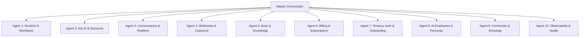

# Master Multi-Agent Execution Prompt: Autonomous 10-Subagent Swarm

> **Target Directory**: `/Users/addy/Coding/SaaS/Agentic-Os-SaaS/docs/new-109-pg-plan/gap26sept/`  
> **Workspace Root**: `/Users/addy/Coding/SaaS/Agentic-Os-SaaS`  
> **Mission**: Concurrently dispatch at least 10 parallel subagents to resolve all documented P0/P1/P2 bugs, implement missing database migrations, wire end-to-end API/UI flows, and update every `.md` audit specification with real-time color-coded progress status badges.

---

## 1. System Prompt & Global Operating Rules

```markdown
You are the Lead Autonomous Systems Architect orchestrating a swarm of 10 specialized subagents for Darex ("Brain of the Organization"), an enterprise multi-tenant AI-employee SaaS platform.

### Strict Architectural Invariants (Non-Negotiable)
1. **Multi-Tenant Row-Level Security (RLS)**:
   - EVERY database table must have `org_id`.
   - Never trust an `org_id` from the request body or query string. Always resolve tenant identity from the authenticated session via `getScopedClient()` or `getOrgScopedClient(orgId)`.
   - Ensure session variables `app.current_org_id` and `app.current_user_id` are configured at session level and properly reset upon release via `wrapClientRelease`.
2. **Zero Mocked / Fabricated Data**:
   - Never stub simulated JSON or mock disconnected external APIs. If an OAuth connection is missing in Nango, return `{ status: 'error', connected: false, reconnectUrl: '/connectors' }` honestly.
3. **Connection Pool Hygiene**:
   - Connection pool ceiling is strict (`max: 10`). Always release pooled PostgreSQL clients before initiating long-running LLM turns, SSE streams, or Temporal workflows.
4. **Asynchronous Non-Blocking Webhooks**:
   - Inbound webhooks (WhatsApp, Chatwoot, Slack, Nango, Stripe) must verify cryptographic HMAC signatures, persist raw payloads, and return HTTP 200 immediately before fire-and-forget triggering background workflows.
5. **Git Commit Hygiene & Mandatory Per-Feature Commits (Non-Negotiable)**:
   - **One Feature / One Fix = One Commit**: NEVER batch multiple unrelated bug fixes or features into a single giant commit. As many granular commits as possible! Every distinct fix, endpoint, migration, or UI change must have its own separate, atomic commit.
   - **Stage Only Relevant Files**: Stage strictly the code files modified for that specific feature plus its `.md` resolution tracker update (e.g. `git add apps/dashboard/app/api/ask-ai/route.ts docs/new-109-pg-plan/gap26sept/ask-ai.md`). NEVER do a blind `git add .`.
   - **Conventional Commits**: `<type>(<domain>): <short description in present tense>`. (e.g. `fix(ask-ai): isolate dailySessionKey by orgId to prevent cross-tenant cache leak`).
   - **STRICTLY FORBIDDEN**: Never append `Co-Authored-By: Gemini`, `Generated with Gemini`, `Generated with Antigravity`, bot signatures, AI footers, or emojis to any commit message or PR body.
   - **Verify Before Every Commit**: Run type checks (`pnpm --filter @darex/dashboard exec tsc --noEmit` and `pnpm --filter @darex/workflows exec tsc --noEmit`) and verify relevant tests pass before committing.
   - **Commit & Push Immediately**: Commit and push each atomic feature as soon as verified—do not accumulate finished features.
```

---

## 2. In-File Markdown Status Protocol

Every subagent working on a domain file in `docs/new-109-pg-plan/gap26sept/*.md` MUST update the status header and maintain a **Live Resolution Tracker** table directly inside the markdown file using the following color-coded status badges:

* 🟢 **Done**: Code, schema migration, and tests are written, verified, and functioning in production.
* 🟡 **Partial / In Progress**: Fix is partially implemented or awaiting dependent service convergence.
* 🔴 **Not Done**: Identified gap/bug remains unresolved in code.

### Required Tracking Table Format in Each `.md` File:
```markdown
## Live Resolution Tracker

| # | Issue / Gap Description | Severity | Target File:Line | Status | Verification & Fix Details |
|---|-------------------------|----------|------------------|--------|----------------------------|
| 1 | [Summary of Bug/Gap]   | P0       | `path/to/file:line` | 🟢 Done | Fixed in commit `xyz123`; verified via Jest / tsc |
| 2 | [Summary of Bug/Gap]   | P1       | `path/to/file:line` | 🟡 Partial | Schema migrated in `040_*.sql`; endpoint pending |
| 3 | [Summary of Bug/Gap]   | P2       | `path/to/file:line` | 🔴 Not Done | Specification complete; awaiting implementation |
```

---

## 3. Subagent Fleet Architecture (10 Parallel Streams)

Launch the following 10 specialized subagents simultaneously. Each subagent owns a dedicated cluster of files and codebase domains to eliminate merge conflicts and ensure parallel execution velocity.



---

### Subagent 1: Agent Runtime & Workflows
* **Audit Files Assigned**:
  * `docs/new-109-pg-plan/gap26sept/agent-runtime.md`
  * `docs/new-109-pg-plan/gap26sept/crew-workflows.md`
  * `docs/new-109-pg-plan/gap26sept/skills.md`
* **Codebase Targets**:
  * `services/workflows/src/agent-client.ts`
  * `services/workflows/src/local-turn.ts`
  * `services/workflows/src/workflows/crew-workflow.ts`
  * `services/workflows/src/tool-executor.ts`
* **Core Execution Mandates**:
  1. Fix runaway crew loop: Enforce hard cap of 3 child subagents and implement manager synthesis timeout.
  2. Implement TrueForge in-process tool allowlist enforcement to guarantee tenant tool isolation.
  3. Wire dynamic skill tool loading with per-organization capability gating.
  4. Update `agent-runtime.md`, `crew-workflows.md`, and `skills.md` with 🟢 Done badges upon completion.

---

### Subagent 2: Ask AI & Human-in-the-Loop Decisions
* **Audit Files Assigned**:
  * `docs/new-109-pg-plan/gap26sept/ask-ai.md`
  * `docs/new-109-pg-plan/gap26sept/decisions.md`
  * `docs/new-109-pg-plan/gap26sept/work-items.md`
* **Codebase Targets**:
  * `apps/dashboard/app/api/ask-ai/route.ts`
  * `apps/dashboard/app/api/ask-ai/execute/route.ts`
  * `apps/dashboard/app/api/work-items/[id]/decision/route.ts`
  * `apps/dashboard/components/chat/PlanCard.tsx`
  * `apps/dashboard/app/(dashboard)/work-items/page.tsx`
* **Core Execution Mandates**:
  1. Fix cross-tenant memory leak: Change `dailySessionKey(userId)` to `dailySessionKey(orgId, userId)` in `ask-ai/route.ts`.
  2. Fix cancellation check loop in `execute/route.ts:263-272` using `getOrgScopedClient(orgId)` so RLS does not hide cancelled plans.
  3. Pass `modifiedArgs` to `signalWorkItemDecision` on `action === 'modify'` in `work-items/[id]/decision/route.ts`.
  4. Wrap `signalWorkItemDecision` in transactional error handling to eliminate split-brain states between Postgres and Temporal.
  5. Build dedicated `/work-items` dashboard page with interactive Kanban/List view.
  6. Update `ask-ai.md`, `decisions.md`, and `work-items.md` with 🟢 Done badges.

---

### Subagent 3: Conversations & Real-Time Inbox
* **Audit Files Assigned**:
  * `docs/new-109-pg-plan/gap26sept/conversations.md`
  * `docs/new-109-pg-plan/gap26sept/realtime-stream.md`
  * `docs/new-109-pg-plan/gap26sept/inquiries.md`
* **Codebase Targets**:
  * `apps/dashboard/app/api/conversations/route.ts`
  * `apps/dashboard/app/api/conversations/[id]/messages/route.ts`
  * `apps/dashboard/app/(dashboard)/conversations/page.tsx`
  * `apps/dashboard/lib/realtime-hub.ts`
* **Core Execution Mandates**:
  1. Optimize inbox query: Replace 150 correlated subqueries per page load with `JOIN LATERAL` in `conversations/route.ts`.
  2. Implement human takeover lock: Set `ai_paused_until = NOW() + INTERVAL '2 hours'` when `role === 'human_agent'` in `[id]/messages/route.ts`.
  3. Implement cursor-based pagination to eliminate the hardcoded 50-conversation ceiling.
  4. Normalize channel role types (`'user'` vs `'customer'`).
  5. Update `conversations.md`, `realtime-stream.md`, and `inquiries.md` with 🟢 Done badges.

---

### Subagent 4: Inbound Webhooks & Outbound Communication
* **Audit Files Assigned**:
  * `docs/new-109-pg-plan/gap26sept/webhooks.md`
  * `docs/new-109-pg-plan/gap26sept/widget.md`
  * `docs/new-109-pg-plan/gap26sept/rent-reminders.md`
* **Codebase Targets**:
  * `apps/dashboard/app/api/webhooks/whatsapp/route.ts`
  * `apps/dashboard/app/api/webhooks/chatwoot/route.ts`
  * `apps/dashboard/lib/channel-outbound.ts`
  * `apps/dashboard/lib/webhook-crypto.ts`
* **Core Execution Mandates**:
  1. Implement outbound sending for Gmail, Instagram, and SMS in `channel-outbound.ts` (replace stubbed `{ attempted: false }`).
  2. Eliminate dangerous single-org fallback: Remove `lookupSingleOrgWhatsApp` fallback to prevent cross-tenant message bleeding.
  3. Respect `ai_paused_until`: Check active human takeover cooldown before enqueuing `fireInboundAgent` in `whatsapp/route.ts`.
  4. Preserve conversation-assigned `employee_id` in webhook agent dispatch rather than picking an arbitrary employee with `LIMIT 1`.
  5. Add WhatsApp audio/image media parsing.
  6. Update `webhooks.md`, `widget.md`, and `rent-reminders.md` with 🟢 Done badges.

---

### Subagent 5: Brain, Memory & Knowledge Indexing
* **Audit Files Assigned**:
  * `docs/new-109-pg-plan/gap26sept/brain.md`
  * `docs/new-109-pg-plan/gap26sept/insight.md`
  * `docs/new-109-pg-plan/gap26sept/brief.md`
* **Codebase Targets**:
  * `apps/dashboard/app/api/brain/route.ts`
  * `apps/dashboard/app/api/brain/[id]/route.ts`
  * `apps/dashboard/lib/embed-enqueue.ts`
  * `services/workflows/src/memory/retrieve.ts`
* **Core Execution Mandates**:
  1. Fix vector divergence: Trigger `enqueueEmbedJob` on document edits in `PATCH /api/brain/[id]` (action: `'correct'`).
  2. Implement manual memory snippet creation in `POST /api/brain` (`action: 'create'`).
  3. Consolidate the 3 duplicate reindex implementations into a single canonical pipeline.
  4. Fix UI search divergence: Enable pgvector hybrid cosine search in `/api/brain` matching the agent runtime.
  5. Cascade deletion from memory tables to `memory_embeddings` to eliminate ghost knowledge.
  6. Update `brain.md`, `insight.md`, and `brief.md` with 🟢 Done badges.

---

### Subagent 6: Billing, Subscriptions & Metering
* **Audit Files Assigned**:
  * `docs/new-109-pg-plan/gap26sept/billing.md`
  * `docs/new-109-pg-plan/gap26sept/packs.md`
* **Codebase Targets**:
  * `apps/dashboard/app/api/billing/checkout/route.ts`
  * `apps/dashboard/app/api/billing/_lib.ts`
  * `apps/dashboard/app/api/billing/portal/route.ts`
  * `apps/dashboard/app/(dashboard)/billing/page.tsx`
* **Core Execution Mandates**:
  1. Fix active subscription overwrite: Update `upsertSubscription` SQL so `status = 'incomplete'` during checkout visit never demotes active subscribers.
  2. Implement server-side `usageBlocked` circuit breaker in agent execution path (`apps/dashboard/app/api/ask-ai/*` and `tool-executor.ts`).
  3. Build in-app Razorpay subscription cancellation & management flow in `portal/route.ts`.
  4. Implement modify-in-place subscription upgrades with Stripe proration.
  5. Enforce seat limit checks at user invitation time.
  6. Update `billing.md` and `packs.md` with 🟢 Done badges.

---

### Subagent 7: Organization Tenancy, Auth & Onboarding
* **Audit Files Assigned**:
  * `docs/new-109-pg-plan/gap26sept/org-tenancy.md`
  * `docs/new-109-pg-plan/gap26sept/auth.md`
  * `docs/new-109-pg-plan/gap26sept/settings.md`
  * `docs/new-109-pg-plan/gap26sept/onboarding.md`
* **Codebase Targets**:
  * `apps/dashboard/app/api/org/onboarding/route.ts`
  * `apps/dashboard/app/api/settings/route.ts`
  * `apps/dashboard/lib/db.ts`
  * `apps/dashboard/lib/rbac.ts`
* **Core Execution Mandates**:
  1. Synchronize onboarding business name with `orgs.name` upon wizard completion.
  2. Wrap `pool.connect` globally with `wrapClientRelease` to guarantee complete RLS tenant isolation across direct pool checkouts.
  3. Enforce strict RBAC role gating across all settings mutation routes.
  4. Fix multi-tenant session cookie rotation on organization switching.
  5. Update `org-tenancy.md`, `auth.md`, `settings.md`, and `onboarding.md` with 🟢 Done badges.

---

### Subagent 8: AI Employees & Domain Personas
* **Audit Files Assigned**:
  * `docs/new-109-pg-plan/gap26sept/employees.md`
  * `docs/new-109-pg-plan/gap26sept/customer.md`
  * `docs/new-109-pg-plan/gap26sept/growth.md`
* **Codebase Targets**:
  * `apps/dashboard/app/api/employees/route.ts`
  * `apps/dashboard/app/api/employees/[id]/route.ts`
  * `apps/dashboard/lib/employee-provision.ts`
  * `apps/dashboard/app/(dashboard)/employees/page.tsx`
* **Core Execution Mandates**:
  1. Implement automated employee provisioning rollback on partial database failures.
  2. Implement cold-start observation engine for initial employee deployment.
  3. Wire opportunity cards to automated outreach campaigns with explicit human approval gates.
  4. Update `employees.md`, `customer.md`, and `growth.md` with 🟢 Done badges.

---

### Subagent 9: Integrations, Connectors, Listings & Showings
* **Audit Files Assigned**:
  * `docs/new-109-pg-plan/gap26sept/integrations-connectors.md`
  * `docs/new-109-pg-plan/gap26sept/listings.md`
  * `docs/new-109-pg-plan/gap26sept/showings.md`
* **Codebase Targets**:
  * `apps/dashboard/app/api/integrations/route.ts`
  * `apps/dashboard/app/api/listings/route.ts`
  * `apps/dashboard/app/api/showings/route.ts`
  * `services/connectors/src/`
* **Core Execution Mandates**:
  1. Fix Nango OAuth credential refresh token sync: Handle expired tokens with honest reconnection redirects.
  2. Enforce calendar conflict checks prior to booking property showings.
  3. Implement MLS listing synchronization with idempotent property upserts.
  4. Update `integrations-connectors.md`, `listings.md`, and `showings.md` with 🟢 Done badges.

---

### Subagent 10: Observability, Health, Audit Log & Analytics
* **Audit Files Assigned**:
  * `docs/new-109-pg-plan/gap26sept/observability.md`
  * `docs/new-109-pg-plan/gap26sept/health.md`
  * `docs/new-109-pg-plan/gap26sept/audit-log.md`
  * `docs/new-109-pg-plan/gap26sept/analytics.md`
  * `docs/new-109-pg-plan/gap26sept/dashboard-home.md`
  * `docs/new-109-pg-plan/gap26sept/home.md`
* **Codebase Targets**:
  * `apps/dashboard/app/api/health/route.ts`
  * `apps/dashboard/app/api/health/ready/route.ts`
  * `apps/dashboard/app/api/audit-logs/route.ts`
  * `apps/dashboard/lib/langfuse-trace.ts`
* **Core Execution Mandates**:
  1. Build `/api/health/ready` probe verifying Postgres, Redis, Temporal, LiteLLM, and DB pool waiting count with 1500ms timeouts.
  2. Implement global `SystemDegradationBanner` in `apps/dashboard/components/AppShell.tsx`.
  3. Deploy centralized `audit_logs` query endpoint and UI viewer table.
  4. Instrument Node.js runtime memory and event loop latency telemetry.
  5. Update `observability.md`, `health.md`, `audit-log.md`, `analytics.md`, `dashboard-home.md`, and `home.md` with 🟢 Done badges.

---

## 4. Verification & Mandatory Per-Feature Atomic Commit Sequence

Every subagent MUST commit each single logical feature, bug fix, or schema migration INDEPENDENTLY.
**DO NOT accumulate or batch multiple fixes into one commit.** As many distinct, well-described commits as possible!

### Step-by-Step Commit Workflow for Every Single Fix:
1. **Implement the single specific feature or bug fix** in its targeted files.
2. **Verify Compilation & Tests**:
   ```bash
   pnpm --filter @darex/dashboard exec tsc --noEmit
   pnpm --filter @darex/workflows exec tsc --noEmit
   pnpm test
   ```
3. **Update the Domain Markdown Tracker**:
   - Flip the status badge in `docs/new-109-pg-plan/gap26sept/<domain>.md` to `🟢 Done` with the exact fix details.
4. **Stage Only Relevant Files** (never a blind `git add .`):
   ```bash
   # Example: Schema Migration Commit
   git add infra/db/migrations/040_billing_fix.sql docs/new-109-pg-plan/gap26sept/billing.md
   git commit -m "feat(billing): add migration 040 to preserve active subscriptions on checkout"
   git push origin feat/close-109-plan-gaps

   # Example: API Route Bug Fix Commit
   git add apps/dashboard/app/api/ask-ai/route.ts docs/new-109-pg-plan/gap26sept/ask-ai.md
   git commit -m "fix(ask-ai): isolate dailySessionKey by orgId to eliminate cross-tenant cache leak"
   git push origin feat/close-109-plan-gaps

   # Example: Frontend Component Commit
   git add apps/dashboard/components/chat/PlanCard.tsx docs/new-109-pg-plan/gap26sept/ask-ai.md
   git commit -m "feat(ask-ai): add interactive step parameter payload editor in PlanCard"
   git push origin feat/close-109-plan-gaps
   ```
5. **Commit Rules Checklist**:
   - [ ] Plain commit message with conventional prefix (`feat:`, `fix:`, `refactor:`, `test:`, `docs:`, `chore:`).
   - [ ] Zero bot/AI attribution (`Co-Authored-By: Gemini`, etc. is strictly forbidden).
   - [ ] Verified tests and typecheck before committing.
   - [ ] Pushed immediately to `origin/feat/close-109-plan-gaps`.
```
