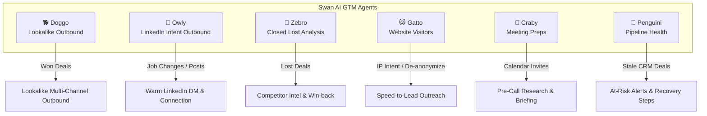

# Swan (getswan.com) — Complete Website & Platform Breakdown

> **Source URL:** [https://www.getswan.com/](https://www.getswan.com/) (Live Fetched & Analyzed)  
> **Tagline:** *"Meet Your AI GTM Engineer: From Prompt to Pipeline"*  
> **Positioning:** *"Lovable for GTM"* — Turn any GTM idea or process into an agentic workflow in seconds using plain English. Scale demand and revenue with intelligence, not headcount.  
> **Company:** Swan AI (Founded 2024, Tel Aviv / Remote, Team of 3).

---

## 1. Executive Summary & Core Value Proposition

Swan positions itself as an **AI Go-To-Market (GTM) Engineer** that replaces the need to manually chain together 3–5 fragmented tools (such as Clay, Zapier, Apollo, and Smartlead) or file tickets with internal RevOps teams.

```
┌───────────────────────────────────────────────────────────────────────────────────┐
│                               SWAN CORE PILLARS                                   │
├──────────────────────────┬──────────────────────────┬─────────────────────────────┤
│ 1. Prompt to Pipeline    │ 2. Context-Aware         │ 3. Change-Ready, Always     │
│ "If you can write it,    │ "Intelligence, not       │ "Adapts in seconds, not     │
│  Swan can build it."     │  automation."            │  months."                   │
│ Build workflows from     │ Agents evaluate context, │ GTM changes daily; adjust   │
│ plain English prompts.   │ weigh options & decide.  │ plays via chat in Slack.    │
└──────────────────────────┴──────────────────────────┴─────────────────────────────┘
```

### The Problem Swan Solves
- **Before Swan:** Intent signals (website visits, webinar attendees, whitepaper downloads) pile up. Acting on them requires filing a ticket with RevOps, waiting a week in the queue for a Zapier/HubSpot workflow build, and by the time outreach launches, the lead is ice-cold.
- **After Swan:** Marketing and sales teams describe the play in plain English (*"Dave, CTO at Acme downloaded our 2025 whitepaper $\rightarrow$ research Acme $\rightarrow$ read CRM $\rightarrow$ assign owner $\rightarrow$ draft outreach"*). Swan engineers and deploys the agent in minutes.

---

## 2. The 6 Named GTM Agents (The Core Fleet)

Swan packages specialized revenue workflows into distinct, named AI agents represented by origami-style animal characters:



### Detailed Agent Specifications

| Agent Name & Icon | Persona / Title | Trigger Event | Autonomous Cognitive Workflow | Connected Tools | Primary Value |
| :--- | :--- | :--- | :--- | :--- | :--- |
| **Doggo** 🐕 | **Lookalike Outbound** | When a deal moves to **Closed Won** in CRM | 1. Analyzes won deal attributes in CRM<br>2. Discovers matching lookalike companies<br>3. Identifies buying committee members<br>4. Crafts tailored value propositions<br>5. Launches multi-channel outreach | Salesforce, HubSpot, Ocean.io, LinkedIn, Gmail | Replicates successful customer wins into instant outbound pipeline. |
| **Owly** 🦉 | **LinkedIn Intent Outbound** | When prospect engages with content or changes jobs | 1. Detects LinkedIn post engagement / job transition<br>2. Enriches prospect profile & contact data<br>3. Researches new company context & UVP<br>4. Drafts personalized icebreaker<br>5. Dispatches connection request or InMail | LinkedIn, HubSpot, Apollo, Slack | Reaches buyers at the exact moment of career transition or public interest. |
| **Zebro** 🦓 | **Closed Lost Analysis** | When a deal moves to **Closed Lost** in CRM | 1. Ingests full deal and meeting transcripts from CRM<br>2. Categorizes loss reasons and pricing objections<br>3. Extracts competitor intelligence<br>4. Recommends process and product fixes<br>5. Alerts sales leadership and triggers future revival timer | Salesforce, HubSpot, Gmail, Slack | Turns lost revenue into actionable competitor intel and revival opportunities. |
| **Gatto** 🐱 | **Website Visitors** | When a high-intent visitor lands on site | 1. De-anonymizes IP visitor via reverse-DNS / identity graph<br>2. Verifies ICP fit (headcount, revenue, industry)<br>3. Identifies key department lead<br>4. Updates CRM record & alerts rep in Slack<br>5. Stages personalized intro outreach | RB2B, Vector, HubSpot, Slack, LinkedIn | Converts passive website traffic into booked meetings in $< 60$ minutes. |
| **Craby** 🦀 | **Meeting Preps** | When a meeting is scheduled on Google Calendar | 1. Pulls attendee and company history from CRM<br>2. Scrapes recent company news, earnings, and tech stack<br>3. Reviews past email threads and interactions<br>4. Generates tailored talking points and trap questions<br>5. Delivers pre-call briefing to rep in Slack | Google Calendar, Salesforce, Apollo, Gmail, Slack | Reps enter discovery calls fully briefed with zero manual research time. |
| **Penguini** 🐧 | **Pipeline Health Monitoring** | Recurring schedule (daily / weekly) | 1. Scans CRM deals for inactivity or stage stagnation<br>2. Flags missing next steps or missed rep follow-ups<br>3. Evaluates close probability and churn risk<br>4. Suggests specific recovery plays and re-engagement text<br>5. Notifies deal owners in Slack | Apollo, Ocean.io, Gmail, HubSpot, LinkedIn | Prevents pipeline slippage and ensures no high-value opportunity goes stale. |

---

## 3. Product Features & Capabilities Matrix

### 1. Natural Language Workflow Builder
- No-code, prompt-based configuration.
- Users describe workflows in plain conversational English (*"When an inbound lead from a healthcare company signs up, enrich their tech stack via Apollo and notify Sarah on Slack with talking points"*).
- Swan compiles the prompt into a stateful, autonomous execution loop.

### 2. Built-In B2B Data Enrichment
- Native access to verified B2B contact data (emails, direct dials, LinkedIn URLs).
- Aggregates multiple underlying data providers (Apollo, Ocean.io, RB2B, Vector) so users don't need individual API subscriptions.

### 3. Slack Copilot Integration
- Full GTM assistance natively in Slack.
- Users can mention `@Swan` to research an account, draft email copy, run a quick company query, or review meeting prep without opening a web dashboard.

### 4. Intent Signal Detection & Triggering
- Ingests signals from:
  - **First-party signals:** Website visitor tracking (pricing page visits, repeat sessions), content downloads, demo form submissions.
  - **Third-party signals:** Executive job changes, departmental hiring sprees, news announcements, tech stack adoption.

### 5. Multi-Channel Outreach Automation
- Direct sequencing across **Email** (Gmail / Google Workspace) and **LinkedIn** (connection requests, direct messages, InMails).
- Built-in human-in-the-loop review mode before messages are dispatched.

---

## 4. Target Audiences & Use Cases

Swan segments its platform by **GTM Role** and **Business Use Case**:

### By Role
- **RevOps:** Eliminate repetitive Zapier / HubSpot maintenance; automate lead routing and deduplication.
- **Demand Gen:** Turn content downloads and webinar signups into immediate outbound plays.
- **Sales Reps & AEs:** Automated pre-call briefing dossiers and automated post-call CRM logging.
- **GTM Engineers:** Rapidly prototype new outbound experiments without writing Python scripts or API connectors.
- **CROs / Sales Leadership:** Instant pipeline hygiene audits, deal slippage warnings, and closed-lost trend analytics.
- **AI SDRs:** Autonomous outbound prospecting combining lookalikes, signals, and personalized drafting.

### By Use Case
1. **Signal-Based Outbound:** Triggering outreach when prospects show public buying signals.
2. **AI Sales Workflow Automation:** Automating the handover between SDRs, AEs, and RevOps.
3. **Automated Lead Qualification:** Instant scoring and routing based on real-time enriched data.
4. **Contact Data Enrichment:** Filling blank CRM fields automatically.
5. **AI ABM Targeting:** Orchestrated campaigns across entire buying committees at target enterprise accounts.
6. **AI-Powered Cold Outreach:** Hyper-personalized first touchpoints referencing company-specific context.
7. **Intent-Based Prospecting:** Identifying accounts actively searching for competitor alternatives.

---

## 5. Integration Ecosystem

Swan organizes its integrations into three tiers:

```
┌─────────────────────────────────────────────────────────────────────────────┐
│                           SWAN INTEGRATIONS BY TIER                         │
├──────────────────────┬──────────────────────────────────────────────────────┤
│ Basic Integrations   │ Slack, Gmail, LinkedIn, Google Calendar (+40 others) │
│ (All Plans)          │                                                      │
├──────────────────────┼──────────────────────────────────────────────────────┤
│ Premium Integrations │ HubSpot CRM, Attio CRM                               │
│ (Growth Plan & Up)   │                                                      │
├──────────────────────┼──────────────────────────────────────────────────────┤
│ Enterprise           │ Salesforce CRM, Gong (Call Transcripts & Recordings) │
│ (Scale Plan)         │                                                      │
└──────────────────────┴──────────────────────────────────────────────────────┘
```

---

## 6. Pricing Architecture & Commercial Model

Swan employs a **credit-based usage model** combined with **platform/seat tiers**:

### Pricing Tiers

| Plan | Price (Monthly) | Billed Annually | Included Credits | Credit Unit Cost | Seats Included | Integrations & Support |
| :--- | :--- | :--- | :--- | :--- | :--- | :--- |
| **Solo** | **$100 / mo** | Save 20% | 625 credits | $0.16 / credit | 1 Seat | Basic (Slack, Gmail, LinkedIn, Calendar) + AI Support |
| **Starter** | **$200 / mo** | Save 20% | 1,250 credits | $0.16 / credit | 1 Seat | Basic Integrations + Unlimited workflows + AI Support |
| **Growth** *(Most Popular)* | **$419 / mo** ($99 fee + credits) | Save 20% | 2,000 credits | $0.16 / credit | 5 Seats | Premium (HubSpot, Attio) + Human & AI Support + Admin Controls |
| **Scale** | **Custom** | Custom | Custom volume | Discounted ($0.035–$0.09) | Custom Seats | Enterprise (Salesforce, Gong) + Dedicated Onboarding Specialist |

### Critical Pricing Rules
- **What is a Seat?** A seat is anyone who **actively converses** with Swan (prompting, giving instructions, reviewing/approving actions).
- **Free for Receivers:** Team members who only receive alerts, notifications, or view the dashboard consume **0 seats ($0)**.
- **Additional Seats:** **$20 / month** per additional conversational user.
- **Credit Rollover:**
  - *Monthly commitments:* Unused credits roll over up to **2× monthly allocation**.
  - *Annual commitments:* **Unlimited rollover** across the entire 12-month contract period.
- **Credit Top-Ups:** Additional on-demand credit packs can be purchased at **150%** of the plan's credit rate.

---

## 7. Customer Testimonials & Proof Points

Swan showcases customer quotes across B2B SaaS and agency founders:
- *"Swan is more productive than our last BDR."* — **Ryan Buckley**, CEO @ Shovels.ai
- *"Dude, we’ve burned through so many AI tools that overpromise. Swan actually works — finds people who want to talk and tells us what to say. Finally."* — **Gary O’Neil**, Director of GTM Ops @ Machinery Partners
- *"Our trial ended today and our sales lead replied 'heartbroken'."* — **Harry Wilson Hallberg**, Co-Founder @ Flowspace
- *"We've significantly increased our meetings scheduled by using Swan."* — **Odelia Lourie**, BD Manager @ Winn.ai
- *"Love your product — right combination of AI scale with human in the loop."* — **Jon Folland**, CEO @ SalesDesk
- *"Saw your post, got onboarded in minutes (your Slack onboarding is phenomenal) and two days in, we are already seeing value."* — **Yoni Leitersdorf**, CEO & Co-Founder @ Solid
- *"Already love the smooth onboarding, visitor identification and the AI research. Amazing you're doing this with only 3 people."* — **Harish Dittakavi**, Chief Growth Officer @ Hivel

---

## 8. Strategic Comparison: Swan vs. DareXAI

| Evaluation Dimension | Swan (getswan.com) | DareXAI (Our SaaS) |
| :--- | :--- | :--- |
| **Product Scope** | GTM / Sales Outbound Tool only | Whole-Company AI Employee SaaS (Growth + Customer + Operations) |
| **Core Abstraction** | Micro-Agent Playground & GTM Prompt Builder | Autonomous AI Employees with Mandates & Shared Company Brain |
| **Customer Service** | ❌ None (No inbound support, no ticket resolution) | ✅ **Customer Employee:** 12-step resolution, Stripe refunds, Shopify edits, Open Loops |
| **Operations & SLAs** | ⚠️ Limited to CRM deal staleness | ✅ **Operations Employee:** Expected vs Actual engine, 9 AM brief, deduplication, team load balancing |
| **Execution Engine** | Trigger-based linear pipelines | Temporal durable workflows, TrueForge runtime, self-healing retries |
| **Knowledge Sharing** | Siloed to GTM data | **Shared Company Brain:** Customer churn reasons instantly update Growth outbound rules & Ops deal audits |
| **Commercial Model** | $100–$419/mo based on work credits & seats | $99–$450/mo per AI Employee slot with Darex Work Credits (DWC) |

### Key Takeaway for DareXAI Product Strategy
Swan provides a compelling UX benchmark for **GTM trigger visualization, named animal agent personas, and prompt-driven workflow generation**.  
However, DareXAI goes significantly deeper: instead of forcing users to invent and wire GTM workflows, DareXAI packages Swan's discovery capabilities (**Scout**, **Lookalike**, **De-anonymize**, **Intent Poller**) underneath the **Growth Employee**, while also providing the **Customer Employee** (inbound resolution) and **Operations Employee** (operational integrity) under a unified multi-tenant platform.
