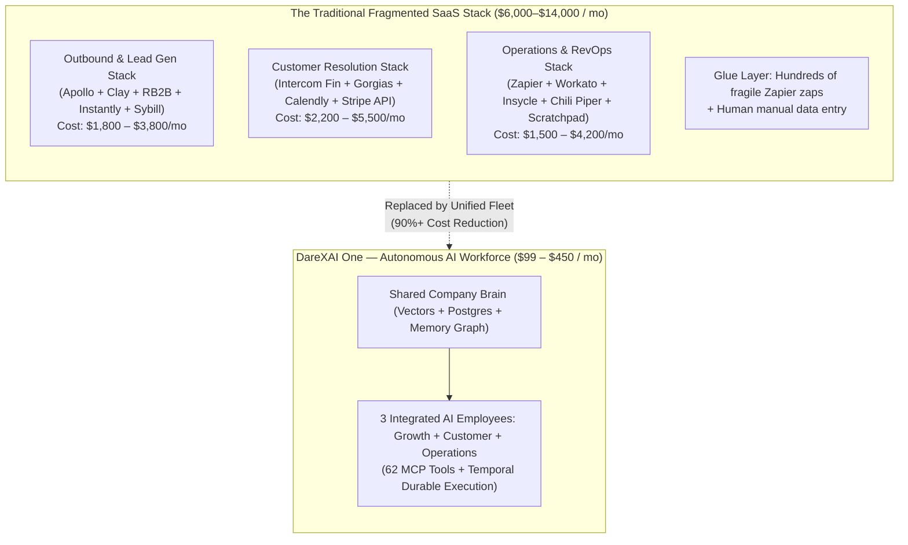

# Competitor Pricing & Feature Cost Benchmark: DareXAI One vs. The Market

> **Document Location:** `docs/new-109-pg-plan/other-company-plans.md`  
> **Referenced Spec:** `docs/new-109-pg-plan/3-employee.md` (Features `GE-01..10`, `CE-01..10`, `OE-01..10`)  
> **Market Data:** 2026 Live Web Intelligence, SaaS Pricing Disclosures (G2, Capterra, Vendr, Capiche), SEC Filings, and Vendor Terms of Service.  
> **Core Objective:** Map every single feature of DareXAI One's 3 AI Employees (**Growth**, **Customer**, **Operations**) against online competitors, revealing exact market pricing, pricing models (per-seat, per-credit, per-resolution, annual ACVs), and the massive cost savings of our unified OS.

---

## 1. Executive Summary: The $8,500/Month "SaaS Sprawl Tax"

Today, modern businesses do not run on one system; they rent **12 to 20 fragmented SaaS point-tools** and pay a punishing monthly tax to keep them glued together:



### High-Level Price Benchmark by Tier

| Solution Archetype | Examples | Typical Annual Cost | Pricing Mechanic | Critical Flaw |
| :--- | :--- | :--- | :--- | :--- |
| **Point Solutions Stitched Together** | Apollo + Clay + Intercom + Zapier + Insycle | **$70,000 – $140,000 / yr** | Multiple per-seat licenses + credit overages | Fragile zaps break; no shared brain; repetitive manual work. |
| **Single-Worker AI Startups** | 11x.ai (Alice), Artisan (Ava) | **$24,000 – $60,000 / yr** | Heavy upfront annual contracts ($2k–$5k/mo) | Pure outbound email only; zero customer support, zero internal ops. |
| **Enterprise AI Resolution Giants** | Sierra.ai, Decagon, Ada.cx | **$60,000 – $250,000+ / yr** | High ACV + $1.50–$3.50 per resolved ticket | Accessible only to Fortune 500; requires 6-month custom deployments. |
| **DareXAI One (Our SaaS)** | **Growth + Customer + Operations** | **$1,188 – $5,400 / yr** ($99–$450/mo) | Predictable Employee Subscription + Darex Work Credits | **Full company OS: 3 employees, 1 shared brain, 62 real tools.** |

---

## 2. Master Feature-by-Feature Competitor Costing Matrix

Below is every single feature from [3-employee.md](file:///Users/addy/Coding/SaaS/Agentic-Os-SaaS/docs/new-109-pg-plan/3-employee.md) mapped directly against what other online companies charge to provide that capability.

### 🚀 Growth Employee (Revenue Engine — GE-01 to GE-10)

| ID | DareXAI Feature List | Similar Online Competitors | Competitor Pricing Tiers | How Competitors Charge | What Customers Pay Elsewhere | DareXAI One Advantage |
| :--- | :--- | :--- | :--- | :--- | :--- | :--- |
| **GE-01** | **Twin Customer Finder**<br>Finds 50–200 lookalikes of top closed accounts. | **Clay.com**, Ocean.io, ZoomInfo Lookalikes | • **Clay:** Pro $349/mo, Enterprise $800+/mo<br>• **Ocean.io:** $600–$1,200/mo<br>• **ZoomInfo:** $15,000–$35,000/yr | Per-credit enrichment ($0.10–$0.25/match) + base platform fee | **$350 – $1,200 / mo** | Built directly into Growth Employee using native closed-won CRM centroid vectors. |
| **GE-02** | **Market Scout**<br>Finds verified B2B decision-makers and direct emails. | **Apollo.io**, ZoomInfo, Cognism, Seamless.ai, Swan | • **Apollo:** Professional $99/user/mo<br>• **ZoomInfo:** $15,000/yr min<br>• **Swan:** Starter $200/mo, Growth $419/mo | Per user/seat/mo + monthly export credit throttles | **$99 – $419 / mo** per seat | Autonomous background sweep with daily lead caps; no per-seat tax. |
| **GE-03** | **Buying Signal Radar**<br>Tracks funding, hiring, and tech stack shifts 24/7. | **Bombora**, G2 Buyer Intent, Demandbase, Leadfeeder | • **Bombora Intent:** $25,000–$45,000/yr<br>• **G2 Intent:** $15,000–$28,000/yr<br>• **Leadfeeder:** $199–$499/mo | Enterprise annual contracts or monthly tracked domain limits | **$200 – $2,500 / mo** | Native Jina web scrapers & Temporal cron sweeps; included in plan. |
| **GE-04** | **Website Visitor Identifier**<br>De-anonymizes corporate IPs on pricing/demo pages. | **RB2B**, Warmly.ai, Factors.ai, Clearbit Reveal | • **RB2B:** Free tier limited, Pro $99–$499/mo<br>• **Warmly:** $750–$1,500/mo<br>• **Clearbit:** $1,000–$2,000/mo | Tracked unique corporate visitors per month | **$100 – $1,500 / mo** | Built-in reverse-IP enrichment (`lib/visitor-enrich.ts`) linked to instant Decision Cards. |
| **GE-05** | **Lost Deal Reviver**<br>Wakes up dormant CRM leads when trigger events occur. | **Regie.ai**, CoPilot AI, 11x.ai (Alice), Swan RevOps | • **Regie.ai:** $89–$199/rep/mo<br>• **11x Alice:** $3,750–$5,000/mo<br>• **Swan:** $419/mo | Annual SDR contracts or per-rep monthly subscriptions | **$180 – $3,750 / mo** | Automated Temporal workflow cross-referencing stale leads with fresh signals. |
| **GE-06** | **"Why Today?" Matchmaker**<br>2-sentence hook explaining why reaching out today makes sense. | **Clay Gentle AI**, UserGems, Common Room | • **Clay AI:** $349–$800/mo + OpenAI token costs<br>• **UserGems:** $12,000–$24,000/yr | Custom workflow credits + data pipeline fees | **$350 – $1,500 / mo** | Synthesized dynamically by TrueForge Reasoner referencing Company Brain wins. |
| **GE-07** | **Pre-Meeting Account Dossier**<br>1-page intelligence brief before calendar demos. | **Attention.tech**, Sybill.ai, Gong, Grain | • **Attention:** $99/rep/mo<br>• **Sybill:** $49–$129/rep/mo<br>• **Gong:** $1,400–$2,000/rep/yr ($5k platform fee) | Per-rep/month licensing with annual commitments | **$100 – $250 / mo** per rep | Google Calendar event trigger automatically compiles 10-K, news, and LinkedIn briefs. |
| **GE-08** | **Tailored Outreach Drafter**<br>Personalized emails addressing pain points and tech stack. | **Instantly.ai**, Smartlead, Lemlist, Artisan (Ava) | • **Instantly / Smartlead:** $39–$97/mo<br>• **Lemlist:** $59–$99/seat/mo<br>• **Artisan Ava:** $2,000/mo | Inboxes connected + warmups + monthly active leads | **$40 – $2,000 / mo** | Native Gmail/LinkedIn drafter with 1-click human-in-the-loop review cards. |
| **GE-09** | **Smart Reply Sorter**<br>Classifies replies: Interested, Objection, OOO, Unsubscribe. | **Regie.ai Rapid Response**, Lavender.ai, Instantly Unibox | • **Regie:** $99/rep/mo<br>• **Lavender:** $29–$49/user/mo<br>• **Instantly Hyper:** $97/mo | Per seat/month or per connected email mailbox | **$50 – $150 / mo** | Inbound Gmail reply classifier updating CRM stages and pinging reps instantly. |
| **GE-10** | **Voice & Style Learner**<br>Learns tone, objections, and ICP rules from user rejections. | **GTM Buddy**, Highspot, Clay Custom Prompts | • **GTM Buddy:** $15,000/yr enterprise<br>• **Clay Prompts:** $349/mo | Enterprise enablement licensing or complex prompt engineering | **$350 – $1,250 / mo** | Self-improving preference engine (`preferences.ts`) learning from every edit/reject. |
| **SUBTOTAL** | **Growth Stack Purchased Separately** | | | | **$1,800 – $12,000+ / mo** | **Included in DareXAI Growth Employee ($99–$450/mo)** |

---

### 💬 Customer Employee (Resolution Engine — CE-01 to CE-10)

| ID | DareXAI Feature List | Similar Online Competitors | Competitor Pricing Tiers | How Competitors Charge | What Customers Pay Elsewhere | DareXAI One Advantage |
| :--- | :--- | :--- | :--- | :--- | :--- | :--- |
| **CE-01** | **Instant Omnichannel Reply**<br>< 500ms WhatsApp & Email acknowledgment. | **Chatwoot**, Respond.io, Twilio Flex, Wati | • **Respond.io:** $79–$279/mo<br>• **Wati:** $49–$279/mo<br>• **Twilio Flex:** $1/active user/hr | Per active contact or per user/hour tiering | **$80 – $300 / mo** | Sub-500ms webhook ack + durable async Temporal dispatch on WhatsApp & Email. |
| **CE-02** | **VIP & Account Profiler**<br>Pulls customer spend, MRR, open orders, and VIP status. | **Zendesk Sunshine**, Vitally, Gainsight, Planhat | • **Zendesk Enterprise:** $115/agent/mo<br>• **Vitally / Planhat:** $12,000–$30,000/yr | Per support seat + per customer account tracked | **$300 – $2,500 / mo** | Real-time DB and billing lookups before drafting any customer answer. |
| **CE-03** | **Company Rulebook Expert (RAG)**<br>Zero-hallucination answers citing uploaded SOPs. | **Intercom Fin 2**, Zendesk AI, Ada.cx, Decagon | • **Intercom Fin:** $0.99 / resolution + $39–$139/seat/mo<br>• **Zendesk AI:** $50/agent/mo + $1.50/resolution<br>• **Ada.cx:** $36,000–$100,000/yr | Base software license + **$0.99 to $2.00 per AI resolution** | **$1,500 – $6,000 / mo** (at 1,500 tickets/mo) | Org RAG retrieval with confidence gating (0.72) and zero resolution penalty fees. |
| **CE-04** | **Self-Service Rescheduling**<br>Checks slots, moves calendar bookings, sends invites. | **Calendly Enterprise**, Reclaim.ai, OnceHub | • **Calendly:** $16–$20/seat/mo<br>• **Reclaim:** $12–$18/user/mo<br>• **OnceHub:** $15–$35/user/mo | Per user/seat/month licensing | **$50 – $200 / mo** | Autonomous calendar update mutation (`tools/google-calendar.ts`) directly via WhatsApp/Chat. |
| **CE-05** | **Automated Refund Processor**<br>Issues Stripe refunds within dollar limits and time windows. | **Sierra.ai**, Forethought.ai Solve, Custom Scripts | • **Sierra:** $150,000–$500,000 ACV<br>• **Forethought:** $24,000–$50,000/yr | Enterprise ACV + professional services deployment fees ($25k+) | **$2,000 – $15,000+ / mo** | Native Stripe refund executor (`tools/stripe.ts`) governed by strict policy limits. |
| **CE-06** | **Address & Order Corrector**<br>Updates delivery address in Shopify before shipment. | **Gorgias Automate**, Richpanel, Wonderment | • **Gorgias:** $300–$750/mo + $1/automated ticket<br>• **Richpanel:** $300–$900/mo | Base tier + per-automated-interaction surcharges | **$350 – $1,200 / mo** | Autonomous Shopify address edit tool (`tools/shopify.ts`) checking fulfillment status. |
| **CE-07** | **Never-Forgotten Promises (Open Loops)**<br>Tracks commitments (*"I'll update you at 4 PM"*) and follows up. | **Temporal Cloud Enterprise** + Custom SRE Engineering | • **Temporal Cloud:** $1,000–$5,000/mo<br>• **Internal Dev Cost:** $150,000/yr engineer | Infrastructure fees + months of custom distributed systems code | **$2,500 – $12,500 / mo** | Durable Temporal timer loop (`open-loop-monitor.ts`) that never loses state across reboots. |
| **CE-08** | **1-Click Manager Approvals**<br>Escalates exceptions via structured Decision Cards. | **Tonkean**, Wrangle.io, Kissflow | • **Tonkean:** $24,000–$60,000/yr<br>• **Wrangle:** $99–$499/mo<br>• **Kissflow:** $1,500/mo | Annual enterprise process automation tiers | **$100 – $2,000 / mo** | Embedded Decision Card system (`DecisionCard.tsx`) with Slack & dashboard 1-click approvals. |
| **CE-09** | **Angry Customer Radar**<br>Detects frustration or cancellation intent to stop churn. | **SupportLogic**, Thematic, Qualtrics CustomerXM | • **SupportLogic:** $15,000–$35,000/yr<br>• **Thematic:** $12,000–$24,000/yr | Per-seat or per-ticket volume enterprise analytics | **$1,000 – $3,000 / mo** | Real-time sentiment trajectory analysis triggering immediate `CustomerRecoveryWorkflow`. |
| **CE-10** | **Knowledge Gap Finder**<br>Flags missing SOP questions to founder automatically. | **Guru Knowledge Sync**, Shelf.io, Notion AI Enterprise | • **Guru:** $15–$25/user/mo<br>• **Shelf:** $15,000–$30,000/yr | Per-seat/month enterprise knowledge bases | **$150 – $1,500 / mo** | Automatically logs failed RAG searches (<0.65 confidence) into dashboard recommendations. |
| **SUBTOTAL** | **Customer Stack Purchased Separately** | | | | **$5,700 – $28,000+ / mo** | **Included in DareXAI Customer Employee ($99–$450/mo)** |

---

### ⚙️ Operations Employee (Execution Sentinel — OE-01 to OE-10)

| ID | DareXAI Feature List | Similar Online Competitors | Competitor Pricing Tiers | How Competitors Charge | What Customers Pay Elsewhere | DareXAI One Advantage |
| :--- | :--- | :--- | :--- | :--- | :--- | :--- |
| **OE-01** | **9:00 AM Morning Triage**<br>Scans overnight messages, leads & forms; assigns owners. | **Moveworks**, Cassidy.ai, Zapier Central | • **Moveworks:** $60,000–$250,000/yr<br>• **Cassidy.ai:** $99–$499/mo<br>• **Zapier Central:** $50–$250/mo | Per employee/month enterprise IT contracts or API task runs | **$100 – $5,000+ / mo** | Timezone-aware 9:00 AM Temporal cron activity cleaning CRM and staging inbox. |
| **OE-02** | **Executive Standup Brief**<br>2-min morning summary of revenue, tickets, and stuck work. | **Geekbot / Friday.app**, Geckoboard, Klipfolio | • **Geekbot:** $2.50–$5.00/user/mo<br>• **Geckoboard:** $99–$399/mo | Per user/seat/month or per dashboard widget | **$50 – $400 / mo** | Proactive Slack/Email brief (`operations/brief.ts`) compiled from whole-company events. |
| **OE-03** | **Expected vs. Actual Engine**<br>24/7 background watchdog for company SLAs and rules. | **Workato**, Make Enterprise, Datadog SLAs | • **Workato:** $10,000–$50,000/yr<br>• **Make Enterprise:** $299–$1,200/mo<br>• **Datadog:** $500–$2,000/mo | Number of workflow recipes or million operations/month | **$300 – $3,000 / mo** | Declarative expectation rules evaluated by continuous Temporal background listeners. |
| **OE-04** | **Slow Rep Follow-up Reminder**<br>Pings reps on Slack if hot leads are untouched after 3 hours. | **Scratchpad**, Troops.ai (Salesforce), Dooly | • **Scratchpad:** $39–$79/rep/mo<br>• **Troops:** $19–$49/rep/mo<br>• **Dooly:** $35–$65/rep/mo | Per sales rep/month licenses | **$150 – $500 / mo** (for 5–10 reps) | Automated inactivity SLA timer that nudges reps with a pre-written email draft. |
| **OE-05** | **Smart Workload Balancer**<br>Routes leads & tickets based on rep capacity and schedule. | **Chili Piper Distro**, LeanData Routing, Full Circle | • **Chili Piper:** $30–$45/user/mo<br>• **LeanData:** $12,000–$30,000/yr | Per routing user/month or annual RevOps contract | **$250 – $2,000 / mo** | Checks active open tickets, calendars, and workload of all team members before assigning. |
| **OE-06** | **Duplicate Record Cleaner**<br>Fuzzy matches and merges duplicate CRM records safely. | **Insycle**, DemandTools (Validity), Dedupely | • **Insycle:** $149–$799/mo (scales with CRM contacts)<br>• **DemandTools:** $3,500–$10,000/yr<br>• **Dedupely:** $49–$249/mo | Scales aggressively by total CRM database record count | **$150 – $800 / mo** | Real-time trigram matching (`dedup-engine.ts`) with review queues for ambiguous duplicates. |
| **OE-07** | **Missing Info Auto-Fill**<br>Extracts missing phone/title info from email signatures. | **Evercontact**, Sigstr / Terminus, LeadIQ | • **Evercontact:** $49–$199/mo<br>• **Terminus:** $1,000+/mo<br>• **LeadIQ:** $75–$130/user/mo | Per mailbox scanned or per contact enriched | **$100 – $600 / mo** | Parses incoming email thread signatures to automatically enrich CRM contact blanks. |
| **OE-08** | **Calendar Deadlock Fixer**<br>Injects video links, resolves conflicts, reminds unconfirmed guests. | **Reclaim.ai**, Clockwise Team, Superhuman Teams | • **Reclaim:** $12–$18/user/mo<br>• **Clockwise:** $6–$12/user/mo<br>• **Superhuman:** $30/user/mo | Per user/month seat fee | **$60 – $200 / mo** | Tomorrow's meeting audit (`meeting-prep.ts`) auto-injecting Zoom links and detecting clashes. |
| **OE-09** | **Stuck Deal Unblocker**<br>Spots pipeline deals idle >10 days and stages a nudge draft. | **Gong Deal Intelligence**, Clari, BoostUp | • **Gong:** $1,400–$2,000/rep/yr + $5k platform<br>• **Clari:** $100–$150/rep/mo | High-tier RevOps revenue intelligence platforms | **$500 – $2,000 / mo** | Identifies stalled deals in `runStuckWorkActivity` and drafts owner nudge messages. |
| **OE-10** | **Downstream Outage Buffer**<br>Durable queue buffering outbound API calls during 3rd-party downtime. | **Temporal Cloud**, AWS SQS/Lambda Architecture | • **Temporal Cloud:** $1,000–$5,000/mo<br>• **Cloud Engineer:** $150,000/yr | Custom distributed cloud architecture | **$1,000 – $4,000 / mo** | Built-in exponential backoff queue (`outage-buffer.ts`) guaranteeing zero dropped transactions. |
| **SUBTOTAL** | **Operations Stack Purchased Separately** | | | | **$2,660 – $18,500+ / mo** | **Included in DareXAI Operations Employee ($99–$450/mo)** |

---

## 3. The Grand TCO Benchmark: Point Solutions vs. Single Bots vs. DareXAI One

### Total Monthly Cost Comparison

```
┌────────────────────────────────────────────────────────────────────────────────────────┐
│                              MONTHLY SOFTWARE EXPENDITURE                              │
├──────────────────────────────────────────────────────┬─────────────────────────────────┤
│ Option 1: 15+ Disconnected Point Solutions           │ $10,160 – $58,500 / month       │
│ (Apollo + Clay + RB2B + Intercom Fin + Zapier, etc.) │                                 │
├──────────────────────────────────────────────────────┼─────────────────────────────────┤
│ Option 2: Single-Worker Point AI Startups            │ $5,750 – $7,000 / month         │
│ (11x.ai Alice $3,750/mo + Artisan Ava $2,000/mo)     │ (Still lacks Support & Ops!)    │
├──────────────────────────────────────────────────────┼─────────────────────────────────┤
│ Option 3: Enterprise Resolution AI Giants            │ $12,500 – $35,000 / month       │
│ (Sierra.ai / Decagon Customer Support alone)         │ (Still lacks Sales & Ops!)      │
├──────────────────────────────────────────────────────┼─────────────────────────────────┤
│ Option 4: DareXAI One (All 3 Employees + Brain)      │ $99 – $450 / month              │
│ (Growth + Customer + Operations in One OS)           │ (95% Software Cost Savings)     │
└──────────────────────────────────────────────────────┴─────────────────────────────────┘
```

### 12-Month Total Cost of Ownership (TCO) Breakdown

| Cost Category | Point-Solution Stack (15 Tools) | Single-Worker AI (11x / Artisan) | Enterprise AI (Sierra / Decagon) | DareXAI One (Growth + Customer + Ops) |
| :--- | :--- | :--- | :--- | :--- |
| **Base Platform Subscriptions** | $65,000 / yr | $45,000 / yr | $150,000 / yr | **$2,988 / yr** ($249/mo Pro) |
| **Per-Seat Software Taxes (5 Users)** | $18,000 / yr | $6,000 / yr | $0 (included in ACV) | **$0** (Unlimited viewer seats) |
| **Credit & Resolution Surcharges** | $24,000 / yr | $12,000 / yr | $35,000 / yr ($1.50/ticket) | Included in Darex Work Credits |
| **Integration / Zapier / Maintenance** | $15,000 / yr | $0 (siloed) | $25,000 / yr professional services | **$0** (Native 62 MCP tools) |
| **RevOps / Engineering Admin Time** | $30,000 / yr | $15,000 / yr | $20,000 / yr | **Self-Service / 1-Click Setup** |
| **TOTAL 1-YEAR TCO** | **$152,000 / year** | **$78,000 / year** | **$230,000 / year** | **$2,988 – $5,400 / year** |
| **NET ANNUAL SAVINGS WITH DAREXAI** | — | **Saves $72,600 / yr** | **Saves $224,600 / yr** | **Saves $146,600 – $224,600 / yr** |

---

## 4. Deep-Dive Competitor Analysis by Category

### Category 1: Outbound Sales & Lead Generation Competitors

#### 1. 11x.ai (Alice, Julian, Jordan)
- **What they sell:** Single-purpose "Digital SDR" (Alice) and "Inbound Qualifier" (Julian).
- **Pricing:** **$3,750 – $5,000 / month** ($45,000 – $60,000/year billed upfront). Julian is an extra $2,000/mo.
- **Cost Flaw:** High barrier to entry. If Alice burns a domain or targets the wrong list, you lose $50k. Alice does not communicate with customer support; if a prospect's company is already having a customer crisis, Alice blindly pitches them cold.
- **DareXAI Winning Move:** Growth Employee is part of the **Shared Company Brain**. If Customer Employee flags a churn risk, Growth stops outreach immediately. Full fleet starts at **$99–$249/mo**, not $50k.

#### 2. Artisan AI (Ava, Liam, James)
- **What they sell:** "Ava the AI BDR" with an integrated 300M B2B contact database and email sequencing.
- **Pricing:** Starts at **$2,000 / month ($24,000 / year)** billed annually.
- **Cost Flaw:** Credit metering runs dry quickly (enrichment = 1–3 credits; AI drafting = 5 credits). Customers face sudden overage bills. Ava cannot handle post-sales tickets, refunds, or operational deduplication.
- **DareXAI Winning Move:** DareXAI provides **transparent Work Credits**, human-in-the-loop Decision Cards, and covers post-sale retention and internal ops.

#### 3. Swan (getswan.com)
- **What they sell:** GTM outbound micro-agents (Scout, Lookalike, De-anonymize) with animal branding (Doggo, Owly, Zebro).
- **Pricing:** Solo ($100/mo, 625 credits), Starter ($200/mo, 1,250 credits), Growth ($419/mo, 2,000 credits).
- **Cost Flaw:** Pure outbound focus. Lacks inbound customer resolution, Stripe refunds, durable Open Loops timers, and operational briefs.
- **DareXAI Winning Move:** DareXAI includes all of Swan's GTM capabilities (**Lookalike, Scout, Signal Poller, De-anonymizer**) inside the Growth Employee, plus delivers Customer & Operations employees for the same price point.

#### 4. Clay.com
- **What they sell:** Visual spreadsheet for lead waterfall enrichment and AI drafting.
- **Pricing:** Starter ($149/mo), Explorer ($349/mo), Pro ($800/mo) + expensive credit packs ($0.05–$0.25/credit).
- **Cost Flaw:** Clay is a "tool for engineers", not an employee. Companies must hire a "Clay Expert" at $5,000–$10,000/mo to build and maintain complex tables.
- **DareXAI Winning Move:** DareXAI is an **autonomous employee with an executive mandate**. Founders don't build formulas; they approve high-level opportunities with 1 click.

---

### Category 2: Inbound Customer Service & AI Resolution Competitors

#### 1. Intercom Fin 2
- **What they sell:** AI customer support chatbot.
- **Pricing:** **$0.99 per AI resolution** + base helpdesk ($39, $99, or $139 per human seat/month).
- **The "Success Tax":** If your business resolves 3,000 customer inquiries in a month, Intercom sends a **$2,970 surcharge bill** on top of human seat licenses.
- **Cost Flaw:** Punishes business growth with resolution fees. Fin cannot execute deep mutations (cannot safely modify orders in Shopify or issue policy-governed Stripe refunds).
- **DareXAI Winning Move:** DareXAI does **not penalize support volume** with per-resolution taxes. Actions are governed by the Autonomy Ladder and include Stripe refunds, Shopify address edits, and durable Open Loops follow-ups.

#### 2. Sierra.ai (Bret Taylor) & Decagon.ai
- **What they sell:** High-end conversational enterprise AI agents capable of system mutations.
- **Pricing:** **$150,000 to $500,000+ Annual Contract Value (ACV)** + $1.50–$3.50 per resolution.
- **Cost Flaw:** Exclusively for Fortune 500 (Sonos, WeightWatchers, SiriusXM). Minimum contract lengths of 12–24 months with massive 3-month consulting deployment fees.
- **DareXAI Winning Move:** DareXAI democratizes enterprise agentic power for SMBs and mid-market companies at **$99–$450/month**, ready to onboard in 10 minutes without enterprise sales reps.

#### 3. Gorgias Automate
- **What they sell:** E-commerce support automation for Shopify merchants.
- **Pricing:** $300 to $750/month base + $1.00 per automated customer interaction.
- **Cost Flaw:** Confined strictly to Shopify store inquiries. Zero outbound lead generation, zero B2B CRM intelligence, zero internal team operations.
- **DareXAI Winning Move:** DareXAI supports both e-commerce (Shopify tools) and B2B workflows (HubSpot, WhatsApp Cloud, Gmail) in one brain.

---

### Category 3: Operations, RevOps & Workflow Automation Competitors

#### 1. Moveworks & ServiceNow AI
- **What they sell:** Autonomous internal enterprise service desk and IT triage.
- **Pricing:** **$60,000 to $250,000 / year** enterprise contracts.
- **Cost Flaw:** High complexity, slow rollout, requires dedicated IT systems administrators.
- **DareXAI Winning Move:** DareXAI's **Operations Employee** delivers 9:00 AM morning standup briefs, CRM duplicate cleanup, and meeting preparation out-of-the-box for small businesses.

#### 2. Zapier / Make / Workato
- **What they sell:** Trigger $\rightarrow$ Action integration scripts.
- **Pricing:** Zapier ($29–$499/mo + task overages), Workato ($10,000–$50,000/yr).
- **Cost Flaw:** Brittle "if this then that" logic. When an API payload changes or an unexpected customer edge-case occurs, Zaps crash silently. Requires constant monitoring and rebuilds.
- **DareXAI Winning Move:** DareXAI uses **Temporal Cloud durable execution** and cognitive reasoning loops via TrueForge. Workflows self-heal, retry with exponential backoff during outages, and escalate clean Decision Cards when ambiguous.

#### 3. Insycle / DemandTools
- **What they sell:** CRM data hygiene, deduplication, and field formatting.
- **Pricing:** Insycle ($149–$799/month based on CRM record size); DemandTools ($3,500–$10,000/yr).
- **Cost Flaw:** Single-purpose utility. You pay hundreds of dollars per month just to merge duplicate contact cards in HubSpot.
- **DareXAI Winning Move:** Deduplication and data hygiene are built natively into the **Operations Employee** (`OE-06` and `OE-07`) at zero extra charge.

---

## 5. Strategic Commercial Recommendation: How DareXAI Wins Customers

### 1. The "Consolidation ROI" Pitch
When selling DareXAI One to a founder, CEO, or RevOps leader, lead with the **Software Audit**:
> *"You are currently paying $150 for Apollo, $350 for Clay, $100 for Instantly, $500 for Intercom Fin, $200 for Zapier, and $250 for Insycle — that's over **$1,550/month ($18,600/year)** for tools that don't even talk to each other. DareXAI One gives you 3 dedicated AI employees with a shared brain that do all of this for **$249/month**."*

### 2. Elimination of the "AI Resolution Surcharge"
Competitors like Intercom Fin ($0.99/resolution) and Gorgias ($1.00/interaction) create anxiety: *the more your customers talk to your AI, the higher your bill becomes.*  
DareXAI's flat employee model with transparent Work Credits eliminates resolution anxiety and aligns with customer success.

### 3. The Fleet Advantage (1 Brain > 15 Bots)
No competitor offers an interconnected fleet where:
1. **Customer Employee** hears an objection/cancellation $\rightarrow$
2. **Company Brain** instantly suppresses that persona in **Growth Employee's** outbound pitches $\rightarrow$
3. **Operations Employee** audits current CRM deals to ensure no reps are promising that deprecated feature.

**This is the moat that single-point tools can never cross.**
