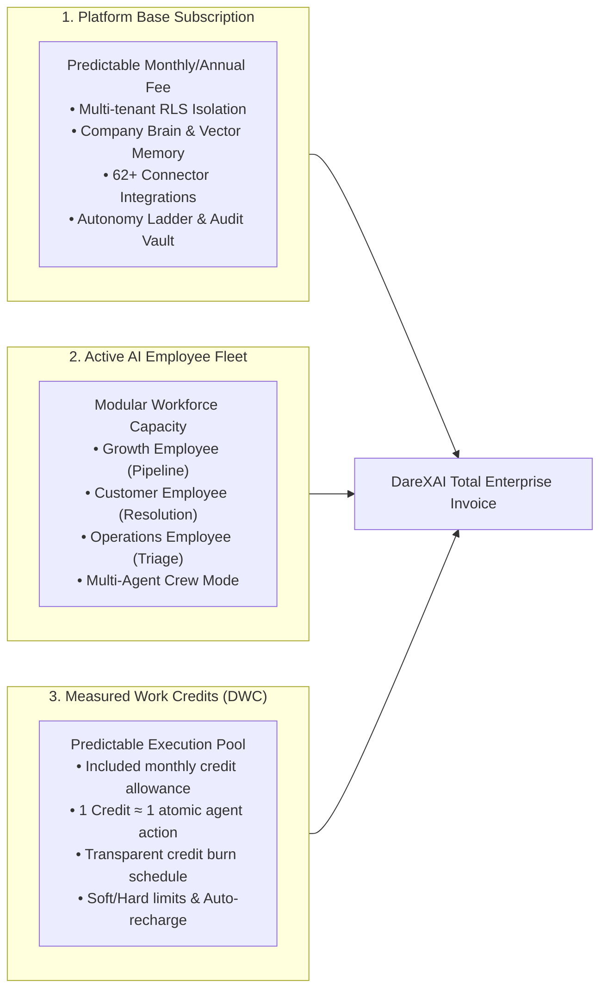
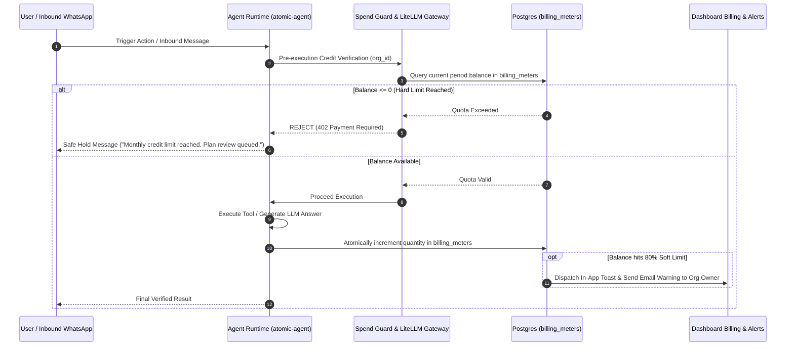
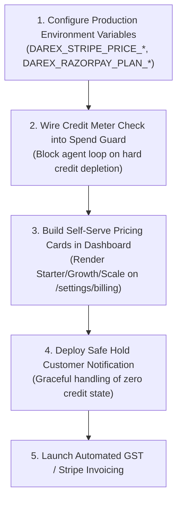

# DareXAI SaaS Payment Plans, Credit Economics & Monetization Master Specification

> **Document Path:** `docs/new-109-pg-plan/payment/payment-plans.md`  
> **Source Synthesis:** DareXAI One Employee Blueprint (106 Pages), Phase 0–5 Runtime Implementation, `017_billing.sql`, `packages/shared-types/src/billing.ts`, and `apps/dashboard/app/api/billing/_lib.ts`.  
> **Audience:** Founders, Executive Leadership, GTM / Sales, Product Managers, and Platform Engineers.

---

## 1. Executive Summary & Strategic Monetization Philosophy

DareXAI is an **Agentic Operating System** powering autonomous AI Employees that observe business state, resolve complex customer requests, generate qualified pipeline, and execute recurring operational duties across 62+ connected enterprise systems.

### 1.1 The Failure of Legacy SaaS Pricing for AI Employees
Traditional software monetization models collapse when applied to autonomous AI workforces:

```
┌────────────────────────────────────────────────────────────────────────────────────────┐
│                          WHY LEGACY PRICING MODELS FAIL                                │
├────────────────────────┬────────────────────────────────┬──────────────────────────────┤
│ Pricing Model          │ Mechanism                      │ Fatal Flaw for AI Employees  │
├────────────────────────┼────────────────────────────────┼──────────────────────────────┤
│ 1. Per-Seat SaaS       │ $30 – $50 / human user / month │ AI Employees REDUCE the need │
│    (Salesforce, Zendesk│                                │ for human seats. Penalizes   │
│     Asana)             │                                │ customers for automating.    │
├────────────────────────┼────────────────────────────────┼──────────────────────────────┤
│ 2. Raw Usage / Tokens  │ Pay per 1M tokens or per API   │ CFOs fear open-ended bills.  │
│    (OpenAI, AWS,       │ call ($0.002 / call)           │ A single agent loop spike    │
│     Twilio)            │                                │ causes billing shock & churn.│
├────────────────────────┼────────────────────────────────┼──────────────────────────────┤
│ 3. Flat Unlimited      │ Flat $199 / month unlimited    │ Severe margin erosion. Power │
│    (Legacy Chatbots)   │ turns                          │ users run deep web scraping  │
│                        │                                │ & multi-agent loops at loss. │
└────────────────────────┴────────────────────────────────┴──────────────────────────────┘
```

### 1.2 The DareXAI Three-Pillar Economic Engine
DareXAI aligns pricing with **delivered business capacity** while safeguarding predictability and SaaS gross margins (>80%). The model combines three synchronized layers:



1. **Platform Base Subscription:** Covers the persistent operating environment, company memory, connector synchronization, security isolation, and dashboard seats.
2. **Active AI Employee Fleet Capacity:** Customers subscribe to active AI Employee slots (Growth, Customer, Operations, or Custom personas). The buyer compares this to hiring human coordinators ($3,500/mo vs $299/mo).
3. **Included Monthly Work Credits (DWC):** Each plan includes a generous monthly credit allowance designed so 90% of customers never pay overage. Heavy power users scale through transparent, pre-purchased credit top-up packs.

---

## 2. Comprehensive Platform Feature Inventory

DareXAI’s pricing packages monetize the complete production architecture built across the platform:

```
┌────────────────────────────────────────────────────────────────────────────────────────┐
│                              DAREXAI PLATFORM CAPABILITIES                             │
├────────────────────────────────┬───────────────────────────────────────────────────────┤
│ Domain                         │ Shipped Production Capabilities                       │
├────────────────────────────────┼───────────────────────────────────────────────────────┤
│ 1. Interactive Ask AI          │ • Natural language query with real-time SSE streaming │
│    (Plan-Confirm-Execute)      │ • Multi-step dependency graph plan generation         │
│                                │ • PlanCard review with human 1-click approval         │
│                                │ • Parallel independent step execution (`stageSteps`)  │
│                                │ • Live step rollback, error logging, and retry        │
├────────────────────────────────┼───────────────────────────────────────────────────────┤
│ 2. Multi-Channel Ingress Hub   │ • Inbound WhatsApp Cloud API webhook (<500ms ingress) │
│                                │ • Chatwoot live chat integration                     │
│                                │ • Unified identity stitching across phone & email     │
│                                │ • Sub-60-second inbound lead qualification response   │
│                                │ • Interim acknowledgement to eliminate silent drops   │
├────────────────────────────────┼───────────────────────────────────────────────────────┤
│ 3. Autonomous AI Employee Fleet│ • Growth Employee: ICP hunter, intent poller, revive  │
│                                │ • Customer Employee: 12-step resolution, open loops   │
│                                │ • Operations Employee: Morning triage, data hygiene   │
│                                │ • Scheduled cron duties (morning brief, Monday digest)│
│                                │ • Expected vs. Actual state discrepancy engine        │
├────────────────────────────────┼───────────────────────────────────────────────────────┤
│ 4. Crew Multi-Agent Engine     │ • Autonomous task decomposition & manager synthesis   │
│                                │ • Up to 3 parallel child agent workers                │
│                                │ • Shared company state and synchronized context       │
├────────────────────────────────┼───────────────────────────────────────────────────────┤
│ 5. Company Brain & Memory      │ • Multi-source ingestion (PDF, DOCX, CSV, Notion, URLs)│
│                                │ • Vector embeddings with pgvector / Qdrant            │
│                                │ • Temporal grounding: platform dates as ground truth   │
│                                │ • Contradiction Detection: flags conflicting records  │
│                                │ • Operator feedback learning loop (no learn on refuse)│
│                                │ • Entity Graph: links Contacts, Deals, Tasks, Policies│
├────────────────────────────────┼───────────────────────────────────────────────────────┤
│ 6. Tool Integrations (62 MCP)  │ • CRM: HubSpot, Salesforce, Pipedrive, Zoho CRM       │
│                                │ • Comms: WhatsApp, Gmail, Outlook, Slack, GCal        │
│                                │ • Payments: Stripe, Razorpay payment links & refunds  │
│                                │ • Research: Live web search & deep multi-page scraper │
│                                │ • Storage: PostgreSQL, Airtable, Notion, Google Drive │
├────────────────────────────────┼───────────────────────────────────────────────────────┤
│ 7. Governance, Trust & Safety  │ • Autonomy Ladder: L1 Read-Only → L2 Plan → L3 Auto   │
│                                │ • Decision Briefs: structured human escalation cards  │
│                                │ • Spend Guard: per-tenant token & dollar rate caps    │
│                                │ • Row Level Security (RLS): absolute tenant isolation │
│                                │ • Outcome Ledger: hours saved, revenue influenced     │
└────────────────────────────────┴───────────────────────────────────────────────────────┘
```

---

## 3. Detailed Subscription Tiers & Pricing Matrix

DareXAI offers native dual-currency pricing: **USD ($)** via Stripe for the Global market, and **INR (₹)** via Razorpay for India.

```
┌────────────────────────────────────────────────────────────────────────────────────────┐
│                              SUBSCRIPTION PLAN MATRIX                                  │
├──────────────────────┬──────────────┬──────────────┬──────────────┬────────────────────┤
│ Feature Dimension    │ Starter      │ Growth (★)   │ Scale        │ Enterprise         │
├──────────────────────┼──────────────┼──────────────┼──────────────┼────────────────────┤
│ Monthly Price (USD)  │ $99 / mo     │ $299 / mo    │ $799 / mo    │ Custom ($2,499+)   │
│ Annual Price (USD)   │ $79 / mo     │ $239 / mo    │ $639 / mo    │ Custom annual      │
│ Monthly Price (INR)  │ ₹7,999 / mo  │ ₹24,999 / mo │ ₹64,999 / mo │ Custom (₹1,99,999+)│
│ Annual Price (INR)   │ ₹6,399 / mo  │ ₹19,999 / mo │ ₹51,999 / mo │ Custom annual      │
│ Target Segment       │ Solo / Micro │ Scaling SMB  │ Multi-dept   │ Enterprise / Corp  │
│ Human Seats Included │ 3 Seats      │ 10 Seats     │ 25 Seats     │ Unlimited          │
│ Active AI Employees  │ 1 Employee   │ 3 Employees  │ 6 Employees  │ Unlimited          │
│ Included Work Credits│ 5,000 / mo   │ 25,000 / mo  │ 80,000 / mo  │ 250,000+ / mo      │
│ Autonomy Ladder Cap  │ Level 2      │ Level 3      │ Level 3      │ Level 4 (Custom)   │
│ Connected Tools      │ 5 Connectors │ All 62 Tools │ All 62 Tools │ Custom MCP Bridges │
│ Crew Parallel Mode   │ ✕ (Solo only)│ ✓ (3 Agents) │ ✓ (Multi-Crew│ ✓ (Dedicated Pool) │
│ Scheduled Cron Duties│ 1 Daily Run  │ Hourly + Cron│ Real-time bus│ Real-time Event Bus│
│ Brain Storage        │ 100 Docs     │ 1,000 Docs   │ 5,000 Docs   │ Dedicated / Unltd  │
│ Contradiction Engine │ Standard     │ Advanced     │ Real-time    │ Enterprise Policy  │
│ Spend Guard Alarms   │ Soft Alert   │ Soft + Hard  │ Dept Quotas  │ Sub-Org Hierarchy  │
│ Support SLA          │ 48h Email    │ 8h Slack/Chat│ 2h Phone/App │ 30m 24/7 Dedicated │
└──────────────────────┴──────────────┴──────────────┴──────────────┴────────────────────┘
```

---

### 3.1 Plan Detailed Profiles

#### 1. Free Pilot / Sandbox ($0 / ₹0 — 14-Day Evaluation)
* **Goal:** Enable rapid time-to-first-cited-answer (<10 minutes) without entering payment details.
* **Workforce:** 1 AI Employee operating strictly in **Level 1 (Read/Draft Only)**.
* **Included Credits:** 500 Credits (one-time).
* **Connectors:** 2 Core Connectors (e.g. Gmail and Google Calendar).
* **Company Brain:** Up to 10 documents (max 5 MB total).
* **Restrictions:** Plan-confirm-execute runs in simulated sandbox mode; no external system mutations.

#### 2. Starter Tier — "The Autonomous Assistant"
* **Pricing:** **$99 / month** ($79/mo billed annually) | **₹7,999 / month** (₹6,399/mo annual).
* **Target Audience:** Solo founders, freelance operators, real estate brokers, boutique consultants (1–5 person teams).
* **Workforce Included:** **1 Active AI Employee** (choose Growth, Customer, or Operations).
* **Included Monthly Credits:** **5,000 Credits** (~$50 credit value).
* **Human Seats:** 3 included ($15/mo or ₹1,200 for each additional seat).
* **Autonomy Level:** **Level 2 (Plan & Confirm)** — the employee formulates plans, suggests tool calls, and waits for one-click human approval.
* **Integrations:** Up to 5 active connectors (e.g. WhatsApp, Gmail, Google Calendar, HubSpot, Slack).
* **Company Brain:** Up to 100 documents / 25 MB vector storage with basic contradiction detection.
* **Proactive Duties:** 1 scheduled morning digest run per day.
* **Support:** Community & Email support with 48-hour response SLA.

#### 3. Growth Tier — "The Autonomous Department" (★ Flagship Tier)
* **Pricing:** **$299 / month** ($239/mo billed annually) | **₹24,999 / month** (₹19,999/mo annual).
* **Target Audience:** Scaling SMBs, e-commerce brands, high-velocity sales agencies (5–30 person teams).
* **Workforce Included:** **All 3 Core AI Employees** (Full Fleet: Growth + Customer + Operations) + **Crew Multi-Agent Mode** (Manager synthesis + 3 parallel workers).
* **Included Monthly Credits:** **25,000 Credits** (~$250 credit value).
* **Human Seats:** 10 included ($15/mo or ₹1,200 for each additional seat).
* **Autonomy Level:** **Level 3 (Autonomous with Guardrails)** — acts autonomously within pre-approved policies and spend budgets; escalates high-risk exceptions via structured Decision Briefs.
* **Integrations:** **All 62 Connector Tools** (HubSpot, Salesforce, Stripe, Razorpay, WhatsApp Cloud, Postgres, Notion, etc.).
* **Company Brain:** 1,000 documents / 250 MB vector storage with Advanced Multi-Document Contradiction Detection and Operator Feedback Learning Loop.
* **Proactive Duties:** Hourly background cron runs, Morning Triage, Stale Lead Reviver sweeps, Friday Pipeline reviews, Monday Executive Briefs.
* **Spend Guards:** Soft limit alerts at 80% quota; automatic Safe Hold hard limit protection.
* **Support:** Priority in-app chat and dedicated Slack Connect channel with 8-hour SLA.

#### 4. Scale / Business Tier — "The Autonomous Organization"
* **Pricing:** **$799 / month** ($639/mo billed annually) | **₹64,999 / month** (₹51,999/mo annual).
* **Target Audience:** Multi-department SMBs, high-ticket B2B service firms, regional logistics providers (25–100 person teams).
* **Workforce Included:** **6 Active AI Employees** with multi-crew parallel orchestration and custom duty schedules.
* **Included Monthly Credits:** **80,000 Credits** (~$800 credit value).
* **Human Seats:** 25 included ($10/mo or ₹800 for each additional seat).
* **Autonomy Level:** **Level 3+** with customizable risk-threshold rules and role-based department approval gates.
* **Integrations:** All 62 Connectors + Custom Webhook triggers + Webhook Ingress endpoints.
* **Company Brain:** 5,000 documents / 1 GB vector storage with continuous real-time contradiction auditing.
* **Proactive Duties:** Continuous event-driven monitoring and real-time open-loop SLA tracking.
* **Support:** Dedicated Customer Success Manager, quarterly business reviews, 2-hour SLA.

#### 5. Enterprise Tier — "Custom Operating Infrastructure"
* **Pricing:** **Custom Contracts starting from $2,499 / month** | **₹1,99,999 / month**.
* **Target Audience:** Regulated enterprises, healthcare networks, financial institutions, global franchises (100+ employees).
* **Workforce Included:** **Unlimited AI Employees** with custom prompt architectures and specialized organizational roles.
* **Included Monthly Credits:** **250,000+ Credits** (custom pooled allocation).
* **Human Seats:** Unlimited.
* **Autonomy Level:** **Level 4 (Custom Enterprise Policy)** with multi-level executive authorization workflows.
* **Integrations:** Custom internal MCP Server Bridges, on-premise PostgreSQL/Oracle database connectors, private VPN tunnels.
* **Compliance & Security:** SSO / SAML 2.0 (Okta, Azure AD), SOC2 Type II audit logs, ISO27001 readiness, Data Residency guarantees (EU, US, India), Zero Data Training legal rider.
* **Infrastructure:** Dedicated Temporal task queues, dedicated LiteLLM instance with Bring-Your-Own-Key (BYOK) option, 99.95% uptime SLA, 30-minute critical response SLA.

---

## 4. The DareXAI Work Credit (DWC) Engine

The Work Credit system provides a frictionless bridge between complex multi-model LLM inference, API mutations, and clean, predictable customer billing.

### 4.1 Credit Equivalence Formula
$$1 \text{ DareXAI Work Credit (DWC)} \equiv 1 \text{ standard atomic action or } 1,000 \text{ fast LLM tokens}$$

Credits are deducted in real-time as agents perform work. If a tool call fails or encounters a disconnected integration, **DareXAI never charges credits for the failure** (recorded as `disconnected_actions` in `billing_meters` at zero credit burn).

```
┌────────────────────────────────────────────────────────────────────────────────────────┐
│                        DAREXAI WORK CREDIT CONSUMPTION SCHEDULE                        │
├────────────────────────────────┬─────────┬──────────────┬──────────────────────────────┤
│ Operation Category             │ Credits │ Vendor COGS  │ Technical Actions Involved   │
├────────────────────────────────┼─────────┼──────────────┼──────────────────────────────┤
│ 1. Ask AI Simple Lookup        │ 2 DWC   │ ~$0.003      │ RAG embedding + Haiku/4o-mini│
│ 2. Ask AI Plan Generation      │ 5 DWC   │ ~$0.008      │ Deep reasoning turn + graph  │
│ 3. Plan Step Mutation (each)   │ 3 DWC   │ ~$0.004      │ Tool executor call + verify  │
│ 4. Inbound WhatsApp Turn       │ 3 DWC   │ ~$0.005      │ Meta fee + RAG + answer turn │
│ 5. Web Search Action           │ 5 DWC   │ ~$0.007      │ Serper API + snippet scrape  │
│ 6. Deep Web Research Task      │ 20 DWC  │ ~$0.035      │ Multi-page scrape + synthesis│
│ 7. Stale Lead Reviver Action   │ 8 DWC   │ ~$0.012      │ CRM read + personalized draft│
│ 8. Morning Operational Triage  │ 15 DWC  │ ~$0.025      │ Inbox + Calendar + CRM scan  │
│ 9. Crew Multi-Agent Run        │ 35 DWC  │ ~$0.055      │ Manager + 3 child trajectories│
│ 10. Document Ingestion (5 pgs) │ 1 DWC   │ ~$0.001      │ Parser + pgvector embeddings │
│ 11. Idle Background Healthcheck│ 0 DWC   │ $0.000       │ Polling with no Δ changes    │
└────────────────────────────────┴─────────┴──────────────┴──────────────────────────────┘
```

### 4.2 Credit Top-Up Packages
Subscribers can purchase top-ups at any time. Credits never expire during an active subscription and carry a **60-day rollover**:

```
┌────────────────────────────────────────────────────────────────────────────────────────┐
│                                CREDIT TOP-UP BUNDLES                                   │
├───────────────────┬──────────────┬────────────┬─────────────┬──────────────────────────┤
│ Pack Name         │ Credits      │ USD Price  │ INR Price   │ Cost / 1,000 Credits     │
├───────────────────┼──────────────┼────────────┼─────────────┼──────────────────────────┤
│ Micro Pack        │ 2,500 DWC    │ $29        │ ₹2,399      │ $11.60                   │
│ Standard Pack     │ 10,000 DWC   │ $99        │ ₹7,999      │ $9.90                    │
│ Pro Pack          │ 30,000 DWC   │ $249       │ ₹19,999     │ $8.30                    │
│ High-Volume Pack  │ 100,000 DWC  │ $699       │ ₹56,999     │ $6.99                    │
└───────────────────┴──────────────┴────────────┴─────────────┴──────────────────────────┘
```

* **Auto-Recharge Rule:** Customers can enable automatic recharges (e.g., *"Automatically add the Standard Pack whenever balance drops below 1,000 credits"*), preventing workflow interruption.

---

## 5. Unit Economics & Gross Margin Safeguards

To ensure DareXAI remains a high-margin venture-scale SaaS business, pricing guarantees **>80% gross margins** across all tiers under realistic operational loads.

### 5.1 Granular Vendor Cost Matrix (COGS)
* **LiteLLM Model Routing:**
  * Fast Tier (Claude 3.5 Haiku / GPT-4o-mini / DeepSeek V3): ~$0.15–$0.25 / 1M input tokens, ~$0.60–$1.00 / 1M output tokens.
  * Heavy Reasoning Tier (Claude 3.5 Sonnet / GPT-4o): ~$3.00 / 1M input tokens, ~$15.00 / 1M output tokens.
  * Blended routing ratio in DareXAI: **75% Fast Tier, 25% Heavy Tier**.
* **Vector Embeddings & Search:** `text-embedding-3-small` at $0.02 / 1M tokens.
* **Meta WhatsApp Cloud API:** ~$0.005–$0.012 per customer-initiated 24-hour conversation window.
* **Web Search (Serper / DuckDuckGo):** ~$0.001 per search query.
* **Compute Allocation (Temporal + PostgreSQL + Next.js):** ~$6.50 per org per month at scale.

### 5.2 Unit Economics: Growth Plan Case Study ($299/mo)
A typical mid-sized B2B company running 3 AI Employees consumes roughly **16,500 Credits/mo** out of their 25,000 allowance:

```
┌────────────────────────────────────────────────────────────────────────────────────────┐
│                GROWTH PLAN MONTHLY FINANCIAL BREAKDOWN ($299/MONTH)                    │
├──────────────────────────────────────────────────────┬──────────────────┬──────────────┤
│ Line Item                                            │ Monthly Volume   │ Net Cost     │
├──────────────────────────────────────────────────────┼──────────────────┼──────────────┤
│ Gross Subscription Revenue                           │ 1 Organization   │ $299.00      │
│ LLM Model Invocations (Fast + Heavy Blended)         │ ~24M tokens      │ -$27.80      │
│ Vector Search & Document Embeddings                  │ ~150 MB indexed  │ -$1.90       │
│ WhatsApp Inbound Conversations (Meta Fees)           │ ~1,100 windows   │ -$9.20       │
│ Web Search & Company Scraping Queries                │ ~350 queries     │ -$3.50       │
│ Cloud Compute & Managed Database Allocation          │ Dedicated share  │ -$6.50       │
│ Payment Processing Fees (Stripe 2.9% + $0.30)        │ Credit card fee  │ -$8.97       │
├──────────────────────────────────────────────────────┼──────────────────┼──────────────┤
│ Total Cost of Goods Sold (COGS)                      │                  │ -$57.87      │
│ Net Monthly Gross Profit                             │                  │ $241.13      │
│ BLENDED GROSS MARGIN                                 │                  │ 80.65%       │
└──────────────────────────────────────────────────────┴──────────────────┴──────────────┘
```

Even if a client completely exhausts all 25,000 included credits with maximum reasoning models, the maximum delivery cost caps out at **$74.20**, maintaining a minimum floor margin of **75.18%**.

---

## 6. Technical Architecture: Billing, Metering & Payment Rails

The billing engine directly implements the schema in `infra/db/migrations/017_billing.sql`, TypeScript interfaces in `packages/shared-types/src/billing.ts`, and helper logic in `apps/dashboard/app/api/billing/_lib.ts`.

### 6.1 Database Tenancy & Metering Flow
Every tenant action passes through the **Spend Guard Gateway** before reaching atomic-agent or third-party APIs:



### 6.2 Dual Payment Rail Architecture

```
┌────────────────────────────────────────────────────────────────────────────────────────┐
│                             DUAL-RAIL PAYMENT GATEWAYS                                 │
├────────────────────────────────┬───────────────────────────────────────────────────────┤
│ Stripe (Global / USD)          │ Razorpay (India / INR)                                │
├────────────────────────────────┼───────────────────────────────────────────────────────┤
│ • Currency: USD, EUR, GBP      │ • Currency: INR (₹)                                   │
│ • Rails: International Cards,  │ • Rails: UPI AutoPay, NetBanking, Indian Debit/Credit │
│   Apple Pay, Google Pay        │ • Invoicing: Automated GST-compliant tax invoices     │
│ • Subscription: Stripe Billing │ • Mandates: RBI-compliant recurring e-mandates        │
│ • Portal: Stripe Hosted Portal │ • Webhook: Razorpay Webhook Signature verification    │
│   for card changes & receipts  │   with crypto timing-safe comparison                  │
└────────────────────────────────┴───────────────────────────────────────────────────────┘
```

* **Webhook Idempotency:** Managed via table `billing_webhook_events`. Events (`invoice.payment_succeeded`, `customer.subscription.deleted`, etc.) are claimed via PostgreSQL function `billing_claim_webhook_event()` and resolved via `billing_finish_webhook_event()`, ensuring zero duplicate billing states.

---

## 7. Modular Add-Ons & Enterprise Customizations

Customers on any paid plan can tailor their setup with modular add-ons:

```
┌────────────────────────────────────────────────────────────────────────────────────────┐
│                              MODULAR PLATFORM ADD-ONS                                  │
├────────────────────────────────┬──────────────┬──────────────┬─────────────────────────┤
│ Add-On Description             │ Monthly USD  │ Monthly INR  │ Capabilities Conferred  │
├────────────────────────────────┼──────────────┼──────────────┼─────────────────────────┤
│ Extra Active AI Employee Slot  │ $79 / mo     │ ₹6,499 / mo  │ Deploy additional role  │
│ Additional Human Seat          │ $15 / mo     │ ₹1,200 / mo  │ Full RBAC seat access   │
│ Dedicated WhatsApp Line        │ $49 / mo     │ ₹3,999 / mo  │ Separate inbound number │
│ Private Custom MCP Bridge      │ $149 / mo    │ ₹11,999 / mo │ Connect custom internal │
│                                │              │              │ databases or REST APIs  │
│ Bring-Your-Own-Key (BYOK)      │ $99 / mo     │ ₹7,999 / mo  │ Zero LLM credit markup; │
│                                │              │              │ direct customer API key │
│ Immutable Audit Compliance Box │ $199 / mo    │ ₹15,999 / mo │ 7-year tamper-proof log │
│                                │              │              │ retention (SOC2 / HIPAA)│
└────────────────────────────────┴──────────────┴──────────────┴─────────────────────────┘
```

---

## 8. Buyer ROI Models & Sales Justification Playbook

When presenting DareXAI to a founder, CFO, or Head of Operations, the sales narrative is anchored in **hard financial ROI and headcount efficiency**:

### 8.1 The Financial Comparison: Human Coordinator vs. DareXAI Growth Plan
```
┌────────────────────────────────────────────────────────────────────────────────────────┐
│                            THE 10X VALUE COMPARISON TABLE                              │
├───────────────────────────────┬────────────────────────────┬───────────────────────────┤
│ Metric                        │ 1 Human Coordinator        │ DareXAI Growth Plan       │
├───────────────────────────────┼────────────────────────────┼───────────────────────────┤
│ Monthly Compensation / Fee    │ $3,500 – $5,000 / month    │ $299 / month              │
│ Available Hours per Week      │ 40 hours (9 AM – 5 PM)     │ 168 hours (24/7/365)      │
│ Inbound Response Latency      │ 15 – 120 minutes           │ < 60 seconds (WhatsApp)   │
│ Cross-System Capacity         │ Switches between 1–2 tools │ Synchronizes all 62 tools │
│ Context Retention on Turnover │ Zero (Knowledge lost)      │ 100% (Stored in Brain)    │
│ Annual Cost                   │ $42,000 – $60,000 / year   │ $2,868 / year (Annual)    │
│ ANNUAL CASH SAVED             │ —                          │ $39,132 – $57,132 (93%+)  │
└───────────────────────────────┴────────────────────────────┴───────────────────────────┘
```

### 8.2 The Three Irrefutable Sales Arguments

1. **The "Speed-to-Lead" Mathematical Multiplier:**
   * *Industry Data:* Inbound leads contacted within 60 seconds convert at a **391% higher rate** than those contacted after 30 minutes.
   * *The Pitch:* *"If your average customer deal value is $1,000, DareXAI pays for its entire annual subscription if it captures just ONE lead that your team would have missed overnight or over the weekend."*

2. **The "Permanent Institutional Brain" Defense:**
   * *The Problem:* Staff turnover creates operational chaos. When an operations manager leaves, your CRM tags, unwritten client rules, and follow-up habits leave with them.
   * *The Pitch:* *"DareXAI’s Company Brain captures every operator edit, customer preference, and company procedure into permanent vector memory. Your AI Employees never forget, never burn out, and never take your operational secrets to a competitor."*

3. **The "Zero-Risk Autonomy Ladder":**
   * *The Objection:* *"Can I trust an AI to touch my HubSpot or message my clients on WhatsApp?"*
   * *The Pitch:* *"You don’t have to trust it on day one. We start at Level 2: every action, email draft, and calendar booking is generated as a visual Plan Card. Your human team approves it with a single tap. You only promote the AI to Level 3 autonomous execution after it has executed 50 plans with 100% accuracy."*

---

## 9. Immediate Implementation Roadmap & Verification Checklist

To bring this payment and credit architecture live in production, execute the following implementation tasks:



- [x] **Database Schema Ready:** `infra/db/migrations/017_billing.sql` deployed with `billing_subscriptions`, `billing_invoices`, `billing_meters`.
- [x] **TypeScript Types Ready:** `packages/shared-types/src/billing.ts` exports `BillingPlanType`, `BillingProvider`, `UsageMeter`.
- [x] **Dual Gateway API Library:** `apps/dashboard/app/api/billing/_lib.ts` validates Stripe and Razorpay signatures and webhook claims.
- [ ] **Frontend Subscription Cards:** Expose one-click checkout buttons in `apps/dashboard/app/(dashboard)/settings/billing/page.tsx`.
- [ ] **Pre-Flight Spend Guard Hook:** Connect `billing_meters.quantity` to LiteLLM router proxy to enforce hard limits in real time.
