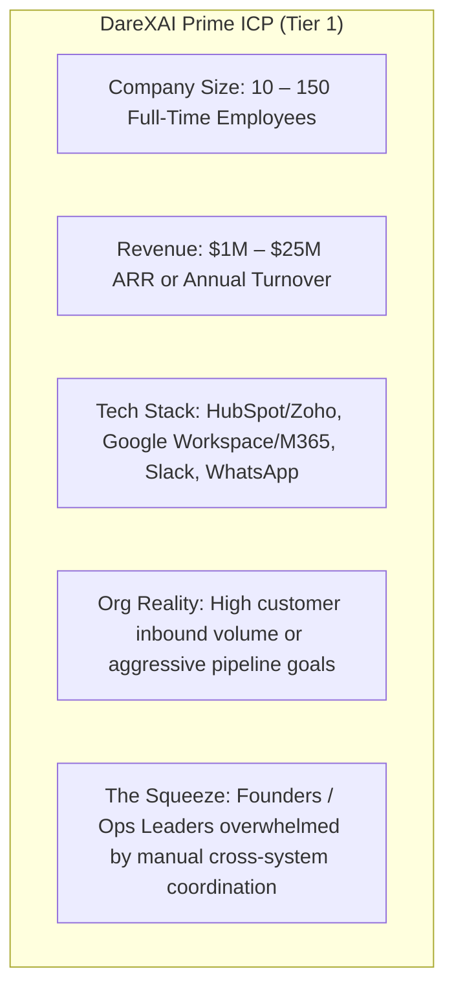
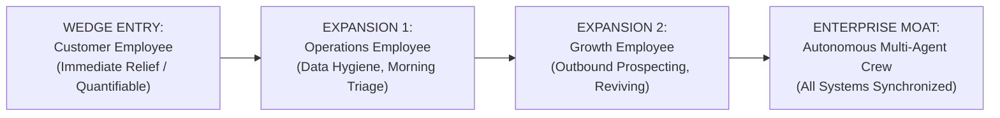
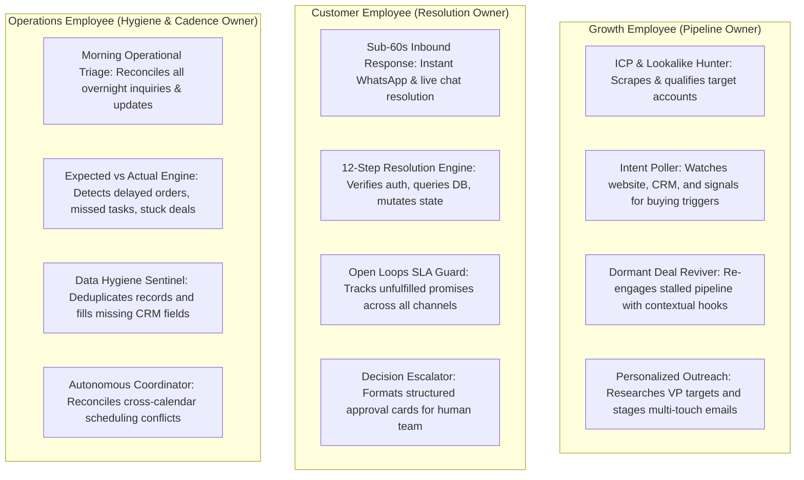
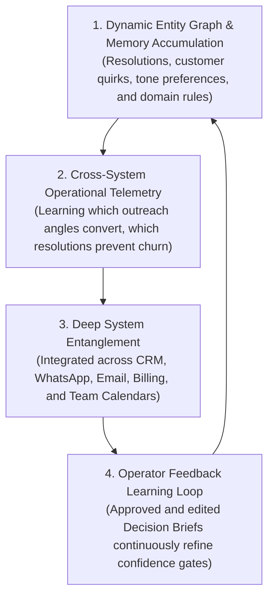
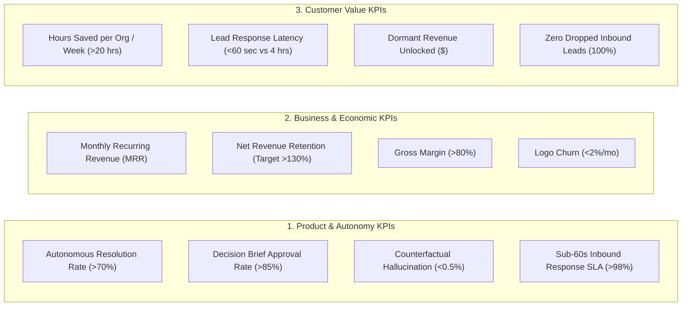

# DareXAI One — What We Are: The Strategic, Economic & Architectural Master Blueprint

> **Document Location:** `docs/new-109-pg-plan/payment/what we are.md`  
> **Source Synthesis:** DareXAI 106-Page Employee Blueprint, Shipped Production Runtime (Phases 0–5.2: Temporal, Atomic-Agent v0.1.72, 62 MCP Tool Bridge, RLS pgvector Brain), and `017_billing.sql` Master Credit Economics.  
> **Audience:** Executive Leadership, Founders, Board of Directors, Product Architects, GTM Leads, and Key Enterprise Buyers.  
> **Core Premise:** DareXAI One is not a chatbot, not an automation workflow canvas, and not an open-ended playground of fragmented micro-agents. DareXAI One is an **Agentic Operating System** powering a production **Autonomous AI Workforce**—digital employees that take full ownership of business responsibilities, reason across multi-system state, request human approval only at defined risk boundaries, and deliver verifiable business outcomes.

---

## Table of Contents

1. [Market — What Market Is DareXAI One Actually Entering?](#1-market--what-market-is-darexai-one-actually-entering)
2. [Category — Where Does "AI Workforce" Sit?](#2-category--where-does-ai-workforce-sit)
3. [ICP — Exactly Which Companies Should We Target?](#3-icp--exactly-which-companies-should-we-target)
4. [Buyer — Who Actually Buys?](#4-buyer--who-actually-buys)
5. [Pain — What Expensive Problem Are We Solving?](#5-pain--what-expensive-problem-are-we-solving)
6. [Employee Wedge — Growth vs. Customer vs. Operations: Where Do We Enter?](#6-employee-wedge--growth-vs-customer-vs-operations-where-do-we-enter)
7. [Use Cases — What Responsibilities Can Each Employee Own?](#7-use-cases--what-responsibilities-can-each-employee-own)
8. [Competition — Who Are We Really Competing Against?](#8-competition--who-are-we-really-competing-against)
9. [Differentiation — Why DareXAI Instead?](#9-differentiation--why-darexai-instead)
10. [USP — What Is the Sharpest Positioning?](#10-usp--what-is-the-sharpest-positioning)
11. [Moat — What Compounds Over Time?](#11-moat--what-compounds-over-time)
12. [GTM — How Do We Acquire the First Customers?](#12-gtm--how-do-we-acquire-the-first-customers)
13. [Sales Motion — Founder-Led, Pilots, Outbound, Partners, and Product-Led Expansion](#13-sales-motion--founder-led-pilots-outbound-partners-and-product-led-expansion)
14. [Pricing — How Do We Charge?](#14-pricing--how-do-we-charge)
15. [Unit Economics — CAC, ACV, Gross Margin, Payback, and Net Revenue Retention (NRR)](#15-unit-economics--cac-acv-gross-margin-payback-and-net-revenue-retention-nrr)
16. [KPIs — What Do We Measure From Pilot to Scale?](#16-kpis--what-do-we-measure-from-pilot-to-scale)
17. [Expansion — How Do We Go From One Employee to Multiple Employees?](#17-expansion--how-do-we-go-from-one-employee-to-multiple-employees)
18. [Market Expansion — How Do We Move Across Functions and Industries?](#18-market-expansion--how-do-we-move-across-functions-and-industries)
19. [12-Month Plan — What Exactly Happens Quarter by Quarter?](#19-12-month-plan--what-exactly-happens-quarter-by-quarter)
20. [Risks — What Could Kill This Strategy and How Do We Neutralize Them?](#20-risks--what-could-kill-this-strategy-and-how-do-we-neutralize-them)
21. [Strategic Conclusion — Where We Play and How We Win](#21-strategic-conclusion--where-we-play-and-how-win)

---

## 1. Market — What Market Is DareXAI One Actually Entering?

DareXAI One is not entering the $12B "Customer Service Chatbot" market, nor is it entering the $18B "iPaaS / Workflow Automation" market. DareXAI One is entering the **Global Knowledge Work & Business Process Labor Market**, transitioning knowledge work from **Human Labor Budgets (Payroll)** into **Compute Budgets (AI Workforce SaaS)**.

```
┌─────────────────────────────────────────────────────────────────────────────────────────┐
│                                 THE MARKET RE-ALLOCATION                                │
│                                                                                         │
│   Traditional Budget: Payroll (OpEx)          DareXAI One Budget: Software (SaaS / Cap) │
│   ──────────────────────────────────          ───────────────────────────────────────── │
│   • Junior SDR: $65,000 / year                • Growth AI Employee: $3,588 / year       │
│   • Tier-1 Support Rep: $52,000 / year   ===> • Customer AI Employee: $3,588 / year     │
│   • Operations Coordinator: $58,000 / year    • Operations AI Employee: $3,588 / year   │
│   Total: $175,000 / year + churn/training     Total: $10,764 / year (Zero Churn / 24x7) │
└─────────────────────────────────────────────────────────────────────────────────────────┘
```

### Total Addressable Market (TAM), Serviceable Addressable Market (SAM), Serviceable Obtainable Market (SOM)

- **Total Addressable Market (TAM) — $4.7 Trillion Global Knowledge Work Capacity:**  
  The total compensation paid to administrative, operations, tier-1 customer resolution, and sales development staff across global mid-market and SMB enterprises ($1.8T in North America, $1.2T in Europe, $1.7T across APAC and Latin America).
- **Serviceable Addressable Market (SAM) — $68 Billion Agentic Business Software:**  
  Cloud-connected businesses (utilizing modern CRMs like HubSpot/Salesforce, Google Workspace/Microsoft 365, Slack, and cloud messaging like WhatsApp Cloud API) spending money on fragmented SaaS tools + BPO/outsourced agencies to perform routine data synchronization, pipeline qualification, and multi-channel inbound customer resolution.
- **Serviceable Obtainable Market (SOM) — $840 Million (Years 1–3):**  
  Tech-forward B2B SaaS companies, digital agencies, professional service firms, and high-velocity multi-channel commerce businesses (5 to 250 employees) operating in North America, the UK, Western Europe, and India requiring unified cross-system execution without expanding headcount.

---

## 2. Category — Where Does “AI Workforce” Sit?

To understand where DareXAI sits, we must map the evolution of enterprise automation. The industry has suffered from a fundamental abstraction mismatch:

```
┌─────────────────────────────────────────────────────────────────────────────────────────┐
│                                THE CATEGORY SPECTRUM                                    │
├───────────────────┬───────────────────┬─────────────────────┬───────────────────────────┤
│ 1. Conversational │ 2. Workflow       │ 3. Agent Sandboxes  │ 4. DareXAI One            │
│    Wrappers       │    Automation     │    & Toolkits       │    Agentic OS / Workforce │
├───────────────────┼───────────────────┼─────────────────────┼───────────────────────────┤
│ ChatGPT, Claude,  │ Zapier, Make,     │ CrewAI, AutoGen,    │ Autonomous AI Employees   │
│ Custom GPTs       │ Workato           │ LangChain, Swan     │ with Shared Org Brain     │
├───────────────────┼───────────────────┼─────────────────────┼───────────────────────────┤
│ Abstraction:      │ Abstraction:      │ Abstraction:        │ Abstraction:              │
│ Prompt & Reply    │ Trigger & Action  │ Code & Prompt Chain │ Role & Responsibility     │
├───────────────────┼───────────────────┼─────────────────────┼───────────────────────────┤
│ Execution:        │ Execution:        │ Execution:          │ Execution:                │
│ Zero action. User │ Rigid determinism.│ Fragile prototype.  │ Stateful, reliable loops  │
│ does all the work.│ Breaks on any     │ Customer must build │ via Temporal, 62 MCP tools│
│                   │ unstructured step.│ agent graph himself.│ and RLS Company Brain.    │
└───────────────────┴───────────────────┴─────────────────────┴───────────────────────────┘
```

### The Category Definition
DareXAI One creates and leads the **Agentic Operating System (Agentic OS)** category.  
An **Agentic OS** is an integrated runtime that provides:
1. **The Substrate:** Persistent memory (pgvector + PostgreSQL temporal grounding), continuous state management, event ingress (WhatsApp Cloud API, webhooks, crons), and security boundaries (Row-Level Security + Spend Guard).
2. **The Workforce:** Purpose-built, pre-trained AI Employees (Growth, Customer, Operations) that execute end-to-end responsibilities autonomously rather than waiting for micro-prompts.
3. **The Governance Fabric:** A 4-level Autonomy Ladder where agents operate autonomously on low-risk actions and surface **Structured Decision Briefs** (with one-click approvals) for high-stakes actions.

---

## 3. ICP — Exactly Which Companies Should We Target?

DareXAI One does not target Fortune 500 enterprises on Day 1 (where procurement takes 14 months and internal IT resists autonomous mutations), nor does it target micro-freelancers (who lack established tool stacks and have zero willingness to pay).

We target the **Operational Squeeze Segment**:



### ICP Tiering Matrix

| Parameter | Tier 1: Prime ICP (Bullseye) | Tier 2: Expansion ICP | Tier 3: Anti-ICP (Do Not Pursue) |
| :--- | :--- | :--- | :--- |
| **Industry** | B2B SaaS, Digital / Marketing Agencies, Logistics / Supply Brokerages, Professional Services | High-Ticket E-commerce, EdTech, Real Estate Franchises, Clinic Networks | Regulated Tier-1 Banking, Defense, Pre-revenue Solo Hackers, Offline Brick-and-Mortar |
| **Headcount** | 15 – 75 employees | 75 – 250 employees | 1 – 3 employees or 5,000+ employees |
| **Lead Volume** | 50 – 500 qualified leads/month; 200 – 2,000 inbound inquiries/month | 1,000 – 10,000 inquiries/month | < 10 inquiries/month |
| **Current Pain** | Founder or CXOs spending 3+ hours/day copying data, checking SLAs, triaging leads | High BPO agency spend ($5k–$20k/mo) with high error rates and turnover | No established process or tools to connect to |
| **Integrations** | HubSpot or Zoho + Gmail + Google Calendar + WhatsApp + Slack | Salesforce + Zendesk + PostgreSQL + Jira + Notion | Custom legacy on-prem DB with no accessible APIs |

---

## 4. Buyer — Who Actually Buys?

In our ICP, the purchasing dynamic is distinct from traditional IT procurement.

```
┌────────────────────────────────────────────────────────────────────────────────────────┐
│                                 THE BUYING TRIAD                                       │
├────────────────────────┬───────────────────────────────┬───────────────────────────────┤
│ Economic Buyer         │ Champions / Primary Users     │ Technical Influencer          │
│ (Signs the Contract)   │ (Live with the AI Employee)   │ (Validates Security & Safety) │
├────────────────────────┼───────────────────────────────┼───────────────────────────────┤
│ • Founder / CEO        │ • Head of Growth / Sales Lead │ • Head of Engineering / CTO   │
│ • Chief Operating      │ • Head of Customer Experience │ • Operations Architect        │
│   Officer (COO)        │ • Operations Manager          │                               │
│                        │                               │                               │
│ Motivated by:          │ Motivated by:                 │ Motivated by:                 │
│ • Non-linear scale     │ • Elimination of manual slog  │ • Zero data leaks (Tenant RLS)│
│ • Fixed, predictable   │ • Never dropping a lead       │ • Guardrails & Spend Caps     │
│   cost vs hiring       │ • Sub-60s resolution speed    │ • High auditability (Temporal)│
└────────────────────────┴───────────────────────────────┴───────────────────────────────┘
```

### The Buyer Persona Profiles
1. **The Scaling Founder / CEO ($1M–$10M ARR):**
   - *Quote:* "I don't have the budget or management bandwidth to hire 3 new coordinators, but my existing team is burning out. I need operational leverage immediately."
   - *Buying Trigger:* Experiencing lead leakage, customer churn due to slow weekend response times, or failed CRM data hygiene.
2. **The VP of Operations / COO ($5M–$25M ARR):**
   - *Quote:* "Our CRM is a graveyard, our calendars are misaligned, and routine status checks consume 40% of my team's week. I want an autonomous layer that enforces business rules 24/7."
   - *Buying Trigger:* Missed client SLAs, manual data migration backlog, escalating outsourcing bills.

---

## 5. Pain — What Expensive Problem Are We Solving?

Businesses do not fail because they lack tools. They fail because of **Operational Friction between Disconnected Systems** and the **Human Latency Tax**.

```
┌─────────────────────────────────────────────────────────────────────────────────────────┐
│                              THE THREE EXPENSIVE CRIMES                                 │
├──────────────────────────────┬──────────────────────────────┬───────────────────────────┤
│ 1. The Human Latency Tax     │ 2. The Context Fragmentation │ 3. The Management &       │
│                              │    Disaster                  │    Churn Tax              │
├──────────────────────────────┼──────────────────────────────┼───────────────────────────┤
│ • Leads contacting a company │ • WhatsApp chats live in one │ • Human turnover in SDR   │
│   wait an avg of 4.2 hours   │   phone; email lives in an   │   and support roles is    │
│   for a response. After 5    │   inbox; deals live in CRM;  │   40% – 60% annually.     │
│   minutes, lead qualification│   SOPs live in Notion.       │ • Onboarding a junior SDR │
│   drops by 80%.              │ • Nobody has the whole picture│   takes 60 days and costs │
│ • Customer issues sitting    │   resulting in incorrect     │   $12,000 before they     │
│   idle overnight create      │   quotes and angry clients.  │   book their first call.  │
│   instant churn.             │                              │                           │
│ Cost: $50k – $250k in lost   │ Cost: 15% revenue leakage    │ Cost: $35k – $75k annual  │
│ pipeline per quarter.        │ through execution errors.    │ recruiting/training loss. │
└──────────────────────────────┴──────────────────────────────┴───────────────────────────┘
```

DareXAI One turns this from a continuous bleeding wound into a reliable, deterministic background engine that runs around the clock for less than the monthly cost of an office coffee subscription.

---

## 6. Employee Wedge — Growth vs. Customer vs. Operations: Where Do We Enter?

When selling a multi-employee autonomous workforce, **the entry wedge determines sales velocity and churn risk**.



### The Strategic Analysis of the Three Wedges

```
┌────────────────────────────────────────────────────────────────────────────────────────┐
│                              WEDGE COMPARISON MATRIX                                   │
├──────────────────────┬────────────────────────┬───────────────────────┬────────────────┤
│ Evaluation Vector    │ Growth Employee        │ Customer Employee (★) │ Operations     │
├──────────────────────┼────────────────────────┼───────────────────────┼────────────────┤
│ Time to First Value  │ 3 – 7 Days             │ < 60 Minutes          │ 1 – 2 Days     │
│ Buyer Skepticism     │ HIGH (Fear of spam /   │ LOW (Inbound volume is│ MEDIUM (Data   │
│                      │ damaged brand)         │ an active fire)       │ mutation fear) │
│ Provable ROI         │ Delayed (30-60 day deal│ Instant (<60s reply,  │ High (10+ hours│
│                      │ cycle closure)         │ resolved tickets)     │ saved/week)    │
│ Hallucination Risk   │ Moderate (Hallucinated │ Contained via Brain   │ High (Faulty DB│
│                      │ claim hurts outbound)  │ Grounding + L2 ladder │ write)         │
│ Sales Velocity       │ Medium                 │ FASTEST (Inbound pain)│ Fast           │
└──────────────────────┴────────────────────────┴───────────────────────┴────────────────┘
```

### The Winning Wedge Sequence:
1. **Primary Entry Door: Customer Employee (The "Never Sleep" Inbound Wedge):**  
   We connect WhatsApp Cloud API, Email, and CRM. Within 60 minutes, the customer sees the AI Employee answer complex queries, look up order statuses in real time, and format clean Decision Briefs for any exceptions. ROI is visible on Day 1.
2. **Secondary Fast Follow: Operations Employee (The Morning Brief Wedge):**  
   Once the buyer sees that DareXAI is grounded and safe, the Operations Employee is activated to scan all CRM records, detect discrepancies, and deliver the 8:00 AM CEO Operational Brief.
3. **Tertiary Value Expander: Growth Employee (The Revenue Multiplier):**  
   Now that the company trust is solidified and the Company Brain is rich with past customer interactions, the Growth Employee is deployed to mine dormant CRM contacts, score inbound intent, and execute personalized research-backed outreach.

---

## 7. Use Cases — What Responsibilities Can Each Employee Own?

In DareXAI One, an employee does not own a "prompt"; it owns an **end-to-end operational mandate**.



### Deep Operational Responsibilities Breakdown

#### 1. Growth Employee
- **Dormant Deal Revival:** Scans HubSpot/Zoho every Monday for deals stuck in "Closed-Lost" or "Stalled" for >60 days. Analyzes the loss reason, checks external company news via live web scraper, crafts a personalized re-engagement angle, and drafts outreach for sales rep approval.
- **De-anonymized Visitor Pipeline:** Captures incoming website leads or form fills, performs automatic company enrichment (headcount, tech stack, funding, revenue), scores them against the company ICP vector, and either triggers instant booking or routes to high-touch reps.
- **Lookalike Account Hunting:** Ingests top 10 highest LTV clients, extracts common industry and structural attributes, searches external databases and web sources, builds an enriched list of 100 verified lookalikes, and stages tailored campaigns.

#### 2. Customer Employee
- **Sub-60s Omnichannel Resolution:** Ingests WhatsApp, Chatwoot, and Gmail inquiries. Validates user identity against CRM/DB, consults the Company Brain for policy truth, checks real-time inventory/status via MCP connectors, executes state changes (e.g., rescheduling delivery or updating ticket status), and notifies the customer.
- **The 12-Step Resolution Cycle:** Ingests $\rightarrow$ Understands $\rightarrow$ Identifies Customer State $\rightarrow$ Gathers Context $\rightarrow$ Checks Confidence Threshold $\rightarrow$ Formulates Plan $\rightarrow$ Executes Read Tools $\rightarrow$ Checks Autonomy Gate $\rightarrow$ Executes Mutating Action $\rightarrow$ Verifies External State $\rightarrow$ Closes Open Loop $\rightarrow$ Updates Company Memory.
- **Escalation via Structured Decision Brief:** If confidence falls below threshold or the request violates policy (e.g., refund > $500), the employee never dumps a chat transcript. It sends a Slack/Dashboard card containing: Customer identity, Lifetime Value, the exact dilemma, policy violated, recommended option, and `[Approve Refund]` / `[Decline]` buttons.

#### 3. Operations Employee
- **Morning CEO / Executive Briefing (8:00 AM Cron):** Sweeps email, calendar, CRM, and project boards. Summarizes overnight customer volume, highlights 3 deals requiring executive intervention, lists team members with overlapping calendar conflicts, and flags unfulfilled delivery milestones.
- **Expected vs. Actual Discrepancy Engine:** Monitors business state continuously. If an invoice was marked "Sent" 14 days ago and payment is "Pending", or a support ticket was left in "Escalated" for 6 hours without human comment, it flags the discrepancy, calculates SLA breach risk, and initiates automated follow-ups.
- **CRM & Data Hygiene Sentinel:** Merges duplicate customer records across email and phone aliases, fills missing LinkedIn and domain fields from recent email threads, and ensures deal stages accurately match calendar meetings.

---

## 8. Competition — Who Are We Really Competing Against?

The competitive landscape is crowded with point solutions, but barren of holistic operating systems.

```
┌──────────────────────────────────────────────────────────────────────────────────────────────────┐
│                                  COMPETITIVE LANDSCAPE MATRIX                                    │
├───────────────────┬───────────────────┬─────────────────────┬───────────────────┬────────────────┤
│ Competitor Class  │ Representative    │ Core Weakness       │ Why DareXAI Wins  │ Killer Angle   │
│                   │ Players           │                     │                   │                │
├───────────────────┼───────────────────┼─────────────────────┼───────────────────┼────────────────┤
│ 1. Point Solution │ Intercom Fin,     │ Siloed only to chat │ DareXAI connects  │ "Fin can only  │
│    Chatbots       │ Zendesk AI,       │ tickets. Cannot fix │ WhatsApp, CRM, DB,│ chat. DareXAI  │
│                   │ Ada               │ CRM, calendars, or  │ and Ops. Resolves │ mutates the    │
│                   │                   │ execute operations. │ cross-system.     │ real business."│
├───────────────────┼───────────────────┼─────────────────────┼───────────────────┼────────────────┤
│ 2. Workflow       │ Zapier Central,   │ Deterministic flow. │ DareXAI reasons   │ "Zapier is     │
│    Builders       │ Make.com,         │ Breaks on edge cases│ under ambiguity,  │ brittle code;  │
│                   │ n8n               │ Customer must build │ handles complex   │ DareXAI is an  │
│                   │                   │ and maintain logic. │ plans & recovery. │ employee."     │
├───────────────────┼───────────────────┼─────────────────────┼───────────────────┼────────────────┤
│ 3. Autonomous SDR │ 11x.ai (Alice),   │ Hyper-expensive     │ DareXAI offers a  │ "11x charges   │
│    Startups       │ Artisan (Ava),    │ ($10k-$30k/yr);     │ complete fleet    │ $20k for an SDR│
│                   │ Regie.ai          │ single-channel; zero│ for a fraction of │ that spams. We │
│                   │                   │ ops/support context.│ the price.        │ run the org."  │
├───────────────────┼───────────────────┼─────────────────────┼───────────────────┼────────────────┤
│ 4. Internal Human │ BPO Agencies,     │ High churn (50%/yr);│ DareXAI is 90%    │ "DareXAI never │
│    Staff / BPOs   │ Offshore VAs,     │ 9am-5pm timezone lag│ cheaper, works    │ calls in sick, │
│                   │ Upwork Freelancers│ inconsistent memory │ 24/7/365, responds│ remembers all, │
│                   │                   │ and quality.        │ in 30 seconds.    │ scales x10."   │
└───────────────────┴───────────────────┴─────────────────────┴───────────────────┴────────────────┘
```

---

## 9. Differentiation — Why DareXAI Instead?

DareXAI’s architectural design creates 7 insurmountable competitive advantages over superficial LLM wrappers:

```
┌────────────────────────────────────────────────────────────────────────────────────────┐
│                              THE 7 TECHNICAL PILLARS                                   │
├────────────────────────────────┬───────────────────────────────────────────────────────┤
│ Architectural Advantage        │ Production Codebase Implementation                    │
├────────────────────────────────┼───────────────────────────────────────────────────────┤
│ 1. Production Temporal Core    │ Durable execution via `AutonomousAgentWorkflow` and   │
│    (Zero Lost State)           │ `CrewWorkflow`. If a worker crashes or an API times   │
│                                │ out, execution resumes mid-step. Zero dropped calls.  │
├────────────────────────────────┼───────────────────────────────────────────────────────┤
│ 2. 62 Real MCP Tool Connectors │ Native Model Context Protocol (MCP) server running on │
│    (Not Mock JSON Stubs)       │ `:8790`. Real OAuth integrations across CRM, Billing, │
│                                │ Email, Storage, Messaging, and Web Scrapers.          │
├────────────────────────────────┼───────────────────────────────────────────────────────┤
│ 3. Company Brain & Temporal    │ PostgreSQL + `pgvector` with temporal grounding. The  │
│    Grounding Architecture      │ agent knows today's date, previous SLA commitments,  │
│                                │ and automatically flags contradictory business docs.  │
├────────────────────────────────┼───────────────────────────────────────────────────────┤
│ 4. The Autonomy Ladder &       │ 4-level gate (L1 Read $\rightarrow$ L2 Plan $\rightarrow$ L3 Safe Mutation    │
│    Decision Escalation Cards   │ $\rightarrow$ L4 Auto). High-risk actions generate single-click│
│                                │ Decision Briefs. Never dumps noisy chat logs on users.│
├────────────────────────────────┼───────────────────────────────────────────────────────┤
│ 5. Native WhatsApp Cloud API   │ Sub-500ms webhook ingress with asynchronous fire-and- │
│    First-Class Citizen         │ forget dispatch and interim acknowledgement. Built    │
│                                │ specifically for global high-velocity conversational  │
│                                │ commerce and instant B2B support.                     │
├────────────────────────────────┼───────────────────────────────────────────────────────┤
│ 6. Multi-Tenant Row Level      │ Strict enterprise tenant isolation (`001_init.sql`   │
│    Security (RLS) at DB Layer  │ and `getScopedClient()`). No tenant can ever access,  │
│                                │ query, or leak another tenant's context or memory.    │
├────────────────────────────────┼───────────────────────────────────────────────────────┤
│ 7. Predictable Credit Economy  │ Built on DareXAI Work Credits (DWC). CFOs get hard    │
│    (Spend Guard Protection)    │ monthly budget caps and soft alerts. Eliminates open- │
│                                │ ended token billing shock forever.                    │
└────────────────────────────────┴───────────────────────────────────────────────────────┘
```

---

## 10. USP — What Is the Sharpest Positioning?

### The 10-Second Elevator Pitch
> *"DareXAI One is the autonomous AI workforce for modern companies. Instead of hiring three separate coordinators to manage your pipeline, resolve customer tickets, and sync your CRM, you hire DareXAI. It connects to your business in one click, works 24/7 across 62+ tools, and requires human approval only when it counts."*

### The Negative Definition (What We Are NOT)
- We are **NOT** another ChatGPT wrapper that tells you what to do.
- We are **NOT** a Zapier workflow builder that forces you to connect 50 brittle webhooks.
- We are **NOT** an experimental multi-agent playground that hallucinating infinite loops.
- **We are an autonomous business workforce that takes full responsibility for outcomes.**

---

## 11. Moat — What Compounds Over Time?

Software features can be copied; **state, feedback loops, and operational entanglement cannot.** DareXAI’s moat deepens with every single transaction:



1. **Memory Entanglement (High Switching Cost):**  
   After 6 months, DareXAI holds the historical memory of 15,000 customer resolutions, edge-case policy decisions, client preferences, and past pricing agreements. Switching to a competitor means losing the institutional memory of the business.
2. **Confidence Calibration Network Effect:**  
   As human operators click `[Approve]` or edit recommendations in Decision Briefs, the system updates its confidence calibration tensors. The employee requires fewer approvals over time, becoming exponentially more autonomous and valuable.
3. **Workflow Data Flywheel:**  
   DareXAI learns the specific cadence and operational patterns of the customer's specific vertical (e.g., freight brokerage vs. B2B SaaS). This proprietary telemetry optimizes our default agent plans and tool call selection, widening our performance gap against generic LLMs.

---

## 12. GTM — How Do We Acquire the First Customers?

We execute an aggressive, disciplined Go-To-Market strategy segmented into three distinct phases:

```
┌────────────────────────────────────────────────────────────────────────────────────────┐
│                              THE THREE-PHASE GTM RUNWAY                                │
├────────────────────────┬───────────────────────────────┬───────────────────────────────┤
│ Phase 1: 0 to 20 Logos │ Phase 2: 20 to 100 Logos      │ Phase 3: 100 to 500+ Logos    │
│ "Founder-Led Trench"   │ "The Repeatable Engine"       │ "Scale & Ecosystem"           │
├────────────────────────┼───────────────────────────────┼───────────────────────────────┤
│ • 100% Founder sales   │ • Outbound powered by our own │ • Self-serve onboarding (PLG) │
│ • High-touch whiteglove│   Growth AI Employee          │ • Agency Partner Program (20% │
│   onboarding           │ • Targeted LinkedIn & cold    │   rev-share for agency ops)   │
│ • Fixed 14-day paid    │   email video teardowns       │ • App Store listings: HubSpot │
│   outcome pilots       │ • Weekly customer spotlight   │   App Marketplace, WhatsApp   │
│ • Focus: Customer &    │   case studies                │   Tech Partner ecosystem      │
│   Operations wedges    │ • Target: $35k MRR            │ • Target: $200k+ MRR          │
└────────────────────────┴───────────────────────────────┴───────────────────────────────┘
```

### The 14-Day "Outcome Guaranteed" Pilot Offer
We eliminate buyer friction with a high-conviction pilot:
- **Price:** $499 upfront setup + pilot fee (100% credited toward annual contract).
- **Setup Time:** 45 minutes to connect Gmail, CRM, WhatsApp, and Knowledge Docs.
- **The Guarantee:** *"If DareXAI does not resolve at least 250 customer inquiries autonomously or identify at least 30 qualified pipeline opportunities within 14 days, we refund 100% of your fee."*

---

## 13. Sales Motion — Founder-Led, Pilots, Outbound, Partners, and PLG

```
┌─────────────────────────────────────────────────────────────────────────────────────────┐
│                                 THE DAREXAI SALES ENGINE                                │
│                                                                                         │
│   Lead Source               Evaluation                   Conversion        Expansion    │
│   ───────────               ──────────                   ──────────        ─────────    │
│   • Inbound WhatsApp / Form ──► 15-Min Live Demo ───────► 14-Day Pilot ──► Annual SOW  │
│   • Outbound (DareX Growth) ──► Audit & Context Ingestion─► Full Onboard──► Add Fleet   │
│   • Agency Partner Referrals──► Value Scorecard Delivered                   (1 ──► 3 EE)│
└─────────────────────────────────────────────────────────────────────────────────────────┘
```

### 1. Founder-Led Motion (First $15k MRR)
Founders personally conduct every demo and configuration call. We sit with the customer, ingest their messy Notion docs and PDF manuals, configure their Autonomy Gates, and celebrate their first autonomous resolution live on screen. This establishes our onboarding playbook.

### 2. "Eating Our Own Cooking" (Outbound via Growth Employee)
Our primary pipeline generator will be **DareXAI One Growth Employee** running live:
- It targets heads of customer support and operations at 25-100 person tech companies.
- It analyzes their public review complaints (e.g., G2 or Trustpilot complaints about slow support response times).
- It generates a hyper-personalized email from our sales team: *"Noticed customers mentioning 4-hour weekend response times on G2. Here is a 60-second video of how DareXAI resolves that exact query in 22 seconds on WhatsApp."*

### 3. Agency & System Integrator Channel
RevOps consultants, HubSpot implementation agencies, and BPO firms face margin pressure. We offer an **Agency Partner Program**:
- Agencies implement DareXAI One for their clients to eliminate manual data entry.
- Agencies keep **20% recurring revenue share** for the life of the account.
- Transforms agencies from low-margin manual labor providers into high-margin AI Workforce managers.

---

## 14. Pricing — How Do We Charge?

DareXAI One executes the three-pillar monetization strategy established in our billing architecture (`017_billing.sql` and `payment-plans.md`). We charge based on **Active AI Employee Fleet Capacity** bundled with **DareXAI Work Credits (DWC)**.

```
┌────────────────────────────────────────────────────────────────────────────────────────┐
│                              SUBSCRIPTION PLAN TIERS                                   │
├──────────────────────┬──────────────┬──────────────┬──────────────┬────────────────────┤
│ Dimension            │ Starter      │ Growth (★)   │ Scale        │ Enterprise         │
├──────────────────────┼──────────────┼──────────────┼──────────────┼────────────────────┤
│ Monthly Price (USD)  │ $99 / mo     │ $299 / mo    │ $799 / mo    │ Custom ($2,499+)   │
│ Annual Price (USD)   │ $79 / mo     │ $239 / mo    │ $639 / mo    │ Custom annual      │
│ Monthly Price (INR)  │ ₹7,999 / mo  │ ₹24,999 / mo │ ₹64,999 / mo │ Custom (₹1,99,999+)│
│ Active AI Employees  │ 1 Employee   │ 3 Employees  │ 6 Employees  │ Unlimited Fleet    │
│ Included Credits     │ 5,000 DWC/mo │ 25,000 DWC/mo│ 80,000 DWC/mo│ 250,000+ DWC/mo    │
│ Human Seats Included │ 3 Seats      │ 10 Seats     │ 25 Seats     │ Unlimited          │
│ Autonomy Level Cap   │ Level 2      │ Level 3      │ Level 3      │ Level 4 (Custom)   │
│ Connected Tools      │ 5 Connectors │ All 62 Tools │ All 62 Tools │ Custom MCP Bridges │
│ Multi-Agent Crew Mode│ ✕ (Solo only)│ ✓ (3 Agents) │ ✓ (Multi)    │ ✓ (Dedicated Pool) │
│ Credit Top-Up Rate   │ $15/1k DWC   │ $12/1k DWC   │ $10/1k DWC   │ Custom Volume      │
└──────────────────────┴──────────────┴──────────────┴──────────────┴────────────────────┘
```

### The Work Credit (DWC) Standard Burn Schedule
To eliminate CFO billing anxiety, credits map to tangible business operations:
- `1 Simple LLM Inbound Chat Turn` = 1 DWC (~$0.012)
- `1 Vector Memory Query + Brain Grounding` = 2 DWC
- `1 CRM / Tool Read (HubSpot, Calendar, Gmail)` = 2 DWC
- `1 External CRM / Tool State Mutation` = 5 DWC
- `1 Deep Web Research / Lookalike Profile Scrape` = 8 DWC
- `1 Complex Multi-Agent Crew Execution Loop` = 15 DWC

**Spend Guard Built-In:** Customers set a soft alert (e.g., at 80% usage) and a hard cap to prevent any unexpected credit billing.

---

## 15. Unit Economics — CAC, ACV, Gross Margin, Payback, and Net Revenue Retention (NRR)

Our unit economics are modeled on proven SaaS dynamics augmented by efficient model routing (LiteLLM + local caching):

```
┌────────────────────────────────────────────────────────────────────────────────────────┐
│                              DAREXAI TARGET UNIT ECONOMICS                             │
├────────────────────────────────────────┬───────────────────────────────────────────────┤
│ Metric                                 │ Target Profile (Steady State)                 │
├────────────────────────────────────────┼───────────────────────────────────────────────┤
│ Average Contract Value (ACV)           │ $3,600 (Blended Starter/Growth/Scale)         │
│ Customer Acquisition Cost (CAC)        │ $900 (Blended Outbound + Inbound + Agency)    │
│ CAC Payback Period                     │ 3.0 Months                                    │
│ Gross Margin                           │ 82% – 86% (After compute, LLM, and infra)     │
│ Monthly Churn                          │ < 1.8%                                        │
│ Net Revenue Retention (NRR)            │ 135% (Driven by Fleet & Credit Expansion)     │
│ LTV to CAC Ratio                       │ 7.2x                                          │
└────────────────────────────────────────┴───────────────────────────────────────────────┘
```

### Cost of Goods Sold (COGS) Breakdown (Per $299/mo Growth Customer)
- **Model Inference (LiteLLM routing to GPT-4o-mini / Haiku for simple, Sonnet/GPT-4o for complex reasoning):** ~$28.00
- **Vector Search & Infrastructure (pgvector, Temporal Cloud, Docker instances):** ~$10.50
- **Third-Party Connector APIs (WhatsApp Cloud API + Nango sync):** ~$6.50
- **Total Direct Monthly COGS:** **$45.00**  
- **Gross Profit Margin:** **$254.00 / $299.00 = 84.95%**

---

## 16. KPIs — What Do We Measure From Pilot to Scale?

We track performance across three rigorous operational dimensions:



---

## 17. Expansion — How Do We Go From One Employee to Multiple Employees?

Expansion in DareXAI One is natural and frictionless because **all employees share the same company context layer (DareXAI Connect)**.

```
┌────────────────────────────────────────────────────────────────────────────────────────┐
│                              THE NATURAL EXPANSION LADDER                              │
│                                                                                        │
│   Day 1: Customer Employee ──► Day 21: Operations ──► Day 45: Growth ──► Day 90: Crew  │
│   ────────────────────────     ──────────────────     ──────────────     ───────────── │
│   Connects WhatsApp & CRM.     Activates 8 AM Brief.   Deploys Outbound   Spawns Cross- │
│   Resolves 80% of inbound.     Fixes CRM records.      to revived leads.  Functional    │
│   Value: 15 hrs/wk saved.      Value: Data hygiene.    Value: New Deals.  Workforce.    │
│   Revenue: $99 or $299/mo      Upsell: +$150/mo        Upsell: +$250/mo   Plan: $799/mo │
└────────────────────────────────────────────────────────────────────────────────────────┘
```

### The Architectural Flywheel of Expansion
1. **Zero Re-integration Friction:** The customer connects HubSpot, WhatsApp, and Google Workspace once. They do not re-integrate to hire a second employee.
2. **Context Cross-Pollination:**
   - The *Customer Employee* learns why customers get frustrated or cancel.
   - It writes these insights to the *Company Memory*.
   - The *Growth Employee* automatically ingests this to avoid targeting similar bad-fit prospects and highlights solutions to these objections in outbound messaging.
   - The *Operations Employee* ensures that onboarding promises made by Growth are scheduled and tracked.

---

## 18. Market Expansion — How Do We Move Across Functions and Industries?

Our market expansion vectors proceed from horizontal functional mastery to vertical depth:

```
┌────────────────────────────────────────────────────────────────────────────────────────┐
│                              HORIZONTAL & VERTICAL EXPANSION                           │
├────────────────────────────────────┬───────────────────────────────────────────────────┤
│ Dimension                          │ Expansion Roadmap                                 │
├────────────────────────────────────┼───────────────────────────────────────────────────┤
│ 1. Functional Breadth              │ • Phase 1: Growth, Customer, Operations (Shipped) │
│    (Expanding the Fleet)           │ • Phase 2: Finance & Invoicing AI Employee        │
│                                    │ • Phase 3: People & HR Onboarding AI Employee     │
│                                    │ • Phase 4: Procurement & Vendor AI Employee       │
├────────────────────────────────────┼───────────────────────────────────────────────────┤
│ 2. Vertical Industry Packs         │ • B2B SaaS Pack (Churn alerts, trial revivals)    │
│    (Pre-built SOPs & Tool Configs) │ • Logistics & Freight Brokerage (Shipment checks) │
│                                    │ • Professional Services (Time tracking, billing)  │
│                                    │ • High-Ticket E-commerce (Returns, VIP retention) │
├────────────────────────────────────┼───────────────────────────────────────────────────┤
│ 3. Geographic Expansion            │ • North America & UK (Stripe USD Billing Engine)  │
│                                    │ • India & South-East Asia (Razorpay INR Engine)   │
│                                    │ • Europe (GDPR-compliant EU data sovereignty pod) │
└────────────────────────────────────┴───────────────────────────────────────────────────┘
```

---

## 19. 12-Month Plan — What Exactly Happens Quarter by Quarter?

```
┌────────────────────────────────────────────────────────────────────────────────────────┐
│                                12-MONTH EXECUTION ROADMAP                              │
├──────────────────────┬─────────────────────────────────────────────────────────────────┤
│ Quarter              │ Concrete Milestones & Deliverables                              │
├──────────────────────┼─────────────────────────────────────────────────────────────────┤
│ Q1: Foundation &     │ • Onboard first 25 paying pilot customers ($7.5k MRR).          │
│     Proof (Months 1-3│ • Solidify Customer Employee 12-step resolution to >75% auto.   │
│                      │ • Perfect Decision Brief escalation UI and mobile push alerts.  │
│                      │ • Verify zero DB pool deadlocks and maintain >80% gross margin. │
├──────────────────────┼─────────────────────────────────────────────────────────────────┤
│ Q2: Fleet Expansion &│ • Reach 75 paying customers ($25k MRR).                         │
│     Outbound (Mos 4-6│ • Launch internal Growth Employee to run automated outbound.   │
│                      │ • Formalize Agency Partner Program with 10 operational agencies.│
│                      │ • Roll out Autonomy Level 3 (Safe Mutation with Rollback).      │
├──────────────────────┼─────────────────────────────────────────────────────────────────┤
│ Q3: Ecosystem & Scale│ • Reach 180 paying customers ($65k MRR).                        │
│     (Months 7-9)     │ • Launch self-serve Product-Led Growth (PLG) onboarding.        │
│                      │ • Release HubSpot App Marketplace & Slack App Directory apps.   │
│                      │ • Introduce Cross-Employee Multi-Agent Crew Mode in Dashboard.  │
├──────────────────────┼─────────────────────────────────────────────────────────────────┤
│ Q4: Category Domin-  │ • Scale to 400+ active enterprise/mid-market customers ($150k+  │
│     ance (Mos 10-12) │   MRR / $1.8M ARR run-rate).                                    │
│                      │ • Launch Enterprise Sub-Org hierarchies and SOC2 Type II audit. │
│                      │ • Release Vertical Industry Blueprint packs (Logistics/SaaS).   │
│                      │ • Initiate Series A funding round backed by top-tier SaaS metrics│
└──────────────────────┴─────────────────────────────────────────────────────────────────┘
```

---

## 20. Risks — What Could Kill This Strategy and How Do We Neutralize Them?

```
┌─────────────────────────────────────────────────────────────────────────────────────────┐
│                                 RISK MITIGATION MATRIX                                  │
├──────────────────────────────┬──────────────────────────────┬───────────────────────────┤
│ Identified Risk              │ Root Cause                   │ Architectural Neutralizer │
├──────────────────────────────┼──────────────────────────────┼───────────────────────────┤
│ 1. Destructive Tool Actions  │ Agent executes unintended CRM│ The Autonomy Ladder: L3   │
│    (Data Corruption)         │ delete or sends wrong email. │ forbids destructive deletes│
│                              │                              │ without explicit Level 4  │
│                              │                              │ grant. Reversible staging │
│                              │                              │ and atomic rollbacks.     │
├──────────────────────────────┼──────────────────────────────┼───────────────────────────┤
│ 2. Compute Margin Erosion    │ Power users loop complex     │ DareXAI Work Credits (DWC)│
│    (Runaway Token Bills)     │ multi-agent queries at loss. │ with hard spend guard caps│
│                              │                              │ and LiteLLM model routing │
│                              │                              │ to cost-efficient models. │
├──────────────────────────────┼──────────────────────────────┼───────────────────────────┤
│ 3. Connector / API Churn     │ External platforms (Meta,    │ Standardized MCP bridge;  │
│    & Rate Limiting           │ Google, HubSpot) change APIs.│ Nango token refresh layer;│
│                              │                              │ Temporal exponential retry│
│                              │                              │ and circuit breakers.     │
├──────────────────────────────┼──────────────────────────────┼───────────────────────────┤
│ 4. Hallucinated Business     │ LLM invents non-existent     │ Company Brain Vector      │
│    Policies or Discounts     │ discounts or delivery dates. │ Grounding with strict     │
│                              │                              │ contradiction detection;  │
│                              │                              │ refusing to answer if     │
│                              │                              │ confidence is < 0.85.     │
└──────────────────────────────┴──────────────────────────────┴───────────────────────────┘
```

---

## 21. Strategic Conclusion — Where We Play and How We Win

### Where We Play
We play directly in the operational heart of **growing 10–150 person mid-market businesses**. We do not compete on generating catchy marketing copy or drawing complex node-based workflow diagrams. We take ownership of the repetitive, high-stakes communication and operational loops that currently drain human teams:
- **Inbound Customer Resolution (Customer Employee)**
- **System Synchronization & Operational Health (Operations Employee)**
- **Pipeline Discovery & Account Research (Growth Employee)**

### How We Win
1. **We Sell Labor, Not Software:**  
   Our buyers do not compare our price to a $30 software seat; they compare it to a $4,000/month human hire or a $15,000/month BPO agency contract. At $299/month, the value proposition is an overwhelming no-brainer.
2. **We Execute Mutating Actions Safely:**  
   While competing chatbots merely speak, DareXAI acts. We safely mutate real-world systems (CRM, calendars, tickets, messaging) backed by Temporal’s bulletproof durability and our 4-level Autonomy Ladder.
3. **We Turn Friction Into Retention:**  
   By centralizing company context, memory, and tool connections into a unified **Agentic OS**, every day a customer uses DareXAI makes it smarter, faster, and more indispensable. Once an organization hires its first DareXAI AI Employee, it never goes back to manual operations.

---
*End of Master Strategic Specification.*
