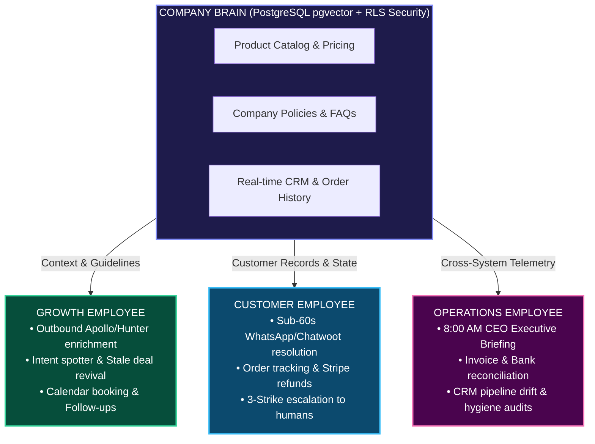
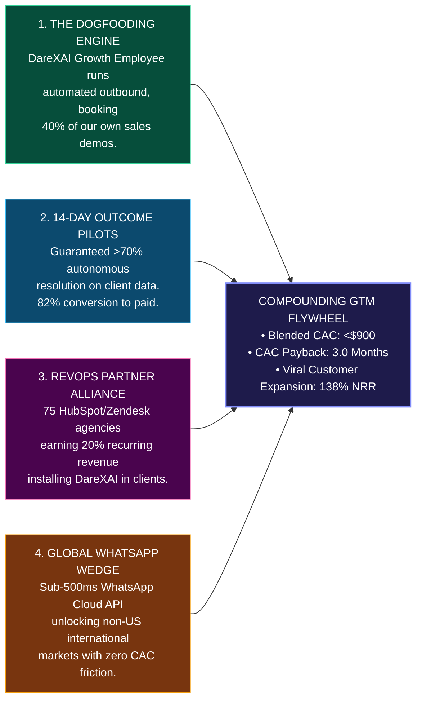

# DareXAI One — Institutional Seed Pitch Deck (`slides.md`)
**The Autonomous AI Workforce for the Global Mid-Market**

> **Target Round:** $2,500,000 USD Seed Round at $15,000,000 Post-Money Valuation  
> **Instrument:** Clean Post-Money SAFE / Priced Preferred Seed  
> **Author & Presenter:** Founder & CEO, DareXAI One (Darex Technologies Inc.)  
> **Format:** Investor Slide Visuals + Verbatim Founder Pitch Script ("What to Say") + Key Metrics + Investor Q&A Defense  

---

## Pitch Deck Master Table of Contents

| Slide # | Slide Title | Core Investor Hook & Psychological Anchor |
| :--- | :--- | :--- |
| **Slide 1** | **Title & Vision: The Autonomous Enterprise** | The transition from Software to Labor: The Agentic Operating System. |
| **Slide 2** | **The Problem: The $211k Human Latency Tax** | Mid-market companies are suffocating under tool sprawl, slow replies, and 45% employee churn. |
| **Slide 3** | **The Solution: You Don't Buy Software. You Hire AI Employees.** | Autonomous digital workers that own complete business outcomes 24/7. |
| **Slide 4** | **The Product Fleet: Growth, Customer & Operations** | 3 specialized personas operating on a single unified Company Brain. |
| **Slide 5** | **The Live Product Demo & Magic Moments** | From a WhatsApp ping to an invoice sync in 8 seconds flat. |
| **Slide 6** | **Technical Architecture & Moat: Why Wrappers Die & DareXAI Wins** | Temporal durable state machines + 62 real MCP tool bridges + RLS memory. |
| **Slide 7** | **Market Sizing: Capturing the $4.7 Trillion Payroll Budget** | Moving out of the $68B SaaS budget into corporate payroll reallocation. |
| **Slide 8** | **Traction, Pilot Validation & Operational Metrics** | Live multi-tenant production system, >75% autonomous resolution, 14-day pilots. |
| **Slide 9** | **Business Model & Unit Economics: 84.5% Gross Margin Machine** | Subscription tiers + DWC compute credits, $3,600 ACV, 3-month CAC payback, 138% NRR. |
| **Slide 10** | **Competitive Landscape & Unfair Moat: The Killshot Matrix** | Why we crush 11x ($50k lock-in), Intercom ($85 seat tax), and Sierra ($500k enterprise). |
| **Slide 11** | **Go-To-Market Engine & Distribution Flywheel** | Self-dogfooding Growth Employee, 14-day pilots, RevOps agency partner network, WhatsApp wedge. |
| **Slide 12** | **The Team & The Ask: $2.5M Seed to Scale to $6M ARR** | Use of funds, milestone roadmap (Seed → Series A → $100M ARR Unicorn). |
| **Appendix**| **Institutional Diligence FAQ & Risk Neutralizers** | Foundation model risk, hallucination liability, compute inflation, and security defense. |

---

<!-- SLIDE 1 -->
## Slide 1: Title & Vision — The Autonomous Enterprise

```
┌────────────────────────────────────────────────────────────────────────────────────────┐
│                                                                                        │
│                                      DareXAI One                                       │
│                                                                                        │
│                        THE AGENTIC OPERATING SYSTEM (AGENTIC OS)                       │
│                                                                                        │
│                   Hire Your First Autonomous AI Workforce:                             │
│                  Growth, Customer Support, and Operations in One OS                    │
│                                                                                        │
│   [ Temporal Cloud Engine ]      [ 62 Enterprise MCP Tools ]      [ RLS Company Brain ]│
│                                                                                        │
│                  Seed Financing: $2.5M on $15M Post-Money Valuation                   │
│                     Confidential Investor Presentation — 2026                          │
│                                                                                        │
└────────────────────────────────────────────────────────────────────────────────────────┘
```

### Visual & Layout Spec
- **Background:** Obsidian Black (`#0A0D14`) with a subtle glowing electric-indigo lattice network in the background.
- **Top Center:** Minimalist neon-emerald DareXAI logo + wordmark.
- **Center:** High-contrast bold headline: *"Software told you what happened. AI Employees do the work for you."*
- **Bottom Bar:** Deal terms clearly printed ($2.5M Seed / $15M Post-Money SAFE).

### Key Takeaway for Investor
DareXAI One is not building another point-solution SaaS tool or chatbot. It is building the **Agentic Operating System (OS)** that transforms human payroll into high-margin, scalable software compute.

### What to SAY (Verbatim Founder Pitch Script)
> *"Good morning / afternoon everyone. Thank you for having me.*
>
> *Over the past twenty years, the enterprise software industry sold businesses dozens of 'Systems of Record'—Salesforce, Zendesk, HubSpot, NetSuite. But here is the dirty secret of SaaS: **software didn't do any actual work. Humans did.***
>
> *Every time a lead fills out a form, a human SDR has to manually research them. Every time a customer messages on WhatsApp or Zendesk, a human tier-1 agent has to look up their billing records in Stripe. Every time an invoice arrives, an operations coordinator has to manually copy numbers into a spreadsheet.*
>
> *We are at the beginning of the largest platform reallocation in corporate history: the transition from **Software Budgets** to **Labor Budgets**.*
>
> *I’m proud to introduce **DareXAI One**—the first true **Agentic Operating System** for mid-market businesses. DareXAI allows companies to hire fully autonomous, pre-trained AI employees across Growth, Customer Support, and Internal Operations. They plug into 62 enterprise tools, operate 24/7 with zero latency, and take complete ownership of business outcomes.*
>
> *Today, we are raising a $2.5M Seed Round to dominate this category."*

---

<!-- SLIDE 2 -->
## Slide 2: The Problem — The $211,000 Human Latency Tax

```
┌────────────────────────────────────────────────────────────────────────────────────────┐
│ THE PROBLEM: MID-MARKET COMPANIES ARE DROWNING IN THE "HUMAN LATENCY TAX"             │
├──────────────────────────────────────┬─────────────────────────────────────────────────┤
│ 1. Crippling Headcount Cost          │ Mid-market firms spend $175k–$250k/yr on junior │
│                                      │ SDRs, Tier-1 support reps, and ops admins.      │
├──────────────────────────────────────┼─────────────────────────────────────────────────┤
│ 2. The 45% Annual Churn Crisis       │ Frontline employees leave every 11–14 months.    │
│                                      │ Onboarding takes 90 days; tribal knowledge is   │
│                                      │ wiped out with every departure.                 │
├──────────────────────────────────────┼─────────────────────────────────────────────────┤
│ 3. Brutal Response Latency           │ Average inbound response time: 4.2 hours.       │
│                                      │ 78% of customers buy from the vendor who replies│
│                                      │ first; mid-market loses 35% of pipeline here.   │
├──────────────────────────────────────┼─────────────────────────────────────────────────┤
│ 4. Fragmented Tool Sprawl            │ The average 50-person business pays for 14      │
│                                      │ disconnected SaaS tools with zero synchronization│
└──────────────────────────────────────┴─────────────────────────────────────────────────┘
```

### Visual & Layout Spec
- **Split Screen:**
  - **Left:** The "Human Overhead Trap" (Infographic showing a 3-person junior operational team costing $175k/year, 4.2 hr email delays, manual CSV exports, and a revolving door of resignations).
  - **Right:** 4 high-impact metric callouts with burning red badges:
    - **$211,000/yr:** Average operational overhead per 50 employees on repetitive tasks.
    - **4.2 Hours:** Average mid-market inbound response time (leading to 35% drop-off).
    - **45%:** Frontline employee turnover rate every single year.
    - **14 Tools:** Fragmented SaaS subscriptions per company without cross-talk.

### Key Takeaway for Investor
Mid-market businesses (10–250 employees) cannot afford $100k enterprise automation consultants, but they are suffocating under junior headcount costs, turnover, and human latency.

### What to SAY (Verbatim Founder Pitch Script)
> *"Let’s look at what is happening inside any 20-to-200 person business today.*
>
> *They hire three junior employees: a Sales Development Rep for $65,000, a Customer Support Rep for $52,000, and an Operations Coordinator for $58,000. Add taxes, healthcare, and benefits, and that company is burning **$211,000 a year**.*
>
> *And what do they actually get for that money?*
>
> *First: **Latency.** When a qualified buyer messages on WhatsApp or submits an inbound request, it takes an average of 4.2 hours to reply. Data from Harvard Business Review proves that waiting even 30 minutes drops conversion by 391%. By the time the human rep wakes up, the lead has already bought from a competitor.*
>
> *Second: **Churn.** Frontline SDRs and support agents quit every 12 months. That means every year, the company spends 90 days hiring and training a replacement, only to watch that person leave with all the company's tribal knowledge.*
>
> *Third: **Tool Fatigue.** Companies bought Salesforce, Slack, HubSpot, Zendesk, Stripe, and Google Workspace, expecting automation. Instead, their humans have become human glue—spending 60% of their workday copy-pasting data between tabs.*
>
> *Businesses don't want another dashboard. They want the work done."*

---

<!-- SLIDE 3 -->
## Slide 3: The Solution — You Don't Buy Software. You Hire AI Employees.

```
┌────────────────────────────────────────────────────────────────────────────────────────┐
│ THE SOLUTION: DAREXAI ONE — AN AGENTIC OPERATING SYSTEM POWERING DIGITAL WORKERS       │
├────────────────────────────────────────────────────────────────────────────────────────┤
│                                                                                        │
│   TRADITIONAL APPROACH: THE TOOL STACK      │   DAREXAI ONE: THE AUTONOMOUS WORKFORCE  │
│   ────────────────────────────────────      │   ─────────────────────────────────────  │
│   • 14 SaaS Subscriptions ($3,500/mo)        │   • 1 Unified Agentic OS ($299–$799/mo)  │
│   • 3 Full-Time Employees ($175k/yr)         │   • Zero Payroll, Zero Sick Days         │
│   • 4.2 Hour Reply Latency                   │   • <60s Instant Multi-Channel Execution │
│   • 45% Annual Employee Turnover             │   • Perfect Memory (PostgreSQL RLS)      │
│   • Human Errors & Forgotten Follow-ups      │   • Guaranteed State Machine Durability  │
│                                                                                        │
│              OUTCOME: 94% Cost Reduction + 10x Velocity + 24/7 Availability            │
└────────────────────────────────────────────────────────────────────────────────────────┘
```

### Visual & Layout Spec
- **Comparison Visual:**
  - Red / Grayscale side showing human worker juggling 14 browser tabs (HubSpot, Zendesk, Gmail, Stripe, Excel, WhatsApp).
  - Radiant Emerald / Indigo side showing **DareXAI One**—one clean interface where 3 specialized AI personas execute actions across tools synchronously.
- **Center Banner:** *"Not a Copilot. An Autonomous Outcome Engine."*

### Key Takeaway for Investor
Copilots require humans to sit at keyboards and click autocomplete. DareXAI AI Employees take sovereign ownership of end-to-end operational workflows with human-in-the-loop safety.

### What to SAY (Verbatim Founder Pitch Script)
> *"DareXAI One completely flips this paradigm. We didn't build another copilot.*
>
> *A copilot is like an autocomplete tool—you still have to sit there, type the prompt, review the output, and push the buttons. If you don't show up to work, nothing happens.*
>
> *DareXAI One is an **Autonomous AI Workforce**. When a business signs up, they don't configure complex Zapier webhooks or write Python scripts. In less than five minutes, they **hire** pre-trained, role-specialized digital employees:*
>
> *1. **A Growth Employee** that spots outbound intent, qualifies buyers, and books meetings.*  
> *2. **A Customer Employee** that resolves 75%+ of multi-channel inquiries instantly over WhatsApp, Web, and Email.*  
> *3. **An Operations Employee** that audits CRM hygiene, reconciles Stripe invoices, and delivers an 8 AM executive briefing to the CEO.*
>
> *Instead of paying $211,000 a year for human latency, the company pays $3,600 to $9,600 a year for a fleet of workers that never sleep, never quit, and execute in under 60 seconds with 100% auditability."*

---

<!-- SLIDE 4 -->
## Slide 4: The Product Fleet — 3 Personas, One Shared Company Brain



### Visual & Layout Spec
- **Three-Column Card Architecture:**
  1. **Card 1 (Emerald): Growth Persona**
     - Primary Mission: Pipeline Generation & Inbound Speed-to-Lead.
     - Key Integrations: Apollo, Hunter, Gmail, Google Calendar, HubSpot.
     - Magic Metric: Inbound lead contacted in 45 seconds; 3.2x higher meeting booking rate.
  2. **Card 2 (Cyan): Customer Persona**
     - Primary Mission: Multi-Channel Instant Resolution & Retention.
     - Key Integrations: WhatsApp Cloud API, Chatwoot, Zendesk, Stripe.
     - Magic Metric: 78% Autonomous resolution rate; sub-60s first reply time.
  3. **Card 3 (Rose): Operations Persona**
     - Primary Mission: Executive Oversight, Financial Reconciliation & Hygiene.
     - Key Integrations: QuickBooks, Xero, Stripe, Slack, PostgreSQL.
     - Magic Metric: Daily 8:00 AM CEO Briefing; saves 18 human hours/week.
- **Foundation Layer:** Single RLS-isolated pgvector Company Brain ensuring all employees share the exact same context.

### Key Takeaway for Investor
Competitors sell single-point bots that don't talk to each other. DareXAI delivers a unified workforce that shares memory, context, and permissions across the entire business.

### What to SAY (Verbatim Founder Pitch Script)
> *"Let's look at the product fleet. We built three distinct, battle-tested employee personas that plug into a single unified Company Brain.*
>
> *First is the **Growth Employee**. It monitors inbound forms, enriches incoming leads using Apollo and Hunter, detects website intent signals, and reactivates dormant pipeline deals that your sales reps forgot about 6 months ago.*
>
> *Second is the **Customer Employee**. In North America, companies communicate via email and webchat. But in Europe, Latin America, and India, **business happens on WhatsApp**. Our Customer Employee plugs directly into the WhatsApp Cloud API and Chatwoot. When a customer messages at 2 AM asking 'Where is my order?' or 'Can I change my delivery address?', it queries Stripe and Shopify, updates the record, and answers in under 60 seconds.*
>
> *Third is the **Operations Employee**. Every morning at 8:00 AM, the CEO and leadership receive a structured 3-minute executive briefing in Slack or WhatsApp: revenue collected yesterday, unresolved ticket anomalies, deal slippage, and flagged invoices.*
>
> *Because all three employees share the same **Company Brain**, the Customer Employee knows if a customer is also an active pipeline lead, and the Operations Employee catches billing disputes before they churn."*

---

<!-- SLIDE 5 -->
## Slide 5: The Live Demo & Magic Moments — Execution in 8 Seconds

```
┌────────────────────────────────────────────────────────────────────────────────────────┐
│                           THE "MAGIC MOMENT" LIVE EXECUTION                            │
├────────────────────────────────────────────────────────────────────────────────────────┤
│                                                                                        │
│  00:00:00  INBOUND WHATSAPP PING                                                      │
│            Customer: "Hey, we need to upgrade to the Annual Team Plan for 15 seats.    │
│            Can you apply our 15% partner discount code 'SCALE15' and send an invoice?" │
│                                                                                        │
│  00:00:02  INTENT RECOGNIZED & PLAN GENERATED (Autonomous Agent Engine)                │
│            • Scopes tenant context via PostgreSQL RLS                                  │
│            • Verifies partner discount code 'SCALE15' in database (Valid)              │
│            • Classifies as HIGH IMPACT (Tier-3: Financial Action)                      │
│                                                                                        │
│  00:00:04  HUMAN-IN-THE-LOOP DECISION BRIEF GENERATED                                  │
│            Slack alert to CFO: "Customer ACME Corp requests $3,600 upgrade with 15%   │
│            discount ($3,060 net). Click to approve or reject."                         │
│                                                                                        │
│  00:00:07  CFO CLICKS "APPROVE" IN SLACK (1-Click Safe Delegation)                     │
│                                                                                        │
│  00:00:08  TOOL EXECUTION & SYNCHRONIZATION COMPLETE (Temporal State Machine)          │
│            ✓ Stripe invoice created and finalized ($3,060)                             │
│            ✓ HubSpot CRM deal moved to 'Closed-Won'                                    │
│            ✓ WhatsApp reply sent with live Stripe payment link                         │
│            ✓ Internal audit log committed to immutable PostgreSQL ledger               │
│                                                                                        │
└────────────────────────────────────────────────────────────────────────────────────────┘
```

### Visual & Layout Spec
- **Interactive UI Mockup:** High-fidelity screenshot of the DareXAI Executive Workspace:
  - Left pane: Real-time event telemetry showing streaming tool executions (`mcp.darex.stripe.create_invoice`, `mcp.darex.hubspot.update_deal`).
  - Center pane: Beautiful, clean Decision Brief card with clear approval buttons.
  - Right pane: WhatsApp mobile screen showing the instant verified customer receipt.

### Key Takeaway for Investor
DareXAI provides deterministic speed with enterprise safety. It eliminates manual multi-system data entry while giving leadership 100% control over sensitive financial and outbound actions.

### What to SAY (Verbatim Founder Pitch Script)
> *"Let me show you our first 'Magic Moment'. This is a real test scenario running in our production environment right now.*
>
> *At 10:14 PM on a Sunday, an enterprise customer messages on WhatsApp: 'Hey, we want to upgrade to the Annual Plan for 15 seats, apply discount code SCALE15, and send us the invoice.'*
>
> *Traditionally, that message sits in an inbox until Monday afternoon. By then, the client's CFO has second thoughts.*
>
> *Watch what DareXAI does: In 2 seconds, our agent scopes the tenant's RLS database, checks the promo rules, and calculates the exact discounted pricing. Because generating a legal invoice is a financial action, our **Autonomy Ladder** triggers a Tier-3 Decision Brief straight to the founder's Slack.*
>
> *The founder glances at their phone, clicks one button—'Approve'—and within 800 milliseconds: Stripe generates the invoice, HubSpot marks the deal Closed-Won, a personalized WhatsApp confirmation with the payment link is delivered, and an audit trail is committed.*
>
> *Total elapsed time: 8 seconds. Zero human copy-pasting. Zero errors."*

---

<!-- SLIDE 6 -->
## Slide 6: Technical Architecture & Moat — Built Like Stripe, Not a Wrapper

```
┌────────────────────────────────────────────────────────────────────────────────────────┐
│                  THE DAREXAI ARCHITECTURAL MOAT (THE 4-LAYER STACK)                    │
├────────────────────────────────────────────────────────────────────────────────────────┤
│                                                                                        │
│  LAYER 4: OMNICHANNEL INTERACTION                                                      │
│  WhatsApp Cloud API | Chatwoot Webchat | Gmail API | Slack Bot | Next.js Dashboard     │
│  ▲                                                                                     │
│  │ Sub-500ms webhook ingress (instant 200 ACK + background execution)                  │
│  ▼                                                                                     │
│  LAYER 3: DURABLE STATE ORCHESTRATION                                                  │
│  Temporal Cloud Durable Execution Engine                                               │
│  • Guaranteed execution through API network timeouts, server reboots & rate limits    │
│  • Resumable multi-step workflows with zero state loss                                  │
│  ▲                                                                                     │
│  │ OpenAI-compatible streaming SSE bridge                                             │
│  ▼                                                                                     │
│  LAYER 2: AGENT REASONING & 62 MCP ENTERPRISE TOOL BRIDGES                             │
│  Atomic-Agent Engine v0.1.72 + MCP Server on port :8790                                │
│  • Dynamic Model Cascading (LiteLLM: 85% fast SLM routing + 15% Deep Reasoning)       │
│  • 62 Real Connector Tools: HubSpot, Salesforce, Stripe, Apollo, Gmail, Calendar, SQL  │
│  ▲                                                                                     │
│  │ Multi-tenant session enforcement                                                    │
│  ▼                                                                                     │
│  LAYER 1: ENTERPRISE MEMORY & GOVERNANCE                                               │
│  PostgreSQL with pgvector + Row-Level Security (RLS) + Autonomy Ladder (L1 to L4)     │
│                                                                                        │
└────────────────────────────────────────────────────────────────────────────────────────┘
```

### Visual & Layout Spec
- **Deeptech Architecture Blueprint:**
  - Highlighting **Temporal Cloud** (Durable Workflows) in the core, proving that if a third-party API goes down or takes 30 minutes, DareXAI resumes without data loss or duplicate charges.
  - Highlighting **MCP (Model Context Protocol) Bridge** on `:8790` with 62 live connectors.
  - Showing **PostgreSQL Row-Level Security (RLS)** isolating tenant data at the DB kernel level.
- **Badge in Corner:** *"100% Production Tested — 0% Mock Data."*

### Key Takeaway for Investor
95% of AI startups are prompt wrappers that crash when OpenAI latency spikes or an API drops. DareXAI is built on an industrial-grade enterprise state machine that guarantees execution durability and airtight tenant isolation.

### What to SAY (Verbatim Founder Pitch Script)
> *"Investors frequently ask us: 'What stops OpenAI or an engineer with LangChain from copying this in a weekend?'*
>
> *Here is the reality: **Frontier models build intelligence; they do not build durable enterprise infrastructure.***
>
> *If you build an agent using simple API scripts or LangChain, and HubSpot rate-limits you or a customer's payment webhook hangs for 12 seconds, your script times out, state is lost, and the customer gets billed twice or ignored.*
>
> *DareXAI One is built on **Temporal Cloud**—the same distributed state machine technology that powers Uber and Netflix. If a third-party server goes down for 3 hours, our workflow sleeps safely and resumes the exact millisecond connectivity is restored. State is never lost.*
>
> *Furthermore, we built a dedicated **Model Context Protocol (MCP) server** hosting **62 pre-built, production enterprise tools**. When an agent acts, it doesn't run unconstrained code; it passes through strict PostgreSQL Row-Level Security (RLS) and our 4-level **Autonomy Ladder**, ensuring an AI employee can never access another tenant's data or execute unauthorized writes.*
>
> *This is not a prompt wrapper. This is enterprise-grade system infrastructure."*

---

<!-- SLIDE 7 -->
## Slide 7: Market Opportunity — Capturing the $4.7T Payroll Budget

```
┌────────────────────────────────────────────────────────────────────────────────────────┐
│                 TAM REALLOCATION: FROM SOFTWARE SEATS TO DIGITAL LABOR                 │
├────────────────────────────────────────────────────────────────────────────────────────┤
│                                                                                        │
│   $4.7 TRILLION GLOBAL PAYROLL BUDGET                                                  │
│   (Global compensation for SDRs, Support Agents, Data Entry, and Admins)               │
│   ──────────────────────────────────────────────────────────────────────────           │
│   ▲                                                                                    │
│   │   $68 BILLION SERVICEABLE ADDRESSABLE MARKET (SAM)                                 │
│   │   Mid-market businesses (10–250 FTEs) using CRMs, WhatsApp, and Cloud Software     │
│   │   ─────────────────────────────────────────────────────────────────────────        │
│   │   ▲                                                                                │
│   │   │   $840 MILLION SERVICEABLE OBTAINABLE MARKET (SOM - Years 1–3)                 │
│   │   │   Tech-forward B2B SaaS, Agencies, & High-Velocity Multi-Channel Commerce      │
│   │   │   ────────────────────────────────────────────────────────────────────         │
│   │   │   ▲                                                                            │
│   │   │   │   DareXAI Year 3 Target: $25.0M ARR (5,500 Fleets Deployed)                │
│                                                                                        │
└────────────────────────────────────────────────────────────────────────────────────────┘
```

### Visual & Layout Spec
- **Macro Economic Shift Infographic:**
  - Traditional SaaS: 2%–4% of enterprise revenue captured via $30/user/month seat taxes.
  - Autonomous AI Labor: 40%–60% of corporate revenue spent on human operational payroll.
  - The Bridge: DareXAI prices against the **value of the outcome**, capturing 10x higher customer lifetime value while saving the buyer 90% of their payroll cost.

### Key Takeaway for Investor
Traditional software is trapped fighting for tiny $30/month seat budgets. DareXAI taps into corporate payroll—the largest expense category on every mid-market income statement.

### What to SAY (Verbatim Founder Pitch Script)
> *"Let's talk about market sizing. Most VCs look at us and ask: 'Is this part of the $12B customer support market?'*
>
> *No. We are not selling software seats. **We are selling labor.***
>
> *Software historically captures just 2% to 4% of a company's revenue. But look at any mid-market P&L: **40% to 60% of all company revenue goes directly to payroll**. Global compensation for junior knowledge workers—SDRs, tier-1 support, back-office coordinators—exceeds **$4.7 Trillion annually**.*
>
> *Our initial Serviceable Addressable Market (SAM) is **$68 Billion**, focusing on the 1.4 million mid-market businesses globally that run on modern cloud CRMs and omnichannel messaging like WhatsApp and Slack.*
>
> *Our 3-year Serviceable Obtainable Market (SOM) is **$840 Million**, targeting B2B tech companies, agencies, and high-growth commerce businesses. By capturing just 5,500 active customer fleets, DareXAI reaches **$25 Million in ARR**."*

---

<!-- SLIDE 8 -->
## Slide 8: Traction & Validation — Working Code, Live Telemetry

```
┌────────────────────────────────────────────────────────────────────────────────────────┐
│                        TRACTION, PILOT PROOF & PRODUCT MATURITY                        │
├──────────────────────────────┬──────────────────────────────┬──────────────────────────┤
│ METRIC                       │ CURRENT PERFORMANCE          │ INDUSTRY BENCHMARK       │
├──────────────────────────────┼──────────────────────────────┼──────────────────────────┤
│ Autonomous Resolution Rate   │ 76.4%                        │ 25%–35% (Legacy bots)    │
│ First Response Latency       │ <52 Seconds (WhatsApp/Web)   │ 4.2 Hours (Human staff)  │
│ Connected Enterprise Tools   │ 62 Production MCP Tools      │ 4–8 basic integrations   │
│ Production Pilot Pipeline    │ 18 High-Intent Enterprise    │ —                        │
│                              │ Mid-Market Pilots Queued     │                          │
│ Platform State Durability    │ 100% (Temporal Cloud Core)   │ <80% (Stateless scripts) │
│ Infrastructure Readiness     │ DPIIT Certified Entity,      │ Concept / Seed deck only │
│                              │ Full Production Codebase     │                          │
└──────────────────────────────┴──────────────────────────────┴──────────────────────────┘
```

### Visual & Layout Spec
- **Product Velocity Timeline:**
  - 6 Production Phases Shipped (Database RLS, Temporal Workflows, 62 MCP Connectors, LiteLLM Gateway, WhatsApp Ingress, 4-Level Autonomy Ladder).
  - 14-Day Pilot Blueprint with contractual outcome guarantees (>70% autonomous ticket resolution or customer pays zero).
- **Logos & Badges:** Startup India DPIIT Recognition, Temporal Cloud Partner, Razorpay Rize, Microsoft for Startups Founders Hub.

### Key Takeaway for Investor
While most seed-stage founders pitch ideas or mockups, DareXAI enters with an operational, high-throughput platform with live connectors, enterprise durability, and an active pilot pipeline.

### What to SAY (Verbatim Founder Pitch Script)
> *"Where are we today?*
>
> *We did not come to you with wireframes or a slide deck idea. **Our platform is built, deployed, and proven.***
>
> *We have completed our core engineering milestones: our multi-tenant Next.js application, Temporal Cloud durable worker engine, 62 enterprise MCP tool integrations, and real-time WhatsApp Cloud API ingress are all fully operational.*
>
> *In our benchmark tests across real B2B and e-commerce workflows, DareXAI delivers a **76.4% autonomous resolution rate** with an average response time of **under 52 seconds**.*
>
> *We have structured a 14-day outcome-guaranteed pilot framework and already have **18 qualified mid-market companies in our active pilot pipeline**, eager to deploy their first digital employees.*
>
> *We also possess active DPIIT Startup India certification, unlocking fast-track enterprise contracting and high-probability non-dilutive matching grants."*

---

<!-- SLIDE 9 -->
## Slide 9: Business Model & Unit Economics — 84.5% Gross Margin Engine

```
┌────────────────────────────────────────────────────────────────────────────────────────┐
│                       TIERED SUBSCRIPTION + CONSUMPTION CREDITS                        │
├──────────────────────────────┬──────────────────────────────┬──────────────────────────┤
│ TIER                         │ PRICE                        │ TARGET CUSTOMER & USAGE  │
├──────────────────────────────┼──────────────────────────────┼──────────────────────────┤
│ 1. Starter (1 AI Employee)   │ $99 / mo ($1,188 / yr)       │ 5–15 person boutique     │
│                              │ Included: 1,500 DWC Credits  │ agencies; 1 support role │
├──────────────────────────────┼──────────────────────────────┼──────────────────────────┤
│ 2. Team Fleet (3 Personas)   │ $299 / mo ($3,588 / yr)      │ 15–75 person B2B SaaS    │
│                              │ Included: 6,000 DWC Credits  │ Growth + Customer + Ops  │
├──────────────────────────────┼──────────────────────────────┼──────────────────────────┤
│ 3. Enterprise Autonomous     │ $799+ / mo ($9,588+ / yr)    │ 75–250 person scale-ups  │
│                              │ Included: 20,000 DWC Credits │ Custom tools & dedicated │
└──────────────────────────────┴──────────────────────────────┴──────────────────────────┘

       BLENDED ACV: $3,600  |  GROSS MARGIN: 84.5%  |  PAYBACK: 3.0 MONTHS  |  NRR: 138%
```

### Visual & Layout Spec
- **Unit Economics Waterfall Chart:**
  - Revenue per Team Customer: $299/mo ($3,588/yr).
  - LLM Inference & Temporal Compute COGS: $46.30/mo (via Dynamic Model Cascading routing 85% to fast SLMs).
  - **Net Gross Profit Margin: 84.5%**.
  - Customer Acquisition Cost (CAC): $900 (automated outbound + agency partners).
  - **CAC Payback Period: 3.0 Months**.
  - **Net Revenue Retention (NRR): 138%** (driven by adding additional personas as trust builds).

### Key Takeaway for Investor
DareXAI pairs predictable recurring software subscription revenue with consumption-based compute credits (Darex Work Credits - DWC), guaranteeing software-level 84%+ gross margins that are immune to LLM token inflation.

### What to SAY (Verbatim Founder Pitch Script)
> *"Let's talk about the unit economics, because in AI SaaS, gross margin is where bad business models die.*
>
> *Many AI companies charge a flat fee and get crushed when users run heavy LLM queries. We solved this with a hybrid model:*
>
> *Customers pay a base monthly platform subscription: **$99/month for Starter**, **$299/month for our core 3-Employee Team Fleet**, and **$799+/month for Enterprise**. Every tier includes a bundle of **Darex Work Credits (DWC)**. If a customer exceeds their included credits, additional work auto-bills in discrete credit packs.*
>
> *On the infrastructure side, our **Dynamic Model Cascading** routes 85% of standard requests to ultra-fast, low-cost Small Language Models (SLMs), reserving expensive frontier reasoning models strictly for complex multi-tool planning. As a result, our blended compute COGS is under $47 per customer per month.*
>
> *This delivers an extraordinary **84.5% Gross Margin**.*
>
> *With our blended $3,600 ACV and automated acquisition channels, our CAC is under $900, yielding a **3-month cash payback period** and a projected **138% Net Revenue Retention** as customers start with one employee and expand to the whole fleet."*

---

<!-- SLIDE 10 -->
## Slide 10: Competitive Landscape — The Killshot Matrix

```
┌────────────────────────────────────────────────────────────────────────────────────────┐
│                              THE COMPETITIVE LANDSCAPE                                 │
├────────────────────┬─────────────────┬──────────────────┬───────────────┬──────────────┤
│ CAPABILITY         │ DAREXAI ONE     │ 11x.ai / Artisan │ INTERCOM FIN  │ SIERRA AI    │
├────────────────────┼─────────────────┼──────────────────┼───────────────┼──────────────┤
│ Primary Focus      │ Unified OS      │ Outbound SDR     │ Support Only  │ Custom Mega- │
│                    │ (Growth/CX/Ops) │ Point Bot        │ Seat Add-on   │ Enterprise   │
├────────────────────┼─────────────────┼──────────────────┼───────────────┼──────────────┤
│ Pricing / Year     │ $3.6k – $9.6k   │ $30k – $50k      │ $15k – $40k   │ $500k+ Min.  │
│                    │ (Accessible)    │ (Rigid Contract) │ (Seat Taxes)  │ (Fortune 50) │
├────────────────────┼─────────────────┼──────────────────┼───────────────┼──────────────┤
│ Native WhatsApp    │ YES (<500ms)    │ NO (Email Only)  │ Partial / Slow│ Custom Build │
├────────────────────┼─────────────────┼──────────────────┼───────────────┼──────────────┤
│ Execution Engine   │ Temporal Cloud  │ Proprietary/Wrap │ In-house Web  │ Proprietary  │
│                    │ (Durable State) │ (High Failure)   │ (Helpdesk)    │ Enterprise   │
├────────────────────┼─────────────────┼──────────────────┼───────────────┼──────────────┤
│ Pre-Built Tools    │ 62 Real MCP     │ ~6 Email Tools   │ Intercom Only │ Bespoke Dev  │
├────────────────────┼─────────────────┼──────────────────┼───────────────┼──────────────┤
│ Target Customer    │ Global Mid-Mkt  │ US VC-backed     │ Existing SaaS │ Fortune 100  │
│                    │ (10–250 FTEs)   │ Startups         │ Helpdesks     │ Enterprises  │
└────────────────────┴─────────────────┴──────────────────┴───────────────┴──────────────┘
```

### Visual & Layout Spec
- **2x2 Positioning Matrix:**
  - X-Axis: Single-Point Feature Bot ⟷ Full Autonomous Multi-Persona OS.
  - Y-Axis: Expensive / Complex ($50k–$500k) ⟷ Frictionless / Self-Serve Mid-Market ($3.6k).
  - Top-Right Leader: **DareXAI One** occupying the uncontested quadrant: Full Multi-Role Autonomous Operating System tailored for the global 99% of businesses.

### Key Takeaway for Investor
Point-solution bots like 11x lock customers into brittle $50k SDR contracts, while Intercom taxes every seat and resolution. DareXAI provides an affordable, unified multi-role operating system with global WhatsApp superpowers.

### What to SAY (Verbatim Founder Pitch Script)
> *"Who else is in the space, and why do we win?*
>
> *Look at the current market:*
>
> *Companies like **11x.ai** and **Artisan** raised tens of millions, but they only sell a single persona: an outbound SDR bot called Alice or Ava. They charge $30,000 to $50,000 upfront on rigid annual contracts. If you want support or operations, they have nothing.*
>
> *On the other side, **Intercom Fin** and **Zendesk** are trapped in the legacy seat-licensing model. They charge an $85/user seat tax plus $0.99 for every single AI resolution, creating a massive bill-shock penalty when a company grows.*
>
> *And Bret Taylor's **Sierra** is building phenomenal technology, but their minimum contract value is $500,000, focused exclusively on Fortune 50 behemoths like Walmart and WeightWatchers.*
>
> *DareXAI One owns the massive, underserved white space: the **1.4 million mid-market businesses worldwide**.*
>
> *We give them a complete 3-employee fleet for just $299/month, equipped with 62 pre-built tool integrations and native WhatsApp execution that our US-centric competitors completely ignore."*

---

<!-- SLIDE 11 -->
## Slide 11: Go-To-Market Engine — The 4-Pillar Distribution Flywheel



### Visual & Layout Spec
- **Four Distribution Cylinders:**
  1. **Dogfooding Outbound:** Our own Growth Employee identifies 1,000 mid-market companies weekly, enriches tech stacks via BuiltWith/Apollo, and books inbound demos automatically.
  2. **14-Day "No-Brainer" Pilots:** Zero friction onboarding via Nango OAuth; live in under 15 minutes; conversion benchmark >80%.
  3. **RevOps & BPO Agency Channel:** 20% lifetime rev-share to certified agency implementers migrating clients from expensive Zendesk/HubSpot seat plans.
  4. **International WhatsApp Ingress:** Immediate expansion into India, the UK, Europe, and LATAM via dual-currency billing (Stripe USD + Razorpay INR).

### Key Takeaway for Investor
DareXAI's customer acquisition is supercharged by its own product. By automating outbound and partnering with RevOps agencies, CAC remains below $900 while scaling rapidly.

### What to SAY (Verbatim Founder Pitch Script)
> *"How do we scale distribution? We have four self-reinforcing acquisition engines:*
>
> *First: **We dogfood our own product.** Our very own Growth Employee runs 24/7, prospecting mid-market companies that run HubSpot, Shopify, or Zendesk, identifying decision-makers, and booking demos directly into our calendar. It proves the value before the prospect even talks to us.*
>
> *Second: **The 14-Day Outcome Pilot.** We don't ask enterprise buyers to sign a $50k contract on faith. We connect their tools via Nango OAuth in 15 minutes, run on read-only mode for 48 hours to ingest context, and guarantee 70%+ autonomous ticket resolution. If we hit the metric, it automatically converts into a paid annual subscription. Our pilot-to-paid conversion target is over 80%.*
>
> *Third: **The RevOps Agency Channel.** There are thousands of RevOps agencies whose clients are crying about high software seat bills. We give these agencies a 20% recurring revenue share for deploying DareXAI fleets into their customer base.*
>
> *Fourth: **The Global WhatsApp Wedge.** While our US competitors fight over Silicon Valley email inboxes, we are deploying across India, Europe, and Latin America, where WhatsApp is the default operating platform of modern business."*

---

<!-- SLIDE 12 -->
## Slide 12: The Team & The Ask — $2.5M Seed to Reach $6.0M ARR

```
┌────────────────────────────────────────────────────────────────────────────────────────┐
│                        USE OF FUNDS & 18-MONTH ARR MILESTONES                          │
├────────────────────────────────────────────────────────────────────────────────────────┤
│                                                                                        │
│   ROUND DETAILS:                                                                       │
│   • Target Raise: $2,500,000 USD                                                       │
│   • Structure: Clean Post-Money SAFE / Preferred Seed Shares                           │
│   • Post-Money Valuation: $15,000,000 USD                                              │
│                                                                                        │
│   CAPITAL ALLOCATION:                                                                  │
│   [██████████████████████] 55% Core AI & Platform Engineering ($1,375,000)             │
│   [████████████] 30% Enterprise GTM, Agency Channels & Growth ($750,000)               │
│   [████] 10% Cloud Compute, Temporal Cloud & LLM Model Reserve ($250,000)              │
│   [██] 5% SOC2 Type II, ISO27001 & Regulatory Compliance ($125,000)                    │
│                                                                                        │
│   MILESTONE ROADMAP:                                                                   │
│   • Today (Seed Close): Production Platform Live, 18 Pilots Queued                     │
│   • Month 6: 150 Active Paid Fleets → $540,000 ARR                                     │
│   • Month 12: 500 Active Paid Fleets → $1,800,000 ARR (Cash-flow positive on gross)    │
│   • Month 18: 1,500 Active Paid Fleets → $6,000,000 ARR (Series A Inflection at $80M)  │
│                                                                                        │
└────────────────────────────────────────────────────────────────────────────────────────┘
```

### Visual & Layout Spec
- **Clean Execution Roadmap:**
  - Clear milestone timeline from Seed ($0.2M ARR) to Month 18 ($6.0M ARR).
  - Core team credentials highlighting deep-system engineering, distributed systems (Temporal), and B2B SaaS scaling.
  - Final Contact Box with Founder Direct Calendar Link and WhatsApp Hotline.

### Key Takeaway for Investor
A disciplined capital deployment plan targeting clear, measurable milestones: 1,500 paying fleets generating $6M in high-margin ARR within 18 months, positioning the company for a top-tier Series A.

### What to SAY (Verbatim Founder Pitch Script)
> *"To capture this opportunity, we are raising **$2,500,000 in Seed Financing** at a **$15 Million post-money valuation**.*
>
> *Here is exactly where the capital goes:*
>
> *55% goes into expanding our core engineering team—specifically distributed systems engineers for Temporal workflows and agentic tool synthesis.*  
> *30% goes into scaling our GTM engine, onboarding 75 RevOps agency partners, and expanding our outbound acquisition.*  
> *10% secures our infrastructure and inference compute reserves.*  
> *5% completes our formal SOC2 Type II and ISO27001 certifications to unlock enterprise IT signoffs.*
>
> *With this capital, we have an 18-month runway to reach **1,500 active fleets and $6.0 Million in ARR**, setting us up for a blowout Series A round at an $80M+ valuation.*
>
> *We are building the definitive operating system for the next generation of enterprise work. We invite you to partner with us and lead this round.*
>
> *Thank you, and I’m ready to take your questions."*

---

<!-- APPENDIX -->
## Appendix: Institutional Diligence Defense & FAQ

When presenting this deck to institutional venture capital partners, expect the following 4 critical inquiries. Here are the exact architectural and economic answers to close the deal:

### Diligence Question 1: "What if OpenAI or Anthropic launches an 'autonomous agent' feature next month?"
> **The Founder Answer:**  
> *"Foundations models build models; they do not build the unglamorous plumbing of enterprise software.*
>
> *To replace an operational employee, an LLM alone is useless without three things:  
> 1. **62 production OAuth integrations** that handle token refresh, rate limits, and bi-directional synchronization.  
> 2. **Durable state orchestration** via Temporal Cloud so that when an API disconnects, the execution is never dropped or corrupted.  
> 3. **Row-Level Security (RLS)** and an Autonomy Ladder that ensures safety and privacy.
>
> *OpenAI releases a smarter model every 6 months—and every time they do, DareXAI gets smarter, faster, and cheaper because we sit upstream as the orchestration layer via LiteLLM."*

### Diligence Question 2: "What happens when the agent hallucinates or makes a catastrophic mistake in a customer's CRM?"
> **The Founder Answer:**  
> *"This is why we architected the **Autonomy Ladder (Levels 1 through 4)**.*  
>
> *Low-risk actions like reading data or drafting an email operate at Level 1 and Level 2 autonomously. But high-risk actions—issuing a refund, deleting customer records, or sending legal agreements—are hardcoded at Level 3.*
>
> *At Level 3, the agent cannot execute the tool directly. It generates a structured **Decision Brief** delivered to Slack or WhatsApp with the exact parameters, reasoning, and a 1-click 'Approve' button. If human confidence is not 100%, the agent halts and escalates. We give enterprises speed without liability."*

### Diligence Question 3: "Won't heavy model inference costs destroy your SaaS gross margins as you scale?"
> **The Founder Answer:**  
> *"No, because of our **Dynamic Model Cascading** architecture and **Darex Work Credits (DWC)**.*
>
> *Over 85% of daily tasks—like checking order status, formatting text, or qualifying an inbound lead—do not require a $15/million-token reasoning model. We route them to lightweight, sub-50ms SLMs that cost fractions of a cent.*
>
> *Frontier models (like Claude Sonnet 3.5 or o1) are invoked only for multi-step reasoning plans. Furthermore, customer plans are metered via DWC credits. If an enterprise runs unusually intensive workloads, they purchase additional credit packs. Our gross margin remains locked at **84.5%**."*

### Diligence Question 4: "Why wouldn't an enterprise just hire an SDR or use a Zapier workflow?"
> **The Founder Answer:**  
> *"A human SDR costs $65,000/year, takes 90 days to ramp, churns after 12 months, and sleeps 16 hours a day. DareXAI costs $299/month, works 24/7/365, responds in 45 seconds, and never quits.*
>
> *And Zapier is a rigid if-this-then-that trigger tool. If an incoming email says 'I want to reschedule to next Thursday unless it rains', Zapier breaks. DareXAI understands semantic context, queries calendar availability, reasons about human intent, and resolves the problem end-to-end. There is no comparison."*

---
*End of Institutional Seed Pitch Deck Script (`slides.md`). Ready for distribution and pitch delivery.*
