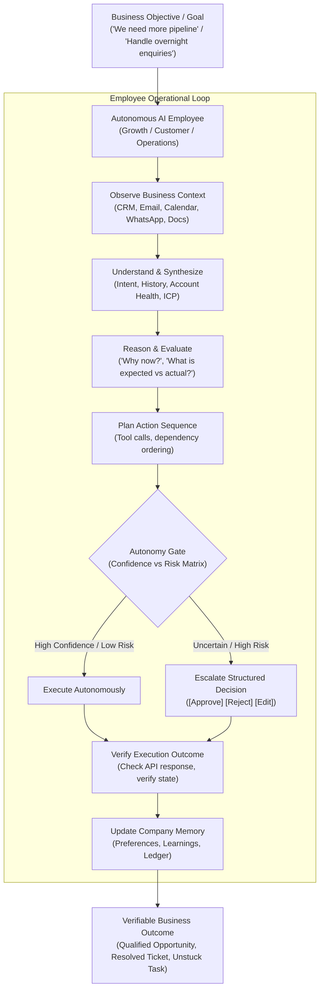

# 00 — Executive Summary, Core Mental Model & Strategic Vision

> **Document Type:** Master Strategic Architecture & Mental Model  
> **Source:** Synthesized from `DareXAI One_ Employee Blueprint.pdf` (106 Pages), engineering gap analyses, and runtime architecture.  
> **Core Premise:** An AI Employee is not a chatbot, not a collection of fragmented agents, and not a workflow builder. It is an autonomous stakeholder responsible for real business outcomes.

---

## 1. The Paradigm Shift: Why Existing AI Approaches Fail

The fundamental failure of first-generation corporate AI initiatives lies in adopting the wrong abstraction layer. Businesses have historically been forced to choose between three flawed paradigms:

```
┌─────────────────────────────────────────────────────────────────────────────────────────┐
│                           THE THREE FLAWED LEGACY PARADIGMS                             │
├────────────────────────────────┬────────────────────────────────────────────────────────┤
│ 1. The Chatbot Paradigm        │ Question → LLM Prompt → Text Answer                    │
│    (ChatGPT, Custom GPTs)      │ Leaves 100% of the actual execution to the human.      │
├────────────────────────────────┼────────────────────────────────────────────────────────┤
│ 2. The Automation Paradigm     │ Trigger → Action                                       │
│    (Zapier, Make, Workato)     │ Fragile, brittle, zero reasoning, breaks on edge cases.│
├────────────────────────────────┼────────────────────────────────────────────────────────┤
│ 3. The Micro-Agent Sandbox     │ 50 Specialized Agents + Workflow Orchestrator          │
│    (CrewAI, AutoGen, Swan)     │ Shifts the burden of prompt tuning & wiring to user.   │
└────────────────────────────────┴────────────────────────────────────────────────────────┘
```

### The DareXAI Employee Abstraction
When a company hires a human employee (e.g., a Growth Lead, Customer Success Manager, or Operations Coordinator), the leadership does not issue imperative, step-by-step API calls:
> *"Query Google Serper API → fetch LinkedIn company profile → extract headcount → compute ICP score → compose 3-paragraph email → insert row into HubSpot CRM."*

Instead, leadership provides a **high-level business mandate**:
> *"Find mid-market logistics companies in the DACH region similar to our top 3 clients, verify their expansion status, and initiate personalized contact with their VP of Supply Chain."*
> *"Ensure every overnight customer enquiry is handled by 9:00 AM, and flag anything at risk of churning."*

The operational capabilities, tool integrations, reasoning loops, and fallback heuristics live **underneath** the employee. The customer hires an **AI Employee**, not a bag of disconnected tools.



---

## 2. The Core Mental Model: From Prompts to Responsibilities

An AI Employee operates on a continuous, stateful lifecycle rather than a transient request-response transaction:

$$\text{Responsibility} \longrightarrow \text{Context} \longrightarrow \text{Judgment} \longrightarrow \text{Action} \longrightarrow \text{Verification} \longrightarrow \text{Outcome}$$

### Key Foundational Axioms

1. **Context Precedes Capability:** An AI employee without deep business context is merely an expensive LLM wrapper. Before an employee acts, it must ingest the company's ICP, value propositions, pricing tiers, past customer histories, communication voice, and explicit negative constraints (*"never offer discounts >15%", "never promise 24-hour delivery"*).
2. **Resolve, Don't Merely Reply:** Chatbots output text. AI Employees execute multi-step mutations across external systems (e.g., rescheduling a Google Calendar invite, issuing a Stripe refund, creating a HubSpot deal, alerting a warehouse supervisor).
3. **Escalate Decisions, Not Conversations:** When human intervention is required, the AI Employee must never dump a chat transcript onto an operator. It must formulate a **structured decision package**: the customer's state, context, the policy constraint encountered, and a concrete recommended action with single-click approval.
4. **Expected vs. Actual Discrepancy Engine:** Operational integrity is maintained by constantly measuring what *actually happened* against what *should have happened* according to SLAs, contracts, and business SOPs.
5. **Auditable Counterfactual Reasoning:** The system must record not only why it performed an action, but also **why it chose not to act** (counterfactual logging). When a founder asks, *"Why didn't you merge these two leads?"*, the employee responds with exact confidence metrics and conflicting domain evidence.

---

## 3. The Three Core AI Employees

DareXAI freezes its core platform around three foundational roles that span the entire business value chain:

```
┌─────────────────────────────────────────────────────────────────────────────────────────┐
│                                DAREXAI ONE CORE FLEET                                   │
├──────────────────────────┬──────────────────────────┬───────────────────────────────────┤
│    GROWTH EMPLOYEE       │    CUSTOMER EMPLOYEE     │      OPERATIONS EMPLOYEE          │
│                          │                          │                                   │
│ "Find opportunities,     │ "Take care of customers  │ "Keep the business moving.        │
│  know when they're worth │  from inbound request    │  Ensure routine work gets         │
│  pursuing, and act."     │  to verified resolution."│  completed correctly."            │
├──────────────────────────┼──────────────────────────┼───────────────────────────────────┤
│ • ICP & Lookalike Hunter │ • 12-Step Resolution     │ • Morning Triage & Ingestion      │
│ • Intent Signal Poller   │ • Open Loop SLA Tracker  │ • Expected vs Actual Engine       │
│ • De-anonymize Visitors  │ • Decision Escalator     │ • Multi-calendar Scheduling       │
│ • Stale Lead Reviver     │ • Churn & Risk Sentinel  │ • Deduplication & Data Hygiene    │
│ • Personalized Outreach  │ • Proactive Recovery     │ • Stuck Work Triage & Unblocking  │
└──────────────────────────┴──────────────────────────┴───────────────────────────────────┘
```

### Detailed Role Matrix

| Dimension | Growth Employee | Customer Employee | Operations Employee |
| :--- | :--- | :--- | :--- |
| **Primary Mandate** | Revenue pipeline generation & account expansion | Customer retention, resolution & lifetime value | Operational throughput, SLA compliance & task hygiene |
| **Trigger Inputs** | Periodic schedules, market signals, website webhooks, CRM staleness timers | Inbound WhatsApp, Email, Zendesk, live chat webhooks | 9:00 AM Cron sweeps, event webhooks, background SLA monitors |
| **Core State Machine** | Lead Discovery $\to$ Enriched $\to$ Qualified $\to$ Outbound $\to$ Engaged | New $\to$ Understood $\to$ Open Loop $\to$ Resolved $\to$ Closed | Created $\to$ Discrepancy Found $\to$ Action Proposed $\to$ Settled |
| **Primary External APIs** | Apollo, LinkedIn, Clearbit, Meta Ads, Google Ads, Gmail, CRM | WhatsApp Business, Gmail, Zendesk, Intercom, Shopify, Stripe | HubSpot, Zoho, Google Drive, Sheets, Slack, Jira, Calendar |
| **Autonomy Tolerance** | Moderate (Outreach drafts require review initially; research is auto) | Conservative (Informational FAQ is auto; financial/booking gated) | High (Internal updates auto; external vendor communication gated) |

---

## 4. Shared Foundation: DareXAI Connect

A critical engineering vulnerability of multi-agent systems is **fragmented integration sprawl**: forcing the customer to connect HubSpot for sales, connect HubSpot again for support, and connect HubSpot a third time for operations.

DareXAI introduces **DareXAI Connect**:

```text
                     ┌──────────────────────────────┐
                     │         DAREXAI ONE          │
                     └──────────────┬───────────────┘
                                    │
                     ┌──────────────┴───────────────┐
                     │       DareXAI Connect        │
                     │ (Unified OAuth & Token Pool) │
                     └──────────────┬───────────────┘
                                    │
        ┌───────────────────────────┼───────────────────────────┐
        ▼                           ▼                           ▼
 ┌──────────────┐            ┌──────────────┐            ┌──────────────┐
 │    GROWTH    │            │   CUSTOMER   │            │  OPERATIONS  │
 │   EMPLOYEE   │            │   EMPLOYEE   │            │   EMPLOYEE   │
 └──────┬───────┘            └──────┬───────┘            └──────┬───────┘
        │                           │                           │
        └───────────────────┬───────┴───────────────────────────┘
                            ▼
         ┌─────────────────────────────────────┐
         │     Shared Multi-Tenant Context     │
         │   (RLS Enforced by org_id Session)  │
         └──────────────────┬──────────────────┘
                            │
       ┌────────────────────┼────────────────────┐
       ▼                    ▼                    ▼
Communication           CRM & Data           Knowledge
• Gmail / Outlook    • HubSpot / Zoho     • Google Drive / Docs
• WhatsApp API       • Google Sheets      • Notion / SOPs
• Slack / Teams      • PostgreSQL DB      • Calendar Schedules
```

### Connect Architecture Principles:
- **Connect Once:** Authenticate an external tool once via Nango / OAuth proxy. Credentials, refresh tokens, and rate-limiting queues are managed centrally.
- **Role-Based Tool Allowlist:** While the connection is shared, tool invocation is strictly scoped by role. The Growth Employee cannot initiate refunds; the Customer Employee cannot run cold scraping loops.
- **Tenancy Boundary:** Every query and tool invocation strictly inherits the tenant context via PostgreSQL Row-Level Security (`SET LOCAL app.current_org_id = :tenantId`). Cross-tenant leakage is architecturally impossible.

---

## 5. The Autonomy & Human-in-the-Loop Governance Ladder

DareXAI treats autonomy as a continuous spectrum governed by **confidence scoring, financial blast radius, and historical accuracy**:

```
Level 4: Fully Autonomous (Zero human touch; background silent execution)
   ▲     Example: Logging CRM interactions, auto-answering standard FAQs, updating sheet rows.
   │
Level 3: Guarded Execution (Executes automatically within strict bounded limits)
   │     Example: Rescheduling appointments within open calendar slots, re-assigning overdue leads.
   │
Level 2: Structured Recommendation (AI drafts complete payload; human single-clicks approval)
   │     Example: Sending personalized cold outreach, issuing refunds, modifying contract terms.
   ▼
Level 1: Passive Observation (Read-only analytics, observation, and internal pattern recognition)
         Example: Scanning email archives, building company dossiers, tracking market shifts.
```

### The Human-in-the-Loop Contract
When an action falls below the autonomous confidence threshold ($\tau < 0.85$) or involves irreversible side effects, the system transitions to a durable **Temporal wait state**:
1. An action proposal is generated and stored in `agent_pending_actions` with a cryptographically signed action token.
2. A Decision Card is surfaced in the dashboard UI and pushed via Slack / WhatsApp notification.
3. The card presents 4 explicit actions: `[Approve]`, `[Reject]`, `[Edit]`, or `[Feedback]`.
4. Upon human interaction, a Temporal Signal resumes the paused workflow. **A timeout never defaults to approval.**

---

## 6. Business Value Metrics vs. AI Vanity Metrics

DareXAI explicitly rejects engineering evaluations based on model vanity metrics (token counts, LLM call counts, prompt iterations). The system is measured solely by business outcomes:

| Legacy AI Metric (Vanity) | DareXAI Business Outcome Metric (Reality) |
| :--- | :--- |
| *Total Tokens Generated* | **Qualified Opportunities Delivered (SQL / Demo Booked)** |
| *Agent Prompt Latency* | **Autonomous Resolution Rate (% customer issues solved without human)** |
| *Tool Execution Count* | **SLA Breach Prevention Count (Enquiries saved from slipping)** |
| *Chat Session Length* | **Stuck Work Cleaned (Duplicate records merged, stale leads revived)** |
| *Embeddings Generated* | **Human Labor Hours Saved (Verified hours eliminated from routine ops)** |

---

## 7. Master System Architecture Overview

DareXAI is engineered as an enterprise-grade, multi-tenant agentic operating system:

```
┌─────────────────────────────────────────────────────────────────────────────┐
│                          PRESENTATION LAYER (Next.js)                       │
│  Ask AI (Plan-Confirm-Execute) | Decision Stream | Live Analytics | Admin   │
└──────────────────────────────────────┬──────────────────────────────────────┘
                                       │ SSE Streams / tRPC / REST
┌──────────────────────────────────────▼──────────────────────────────────────┐
│                    DURABLE ORCHESTRATION LAYER (Temporal)                   │
│  AutonomousAgentWorkflow | CustomerInteractionWorkflow | MorningIntakeCron  │
│  Stateful Timers (Hours/Days) | Deterministic Signals | Resilient Retries   │
└──────────────────────────────────────┬──────────────────────────────────────┘
                                       │ Activity Dispatches
┌──────────────────────────────────────▼──────────────────────────────────────┐
│                   AGENTIC RUNTIME & TOOL EXECUTION LAYER                    │
│  Atomic-Agent Loop | LiteLLM Router | Model Context Protocol (MCP Bridge)   │
│  Prompt Guardrails | Decision Ledger | Fact Conflict Memory Engine          │
└──────────────────────────────────────┬──────────────────────────────────────┘
                                       │
            ┌──────────────────────────┴──────────────────────────┐
            ▼                                                     ▼
┌──────────────────────────────┐              ┌──────────────────────────────┐
│    DATA & TENANCY LAYER      │              │     CONNECTOR & API LAYER    │
│  PostgreSQL 16 + RLS         │              │  Nango OAuth Proxy           │
│  pgvector Semantic Memory    │              │  Meta WhatsApp Cloud API     │
│  Decision Trace Ledger       │              │  Google Graph / Microsoft 365│
│  Open Loop State Store       │              │  HubSpot / Zoho CRM APIs     │
└──────────────────────────────┘              └──────────────────────────────┘
```

---

## 8. Multi-Phase Strategic Implementation Roadmap

```
  Phase 1: Foundation & Guarded Core (V1 MVP)
  ├── 10 Core Connectors via DareXAI Connect
  ├── PostgreSQL RLS Schema + Open Loops + Pending Action Ledger
  ├── Temporal Workflows: Morning Intake, Customer Resolution Loop, Lookalike Scout
  └── Level 2 Autonomy: All outbound actions require single-click human sign-off.
  
  Phase 2: Operational Deepening & Proactive Tracking (V2)
  ├── Autonomous FAQ resolution + Calendar rescheduling (Level 3 Autonomy)
  ├── Expected vs Actual engine tracking cross-system discrepancies
  ├── Website visitor de-anonymization & intent scoring
  └── Decision ledger counterfactual reasoning ("Why didn't you...")
  
  Phase 3: Multi-Employee Swarm & Crew Coordination (V3)
  ├── Dynamic task handoffs: Growth spots opportunity → Operations creates onboarding
  ├── Proactive churn prevention & automated customer recovery campaigns
  ├── Procedural memory & playbook generation from human edits
  └── Level 4 Autonomy enabled for high-confidence operational hygiene.
  
  Phase 4: Fully Autonomous Enterprise OS (V4)
  ├── Cross-organizational market intelligence
  ├── Multi-channel conversational voice & omni-inbox
  └── Predictive resource allocation and strategic executive briefing.
```
