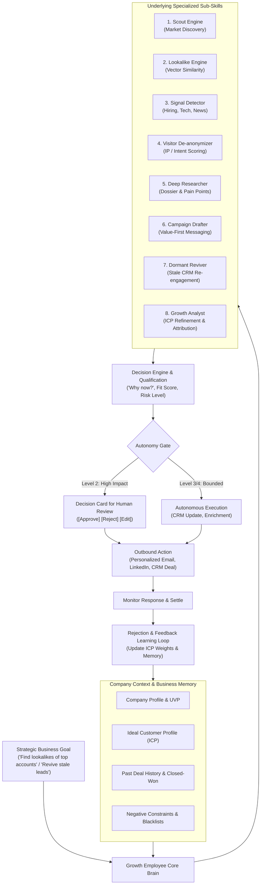
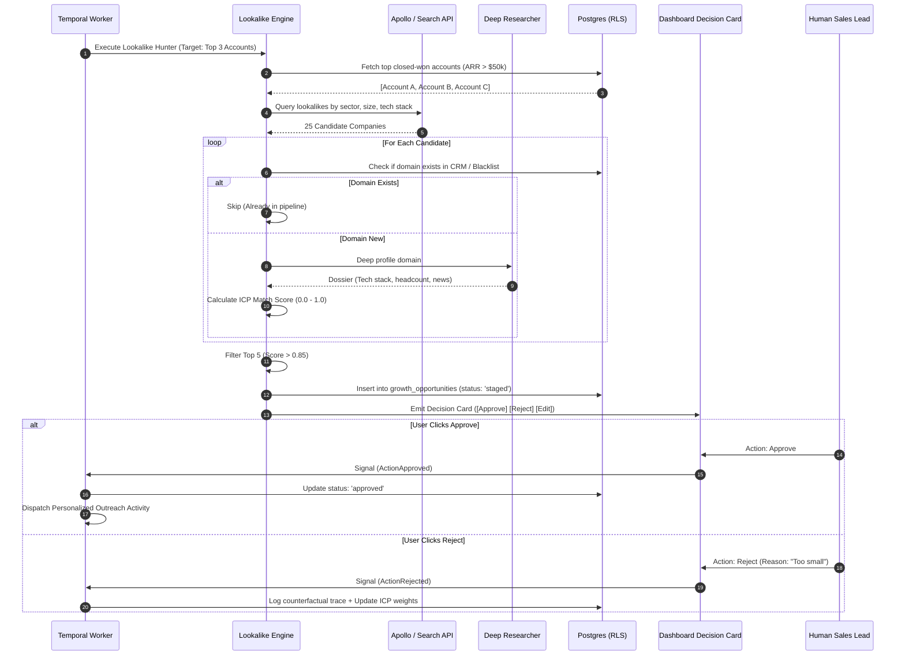

# 01 — Growth Employee: Deep Workflow, Architectural Specification & Operating Model

> **Document Type:** Comprehensive Engineering & Operational Specification  
> **Source:** Synthesized from `DareXAI One_ Employee Blueprint.pdf` (Pages 1–31), engineering gap analyses, runtime execution models, and Temporal workflow architecture.  
> **Core Mandate:** *“Find opportunities for the business, identify when those opportunities are becoming valuable, and make sure the business acts on them.”*

---

## 1. The Fundamental Philosophy & Mental Model

The Growth Employee is not a marketing chatbot, not a fragmented collection of autonomous scraping scripts, and not a static Zapier workflow builder. 

### Why Existing GTM Tools Fall Short
Current go-to-market software forces humans into the role of low-level data orchestrators:
- **Apollo / ZoomInfo:** Provides a massive, stale database; leaves humans to construct filters, export CSVs, and verify deliverability.
- **Clay / Smartlead:** Requires technical operators to string together 15-step enrichment waterfalls that fail unpredictably when third-party APIs change.
- **Swan / Multi-Agent Frameworks:** Presents a chaotic sandbox of 20 micro-agents where the user must define handoffs, prompts, and tool configurations.

### The DareXAI Employee Abstraction
A business executive does not hire a human Head of Growth and say:
> *"Query Google Search $\to$ scrape LinkedIn $\to$ compute similarity score $\to$ call Clearbit $\to$ draft email $\to$ push to CRM."*

The executive provides a strategic business goal:
> *“Find companies similar to our three highest-paying logistics clients in Northern Europe, detect who is actively scaling their freight operations, and prepare personalized introduction briefs for our sales reps.”*

The capabilities live **underneath the employee**. The customer hires the **Growth Employee**, which possesses specialized sub-skills that it invokes autonomously based on context, goals, and feedback.



---

## 2. Onboarding & Context Ingestion: Teaching the Employee the Business

An AI employee without deep business context produces generic spam. Before the Growth Employee executes a single workflow, it must ingest and synthesize four layers of company memory:

```
┌─────────────────────────────────────────────────────────────────────────────────────────┐
│                           GROWTH EMPLOYEE CONTEXT TAXONOMY                              │
├──────────────────────┬──────────────────────────────────────────────────────────────────┤
│ 1. Business Profile  │ What product/service is sold? Pricing models? What exact problem │
│                      │ does it solve? Unique Value Proposition (UVP) vs competitors?    │
├──────────────────────┼──────────────────────────────────────────────────────────────────┤
│ 2. Customer Profile  │ Who buys (titles, seniority)? Who are the top 10 historical      │
│    & ICP Definitions │ closed-won clients? Why did they buy? What indicates high LTV?   │
├──────────────────────┼──────────────────────────────────────────────────────────────────┤
│ 3. Growth Guardrails │ Which geographies, industries, or company sizes are targets?     │
│    & Constraints     │ Negative constraints: Who must NEVER be contacted? Blacklists.   │
├──────────────────────┼──────────────────────────────────────────────────────────────────┤
│ 4. Historical Data   │ Previous email campaigns, open/reply rates, lost deal reasons,   │
│    & Touchpoints     │ existing CRM pipeline, active customer accounts.                 │
└──────────────────────┴──────────────────────────────────────────────────────────────────┘
```

### Context Schema (TypeScript Interface)

```typescript
export interface GrowthBusinessContext {
  orgId: string;
  companyName: string;
  industry: string;
  coreOfferings: Array<{
    name: string;
    description: string;
    targetBuyer: string[];
    priceRange: string;
    keyBenefits: string[];
  }>;
  idealCustomerProfile: {
    targetIndustries: string[];
    targetCompanySizes: Array<{ minEmployees: number; maxEmployees: number }>;
    targetGeographies: string[];
    decisionMakerTitles: string[];
    positiveSignals: string[]; // e.g., "Hiring React Engineers", "Raised Series A"
    disqualificationRules: string[]; // e.g., "B2C only", "Less than 10 employees"
  };
  negativeConstraints: {
    blacklistedDomains: string[];
    blacklistedCompetitors: string[];
    maxOutreachPerDay: number;
    forbiddenPhrases: string[];
  };
  toneAndVoice: {
    style: 'consultative' | 'direct' | 'technical' | 'executive';
    sampleWinningTemplates: string[];
  };
}
```

---

## 3. Natural Language Goal Translation & Execution Planning

When an executive provides a high-level command, the Growth Employee does not execute immediately. It runs a **Goal Translation & Planning Phase**:

### Example Interaction Flow
> **User:** *“Find companies similar to our best customers and help us reach them.”*

The Growth Employee evaluates current context:
1. *Do I know who the best customers are?*
   - Query CRM: Fetch top 5 accounts by ARR and retention duration.
   - Identified: `LogixFleet (ARR $120k)`, `FreightFlow (ARR $95k)`, `TransNordic (ARR $85k)`.
2. *Do I know the geography and target roles?*
   - Ambiguity detected: Geography unspecified.
3. *Proactive Clarification:*
   Instead of guessing, the employee generates a lightweight clarification card:
   > *“I identified our top 3 accounts: LogixFleet, FreightFlow, and TransNordic. They are all mid-market logistics software providers (50–250 employees) in Northern Europe. Should I focus exclusively on Europe, or expand to North America as well?”*

Once confirmed, the employee builds a structured **Execution Plan**:
```json
{
  "planId": "plan_growth_lookalike_01",
  "goal": "Identify and engage 10 lookalikes of LogixFleet, FreightFlow, TransNordic",
  "steps": [
    { "step": 1, "skill": "lookalike_engine", "action": "Extract embedding vectors and search Apollo & Serper for 20 similar companies" },
    { "step": 2, "skill": "deep_researcher", "action": "Verify tech stack, employee count, and recent operational expansion" },
    { "step": 3, "skill": "signal_detector", "action": "Filter for companies with recent hiring or funding signals" },
    { "step": 4, "skill": "qualify_engine", "action": "Score fit against ICP; filter down to top 10 opportunities" },
    { "step": 5, "skill": "campaign_drafter", "action": "Draft tailored email referencing specific trigger event for VP of Logistics" },
    { "step": 6, "skill": "autonomy_gate", "action": "Surface 10 Decision Cards to Dashboard for human approval" }
  ]
}
```

---

## 4. The 8 Specialized Sub-Capabilities

The Growth Employee encapsulates 8 modular sub-skills:

### Sub-Skill 1: Scout Engine (Market Discovery)
- **Role:** Broad market exploration across industry databases, business registries, and open web directories.
- **Capabilities:**
  - Queries search engines (Google Serper / Brave Search) using boolean modifiers (`"logistics platform" AND ("fleet management") AND ("Germany" OR "Netherlands")`).
  - Scrapes corporate directories and industry association member lists.
  - Normalizes raw web listings into structured domain records (`domain`, `company_name`, `headquarters`, `estimated_size`).

### Sub-Skill 2: Lookalike Engine (Vector Similarity)
- **Role:** Finds high-fit prospects that mathematically match existing high-value customers.
- **Algorithm:**
  1. Computes a rich textual representation of existing top customers (UVP, industry classification, customer base, technologies used, employee size, business model).
  2. Generates semantic embeddings using `text-embedding-3-small` or `voyage-large`.
  3. Executes cosine similarity searches over company knowledge graphs and prospective company vectors in PostgreSQL via `pgvector`:
     $$\text{Similarity}(A, B) = \frac{\mathbf{v}_A \cdot \mathbf{v}_B}{\|\mathbf{v}_A\| \|\mathbf{v}_B\|}$$
  4. Applies hard metadata filters (e.g., exclude companies in current CRM, exclude active competitors).

### Sub-Skill 3: Signal Detector (Intent & Timing Engine)
- **Role:** Detects *why now* is the right time to reach out. Reaching out without a trigger is spam; reaching out during a trigger is consultative assistance.
- **Monitored Signals:**
  - **Hiring Spikes:** 3+ job postings for key roles (e.g., "VP Supply Chain", "Warehouse Operations Manager") within 30 days.
  - **Technology Changes:** Adding or removing competing tools (detected via BuiltWith / HTTP header inspection).
  - **Corporate Milestones:** Seed / Series A / Series B funding rounds, new office openings, executive leadership changes.
  - **Regulatory Triggers:** New compliance deadlines impacting their industry.

### Sub-Skill 4: Website Visitor De-anonymizer & Intent Evaluator
- **Role:** Identifies high-intent accounts visiting the company's website before they fill out a form.
- **Capabilities:**
  - Ingests reverse-IP lookups (via 6sense, Clearbit, or Snitcher webhook).
  - Matches corporate IP to CRM records or prospective account database.
  - Analyzes page visit behavior:
    - *Low Intent:* Blog post read for 15 seconds $\to$ Ignore.
    - *High Intent:* Pricing page + Integration docs visited 3 times in 48 hours $\to$ **Immediate High-Priority Opportunity**.
  - Identifies relevant decision makers at that company via Apollo / LinkedIn.

### Sub-Skill 5: Deep Company Researcher
- **Role:** Performs granular research on a qualified target company and synthesizes a **Company Dossier**.
- **Execution:**
  - Fetches homepage, about page, and recent press releases.
  - Analyzes company challenges: What initiatives are they promoting? What is their current pain point?
  - Identifies target decision makers (e.g., Head of Operations, CTO).
  - Output: A comprehensive 1-page dossier attached to the opportunity record.

### Sub-Skill 6: Campaigner & Hyper-Personalized Drafter
- **Role:** Crafts bespoke, value-first messaging that completely avoids standard cold email templates.
- **Guiding Principles:**
  - **Zero Generic Fluff:** Never start with *"I hope this email finds you well"* or *"My name is X and I work at Y"*.
  - **Trigger-Anchored:** Starts directly with the observation: *"Noticed your team recently expanded freight routes into Hamburg..."*
  - **Specific Value Proposition:** Connects the trigger to a verified outcome achieved for a lookalike customer.
  - **Soft Call to Action (CTA):** Requests interest, not a 30-minute calendar lock (*"Open to seeing how LogixFleet handled route balancing during their German expansion?"*).

### Sub-Skill 7: Dormant Opportunity Reviver
- **Role:** Inspects the CRM for forgotten revenue opportunities.
- **Triggers for Dormancy:**
  - Deals marked `Closed Lost` 6+ months ago due to *"timing"* or *"budget"*.
  - Leads contacted 90 days ago that went silent without a firm *"no"*.
  - Former customers who churned on friendly terms.
- **Execution:** Checks if key conditions have changed (e.g., new leadership hired, company raised capital, new features launched that solve their original objection). If verified, drafts a contextual revival email.

### Sub-Skill 8: Growth Analyst & ICP Learner
- **Role:** Analyzes outbound performance, human approvals, and rejections to continuously refine company memory.
- **Feedback Loops:**
  - Tracks reply rates, positive sentiment, meetings booked, and deal velocity per industry / company size.
  - Dynamically updates ICP weights: If 5 biotech prospects are rejected by the human operator with *"Too early stage"*, automatically adds an employee count filter (>50) for all future biotech lookups.

---

## 5. The Four Core Operating Workflows (Step-by-Step Algorithms)

```
┌─────────────────────────────────────────────────────────────────────────────┐
│                    THE 4 PRIMARY GROWTH WORKFLOWS                           │
├─────────────────────────────────────────────────────────────────────────────┤
│ 1. The Lookalike Opportunity Hunter                                         │
│ 2. The Real-Time Intent Signal Trigger                                      │
│ 3. The Dormant CRM Lead Reviver                                             │
│ 4. The High-Intent Website Visitor Interceptor                              │
└─────────────────────────────────────────────────────────────────────────────┘
```

### Workflow 1: The Lookalike Opportunity Hunter



### Workflow 2: Real-Time Intent Signal Trigger
1. **Event Ingestion:** Periodic cron or webhook receives an external signal (e.g., Target Account `NordicLogistics` posts a job opening for *"Head of Automated Routing"*).
2. **Relevance Reasoning:** LLM evaluates:
   - Does this job posting indicate our software is needed?
   - Yes: They are building an automated routing team; our software reduces routing overhead by 40%.
3. **Contact Discovery:** Identifies the VP of Operations or hiring executive via Apollo / LinkedIn connector.
4. **Draft Generation:** Composes a targeted note:
   > *"Hi Erik, saw your team is expanding routing operations in Stockholm. When FreightFlow scaled their Stockholm dispatch hub last quarter, their main bottleneck was legacy carrier sync. We put together a short breakdown of how they solved it—happy to send it over if useful."*
5. **Autonomy Gating:** If confidence > 0.90 and Level 3 autonomy is permitted for existing prospect accounts, stages message; otherwise, surfaces a Decision Card.

### Workflow 3: Dormant CRM Lead Reviver
1. **Scheduled Sweep:** Weekly Temporal cron sweeps CRM leads with `status = 'closed_lost'` or `last_contact_date > 90 days ago`.
2. **Disqualification Check:** Filter out leads explicitly marked *"unqualified"*, *"spam"*, or *"hostile"*.
3. **Trigger Search:** Query web search for company news in the last 90 days:
   - Did they launch a new product?
   - Did they announce a merger or acquisition?
   - Did their competitor suffer a major outage?
4. **Re-engagement Angle:** If a trigger is found, generate a low-friction re-engagement proposal.
5. **Human Sign-Off:** Push to Decision Card stream with 1-click execution.

### Workflow 4: High-Intent Website Visitor Interceptor
1. **Webhook Ingress:** De-anonymization provider fires webhook: `Company: Apex Logistics (50-200 emp), Pages: /pricing (3m), /integrations/hubspot (2m)`.
2. **Context Enrichment:** Verify whether Apex Logistics is an existing lead or customer.
3. **Contact Identification:** Query Apollo for VP of Operations or Head of Sales.
4. **Action Generation:**
   - Add Apex Logistics to CRM as `Prospect - High Intent`.
   - Prepare a gentle outbound note referencing recent industry trends in their specific vertical.
   - Alert account executive via Slack notification: *"Apex Logistics is evaluating pricing right now."*

---

## 6. Autonomy Matrix & Decision Card Protocol

The Growth Employee adheres to a strict 4-tier autonomy governance model:

```
┌─────────────────────────────────────────────────────────────────────────────┐
│                     GROWTH EMPLOYEE AUTONOMY MATRIX                         │
├───────┬──────────────┬─────────────────────────────┬────────────────────────┤
│ Tier  │ Level        │ Permissions                 │ Specific Examples      │
├───────┼──────────────┼─────────────────────────────┼────────────────────────┤
│ L1    │ Observe      │ Read-only scanning          │ Scan web, parse CRM,   │
│       │              │                             │ calculate ICP scores   │
├───────┼──────────────┼─────────────────────────────┼────────────────────────┤
│ L2    │ Recommend    │ Human must approve action   │ Send cold emails, add  │
│       │              │ via Decision Card           │ new contacts to CRM    │
├───────┼──────────────┼─────────────────────────────┼────────────────────────┤
│ L3    │ Guarded Auto │ Executes within bounds      │ Enrich records, tag    │
│       │              │                             │ intent signals, dedup  │
├───────┼──────────────┼─────────────────────────────┼────────────────────────┤
│ L4    │ Autonomous   │ Full autonomy without gate  │ Re-check dormant leads,│
│       │              │                             │ internal analytics     │
└───────┴──────────────┴─────────────────────────────┴────────────────────────┘
```

### The Anatomy of a Decision Card
A Decision Card must provide complete contextual transparency so the human can evaluate and act in under **10 seconds**:

```text
┌─────────────────────────────────────────────────────────────────────────────┐
│ [DECISION CARD] — Growth Opportunity Identified                             │
├─────────────────────────────────────────────────────────────────────────────┤
│ Opportunity: Nordic Logistics (Logistics & Supply Chain • 85 Employees)     │
│ Fit Score: 92/100 (Lookalike match to LogixFleet)                           │
│                                                                             │
│ WHY NOW? (Trigger Event):                                                   │
│ Posted 2 new job openings for "Fleet Dispatcher" in Oslo 3 days ago.        │
│                                                                             │
│ PROPOSED ACTION:                                                            │
│ Send personalized email to Henrik Lindqvist (VP of Operations)              │
│                                                                             │
│ DRAFT MESSAGE:                                                              │
│ "Hi Henrik, noticed Nordic Logistics is growing its Oslo dispatch team.     │
│  When LogixFleet scaled their Nordic operations last year, dispatchers      │
│  were spending 3 hours a day manually reconciling carrier manifests.        │
│  We helped them automate that sync. Thought this might be relevant to       │
│  your team's expansion—worth a quick look?"                                 │
│                                                                             │
│ [ ✔ APPROVE & SEND ]   [ ✎ EDIT DRAFT ]   [ ✖ REJECT ]   [ 💬 FEEDBACK ]   │
└─────────────────────────────────────────────────────────────────────────────┘
```

### Rejection Feedback & Policy Adaptation
If the human clicks `[ ✖ REJECT ]`, the UI prompts for a 1-click reason:
- `[Wrong Size]` $\to$ Updates minimum employee threshold.
- `[Bad Timing]` $\to$ Snoozes domain for 90 days.
- `[Competitor / Partner]` $\to$ Adds domain to permanent blacklist.
- `[Off-brand messaging]` $\to$ Saves message as negative few-shot example.

---

## 7. Data Models & Database Schemas

### PostgreSQL DDL: Growth Opportunities & Intent Signals

```sql
-- Growth Opportunities Table
CREATE TABLE IF NOT EXISTS growth_opportunities (
    id UUID PRIMARY KEY DEFAULT gen_random_uuid(),
    org_id TEXT NOT NULL,
    company_name TEXT NOT NULL,
    domain TEXT NOT NULL,
    icp_score NUMERIC(4, 3) NOT NULL,
    source_skill TEXT NOT NULL, -- 'lookalike', 'signal', 'visitor', 'dormant'
    trigger_type TEXT,          -- 'hiring', 'funding', 'page_visit', 'staleness'
    trigger_summary TEXT,
    target_contact_name TEXT,
    target_contact_title TEXT,
    target_contact_email TEXT,
    target_contact_linkedin TEXT,
    proposed_outreach_channel TEXT DEFAULT 'email',
    proposed_message_body TEXT,
    status TEXT NOT NULL DEFAULT 'staged', -- 'staged', 'approved', 'rejected', 'executed', 'converted'
    rejection_reason TEXT,
    decision_card_id UUID,
    metadata JSONB DEFAULT '{}'::jsonb,
    created_at TIMESTAMPTZ NOT NULL DEFAULT NOW(),
    updated_at TIMESTAMPTZ NOT NULL DEFAULT NOW()
);

-- Lead Intent Signals Table
CREATE TABLE IF NOT EXISTS lead_intent_signals (
    id UUID PRIMARY KEY DEFAULT gen_random_uuid(),
    org_id TEXT NOT NULL,
    domain TEXT NOT NULL,
    signal_type TEXT NOT NULL, -- 'hiring_spike', 'funding', 'tech_change', 'web_visit'
    signal_strength NUMERIC(3, 2) NOT NULL, -- 0.00 to 1.00
    raw_payload JSONB NOT NULL,
    detected_at TIMESTAMPTZ NOT NULL DEFAULT NOW(),
    processed BOOLEAN DEFAULT FALSE
);

-- Indexes & RLS Policies
CREATE INDEX idx_growth_opps_org_status ON growth_opportunities(org_id, status);
CREATE INDEX idx_growth_opps_domain ON growth_opportunities(org_id, domain);
CREATE INDEX idx_lead_signals_org_proc ON lead_intent_signals(org_id, processed);

ALTER TABLE growth_opportunities ENABLE ROW LEVEL SECURITY;
ALTER TABLE lead_intent_signals ENABLE ROW LEVEL SECURITY;

CREATE POLICY growth_opps_org_isolation ON growth_opportunities
    FOR ALL USING (org_id = current_setting('app.current_org_id', true));

CREATE POLICY lead_signals_org_isolation ON lead_intent_signals
    FOR ALL USING (org_id = current_setting('app.current_org_id', true));
```

---

## 8. Temporal Durable Workflow Implementation

```typescript
// services/workflows/src/workflows/GrowthOpportunityWorkflow.ts
import { proxyActivities, defineSignal, setHandler, condition } from '@temporalio/workflow';
import type * as activities from '../activities/growth-activities';

const {
  researchTargetCompany,
  generatePersonalizedPitch,
  createDecisionCard,
  executeOutboundSend,
  recordRejectionLearning
} = proxyActivities<typeof activities>({
  startToCloseTimeout: '5 minutes',
  retry: { maximumAttempts: 3 }
});

export const approveActionSignal = defineSignal<[string]>('approveAction');
export const rejectActionSignal = defineSignal<[string, string]>('rejectAction');

export async function GrowthOpportunityWorkflow(params: {
  orgId: string;
  opportunityId: string;
  domain: string;
}) {
  // Step 1: Deep research activity
  const dossier = await researchTargetCompany(params.orgId, params.domain);
  
  // Step 2: Pitch generation activity
  const pitch = await generatePersonalizedPitch(params.orgId, dossier);
  
  // Step 3: Create Decision Card for human approval
  const cardId = await createDecisionCard(params.orgId, params.opportunityId, pitch);
  
  let approved = false;
  let rejected = false;
  let rejectionReason = '';

  setHandler(approveActionSignal, (userToken) => {
    approved = true;
  });

  setHandler(rejectActionSignal, (userToken, reason) => {
    rejected = true;
    rejectionReason = reason;
  });

  // Step 4: Durable Wait (Pause up to 7 days for human review)
  await condition(() => approved || rejected, '7 days');

  if (approved) {
    // Step 5A: Execute send activity
    await executeOutboundSend(params.orgId, params.opportunityId, pitch);
  } else if (rejected) {
    // Step 5B: Learn from rejection
    await recordRejectionLearning(params.orgId, params.domain, rejectionReason);
  }
}
```

---

## 9. Anti-Spam Guardrails, Safety & Compliance

To protect brand reputation and comply with global communication standards (CAN-SPAM, GDPR, CASL), the Growth Employee enforces strict system guardrails:

1. **Daily Volume Throttling:** Strict cap of maximum 30 cold outbound emails per sender address per day, with randomized send delays (3–12 minutes between sends).
2. **Domain Warming & SPF/DKIM/DMARC Validation:** Automatically halts outbound dispatch if DNS records fail validation or domain bounce rate exceeds 3.5%.
3. **Mandatory 1-Click Opt-Out:** Injects compliant, plain-text opt-out mechanisms in all outbound footers.
4. **Immediate Unsubscribe Honoring:** If an inbound reply contains opt-out keywords (*"unsubscribe"*, *"stop"*, *"not interested"*), the domain is permanently written to `negative_constraints.blacklisted_domains` across all three employees.
5. **No Hallucinated Claims:** The campaign drafter is constrained by system prompts to only reference verified case studies present in the knowledge base.

---

## 10. Multi-Phase Growth Roadmap (V1 to V4)

```
  V1: Lookalike Hunter & Guarded Outbound (Weeks 1–4)
  ├── Single-connection shared CRM + Gmail + Apollo + Serper
  ├── Lookalike vector matching against top 5 closed-won accounts
  ├── 100% Level 2 Autonomy: Every outbound email requires human Decision Card approval
  └── Rejection feedback capture (Too small, bad timing, competitor)
  
  V2: Intent Signals & Dormant Lead Reviver (Weeks 5–8)
  ├── Ingestion of hiring spikes and funding triggers
  ├── Automated weekly sweep of dormant CRM opportunities (>90 days)
  ├── Website visitor de-anonymization via reverse-IP webhook
  └── Level 3 Autonomy for CRM record enrichment and stage tagging
  
  V3: Multi-Channel Touchpoints & ICP Auto-Tuning (Weeks 9–12)
  ├── LinkedIn message drafts + phone call battle-card generation for reps
  ├── Autonomous adjustment of ICP weights based on 30-day conversion cohorts
  └── Cross-employee sync: Growth informs Customer Employee of new account pain points
  
  V4: Autonomous Revenue Intelligence (Enterprise)
  ├── Predictive churn signals alerting Growth to account renewal expansion
  ├── Dynamic competitive displacement triggers (competitor price hikes)
  └── Complete autonomous orchestration of top-of-funnel outbound
```
