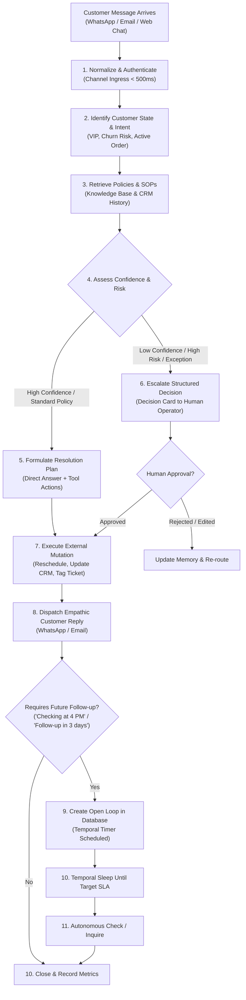
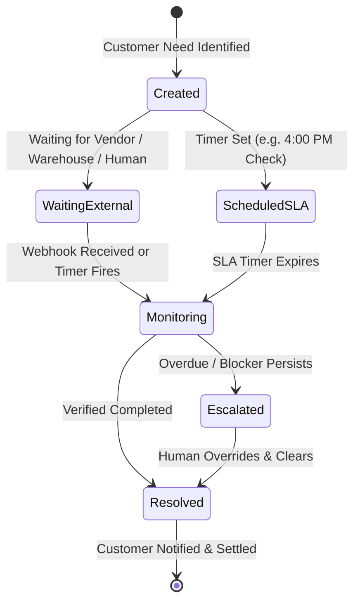

# 02 — Customer Employee: Resolution Engine, Open Loops & Operating Architecture

> **Document Type:** Comprehensive Engineering & Operational Specification  
> **Source:** Synthesized from `DareXAI One_ Employee Blueprint.pdf` (Pages 32–61), engineering gap analyses, runtime execution models, and Temporal workflow architecture.  
> **Core Mandate:** *“The Customer Employee is not responsible for answering messages. It is responsible for resolving customer needs from the moment they ask for help until their issue is resolved.”*

---

## 1. The Fundamental Philosophy: Resolution vs. Reply

The fundamental failure of first-generation customer service AI (chatbots, auto-responders, Intercom Fin) is optimizing for **speed of conversational reply** rather than **depth of business resolution**:

```
┌─────────────────────────────────────────────────────────────────────────────────────────┐
│                           REPLY VS. RESOLUTION PARADIGM                                 │
├────────────────────────────────┬────────────────────────────────────────────────────────┤
│ The Chatbot Paradigm           │ Inbound Message → LLM Prompt → Polite Text Reply       │
│ (Answering Messages)           │ The customer still has the problem. No state changed.  │
├────────────────────────────────┼────────────────────────────────────────────────────────┤
│ The DareXAI Employee Model     │ Inbound Need → Context → Verification → Tool Action    │
│ (Resolving Needs)              │ → Follow-up SLA → Closed Loop                          │
└────────────────────────────────┴────────────────────────────────────────────────────────┘
```

### The Core Operating Law
A human customer service manager does not view a ticket as completed because an email was sent. A ticket is completed when:
1. The underlying system record has been correctly updated (e.g., appointment moved in Calendar, refund issued in Stripe, delivery address changed in Shopify).
2. The customer has received clear confirmation.
3. Any future obligations (*"checking with the warehouse at 4:00 PM"*) are tracked as **Open Loops** until verified.



---

## 2. Onboarding & Context Ingestion: Teaching the Employee the Business

Before the Customer Employee touches an inbound channel, it must ingest the company's operational rules, policies, and system permissions:

```
┌─────────────────────────────────────────────────────────────────────────────────────────┐
│                          CUSTOMER EMPLOYEE CONTEXT TAXONOMY                             │
├──────────────────────┬──────────────────────────────────────────────────────────────────┤
│ 1. Business Policies │ Exact refund rules (e.g., "Full refund if within 14 days and     │
│    & SOPs            │ unopened"), cancellation terms, warranty policies, service SLAs. │
├──────────────────────┼──────────────────────────────────────────────────────────────────┤
│ 2. Operational Rules │ Operating hours, delivery timeframes, escalation contacts for    │
│                      │ emergencies, dietary restrictions (hospitality), pricing tiers.  │
├──────────────────────┼──────────────────────────────────────────────────────────────────┤
│ 3. Systems of Record │ Where does truth live? (Shopify for orders, Calendar for slots,  │
│                      │ HubSpot for CRM deals, Stripe for invoices).                     │
├──────────────────────┼──────────────────────────────────────────────────────────────────┤
│ 4. Negative Guardrails│ Forbidden commitments ("Never guarantee same-day delivery unless│
│                      │ courier API confirms"), VIP customer lists, tone constraints.    │
└──────────────────────┴──────────────────────────────────────────────────────────────────┘
```

---

## 3. The 12-Step Autonomous Resolution Engine

The Customer Employee executes a deterministic, 12-step cognitive loop for every customer interaction:

### Step 1: Ingest & Channel Normalization
- Ingests inbound payloads from WhatsApp Cloud API, Gmail, Zendesk, Intercom, or Web Forms.
- Fast ACK: Responds `200 OK` to the provider within **500ms** to satisfy platform timeout limits (e.g., Meta WhatsApp 3,000ms deadline).
- Enqueues background processing task.

### Step 2: Understand Intent & Identity Resolution
- Maps inbound phone number or email to a unified customer record in PostgreSQL.
- Extracts core intent using structured JSON schema:
  - `intent_category`: `'billing'` | `'scheduling'` | `'support'` | `'complaint'` | `'general'`
  - `urgency`: `'critical'` | `'high'` | `'normal'` | `'low'`
  - `requested_mutation`: Boolean (Does the customer want something changed in a database?)

### Step 3: Customer State & Journey Resolution
- Queries CRM and transaction history to determine the customer's exact relationship state:
  - *Is this a high-value VIP customer (LTV > $10,000)?*
  - *Do they have an active open order currently in transit?*
  - *Have they reported 2+ issues in the past 14 days (High Churn Risk)?*

### Step 4: Knowledge Base & Policy Retrieval
- Executes hybrid vector + BM25 keyword search over scoped company SOPs, FAQs, and policy documents stored in Google Drive / Notion.
- Fetches exact constraint rules (e.g., *"Table reservations over 6 people require a $50 deposit"*).

### Step 5: Confidence & Risk Assessment
- Computes an autonomous confidence composite score ($C \in [0.0, 1.0]$):
  $$C = 0.40 \cdot \text{RetrievalRelevance} + 0.35 \cdot \text{IntentClarity} + 0.25 \cdot \text{PolicyMatch}$$
- If $C < 0.85$ or if the requested action involves irreversible financial or high-risk changes, marks action for **Human Gating**.

### Step 6: Determine Next Best Action
- Evaluates whether the request is:
  1. *Informational Answer:* Can be answered directly via knowledge base.
  2. *Executable Mutation:* Requires calling a connector tool (e.g., reschedule booking, update address).
  3. *Policy Exception:* Requires human managerial discretion.

### Step 7: Autonomy Gating & Decision Escalation
- **"Escalate Decisions, Not Conversations":**
  If human intervention is required, the AI Employee does **not** dump a raw chat into a Slack channel. It generates a **Structured Decision Card**:
  - Who the customer is & their value.
  - Exactly what they asked for.
  - The policy constraint that prevents automatic execution.
  - The recommended resolution with a 1-click execution button.

### Step 8: External Tool Execution
- Invokes external tools via the unified MCP connector layer (`mcp.darex.*`):
  - `calendar.rescheduleAppointment`
  - `crm.updateContactState`
  - `payment.issueRefund`
  - `support.createInternalTicket`

### Step 9: Customer Communication & Empathy Framing
- Crafts a personalized, clear, and empathetic response.
- Explicitly states what actions have been performed and what will happen next.
- Avoids robotic boilerplate (*"Your request has been logged"* $\to$ *"I've moved your table to tomorrow at 7:30 PM and notified Chef Marcus about your peanut allergy."*).

### Step 10: Open Loop Creation & SLA Timer Scheduling
- If the resolution involves a future dependency (*"The warehouse manager will check on this order at 4:00 PM"*), the employee creates a persistent **Open Loop** in PostgreSQL.
- Schedules a durable Temporal workflow timer to wake up and verify the status at the target SLA timestamp.

### Step 11: Verification & Customer Confirmation
- Verifies that external API calls returned success (`HTTP 200 / 204`).
- Confirms the updated state in the underlying system of record before reporting completion.

### Step 12: Outcome Recording, Memory Update & Learning
- Appends the complete interaction trajectory, tool calls, and customer sentiment to the `agent_decision_ledger`.
- Updates the customer's profile memory with newly discovered preferences (e.g., dietary restrictions, preferred meeting times).

---

## 4. The Open Loop Architecture: Never Let Work Slip

One of the greatest points of customer dissatisfaction in service businesses is the **"Broken Promise"**: an agent says *"I'll check on this and get back to you"*, and the ticket is forgotten.

DareXAI introduces the **Open Loop State Machine**:



### Open Loop Database Schema (PostgreSQL DDL)

```sql
CREATE TABLE IF NOT EXISTS agent_open_loops (
    id UUID PRIMARY KEY DEFAULT gen_random_uuid(),
    org_id TEXT NOT NULL,
    customer_id TEXT NOT NULL,
    customer_channel TEXT NOT NULL, -- 'whatsapp', 'email', 'zendesk'
    customer_contact_handle TEXT NOT NULL, -- phone number or email
    issue_summary TEXT NOT NULL,
    promised_action TEXT NOT NULL,
    dependency_type TEXT NOT NULL, -- 'warehouse_check', 'refund_approval', 'supplier_response', 'follow_up'
    status TEXT NOT NULL DEFAULT 'open', -- 'open', 'waiting_external', 'monitoring', 'escalated', 'resolved'
    target_check_at TIMESTAMPTZ NOT NULL,
    escalation_timeout_at TIMESTAMPTZ NOT NULL,
    assigned_employee TEXT NOT NULL DEFAULT 'customer_employee',
    metadata JSONB DEFAULT '{}'::jsonb,
    created_at TIMESTAMPTZ NOT NULL DEFAULT NOW(),
    updated_at TIMESTAMPTZ NOT NULL DEFAULT NOW()
);

CREATE INDEX idx_open_loops_org_status ON agent_open_loops(org_id, status);
CREATE INDEX idx_open_loops_target_check ON agent_open_loops(target_check_at) WHERE status = 'open';

ALTER TABLE agent_open_loops ENABLE ROW LEVEL SECURITY;
CREATE POLICY open_loops_org_isolation ON agent_open_loops
    FOR ALL USING (org_id = current_setting('app.current_org_id', true));
```

---

## 5. Detailed Real-World Scenario Walkthroughs

### Scenario A: Restaurant Reservation & Special Dietary Request
- **Context:** High-end Italian restaurant using DareXAI via WhatsApp.
- **Inbound Message (11:15 AM):**  
  > *"Hi, can I move our reservation tonight from 7:00 PM to 8:30 PM for 4 people? Also, my wife has a severe tree nut allergy."*
- **Step-by-Step Resolution:**
  1. *Customer Recognition:* Matches phone number to `VIP Guest: Michael Chang (5 visits, $1,200 lifetime spend)`.
  2. *Check Availability:* Invokes `calendar.getAvailability({ date: 'today', partySize: 4, targetTime: '20:30' })`.
  3. *Result:* 8:30 PM is fully booked; 8:45 PM has an open booth.
  4. *Policy Check:* Restaurant allows $\pm 30$ minute flexibility for VIP guests.
  5. *Execution:*
     - Reserves 8:45 PM slot.
     - Updates reservation notes in SevenRooms / Google Sheets: `"Guest: Michael Chang. Severe tree nut allergy. Alert Chef."`
  6. *Customer Reply:*
     > *"Hi Michael! We have you moved to 8:45 PM tonight in a booth (8:30 PM was fully booked). I've also flagged the kitchen and Chef Antonio regarding your wife's tree nut allergy so the team is prepared. See you at 8:45 PM!"*
  7. *Open Loop:* None needed; issue completely resolved.

---

### Scenario B: B2B SaaS Enterprise Billing & Downgrade Dispute
- **Context:** B2B SaaS platform ($299/mo plan).
- **Inbound Email (2:30 PM):**  
  > *"We were charged $299 yesterday, but our account was supposed to be paused. I want an immediate refund and cancellation."*
- **Step-by-Step Resolution:**
  1. *Identity & Contract Resolution:* Identifies customer `Sarah Jenkins, VP Marketing at RetailPulse`. Account plan: Annual Pro ($299/mo).
  2. *Policy Evaluation:* Policy dictates: *Refunds over $100 require human managerial sign-off. Pausing must be requested before billing cycle renews.*
  3. *Confidence Assessment:* $C = 0.72$ (Policy exception required; financial refund exceeds autonomous limit).
  4. *Decision Escalation:* The employee creates a **Decision Card** in Slack / Dashboard:
     ```text
     ┌─────────────────────────────────────────────────────────────────────┐
     │ [DECISION CARD] — Refund & Cancellation Request                     │
     ├─────────────────────────────────────────────────────────────────────┤
     │ Customer: Sarah Jenkins (RetailPulse • ARR $3,588)                 │
     │ Issue: Charged $299 renewal after intended pause.                  │
     │ Account Health: High Churn Risk (Account active 14 months).         │
     │                                                                     │
     │ Policy Constraint: Refund > $100 requires manager approval.        │
     │ Recommended Action:                                                 │
     │ 1. Approve full refund of $299.                                     │
     │ 2. Apply courtesy pause for 60 days rather than hard churn.         │
     │                                                                     │
     │ [ ✔ APPROVE REFUND & PAUSE ]   [ ✖ REJECT ]   [ ✎ CUSTOM AMOUNT ]   │
     └─────────────────────────────────────────────────────────────────────┘
     ```
  5. *Human Action:* Manager clicks `[ ✔ APPROVE REFUND & PAUSE ]`.
  6. *Execution:*
     - Calls `stripe.refundPayment({ chargeId: 'ch_109283', amount: 29900 })`.
     - Calls `crm.updateSubscriptionState({ orgId: 'RetailPulse', status: 'paused_60_days' })`.
  7. *Customer Confirmation:*
     > *"Hi Sarah, I've processed a full refund of $299 back to your card (should reflect in 3–5 business days), and paused your subscription for 60 days so your historical workspace data is safely preserved. Let me know if you need anything else!"*

---

### Scenario C: E-Commerce Lost Package & Warehouse Check
- **Context:** Direct-to-Consumer e-commerce brand.
- **Inbound Message (10:14 AM):**  
  > *"My order #48291 was supposed to arrive yesterday. Tracking says it's stuck in transit. Where is it?"*
- **Step-by-Step Resolution:**
  1. *Tracking Lookup:* Queries carrier API (FedEx/ShipStation): Package delayed at regional hub due to weather. Expected delivery tomorrow morning.
  2. *Immediate Action:* Sends empathetic notification explaining the carrier delay.
  3. *Open Loop Creation:* Does **not** close the ticket. Creates an Open Loop:
     - `target_check_at`: Tomorrow at 11:00 AM.
     - `promised_action`: Verify carrier delivered the package; if still stuck, initiate replacement shipment.
  4. *Temporal Timer:* Sleeps for 24 hours.
  5. *Verification Tomorrow:* Timer wakes up, queries FedEx API $\to$ Package delivered at 9:42 AM.
  6. *Proactive Closing Follow-up:*
     > *"Hi David, tracking shows your package was delivered this morning at your front porch. Just wanted to confirm you received everything in good order?"*

---

## 6. Sentiment Analysis & Churn Risk Sentinel

The Customer Employee continuously assesses the emotional and commercial health of the relationship:

```
┌─────────────────────────────────────────────────────────────────────────────┐
│                       CHURN RISK EVALUATION ENGINE                          │
├──────────────────────┬─────────────────────────────┬────────────────────────┤
│ Frustration Marker   │ Sentiment Trigger           │ Automated Safeguard    │
├──────────────────────┼─────────────────────────────┼────────────────────────┤
│ High Threat Language │ "Lawyer", "Fraud", "Scam",  │ Immediate priority P0  │
│                      │ "Chargeback", "Terrible"    │ page to executive lead │
├──────────────────────┼─────────────────────────────┼────────────────────────┤
│ Chronic Friction     │ 3+ tickets submitted within │ Tag as 'At-Risk';      │
│                      │ 14 days without resolution  │ suppress upsell emails │
├──────────────────────┼─────────────────────────────┼────────────────────────┤
│ Feature Churn Tell   │ "Missing feature X", "Why   │ Route feedback to      │
│                      │ can't we do Y anymore?"     │ product knowledge base │
└──────────────────────┴─────────────────────────────┴────────────────────────┘
```

When high churn risk is detected, the Customer Employee initiates the **Customer Recovery Protocol**:
1. Freezes all outgoing automated sales / promotional emails via the shared Connect layer.
2. Formulates an executive recovery proposal (e.g., courtesy account credit or personalized check-in from founder).
3. Surfaces a high-priority Decision Card to the customer success team.

---

## 7. Safety, Anti-Hallucination Guardrails & Fallbacks

To ensure absolute reliability, the Customer Employee enforces strict architectural guardrails:

1. **Zero Hallucination on Ground Truth:** The model is prohibited from guessing inventory quantities, flight/appointment availability, or order tracking numbers. If the API returns no data, the model must respond: *"I am checking the real-time record with our team and will confirm shortly."*
2. **Deterministic Mutation Safeguards:** Tool calls that modify state (`reschedule`, `cancel`, `refund`) require strict JSON schema validation before dispatch.
3. **No Unbounded Promises:** System prompt strictly forbids promises containing unconditional future commitments (*"I promise this will arrive tomorrow"*) unless the external logistics API explicitly guarantees delivery.
4. **Fallback Circuit Breaker:** If 2 consecutive tool executions fail or return errors, the interaction is immediately routed to human triage with an apology message to the customer.

---

## 8. Temporal Durable Workflow Implementation

```typescript
// services/workflows/src/workflows/CustomerInteractionWorkflow.ts
import { proxyActivities, defineSignal, setHandler, condition, sleep } from '@temporalio/workflow';
import type * as activities from '../activities/customer-activities';

const {
  fetchCustomerProfile,
  evaluateIntentAndPolicy,
  executeResolutionMutation,
  dispatchCustomerMessage,
  createOpenLoopRecord,
  resolveOpenLoopRecord,
  createDecisionCard
} = proxyActivities<typeof activities>({
  startToCloseTimeout: '2 minutes',
  retry: { maximumAttempts: 3 }
});

export const decisionSignal = defineSignal<[string, boolean, any]>('decisionSignal');

export async function CustomerInteractionWorkflow(params: {
  orgId: string;
  customerId: string;
  channel: string;
  incomingMessage: string;
}) {
  // Step 1: Ingest & Retrieve context
  const customer = await fetchCustomerProfile(params.orgId, params.customerId);
  const evaluation = await evaluateIntentAndPolicy(params.orgId, customer, params.incomingMessage);

  if (evaluation.requiresHumanApproval) {
    // Step 2A: Escalate structured decision card
    const cardId = await createDecisionCard(params.orgId, customer, evaluation);
    
    let decisionReceived = false;
    let approved = false;
    let overrides: any = null;

    setHandler(decisionSignal, (token, isApproved, userOverrides) => {
      decisionReceived = true;
      approved = isApproved;
      overrides = userOverrides;
    });

    // Wait up to 24 hours for human sign-off
    await condition(() => decisionReceived, '24 hours');

    if (approved) {
      await executeResolutionMutation(params.orgId, evaluation.actionPayload, overrides);
      await dispatchCustomerMessage(params.orgId, params.channel, customer.handle, evaluation.approvalMessage);
    } else {
      await dispatchCustomerMessage(params.orgId, params.channel, customer.handle, evaluation.rejectionMessage);
    }
  } else {
    // Step 2B: Autonomous Resolution
    if (evaluation.toolAction) {
      await executeResolutionMutation(params.orgId, evaluation.toolAction);
    }
    await dispatchCustomerMessage(params.orgId, params.channel, customer.handle, evaluation.resolutionText);
  }

  // Step 3: Check if Open Loop is required
  if (evaluation.futureDependency) {
    const loopId = await createOpenLoopRecord(params.orgId, customer, evaluation.futureDependency);
    
    // Durable timer: sleep until target check SLA
    await sleep(evaluation.futureDependency.waitDurationMs);
    
    // Wake up and verify resolution
    await resolveOpenLoopRecord(params.orgId, loopId);
  }
}
```

---

## 9. Multi-Phase Customer Roadmap (V1 to V4)

```
  V1: Guarded Resolution & WhatsApp Intake (Weeks 1–4)
  ├── WhatsApp Business + Gmail + Google Calendar + Drive SOP ingestion
  ├── Autonomous FAQ answering (100% ground-truth verified from Docs)
  ├── 100% Level 2 Gating on database mutations (refunds, cancellations, bookings)
  └── Open Loop tracking with Temporal timers for multi-hour promises
  
  V2: Autonomous Actions & Omnichannel Support (Weeks 5–8)
  ├── Level 3 Autonomy: Automatic calendar rescheduling within open booking windows
  ├── Zendesk & Intercom bidirectional synchronization
  ├── Automatic tracking and follow-up on order shipping delays
  └── Real-time sentiment scoring and churn alert triggers
  
  V3: Proactive Customer Recovery & Health Scoring (Weeks 9–12)
  ├── Automated re-engagement for customers who experienced delivery delays
  ├── VIP concierge routing based on LTV and historical ticket frequency
  └── Shared context bridge: Customer Employee alerts Growth of expansion readiness
  
  V4: Autonomous Customer Operations Hub (Enterprise)
  ├── Voice agent telephony integration for phone reservations and Tier 1 triage
  ├── Dynamic self-healing knowledge base that drafts new SOPs from human escalations
  └── Enterprise multi-brand and multi-region routing
```
