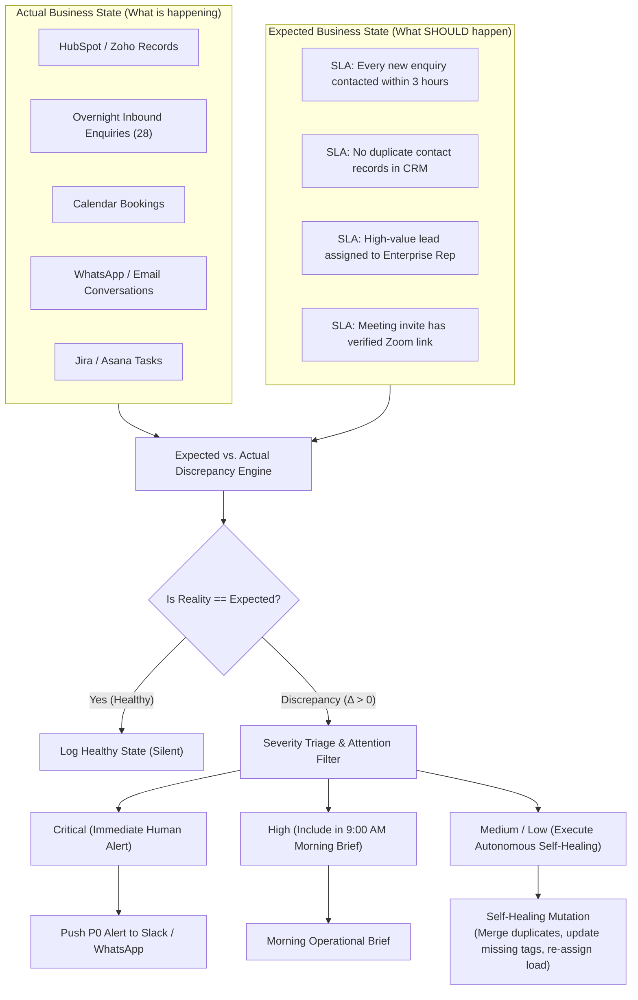

# 03 — Operations Employee: Operating Architecture, Expected vs. Actual Engine & Workflows

> **Document Type:** Comprehensive Engineering & Operational Specification  
> **Source:** Synthesized from `DareXAI One_ Employee Blueprint.pdf` (Pages 62–98), engineering gap analyses, runtime execution models, and Temporal workflow architecture.  
> **Core Mandate:** *“Keep the business moving. Make sure routine work gets completed correctly. Nothing important should fall through the cracks.”*

---

## 1. The Fundamental Mental Model: Expected vs. Actual

Traditional automation systems (Zapier, Make, cron jobs) execute dumb, blind steps:
$$\text{Trigger} \longrightarrow \text{Action}$$
If an API fails, data is malformed, or a human forgets to perform their task, the automation system is completely oblivious. The task dies silently in an error log.

### The DareXAI Operations Paradigm
The Operations Employee is built on an **Expected vs. Actual State Discrepancy Engine**:

$$\text{Business Rule / Expected State} \quad \longleftrightarrow \quad \text{Real-World / Actual State} \quad \Longrightarrow \quad \Delta \text{ (Discrepancy / Action)}$$



### Core Axiom
> *“The Operations Employee is not responsible for running workflows. It is responsible for making sure operational work gets completed correctly.”*

---

## 2. The 9 Core Operational Workflows (Granular Algorithmic Specifications)

The Operations Employee executes 9 mission-critical operational workflows:

```
┌─────────────────────────────────────────────────────────────────────────────┐
│                   THE 9 OPERATIONS EMPLOYEE WORKFLOWS                       │
├─────────────────────────────────────────────────────────────────────────────┤
│ 1. The Morning Operation (9:00 AM Intake & Daily Operational Brief)         │
│ 2. Continuous Daytime Monitoring (SLA Breaches & Real-time Drift)           │
│ 3. Multi-Calendar Scheduling & Intelligent Rescheduling                    │
│ 4. Follow-Up Verification (Human Rep SLA Enforcement)                       │
│ 5. Task Assignment & Dynamic Capacity Load Balancing                        │
│ 6. Data Hygiene, Entity Resolution & Duplicate Record Reconciliation        │
│ 7. Knowledge Base & SOP Drift Synchronization                               │
│ 8. Stuck Work Detection & Cross-System Unblocking                           │
│ 9. External Outage & Incident Buffering                                     │
└─────────────────────────────────────────────────────────────────────────────┘
```

---

### Workflow 1: The Morning Operation (9:00 AM Intake & Daily Brief)
- **Schedule:** Runs every business morning at 9:00 AM local organization time via Temporal Cron (`continueAsNew`).
- **Input Corpus:** Ingests all overnight events across Gmail, WhatsApp, Web Forms, and CRM created in the last 24 hours (e.g., 28 inbound items).
- **Execution Pipeline:**
  1. **Deduplication & Matching:** Compares incoming items against existing contacts using fuzzy name and email matching.
  2. **CRM Record Creation / Update:**
     - Creates new leads for unmapped contacts.
     - Enriches existing records with overnight conversation context.
  3. **Discrepancy Evaluation:** Checks if any item breaches expected business rules.
  4. **The Morning Report Generation:** Produces a clean, noise-free summary for business leadership.

#### Real-World Example (The YC Demo Baseline)
```text
Operations Employee — Daily Morning Brief
Time: 9:00 AM EST • 28 Overnight Enquiries Processed

Operational Throughput:
• 8 new leads created in CRM
• 12 existing contact records updated
• 5 inbound messages matched to open conversation threads

3 Items Require Attention:
1. [CRITICAL] High-value enterprise enquiry (Nexus Logistics, 500+ emp) — 
   Arrived at 6:15 AM. SLA threshold (3h) reached. No assigned rep has contacted.
   Recommended Action: Reassign to Sarah Miller & send introductory brief.
   [ ✔ APPROVE REASSIGNMENT ]

2. [HIGH] Potential Duplicate CRM Record Detected:
   Record A: "David K., Apex Trans" (created Jan 2026)
   Record B: "Dave Klein, Apex Transportation Inc." (arrived 4:00 AM)
   Confidence: 81%. Not merged autonomously due to conflicting phone numbers.
   [ MERGE RECORDS ]   [ KEEP SEPARATE ]

3. [MEDIUM] Missing Information:
   Inbound form submission from "Dr. Alan Grant" — Phone provided is missing 
   country code (+44 vs +1). CRM marked as "Incomplete Contact".
   [ DISPATCH SMS LOOKUP ]

Everything else is verified and up to date.
```

---

### Workflow 2: Continuous Daytime Monitoring
- **Trigger:** Runs continuously throughout the business day (either via real-time webhooks or 15-minute polling passes).
- **Checks Executed:**
  - *Lead Response Time:* Monitors elapsed time between lead creation and first human outreach.
  - *SLA Timers:* Flags leads idle for >180 minutes.
  - *Missed Milestones:* Alerts if a scheduled demo was marked as completed in Calendar but no notes were logged in CRM within 2 hours.

---

### Workflow 3: Multi-Calendar Scheduling & Intelligent Rescheduling
- **Objective:** Eliminate back-and-forth scheduling friction while maintaining strict calendar rules.
- **Rules Enforced:**
  - Respect buffer zones (e.g., 15-minute gap between client meetings).
  - Enforce working hours and timezone parity.
  - Automatically generate video conference links (Zoom / Google Meet) and verify link validity.
- **Rescheduling Negotiation:** When a client says *"Can we move to Thursday afternoon?"*, the employee checks host calendars, finds optimal slots, reserves the slot tentatively, and sends confirmation.

---

### Workflow 4: Follow-Up Verification (Human SLA Enforcement)
- **Problem Solved:** Reps forget to follow up with leads after introductory calls.
- **Algorithm:**
  1. Detects calendar event: `Demo with Novatech` concluded at 3:00 PM.
  2. Temporal workflow starts a 24-hour timer.
  3. At $T+24\text{h}$, inspects CRM and Gmail sent items for outbound communication to Novatech attendees.
  4. If no follow-up email or proposal is logged:
     - Pings the assigned account rep in Slack: *"Hey Alex, noticed Novatech's demo concluded yesterday, but no follow-up email is logged. Here is a drafted follow-up recap based on the meeting notes—want to send it?"*

---

### Workflow 5: Task Assignment & Capacity Load Balancing
- **Objective:** Route incoming work based on real-time rep capacity, skill tags, and geographic territory.
- **Routing Heuristics:**
  $$\text{Score}(Rep) = 0.50 \cdot (1 - \text{CurrentOpenDeals}/\text{MaxCapacity}) + 0.30 \cdot \text{TerritoryMatch} + 0.20 \cdot \text{PastConversionRate}$$
- Automatically prevents high-performing reps from being overloaded while junior reps sit idle.

---

### Workflow 6: Data Hygiene, Entity Resolution & Duplicate Reconciliation
- **Objective:** Maintain pristine CRM data without corrupting records through false-positive merges.
- **Entity Resolution Confidence Bands:**
  - **Match Confidence $\ge 95\%$:** Exact match on corporate email domain (`@acme.com`) and identical full name $\to$ **Merge Autonomously (Level 3 Autonomy)**.
  - **Match Confidence $75\% - 94\%$:** Fuzzy match (e.g., *"Apex Trans"* vs *"Apex Transportation"*), identical website, but different phone numbers $\to$ **Stage for Human Review in Morning Brief**.
  - **Match Confidence $< 75\%$:** Distinct entities $\to$ **Keep Separate; Log Negative Trace**.

---

### Workflow 7: Knowledge Base & SOP Drift Synchronization
- **Objective:** Ensure the organization's knowledge base reflects reality.
- **Execution:**
  - Inspects updated pricing sheets or service agreements in Google Drive.
  - Compares new terms against old FAQ documents.
  - If a discrepancy is detected (e.g., pricing sheet says $49/mo, website FAQ says $39/mo), alerts the operations manager: *"Pricing drift detected between Drive Sheet 'Pricing_2026.xlsx' and Knowledge Base Doc #14."*

---

### Workflow 8: Stuck Work Detection & Cross-System Unblocking
- **Objective:** Spot tasks that have been stalled across Jira, Trello, Google Sheets, or CRM.
- **Stuck Criteria:**
  - Deal in `Contract Sent` stage for >7 days without signature.
  - Customer ticket marked `Waiting on Development` with no Jira update for >5 days.
  - Internal purchase request pending approval for >72 hours.
- **Unblocking Action:** Sends a polite, context-aware ping to the blocker owner: *"Contract for Apex Logistics has been with legal for 8 days. Renewal deadline is in 48 hours. Can we assist in unblocking this?"*

---

### Workflow 9: External Outage & Incident Buffering
- **Objective:** Protect the business when external SaaS services (HubSpot, WhatsApp, Stripe) suffer outages.
- **Mechanism:**
  - Catches upstream HTTP 500/503 errors.
  - Buffers inbound and outbound payloads in PostgreSQL `offline_event_buffer`.
  - Continuously probes endpoint health with exponential backoff.
  - Upon service restoration, drains the buffer sequentially in exact timestamp order, avoiding race conditions and duplicate executions.

---

## 3. The Morning Brief Architecture: Signal vs. Noise

A major danger of AI operations tools is **Notification Fatigue**: spamming the founder with 50 trivial notifications until all alerts are ignored.

```
┌─────────────────────────────────────────────────────────────────────────────┐
│                     ATTENTION SEVERITY FILTERING MODEL                      │
├───────────┬──────────────────────────────────┬──────────────────────────────┤
│ Severity  │ Action Channel                   │ Criteria                     │
├───────────┼──────────────────────────────────┼──────────────────────────────┤
│ CRITICAL  │ Immediate Slack / SMS Interrupt  │ Revenue at immediate risk,   │
│           │ (Within 5 minutes)               │ SLA breach on enterprise VIP │
├───────────┼──────────────────────────────────┼──────────────────────────────┤
│ HIGH      │ Included in 9:00 AM Morning      │ Approvals needed, ambiguous  │
│           │ Brief Summary                    │ duplicates, overdue tasks    │
├───────────┼──────────────────────────────────┼──────────────────────────────┤
│ MEDIUM    │ Dashboard Activity Feed          │ Informational status changes,│
│           │ (No active notification)         │ auto-assigned leads          │
├───────────┼──────────────────────────────────┼──────────────────────────────┤
│ LOW       │ Silent Postgres Ledger           │ Successful auto-merges,      │
│           │ (Available on audit query)       │ routine tag updates          │
└───────────┴──────────────────────────────────┴──────────────────────────────┘
```

> **The Golden Health Rule:** In a perfectly functioning organization, the Morning Brief should be **nearly empty**:  
> *"28 enquiries processed. All records matched, enriched, and assigned. Zero items require attention."*

---

## 4. The Explanatory Engine: "Why Did You?" & "Why Didn't You?"

A true employee can explain its reasoning retroactively. DareXAI implements **Counterfactual Decision Logging**:

### Example Query 1: "Why did you do that?"
- **User:** *“Why did you assign Nexus Logistics to Sarah instead of John?”*
- **Operations Employee:**  
  > *“Nexus Logistics is an enterprise account (500+ employees). Sarah currently has 4 open enterprise deals with a 38% close rate, while John is at capacity with 9 active deals. Sarah also handles our Midwest territory where Nexus is headquartered.”*

### Example Query 2: "Why didn't you do that?" (The Harder Test)
- **User:** *“Why didn't you merge Dave Klein with David K. this morning?”*
- **Operations Employee:**  
  > *“I identified an 81% text similarity between the names and company domains. However, Dave Klein registered with a Chicago landline, while David K. is listed with a London mobile number. Because our cross-country merge confidence threshold is 95%, I flagged it for your manual confirmation rather than risking data corruption.”*

---

## 5. Autonomy Governance & Permission Tiers

```
┌─────────────────────────────────────────────────────────────────────────────┐
│                   OPERATIONS EMPLOYEE AUTONOMY MATRIX                       │
├───────┬──────────────┬─────────────────────────────┬────────────────────────┤
│ Tier  │ Level        │ Execution Scope             │ Concrete Examples      │
├───────┼──────────────┼─────────────────────────────┼────────────────────────┤
│ L1    │ Observe      │ Read-only cross-system scan │ Check CRM, inspect     │
│       │              │                             │ calendars, read Sheets │
├───────┼──────────────┼─────────────────────────────┼────────────────────────┤
│ L2    │ Recommend    │ Human must click approval   │ Delete records, merge  │
│       │              │ via Decision Card           │ ambiguous leads, re-   │
│       │              │                             │ route enterprise deals │
├───────┼──────────────┼─────────────────────────────┼────────────────────────┤
│ L3    │ Guarded Auto │ Executes within deterministic│ Schedule calendar slots│
│       │              │ bounded constraints         │ within open hours, add │
│       │              │                             │ standard CRM tags      │
├───────┼──────────────┼─────────────────────────────┼────────────────────────┤
│ L4    │ Autonomous   │ Full background execution   │ Update lead status,    │
│       │              │                             │ merge 100% exact dups  │
└───────┴──────────────┴─────────────────────────────┴────────────────────────┘
```

---

## 6. Data Models & Database Schemas (PostgreSQL DDL)

```sql
-- Operational Exceptions & Discrepancies Table
CREATE TABLE IF NOT EXISTS operational_exceptions (
    id UUID PRIMARY KEY DEFAULT gen_random_uuid(),
    org_id TEXT NOT NULL,
    workflow_name TEXT NOT NULL, -- 'morning_intake', 'daytime_monitor', 'dedup'
    severity TEXT NOT NULL, -- 'critical', 'high', 'medium', 'low'
    expected_state TEXT NOT NULL,
    actual_state TEXT NOT NULL,
    discrepancy_summary TEXT NOT NULL,
    target_entity_type TEXT NOT NULL, -- 'crm_lead', 'calendar_event', 'task'
    target_entity_id TEXT NOT NULL,
    recommended_action TEXT NOT NULL,
    action_payload JSONB DEFAULT '{}'::jsonb,
    status TEXT NOT NULL DEFAULT 'pending', -- 'pending', 'approved', 'rejected', 'auto_resolved'
    resolved_at TIMESTAMPTZ,
    created_at TIMESTAMPTZ NOT NULL DEFAULT NOW()
);

-- Agent Decision & Counterfactual Ledger Table
CREATE TABLE IF NOT EXISTS agent_decision_ledger (
    id UUID PRIMARY KEY DEFAULT gen_random_uuid(),
    org_id TEXT NOT NULL,
    employee_name TEXT NOT NULL, -- 'operations', 'growth', 'customer'
    action_considered TEXT NOT NULL,
    decision_outcome TEXT NOT NULL, -- 'executed', 'gated', 'rejected', 'counterfactual_no_action'
    confidence_score NUMERIC(4, 3) NOT NULL,
    primary_reasoning TEXT NOT NULL,
    conflicting_evidence TEXT,
    supporting_context JSONB DEFAULT '{}'::jsonb,
    created_at TIMESTAMPTZ NOT NULL DEFAULT NOW()
);

CREATE INDEX idx_op_exceptions_org_status ON operational_exceptions(org_id, status);
CREATE INDEX idx_decision_ledger_org_created ON agent_decision_ledger(org_id, created_at DESC);

ALTER TABLE operational_exceptions ENABLE ROW LEVEL SECURITY;
ALTER TABLE agent_decision_ledger ENABLE ROW LEVEL SECURITY;

CREATE POLICY op_exceptions_org_isolation ON operational_exceptions
    FOR ALL USING (org_id = current_setting('app.current_org_id', true));

CREATE POLICY decision_ledger_org_isolation ON agent_decision_ledger
    FOR ALL USING (org_id = current_setting('app.current_org_id', true));
```

---

## 7. Temporal Durable Workflow Implementation

```typescript
// services/workflows/src/workflows/OperationsMorningIntakeWorkflow.ts
import { proxyActivities, sleep } from '@temporalio/workflow';
import type * as activities from '../activities/operations-activities';

const {
  fetchOvernightEnquiries,
  reconcileAndDeduplicateRecords,
  evaluateBusinessRuleDiscrepancies,
  generateAndDispatchMorningBrief,
  executeSelfHealingActions
} = proxyActivities<typeof activities>({
  startToCloseTimeout: '10 minutes',
  retry: { maximumAttempts: 3 }
});

export async function OperationsMorningIntakeWorkflow(params: { orgId: string }) {
  // Step 1: Pull all overnight enquiries across Gmail, WhatsApp, and Web Forms
  const enquiries = await fetchOvernightEnquiries(params.orgId);

  // Step 2: Reconcile entities and identify duplicates
  const reconciliation = await reconcileAndDeduplicateRecords(params.orgId, enquiries);

  // Step 3: Run Expected vs Actual engine
  const discrepancies = await evaluateBusinessRuleDiscrepancies(params.orgId, reconciliation);

  // Step 4: Execute autonomous self-healing for Low/Medium items (L3/L4 Autonomy)
  await executeSelfHealingActions(params.orgId, discrepancies.autoResolvable);

  // Step 5: Format and send the Morning Brief with remaining High/Critical items (L2 Autonomy)
  await generateAndDispatchMorningBrief(params.orgId, {
    totalProcessed: enquiries.length,
    autoResolvedCount: discrepancies.autoResolvable.length,
    attentionRequired: discrepancies.requiresHumanAttention
  });
}
```

---

## 8. Multi-Phase Operations Roadmap (V1 to V4)

```
  V1: The Morning Operation & Guarded Ingestion (Weeks 1–4)
  ├── 9:00 AM Cron Intake across Gmail + WhatsApp + HubSpot + Sheets
  ├── Deduplication engine with confidence scoring (<95% flagged for review)
  ├── Daily Morning Brief generated and delivered via Slack / Email
  └── Level 2 Gated approval for lead assignment and record merges
  
  V2: Continuous Daytime Monitoring & Calendar Scheduling (Weeks 5–8)
  ├── 15-minute polling passes for SLA breaches and missed follow-ups
  ├── Autonomous Google Calendar slot negotiation and rebooking (Level 3 Autonomy)
  ├── Counterfactual decision ledger recording "Why didn't you act"
  └── Stuck work detector scanning CRM deals stalled >7 days
  
  V3: Cross-System Unblocking & Capacity Routing (Weeks 9–12)
  ├── Rep capacity load balancing and intelligent lead routing
  ├── SOP drift detection across Google Drive docs and live system rules
  └── Cross-employee sync: Operations provisions onboarding tasks when Growth closes deal
  
  V4: Autonomous Self-Healing Enterprise (Enterprise)
  ├── Full self-healing data pipeline across ERP, CRM, and customer support
  ├── Proactive resource reallocation based on predictive pipeline bottlenecks
  └── Executive board-level operational health and throughput auditing
```
