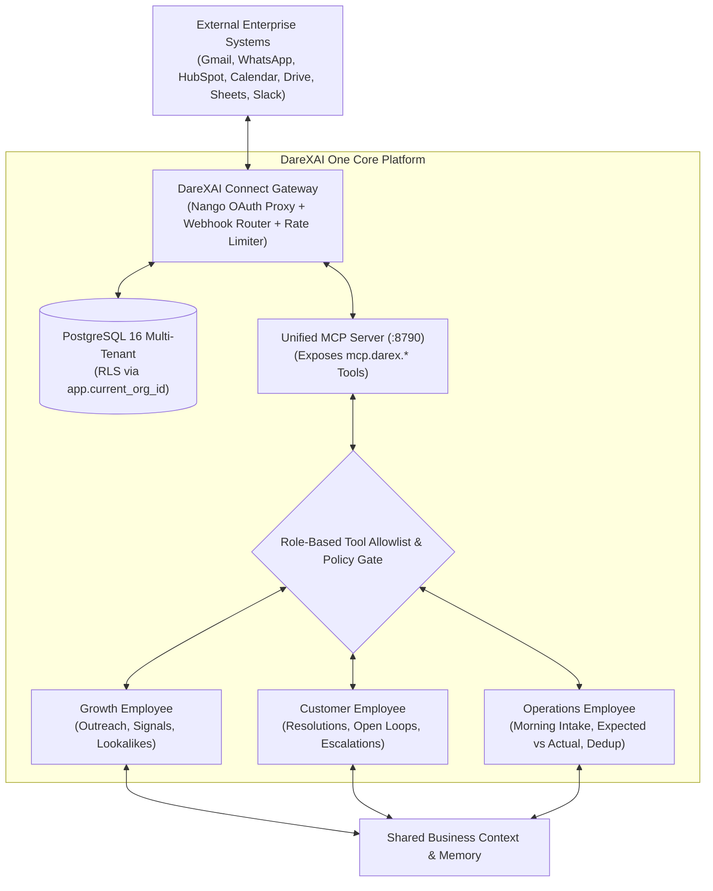
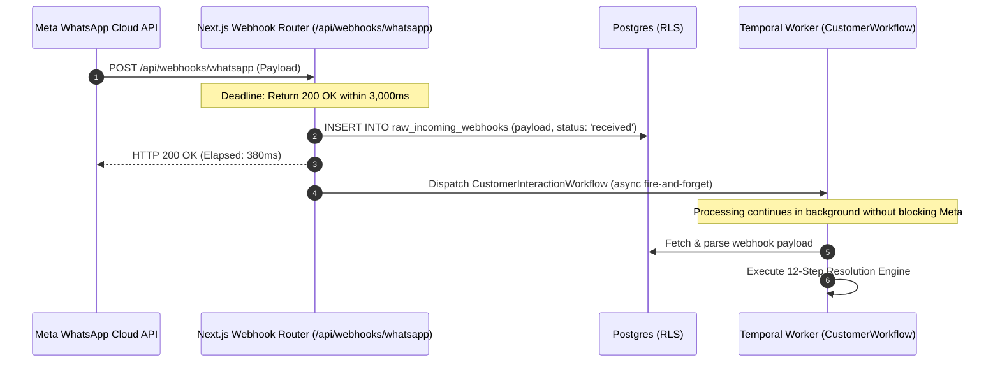

# 04 — DareXAI Connect: Unified Integration Architecture, Token Management & Tool Protocols

> **Document Type:** Comprehensive Engineering & Integration Architecture Specification  
> **Source:** Synthesized from `DareXAI One_ Employee Blueprint.pdf` (Pages 99–106), engineering gap analyses, connector SDK, and Model Context Protocol (MCP) runtime.  
> **Core Architecture:** *“Connect your business once through DareXAI Connect. All three employees share the unified business context, but execute within strict, role-scoped permissions.”*

---

## 1. Architectural Mental Model: Connect Once, Share Context

The fundamental error in building agentic software is treating integrations as department-specific plugins or fragmented workflow automations:

```
┌─────────────────────────────────────────────────────────────────────────────────────────┐
│                        FRAGMENTED INTEGRATION PLATFORM (WRONG)                          │
├─────────────────────────────────────────────────────────────────────────────────────────┤
│ • Sales App connects HubSpot for lead tracking.                                         │
│ • Support App connects HubSpot again for ticket history.                                │
│ • Operations App connects HubSpot a third time for task deduplication.                  │
│ Result: Massive credential fragmentation, duplicate API rate limits, out-of-sync data.  │
└─────────────────────────────────────────────────────────────────────────────────────────┘
```

### The DareXAI Connect Architecture
DareXAI introduces **DareXAI Connect**: a single, centralized multi-tenant integration and credential management fabric:



### The Core Paradigm
$$\text{Integrations} \longrightarrow \text{Context} \longrightarrow \text{Employee} \longrightarrow \text{Judgment} \longrightarrow \text{Action} \longrightarrow \text{Verification} \longrightarrow \text{Outcome}$$

---

## 2. Infrastructure & Credential Security: Multi-Tenant Token Lifecycle

All external connections in DareXAI are managed through a hardened OAuth proxy architecture:

1. **Centralized Token Refresh:** Leverages **Nango** as the unified OAuth orchestrator. OAuth access and refresh tokens are encrypted at rest using AES-256-GCM. Tokens are automatically refreshed prior to expiration without requiring user re-authentication.
2. **Tenant Isolation via PostgreSQL RLS:** Every external connection, sync log, and webhook record is bound to an `org_id`. When an employee invokes a tool, the database connection enforces tenant isolation:
   ```sql
   SET LOCAL app.current_org_id = 'org_enterprise_1029';
   ```
   Cross-tenant credential contamination or data leakage is architecturally impossible at the database engine level.
3. **Least-Privilege Scoping:** Tools request only the specific OAuth scopes required for business functionality (e.g., `https://www.googleapis.com/auth/calendar.events` rather than full Google Drive root access).

---

## 3. Role-Based Tool Allowlist & Capability Matrix

While all three employees share access to connected integrations, their execution authority is strictly partitioned by role:

```
┌─────────────────────────────────────────────────────────────────────────────────────────┐
│                      CROSS-EMPLOYEE TOOL ALLOWLIST MATRIX                               │
├──────────────────────┬─────────────┬──────────────┬──────────────┬──────────────────────┤
│ Integration          │ Growth      │ Customer     │ Operations   │ Core Priority        │
├──────────────────────┼─────────────┼──────────────┼──────────────┼──────────────────────┤
│ 1. Gmail / Outlook   │ Draft/Send  │ Reply/Thread │ Read/Parse   │ 🔴 Tier 1 (Must)     │
├──────────────────────┼─────────────┼──────────────┼──────────────┼──────────────────────┤
│ 2. Google Calendar   │ Read Free   │ Reschedule   │ Check/Book   │ 🔴 Tier 1 (Must)     │
├──────────────────────┼─────────────┼──────────────┼──────────────┼──────────────────────┤
│ 3. WhatsApp Cloud    │ Read/Outbnd │ Full Resolve │ Read/Audit   │ 🔴 Tier 1 (Must)     │
├──────────────────────┼─────────────┼──────────────┼──────────────┼──────────────────────┤
│ 4. HubSpot / Zoho    │ Opps/Leads  │ Contact Hist │ Dedup/Clean  │ 🔴 Tier 1 (Must)     │
├──────────────────────┼─────────────┼──────────────┼──────────────┼──────────────────────┤
│ 5. Google Drive      │ Case Studies│ Policies/SOP │ Sync/Inspect │ 🔴 Tier 1 (Must)     │
├──────────────────────┼─────────────┼──────────────┼──────────────┼──────────────────────┤
│ 6. Google Sheets     │ Export Leads│ Read Orders  │ Clean/Update │ 🔴 Tier 1 (Must)     │
├──────────────────────┼─────────────┼──────────────┼──────────────┼──────────────────────┤
│ 7. Web Forms/Website │ Intent Track│ Ingest Help  │ Ingest Leads │ 🔴 Tier 1 (Must)     │
├──────────────────────┼─────────────┼──────────────┼──────────────┼──────────────────────┤
│ 8. Slack / Teams     │ Alerts      │ Escalate P0  │ Morning Brief│ 🔴 Tier 1 (Must)     │
├──────────────────────┼─────────────┼──────────────┼──────────────┼──────────────────────┤
│ 9. Apollo / Serper   │ Prospect/Web│ ✖ Forbidden  │ Verify Co    │ 🟠 Tier 2 (Growth)   │
├──────────────────────┼─────────────┼──────────────┼──────────────┼──────────────────────┤
│ 10. Stripe / Shopify │ ✖ Forbidden │ Refund/Order │ Read Trans   │ 🟠 Tier 2 (Customer) │
└──────────────────────┴─────────────┴──────────────┴──────────────┴──────────────────────┘
```

---

## 4. The 10 Core Tier 1 Integrations (Detailed Technical Specs)

### 1. Gmail & 2. Outlook (Email Ecosystem)
- **Protocols:** Google Workspace REST API v1 & Microsoft Graph API v1.0.
- **Key Actions:**
  - `email.searchThreads({ query: 'from:customer@acme.com newer_than:7d' })`
  - `email.fetchThreadContext({ threadId: 'th_1892a' })`
  - `email.createDraft({ to: '...', subject: '...', bodyHtml: '...' })`
  - `email.sendGuardedMessage({ draftId: '...', approvalToken: '...' })`
- **Real-Time Push:** Ingests new inbound messages via Google Cloud Pub/Sub webhooks and Microsoft Graph Change Notifications.

### 3. Google Calendar & Microsoft Calendar
- **Protocols:** Google Calendar API v3 & Microsoft Graph Calendars.
- **Key Actions:**
  - `calendar.getFreeBusySlots({ calendarIds: [...], timeMin: '...', timeMax: '...' })`
  - `calendar.createEvent({ summary: '...', start: '...', end: '...', attendees: [...] })`
  - `calendar.rescheduleEvent({ eventId: '...', newStart: '...', newEnd: '...' })`
- **Conflict Safeguards:** Automatically verifies minimum 15-minute buffer periods and checks for double-booking before committing.

### 4. WhatsApp Business Cloud API
- **Protocol:** Meta Graph API v20.0 (Direct Cloud API).
- **Ingress SLA:** Must respond `HTTP 200 OK` within **3,000ms** to prevent Meta retry loops. Inbound webhooks are immediately logged to PostgreSQL and acknowledged within 400ms, dispatching asynchronous Temporal processing.
- **Key Actions:**
  - `whatsapp.sendTextMessage({ toPhone: '...', message: '...' })`
  - `whatsapp.sendTemplateMessage({ templateName: 'order_update', params: [...] })`
- **24-Hour Window Management:** Automatically uses HSM pre-approved templates if the 24-hour customer service window has expired.

### 5. HubSpot & 6. Zoho CRM (Customer Systems of Record)
- **Protocols:** HubSpot v3 CRM API & Zoho CRM REST API v2.
- **Key Actions:**
  - `crm.getContactByEmailOrPhone({ email: '...', phone: '...' })`
  - `crm.createOrUpdateLead({ properties: { email: '...', firstname: '...', dealstage: '...' } })`
  - `crm.reconcileDuplicateRecords({ primaryId: '...', secondaryId: '...' })`
  - `crm.logTimelineActivity({ contactId: '...', title: '...', note: '...' })`
- **Rate Limit Protection:** Implements a token bucket rate limiter (HubSpot max 100 requests per 10 seconds).

### 7. Google Drive & Notion (Organizational Knowledge Base)
- **Protocols:** Google Drive REST API v3 & Notion REST API v1.
- **Key Actions:**
  - `knowledge.syncFolder({ folderId: 'drive_sop_folder_id' })`
  - `knowledge.extractDocumentText({ fileId: 'doc_pricing_2026' })`
  - `knowledge.semanticSearch({ query: 'refund policy for damaged goods' })`
- **Vector Ingestion:** Documents are chunked (500 tokens with 50-token overlap) and embedded into PostgreSQL `pgvector` with metadata filtering.

### 8. Google Sheets (Tabular Business Data)
- **Protocol:** Google Sheets REST API v4.
- **Key Actions:**
  - `sheets.readRows({ spreadsheetId: '...', range: 'Sheet1!A1:Z100' })`
  - `sheets.appendRow({ spreadsheetId: '...', values: [...] })`
  - `sheets.updateCellByPredicate({ spreadsheetId: '...', column: 'Status', matchValue: 'Done' })`
- **Concurrency Locking:** Employs optimistic locking to prevent overwriting concurrent updates.

### 9. Website Webhooks & Web Forms (Lead & Inquiry Ingress)
- **Protocol:** Standardized JSON Webhook Receiver (`POST /api/webhooks/forms`).
- **Features:**
  - Instant parsing of form submissions (Webflow, WordPress, Typeform, Framer).
  - Captures UTM parameters, referrer domain, and client IP address.
  - Honeypot and spam filtering before dispatching to the Operations Employee.

### 10. Slack & Microsoft Teams (Internal Operating Interface)
- **Protocols:** Slack Bolt API / Block Kit & Microsoft Bot Framework.
- **Key Actions:**
  - `slack.postDailyBrief({ channel: '#ops-leadership', briefMarkdown: '...' })`
  - `slack.postDecisionCard({ channel: '#growth-approvals', cardPayload: {...} })`
  - `slack.handleInteractiveAction({ actionId: 'approve_outreach', token: '...' })`

---

## 5. Unified MCP Tool Interface & TypeScript Definition

DareXAI standardizes all connector actions into the **Model Context Protocol (MCP)** specification:

```typescript
// services/workflows/src/types/mcp-tools.ts

export interface MCPToolDefinition {
  name: string;
  description: string;
  employeeScope: Array<'growth' | 'customer' | 'operations'>;
  riskLevel: 'read_only' | 'low_risk_mutation' | 'high_risk_financial' | 'external_communication';
  requiredPermissions: string[];
  parameters: Record<string, any>; // JSON Schema
}

export interface MCPToolExecutionResult<T = any> {
  success: boolean;
  status: 'executed' | 'gated_pending_approval' | 'error' | 'not_connected';
  data?: T;
  errorMessage?: string;
  decisionCardId?: string;
  auditTrail: {
    durationMs: number;
    sourceSystem: string;
    timestamp: string;
  };
}
```

---

## 6. Resilient Ingress Pipeline & Rate Limiting Engine



### Rate Limiting & Backpressure Discipline
1. **Per-Provider Token Buckets:** Each integration maintains an in-memory Redis / Postgres token bucket matching the vendor's API limits:
   - HubSpot: 10 calls/second per tenant.
   - Gmail: 250 quota units/second.
   - WhatsApp Cloud API: 80 messages/second.
2. **Exponential Backoff with Jitter:** All API client calls employ full jitter exponential backoff on HTTP 429 (Too Many Requests) or 503 (Service Unavailable):
   $$T_{\text{sleep}} = \min(M, 2^{\text{attempt}} \cdot \text{base} + \text{random}(0, 100))$$

---

## 7. Multi-Phase Connect Roadmap (V1 to V4)

```
  V1: The Core 10 Connectors (Weeks 1–4)
  ├── Single-connection Nango OAuth proxy with AES-256 encrypted credential vault
  ├── 10 Core Connectors: Gmail, Outlook, Google Calendar, WhatsApp, HubSpot, Zoho, Drive, Sheets, Forms, Slack
  ├── Multi-tenant PostgreSQL RLS scoping (SET LOCAL app.current_org_id)
  └── Fast-ACK decoupled webhook ingress pipeline (<500ms response)
  
  V2: Tier 2 Marketing & E-Commerce Integrations (Weeks 5–8)
  ├── Apollo & Serper for Growth Employee lead discovery
  ├── Shopify & Stripe for Customer Employee order lookup & refund processing
  ├── Notion & Asana for Operations task synchronization
  └── Automated token refresh failure alerts delivered to Dashboard
  
  V3: Multi-Provider Redundancy & Deep Sync (Weeks 9–12)
  ├── Automatic fallback from Gmail to Outlook or WhatsApp to SMS if channels fail
  ├── Bidirectional real-time CRM state syncing via CDC (Change Data Capture)
  └── Cross-connector schema normalization (Unified Contact, Unified Order)
  
  V4: Enterprise Connector SDK & On-Premise Agents (Enterprise)
  ├── Self-serve custom connector SDK for enterprise proprietary internal databases
  ├── Local VPC agent sidecar for connecting air-gapped on-premise ERP systems
  └── Zero-trust audit logging with end-to-end cryptographic payload verification
```
