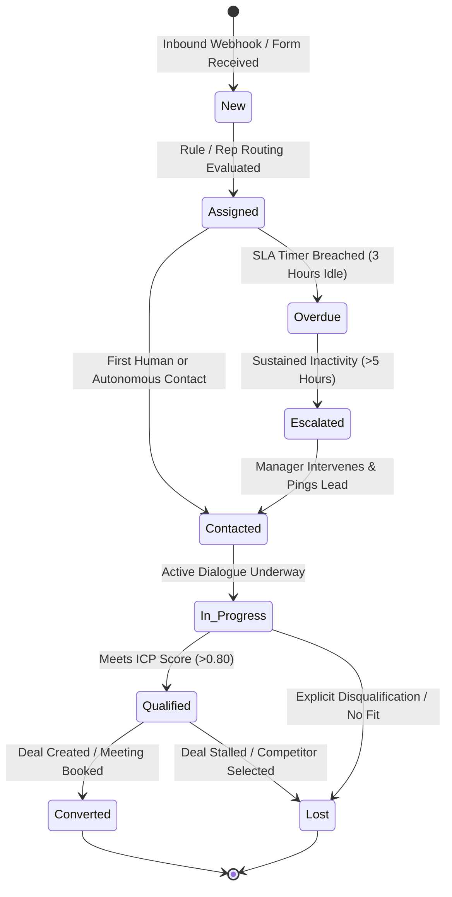
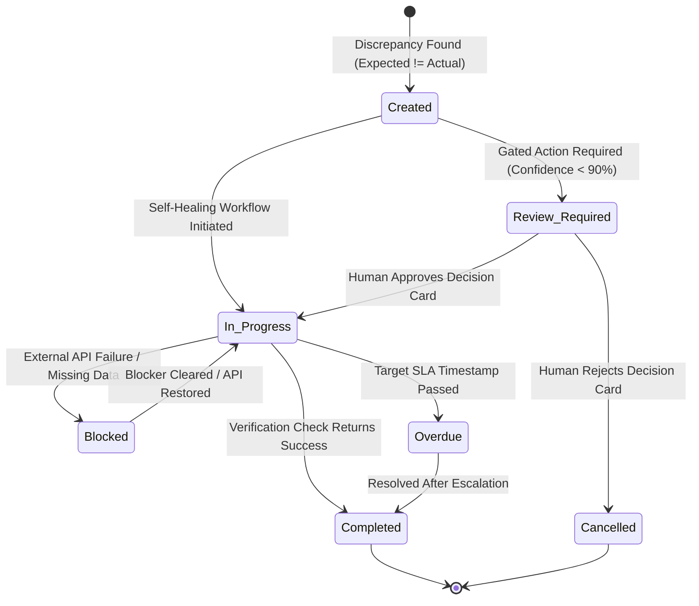
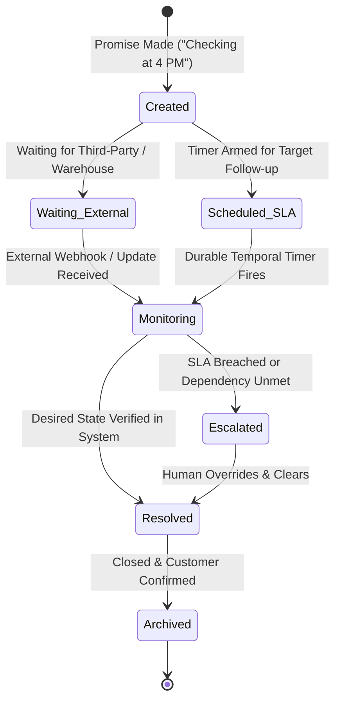
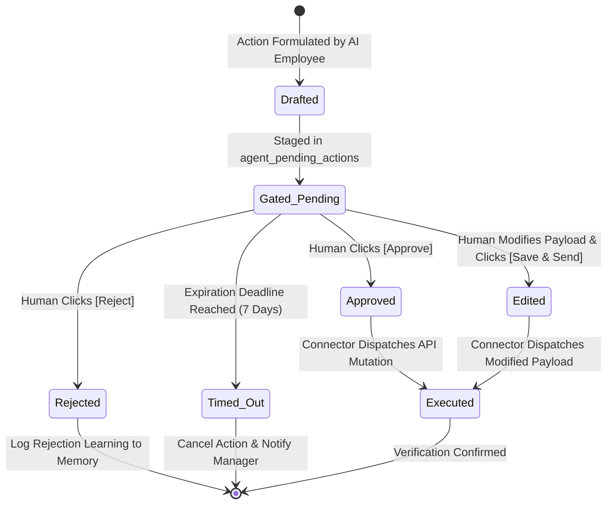
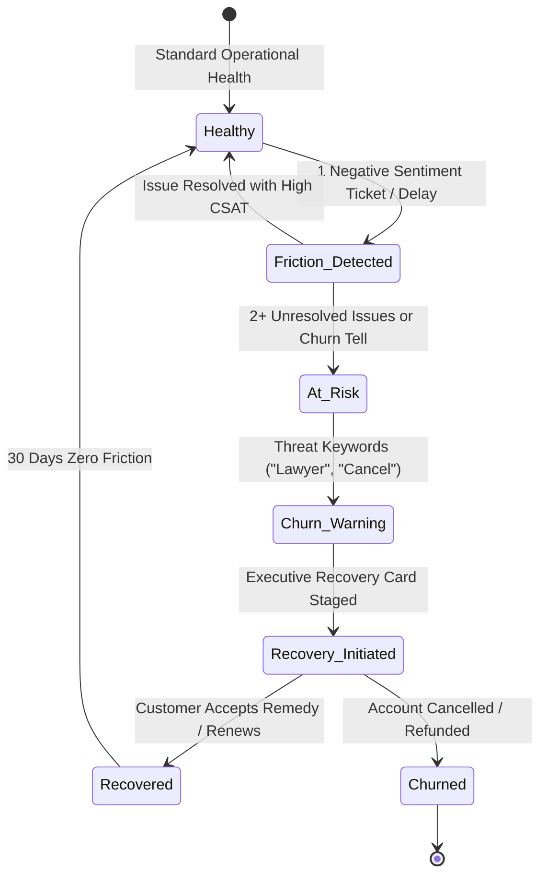

# 05 — Master State Machines, Data Models & Database Schemas

> **Document Type:** Canonical State Machine & Database Architecture Specification  
> **Source:** Synthesized from `DareXAI One_ Employee Blueprint.pdf`, engineering gap analyses, PostgreSQL schema migrations (`022`–`024`), and Temporal state contracts.  
> **Core Architecture:** Mathematical state machines governing every business entity, combined with multi-tenant PostgreSQL schemas secured by Row-Level Security (RLS).

---

## 1. Formal State Machine Specifications

Every critical entity in DareXAI is governed by a deterministic, formal finite state machine (FSM):

$$M = (S, \Sigma, \delta, s_0, F)$$

Where:
- $S$ is the finite set of valid states.
- $\Sigma$ is the finite set of permissible input events/triggers.
- $\delta: S \times \Sigma \to S$ is the state transition function (with optional guards).
- $s_0 \in S$ is the initial state.
- $F \subseteq S$ is the set of terminal/final states.

---

### State Machine 1: Inbound Lead & Enquiry Lifecycle

Governs how overnight enquiries, form submissions, and inbound messages progress from discovery to conversion.



#### Transition Table & Guard Conditions

| Current State ($S_t$) | Trigger Event ($\Sigma$) | Guard Condition ($G$) | Next State ($S_{t+1}$) | Side Effect / Action |
| :--- | :--- | :--- | :--- | :--- |
| `New` | `ROUTE_LEAD` | Valid rep capacity exists | `Assigned` | Assign rep ID; set SLA timer (3h) |
| `Assigned` | `FIRST_CONTACT` | Timestamp logged in CRM/Gmail | `Contacted` | Clear overdue SLA timer |
| `Assigned` | `SLA_TIMER_EXPIRED` | Elapsed time $> 180\text{ min}$ | `Overdue` | Flag in Daytime Monitor |
| `Overdue` | `ESCALATION_TIMEOUT` | Elapsed time $> 300\text{ min}$ | `Escalated` | Push Critical Alert to Slack |
| `Contacted` | `CUSTOMER_REPLY` | Inbound interest detected | `In_Progress` | Update CRM pipeline stage |
| `In_Progress` | `ICP_EVALUATED` | Fit Score $\ge 0.80$ | `Qualified` | Stage Opportunity in Dashboard |
| `In_Progress` | `DISQUALIFIED` | Unresponsive or B2C entity | `Lost` | Log lost reason in CRM |
| `Qualified` | `MEETING_CONFIRMED` | Calendar invite accepted | `Converted` | Hand off to Account Exec |

---

### State Machine 2: Operational Task & Exception State Machine

Governs how discrepancies discovered by the Operations Employee are tracked, self-healed, or escalated.



---

### State Machine 3: Customer Interaction Open Loop State Machine

Ensures that multi-hour and multi-day customer promises are tracked to verified completion.



---

### State Machine 4: Human-in-the-Loop Decision Approval Gate

Governs the lifecycle of an action proposal requiring human review before external execution.



---

### State Machine 5: Customer Churn & Recovery State Machine

Monitors customer relationship sentiment and executes proactive retention interventions.



---

## 2. Production PostgreSQL Database Schemas (DDL)

All tables strictly enforce multi-tenant isolation via Row-Level Security (RLS) tied to the active session variable `app.current_org_id`:

```sql
-- ============================================================================
-- DAREXAI ONE — PRODUCTION DATABASE SCHEMAS
-- ============================================================================

-- 1. Agent Open Loops Table (Multi-day Customer Follow-ups)
CREATE TABLE IF NOT EXISTS agent_open_loops (
    id UUID PRIMARY KEY DEFAULT gen_random_uuid(),
    org_id TEXT NOT NULL,
    customer_id TEXT NOT NULL,
    customer_channel TEXT NOT NULL, -- 'whatsapp', 'email', 'zendesk'
    customer_contact_handle TEXT NOT NULL,
    issue_summary TEXT NOT NULL,
    promised_action TEXT NOT NULL,
    dependency_type TEXT NOT NULL, -- 'warehouse_check', 'refund_approval', 'supplier_response', 'follow_up'
    status TEXT NOT NULL DEFAULT 'open', -- 'open', 'waiting_external', 'monitoring', 'escalated', 'resolved'
    target_check_at TIMESTAMPTZ NOT NULL,
    escalation_timeout_at TIMESTAMPTZ NOT NULL,
    assigned_employee TEXT NOT NULL DEFAULT 'customer_employee',
    metadata JSONB DEFAULT '{}'::jsonb,
    created_at TIMESTAMPTZ NOT NULL DEFAULT NOW(),
    updated_at TIMESTAMPTZ NOT NULL DEFAULT NOW()
);

-- 2. Operational Exceptions & Discrepancies Table
CREATE TABLE IF NOT EXISTS operational_exceptions (
    id UUID PRIMARY KEY DEFAULT gen_random_uuid(),
    org_id TEXT NOT NULL,
    workflow_name TEXT NOT NULL, -- 'morning_intake', 'daytime_monitor', 'dedup'
    severity TEXT NOT NULL, -- 'critical', 'high', 'medium', 'low'
    expected_state TEXT NOT NULL,
    actual_state TEXT NOT NULL,
    discrepancy_summary TEXT NOT NULL,
    target_entity_type TEXT NOT NULL, -- 'crm_lead', 'calendar_event', 'task'
    target_entity_id TEXT NOT NULL,
    recommended_action TEXT NOT NULL,
    action_payload JSONB DEFAULT '{}'::jsonb,
    status TEXT NOT NULL DEFAULT 'pending', -- 'pending', 'approved', 'rejected', 'auto_resolved'
    resolved_at TIMESTAMPTZ,
    created_at TIMESTAMPTZ NOT NULL DEFAULT NOW()
);

-- 3. Human Approval & Decision Gate Table
CREATE TABLE IF NOT EXISTS agent_pending_actions (
    id UUID PRIMARY KEY DEFAULT gen_random_uuid(),
    org_id TEXT NOT NULL,
    employee_name TEXT NOT NULL, -- 'growth', 'customer', 'operations'
    action_type TEXT NOT NULL, -- 'cold_email', 'refund', 'reschedule', 'merge_records'
    target_channel TEXT NOT NULL, -- 'gmail', 'whatsapp', 'hubspot', 'calendar'
    target_entity_id TEXT,
    proposal_summary TEXT NOT NULL,
    action_payload JSONB NOT NULL,
    confidence_score NUMERIC(4, 3) NOT NULL,
    status TEXT NOT NULL DEFAULT 'pending', -- 'pending', 'approved', 'rejected', 'edited', 'executed', 'timed_out'
    human_feedback TEXT,
    reviewed_by TEXT,
    reviewed_at TIMESTAMPTZ,
    expires_at TIMESTAMPTZ NOT NULL,
    created_at TIMESTAMPTZ NOT NULL DEFAULT NOW()
);

-- 4. Decision Trace & Counterfactual Ledger Table
CREATE TABLE IF NOT EXISTS agent_decision_ledger (
    id UUID PRIMARY KEY DEFAULT gen_random_uuid(),
    org_id TEXT NOT NULL,
    employee_name TEXT NOT NULL,
    action_considered TEXT NOT NULL,
    decision_outcome TEXT NOT NULL, -- 'executed', 'gated', 'rejected', 'counterfactual_no_action'
    confidence_score NUMERIC(4, 3) NOT NULL,
    primary_reasoning TEXT NOT NULL,
    conflicting_evidence TEXT,
    supporting_context JSONB DEFAULT '{}'::jsonb,
    created_at TIMESTAMPTZ NOT NULL DEFAULT NOW()
);

-- 5. Growth Opportunities Table
CREATE TABLE IF NOT EXISTS growth_opportunities (
    id UUID PRIMARY KEY DEFAULT gen_random_uuid(),
    org_id TEXT NOT NULL,
    company_name TEXT NOT NULL,
    domain TEXT NOT NULL,
    icp_score NUMERIC(4, 3) NOT NULL,
    source_skill TEXT NOT NULL, -- 'lookalike', 'signal', 'visitor', 'dormant'
    trigger_type TEXT,
    trigger_summary TEXT,
    target_contact_name TEXT,
    target_contact_title TEXT,
    target_contact_email TEXT,
    target_contact_linkedin TEXT,
    proposed_outreach_channel TEXT DEFAULT 'email',
    proposed_message_body TEXT,
    status TEXT NOT NULL DEFAULT 'staged', -- 'staged', 'approved', 'rejected', 'executed', 'converted'
    rejection_reason TEXT,
    decision_card_id UUID REFERENCES agent_pending_actions(id) ON DELETE SET NULL,
    metadata JSONB DEFAULT '{}'::jsonb,
    created_at TIMESTAMPTZ NOT NULL DEFAULT NOW(),
    updated_at TIMESTAMPTZ NOT NULL DEFAULT NOW()
);

-- 6. Lead Intent Signals Table
CREATE TABLE IF NOT EXISTS lead_intent_signals (
    id UUID PRIMARY KEY DEFAULT gen_random_uuid(),
    org_id TEXT NOT NULL,
    domain TEXT NOT NULL,
    signal_type TEXT NOT NULL, -- 'hiring_spike', 'funding', 'tech_change', 'web_visit'
    signal_strength NUMERIC(3, 2) NOT NULL,
    raw_payload JSONB NOT NULL,
    detected_at TIMESTAMPTZ NOT NULL DEFAULT NOW(),
    processed BOOLEAN DEFAULT FALSE
);

-- 7. Customer Recovery & Churn Prevention Table
CREATE TABLE IF NOT EXISTS customer_recovery_tasks (
    id UUID PRIMARY KEY DEFAULT gen_random_uuid(),
    org_id TEXT NOT NULL,
    customer_id TEXT NOT NULL,
    account_value_arr NUMERIC(10, 2) NOT NULL DEFAULT 0,
    sentiment_score NUMERIC(3, 2) NOT NULL, -- -1.00 (hostile) to 1.00 (delighted)
    friction_summary TEXT NOT NULL,
    recommended_recovery_action TEXT NOT NULL,
    status TEXT NOT NULL DEFAULT 'open', -- 'open', 'action_staged', 'recovered', 'churned'
    created_at TIMESTAMPTZ NOT NULL DEFAULT NOW()
);

-- ============================================================================
-- INDEXES FOR HIGH-THROUGHPUT REAL-TIME QUERYING
-- ============================================================================
CREATE INDEX idx_open_loops_org_status ON agent_open_loops(org_id, status);
CREATE INDEX idx_open_loops_target_check ON agent_open_loops(target_check_at) WHERE status = 'open';
CREATE INDEX idx_op_exceptions_org_status ON operational_exceptions(org_id, status);
CREATE INDEX idx_pending_actions_org_status ON agent_pending_actions(org_id, status);
CREATE INDEX idx_decision_ledger_org_created ON agent_decision_ledger(org_id, created_at DESC);
CREATE INDEX idx_growth_opps_org_status ON growth_opportunities(org_id, status);
CREATE INDEX idx_lead_signals_org_proc ON lead_intent_signals(org_id, processed);
CREATE INDEX idx_recovery_tasks_org_status ON customer_recovery_tasks(org_id, status);

-- ============================================================================
-- ROW LEVEL SECURITY (RLS) POLICIES
-- ============================================================================
ALTER TABLE agent_open_loops ENABLE ROW LEVEL SECURITY;
ALTER TABLE operational_exceptions ENABLE ROW LEVEL SECURITY;
ALTER TABLE agent_pending_actions ENABLE ROW LEVEL SECURITY;
ALTER TABLE agent_decision_ledger ENABLE ROW LEVEL SECURITY;
ALTER TABLE growth_opportunities ENABLE ROW LEVEL SECURITY;
ALTER TABLE lead_intent_signals ENABLE ROW LEVEL SECURITY;
ALTER TABLE customer_recovery_tasks ENABLE ROW LEVEL SECURITY;

CREATE POLICY open_loops_isolation ON agent_open_loops
    FOR ALL USING (org_id = current_setting('app.current_org_id', true));

CREATE POLICY op_exceptions_isolation ON operational_exceptions
    FOR ALL USING (org_id = current_setting('app.current_org_id', true));

CREATE POLICY pending_actions_isolation ON agent_pending_actions
    FOR ALL USING (org_id = current_setting('app.current_org_id', true));

CREATE POLICY decision_ledger_isolation ON agent_decision_ledger
    FOR ALL USING (org_id = current_setting('app.current_org_id', true));

CREATE POLICY growth_opps_isolation ON growth_opportunities
    FOR ALL USING (org_id = current_setting('app.current_org_id', true));

CREATE POLICY lead_signals_isolation ON lead_intent_signals
    FOR ALL USING (org_id = current_setting('app.current_org_id', true));

CREATE POLICY recovery_tasks_isolation ON customer_recovery_tasks
    FOR ALL USING (org_id = current_setting('app.current_org_id', true));
```

---

## 3. TypeScript Domain Types & Zod Schemas

```typescript
// packages/shared-types/src/domain-models.ts
import { z } from 'zod';

export const AgentOpenLoopSchema = z.object({
  id: z.string().uuid(),
  orgId: z.string(),
  customerId: z.string(),
  customerChannel: z.enum(['whatsapp', 'email', 'zendesk']),
  customerContactHandle: z.string(),
  issueSummary: z.string(),
  promisedAction: z.string(),
  dependencyType: z.enum(['warehouse_check', 'refund_approval', 'supplier_response', 'follow_up']),
  status: z.enum(['open', 'waiting_external', 'monitoring', 'escalated', 'resolved']),
  targetCheckAt: z.coerce.date(),
  escalationTimeoutAt: z.coerce.date(),
  assignedEmployee: z.enum(['customer_employee', 'growth_employee', 'operations_employee']),
  metadata: z.record(z.any()).default({})
});

export type AgentOpenLoop = z.infer<typeof AgentOpenLoopSchema>;

export const OperationalExceptionSchema = z.object({
  id: z.string().uuid(),
  orgId: z.string(),
  workflowName: z.enum(['morning_intake', 'daytime_monitor', 'dedup', 'sop_drift']),
  severity: z.enum(['critical', 'high', 'medium', 'low']),
  expectedState: z.string(),
  actualState: z.string(),
  discrepancySummary: z.string(),
  targetEntityType: z.enum(['crm_lead', 'calendar_event', 'task', 'document']),
  targetEntityId: z.string(),
  recommendedAction: z.string(),
  actionPayload: z.record(z.any()).default({}),
  status: z.enum(['pending', 'approved', 'rejected', 'auto_resolved']),
  resolvedAt: z.coerce.date().nullable()
});

export type OperationalException = z.infer<typeof OperationalExceptionSchema>;

export const AgentPendingActionSchema = z.object({
  id: z.string().uuid(),
  orgId: z.string(),
  employeeName: z.enum(['growth', 'customer', 'operations']),
  actionType: z.enum(['cold_email', 'refund', 'reschedule', 'merge_records', 'reassign_lead']),
  targetChannel: z.enum(['gmail', 'whatsapp', 'hubspot', 'calendar', 'slack']),
  targetEntityId: z.string().nullable(),
  proposalSummary: z.string(),
  actionPayload: z.record(z.any()),
  confidenceScore: z.number().min(0).max(1),
  status: z.enum(['pending', 'approved', 'rejected', 'edited', 'executed', 'timed_out']),
  humanFeedback: z.string().nullable(),
  reviewedBy: z.string().nullable(),
  expiresAt: z.coerce.date()
});

export type AgentPendingAction = z.infer<typeof AgentPendingActionSchema>;
```

---

## 4. Concurrency Control & Race Condition Prevention

When multiple events or cron workflows execute concurrently across shared business records (e.g., 28 overnight enquiries ingested simultaneously at 9:00 AM):

1. **Advisory Locking:** Temporal cron activities acquire a PostgreSQL advisory lock per tenant before running entity deduplication:
   ```sql
   SELECT pg_try_advisory_xact_lock(hashtext('org_morning_intake_' || :tenantId));
   ```
   If the lock is already held by an in-flight sweep, the duplicate run terminates immediately.
2. **Optimistic Row Versioning:** Modifying critical customer open loops or pending actions enforces row versioning:
   ```sql
   UPDATE agent_open_loops 
   SET status = 'resolved', updated_at = NOW(), version = version + 1
   WHERE id = :loopId AND version = :expectedVersion;
   ```
   If 0 rows are updated, the workflow detects concurrent modification, fetches the latest state, and re-evaluates.
