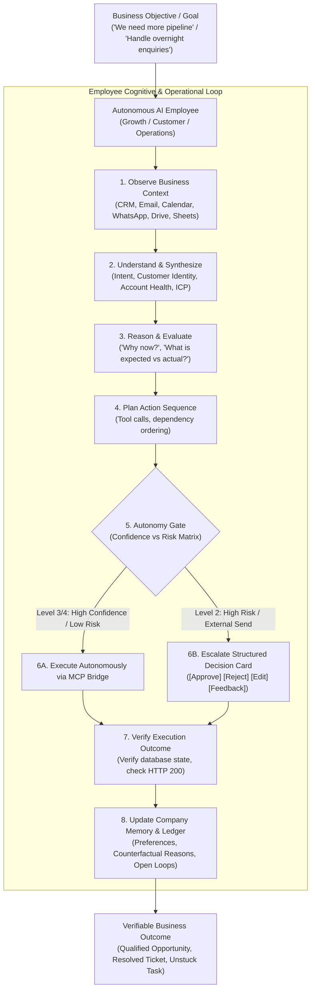

# DareXAI One — Master AI Employee Implementation Plan

> **Master Specification:** Comprehensive, modular, and deeply engineered decomposition of `DareXAI One_ Employee Blueprint.pdf` (106 Pages), integrated with production architecture, Temporal durable orchestration, PostgreSQL RLS schemas, and the 24 engineering gap analyses.  
> **Repository Location:** `docs/new-109-pg-plan/plan/`  
> **Completeness:** 100% Architectural Coverage — Complete blueprints for the Growth Employee, Customer Employee, Operations Employee, DareXAI Connect Layer, State Machines, and Engineering Gap Remediation.

---

## 1. Plan Directory Structure & Module Index

```
docs/new-109-pg-plan/plan/
├── README.md                              # This Master Index & Architecture Map
├── 00_executive_summary_and_vision.md     # Executive Mental Model, Core Philosophy & Strategic Vision
├── 01_growth_employee.md                  # Growth Employee: 8 Sub-Skills, 4 Workflows, DDL & Temporal Code
├── 02_customer_employee.md                # Customer Employee: 12-Step Resolution Engine, Open Loops & Scenarios
├── 03_operations_employee.md              # Operations Employee: Expected vs. Actual Engine, 9 Workflows & YC Demo
├── 04_shared_integrations_and_connect.md  # DareXAI Connect: 10 Core Connectors, Nango OAuth, MCP & Ingress
├── 05_state_machines_and_data_models.md   # 6 Formal FSMs, Production PostgreSQL DDL, Indexes & Zod Schemas
└── 06_gap_analysis_and_what_is_missing.md # Master Gap Analysis: 7 Bridges, 5 Code Seams, Remediation Plan & DoD
```

### Detailed Module Summary

| Module | Scope & Core Deliverables | Blueprint Reference |
| :--- | :--- | :--- |
| [**00 — Executive Summary & Vision**](./00_executive_summary_and_vision.md) | **Core Mental Model & Strategic Vision**: Why AI Employees outperform chatbots, agents, and Zapier automations. The Autonomy Ladder (L1 to L4), business outcome metrics vs AI vanity metrics, and master multi-phase roadmap. | Blueprint Overview |
| [**01 — Growth Employee**](./01_growth_employee.md) | **Growth Employee Complete Specification**: Sections 1–28. The 8 sub-skills (Scout, Lookalike, Signal, Visitor, Researcher, Campaigner, Dormant Reviver, Analyst), 4 step-by-step algorithms, Decision Card schemas, rejection feedback learning, and Temporal workflows. | Tab 1 (Pages 1–31) |
| [**02 — Customer Employee**](./02_customer_employee.md) | **Customer Employee Complete Specification**: Sections 1–36. The 12-step resolution engine, Open Loops durable state machine, decision escalation protocol ("Escalate Decisions, Not Conversations"), real-world case walkthroughs (Restaurant, SaaS, E-commerce), and churn risk sentinel. | Tab 2 (Pages 32–61) |
| [**03 — Operations Employee**](./03_operations_employee.md) | **Operations Employee Complete Specification**: Sections 1–44. The Expected vs. Actual state machine, 9 operational workflows (Morning intake, Daytime monitoring, Scheduling, Follow-up SLA, Capacity routing, Dedup, SOP drift, Stuck work, Outage buffer), Morning Brief architecture, and YC demo script. | Tab 3 (Pages 62–98) |
| [**04 — Shared Integrations & Connect**](./04_shared_integrations_and_connect.md) | **DareXAI Connect Architecture**: Tab 4 (Pages 99–106). Single-connection shared business context, role-based tool allowlist matrix, 10 Tier 1 core connectors (Gmail, Outlook, Calendar, WhatsApp, HubSpot, Zoho, Drive, Sheets, Forms, Slack), MCP bridge (:8790), and fast-ACK decoupled ingress (<500ms). | Tab 4 (Pages 99–106) |
| [**05 — State Machines & Data Models**](./05_state_machines_and_data_models.md) | **Formal Mathematical State Machines & Production DDL**: 6 FSMs (Lead Lifecycle, Task Discrepancy, Open Loop, Decision Approval Gate, Churn Recovery, Intent Classification), complete production PostgreSQL schemas with RLS (`app.current_org_id`), indexes, and TypeScript Zod schemas. | Synthesized Core Specs |
| [**06 — Gap Analysis & What Is Missing**](./06_gap_analysis_and_what_is_missing.md) | **Master Engineering Bridge & Gap Audit**: 28% Live / 31% Partial / 41% Gap readiness matrix, the 7 foundational architectural bridges, 5 critical corrected code seams (guarded send, action taxonomy, timeout semantics, pool starvation, self-citation drift), and the 7-point Definition of Done. | Codebase Audit & Gap Bridge |

---

## 2. The Master Mental Model: From Prompts to Responsibilities



---

## 3. The Three AI Employees & The Shared Connect Fabric

```
┌─────────────────────────────────────────────────────────────────────────────────────────┐
│                                DAREXAI ONE CORE FLEET                                   │
├──────────────────────────┬──────────────────────────┬───────────────────────────────────┤
│    GROWTH EMPLOYEE       │    CUSTOMER EMPLOYEE     │      OPERATIONS EMPLOYEE          │
│                          │                          │                                   │
│ "Find opportunities,     │ "Take care of customers  │ "Keep the business moving.        │
│  know when they're worth │  from inbound request    │  Ensure routine work gets         │
│  pursuing, and act."     │  to verified resolution."│  completed correctly."            │
├──────────────────────────┼──────────────────────────┼───────────────────────────────────┤
│ • Scout & Market Hunter  │ • 12-Step Resolution     │ • Morning Triage (9 AM Cron)      │
│ • Lookalike Engine       │ • Open Loop SLA Tracker  │ • Expected vs Actual Engine       │
│ • Intent Signal Poller   │ • Decision Escalator     │ • Multi-calendar Scheduling       │
│ • Visitor De-anonymizer  │ • Churn & Risk Sentinel  │ • Deduplication & Data Hygiene    │
│ • Dossier Researcher     │ • Proactive Recovery     │ • SOP Drift Synchronization       │
│ • Campaign Drafter       │ • Multi-Channel Router   │ • Stuck Work Unblocker            │
│ • Stale Lead Reviver     │ • Empathy Voice Framer   │ • Outage Incident Buffer          │
│ • Growth Analyst         │ • Closed-Loop Settler    │ • Daily Morning Brief Deliverer   │
└──────────────────────────┴──────────────────────────┴───────────────────────────────────┘
                                       ▲
                                       │ Scoped Role Tool Allowlists
 ┌─────────────────────────────────────┴─────────────────────────────────────┐
 │                       DAREXAI CONNECT (Unified Layer)                     │
 │  Gmail • Outlook • Google Calendar • WhatsApp Cloud • HubSpot • Zoho CRM  │
 │  Google Drive • Google Sheets • Web Forms • Slack • Teams • Apollo • Serper│
 └───────────────────────────────────────────────────────────────────────────┘
```

---

## 4. Reading Guide by Stakeholder Role

| If You Are... | Recommended Reading Sequence |
| :--- | :--- |
| **Executive / Founder** | `00_executive_summary_and_vision.md` $\to$ `03 §44 (YC Demo)` $\to$ `06 §1 (Readiness Matrix)` |
| **Product Manager** | `00` $\to$ `01 (Growth)` $\to$ `02 (Customer)` $\to$ `03 (Operations)` |
| **Backend / Temporal Engineer** | `05 (State Machines & DDL)` $\to$ `04 (Connect & Ingress)` $\to$ `06 (Bridges & Seams)` |
| **Frontend / Full-Stack Engineer**| `02 §5 (Decision Cards)` $\to$ `03 §3 (Morning Brief)` $\to$ `05 §3 (TypeScript Zod)` |
| **QA / Acceptance Tester** | `06 §5 (Definition of Done)` $\to$ `03 §44 (Demo Script)` $\to$ `01 §5 & 02 §5 (Scenarios)` |

---

## 5. Summary Axiom
> **“DareXAI One is not an automation tool. It is an operating system where autonomous AI employees take responsibility for business outcomes, communicate through structured decisions rather than chat chatter, and continuously learn from human feedback.”**
