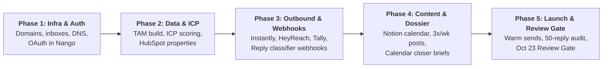

# XYZ GTM Automation Plan · End-to-End Execution & TODO Action Plan

> **Document Type:** Operational Implementation Guide & Actionable TODO Checklist  
> **Platform Target:** DareX Agentic OS (`Agentic-Os-SaaS`)  
> **Entity:** XYZ Talent & Creator Agency GTM Engine  
> **Date:** September 28, 2026  
> **Target Launch Date:** October 5, 2026 (Warm send commencement)  
> **Target Review Gate:** October 23, 2026  

---

## 🎯 Executive Overview & Action Roadmap

This actionable checklist breaks down every single task required to take the **XYZ GTM Automation Plan** from plan to a fully live, autonomous revenue engine that books 20+ qualified agency meetings per month.

---

## 📋 Comprehensive Phase-by-Phase TODO Checklist

### Phase 1: Infrastructure, Domains & Authentication (Days 1–3)
*Goal: Establish sending reputation, secondary domains, and OAuth connectivity.*

- [ ] **1.1 Purchase 4–6 Secondary Domains** *(Owner: Client)*
  - Buy domains distinct from main domain (e.g., `XYZconnecthq.com`, `XYZdealops.com`, `XYZcreators.co`, `XYZtalentops.io`).
  - Set 301 redirects on all secondary domains back to the main XYZ marketing website.
- [ ] **1.2 Configure DNS Authentication Records** *(Owner: Client / IT)*
  - Set up **SPF** (`v=spf1 include:_spf.google.com ~all` or Microsoft equivalent).
  - Generate and publish 2048-bit **DKIM** keys on all sending domains.
  - Publish **DMARC** policy (`v=DMARC1; p=none; rua=mailto:dmarc@XYZconnecthq.com`).
  - Configure Custom Tracking Domains (CNAME) in Instantly for click/open isolation.
- [ ] **1.3 Create 12 Sending Inboxes** *(Owner: Client)*
  - 2–3 inboxes per domain on Google Workspace / Microsoft 365.
  - Use real names: Jacob (Founder) + 2 GTM team members.
  - Upload profile photos and set plain text signatures with physical CAN-SPAM address.
- [ ] **1.4 Launch Automated Inbox Warmup** *(Owner: Eng / Client)*
  - Connect all 12 inboxes to Instantly Warmup.
  - Configure warmup settings: 20–30 warmup emails/day, ramp rate 2–4/day, 40% reply rate.
  - Maintain warmup permanently in the background.
- [ ] **1.5 Connect OAuth Tokens in DareX / Nango** *(Owner: Eng / Client)*
  - Connect **HubSpot CRM** portal with `crm.objects.contacts`, `crm.objects.companies`, `crm.objects.deals` scopes.
  - Connect **LinkedIn** personal profiles (Jacob + closer + GTM team).
  - Connect **Google Calendar** (Closer demo calendar) for meeting dossier listening.
  - Connect **Slack** workspace (`#replies-hot`, `#replies-review`, `#signals-tier1`).

---

### Phase 2: Data Architecture, TAM Building & ICP Scoring (Days 3–5)
*Goal: Source the US creator agency market, score accounts into Tiers 1–3, and sync to HubSpot.*

- [ ] **2.1 Configure HubSpot Custom Properties** *(Owner: Eng / CRM Admin)*
  - Create Account Property: `ICP_Tier` (Dropdown: `Tier 1`, `Tier 2`, `Tier 3`, `Nurture`).
  - Create Account Property: `Awareness_Stage` (Dropdown: `Identified`, `Aware`, `Interested`, `Evaluating`, `Selecting`).
  - Create Account Property: `Enriched_By_Clay` (Boolean: `true` / `false`).
  - Create Contact Property: `Active_Sequence` (Text: prevents double-enrollment).
  - Create Deal Stage: `Meeting Requested` and `Demo Scheduled`.
- [ ] **2.2 Build US Talent Agency TAM List** *(Owner: Eng)*
  - Run Apollo B2B extraction with filters: US-based, Keywords ("Talent Management", "Creator Management", "Influencer Agency"), Employee count 5–50.
  - Scrape top creator rosters and agency directories (using DareX `src/tools/apollo.ts` & `src/tools/web-extract.ts`).
  - Deduplicate accounts against current customers and open pipeline.
- [ ] **2.3 Calibrate ICP Point Scoring in DareX** *(Owner: Eng)*
  - Verify scoring weights in `services/workflows/src/growth/lookalike.ts`:
    - `+5`: US-based agency (Disqualify non-US).
    - `+5`: Creator or influencer talent agency.
    - `+5`: Team size 5–50 on LinkedIn.
    - `+4`: Roster of 15+ managed creators.
    - `+3`: Actively hiring talent managers.
    - `+3`: Uses spreadsheets/email for payouts.
    - `+3`: Partner or roll-up affiliation (e.g. The Team / Wasserman).
  - Verify Tier thresholds: Tier 1 = 18+, Tier 2 = 10–17, Tier 3 = 5–9, Under 5 = Nurture.
- [ ] **2.4 Ingest Founder LinkedIn Connections** *(Owner: Client)*
  - Export Jacob's 1st-degree LinkedIn connections via LinkedIn Data Export.
  - Ingest into DareX to tag warm contacts for immediate Tier 1 founder-to-founder outreach.
- [ ] **2.5 Set Up Website De-Anonymization Webhook** *(Owner: Eng)*
  - Embed tracking script (RB2B / Warmly) on XYZ marketing & pricing pages.
  - Point webhook to DareX endpoint `/api/widget/intent`.
  - Confirm `apps/dashboard/lib/visitor-enrich.ts` triggers 2+ visit/24hr frequency gate.

---

### Phase 3: Outbound Flows, Inbound Forms & Reply Pipeline (Days 6–9)
*Goal: Deploy the 6 email flows, 7-category reply classifier, and form handlers.*

- [ ] **3.1 Seed Org Wiki with Copy & Objection Library** *(Owner: Client / Copywriter)*
  - Populate `/wiki/icp.md` with persona definitions (Founder, Head of Talent, Talent Manager).
  - Populate `/wiki/objections.md` with the top 5 objections (spreadsheets work fine, no budget, already using custom Airtable, creator privacy).
  - Populate `/wiki/case-studies.md` with agency before-and-after proof points.
- [ ] **3.2 Configure Email Flows E1–E6 in Instantly** *(Owner: Eng)*
  - **Flow E1 (Cold ICP):** Manager time lost to brand deal spreadsheets and invoicing (<80 words).
  - **Flow E2 (Tier 1 Founder-to-Founder):** 13-touch cadence over 28 days sent from Jacob.
  - **Flow E3 (Website Visitors):** 8-touch hot signal burst triggered within 24 hours of site visit.
  - **Flow E4 (Engagers):** Sequence referencing post topic or creator voice engagement.
  - **Flow E5 (Trigger Events):** Sequences triggered by hiring or new roster signings.
  - **Flow E6 (Re-engagement):** Automated re-enrollment for OOO, "not now", and meeting no-shows.
- [ ] **3.3 Connect Inbound Reply Webhooks to DareX** *(Owner: Eng)*
  - Point Instantly "Lead Replied" webhook to `https://app.darex.ai/api/webhooks/reply`.
  - Point HeyReach "Message Received" webhook to the same endpoint.
  - Verify `services/workflows/src/growth/reply-classifier.ts` accurately parses the 7 outcomes:
    - `Interested` → Sends Cal.com booking link + Slack card to closer in <5 minutes.
    - `Question` → Claude drafts reply from `/wiki` + Slack 1-click approval card.
    - `Referral` → Extracts new contact, enrolls into Clay/DareX routing.
    - `Not Now` → Parses callback date, schedules re-enrollment in HubSpot.
    - `Out of Office` → Parses return date, pauses sequence, resumes return + 2 days.
    - `Not Interested` → 12-month suppression ledger across all channels.
    - `Unclear` → Routes to `#replies-review` Slack queue.
- [ ] **3.4 Configure Tally Qualifying Form & Cal.com** *(Owner: Eng / Client)*
  - Build two-field intake form (email, agency website) + Tally qualification (roster size, role, deal tools).
  - Qualified leads immediately see Cal.com embedding.
  - Webhook into DareX for instant account creation and closer dossier generation.

---

### Phase 4: LinkedIn Content Engine & Closer Intelligence (Days 10–12)
*Goal: Automate executive posting, comment-to-lead magnets, and pre-meeting briefings.*

- [ ] **4.1 Set Up Notion Content Calendar & Ordinal Scheduler** *(Owner: Eng / Marketing)*
  - Connect Notion database template with columns: `Author`, `Pillar`, `Hook Score`, `Draft Status`, `Scheduled Date`.
  - Configure Monday automated ideation task: Claude reads call transcripts & reply objections to draft 9 ideas.
  - Configure Tuesday 30-minute human review window for Jacob and team.
  - Schedule posts in Ordinal for Monday, Wednesday, and Friday at 8–9 AM Central.
- [ ] **4.2 Launch Lead Magnet Flow L2 (Monthly)** *(Owner: Marketing)*
  - Create monthly resource: *Talent Agency Brand Deal Rate Card Template (2026)*.
  - Publish post: *"Comment RATECARD and I'll send it over."*
  - Configure HeyReach / DareX poll every 30 mins to DM commenters the Tally download link.
- [ ] **4.3 Test Pre-Meeting Account Dossier (Flow R2)** *(Owner: Eng / Closer)*
  - Book a test demo event on Google Calendar.
  - Confirm `services/workflows/src/workflows/MeetingDossierWorkflow.ts` fires automatically.
  - Verify Slack receives a 1-page intelligence brief with agency overview, creator count, recent deals, and suggested talk track.
  - Confirm closer receives a task to connect with the lead on LinkedIn before the call.

---

### Phase 5: Verification, Soft Launch & Review Gate (Days 13–25)
*Goal: Send warm batches, monitor inbox deliverability, and pass the Oct 23 Review Gate.*

- [ ] **5.1 Send Initial Warm Batch (Oct 5, 2026)** *(Owner: Eng / Client)*
  - Cap sends at 15 sends/inbox/day to warmest lists (founder connections + website visitors via E3).
  - Ensure 100% human-approved replies for the first 14 days.
- [ ] **5.2 Daily Deliverability Health Checks** *(Owner: Eng)*
  - Verify bounce rate remains `< 2%`.
  - Verify spam complaint rate remains `< 0.1%`.
  - Verify LinkedIn connection acceptance rate remains `> 30%`.
- [ ] **5.3 50-Reply Accuracy Audit** *(Owner: Eng / Closer)*
  - Pull sample of 50 classified replies.
  - Validate classifier agreement against human labeling.
  - If accuracy `>= 95%`, enable 1-click auto-reply for routine questions.
- [ ] **5.4 Execute Review Gate Audit (Oct 23, 2026)** *(Owner: Leadership)*
  - Audit: `70%+` of positive replies come from Tier 1–2 accounts.
  - Audit: `20+` qualified meetings pacing for month 1.
  - Audit: Email positive reply rate `> 1.5%`, LinkedIn DM reply rate `> 8%`.
  - Decide on Phase 3 rollout: Activate Nooks parallel calling and LinkedIn ads retargeting.

---

## 🔑 Required API Keys & Secrets Matrix

Configure these in `Agentic-Os-SaaS/.env.local` and Nango dashboard:

| Service | Environment Variable | Where to Obtain |
| :--- | :--- | :--- |
| **Apollo.io** | `APOLLO_API_KEY` | Apollo.io Settings → Integrations → API Keys |
| **HubSpot** | `NANGO_CONNECTION_ID_HUBSPOT` | Authorized via Nango OAuth connect screen |
| **LinkedIn** | `NANGO_CONNECTION_ID_LINKEDIN` | Authorized via Nango OAuth connect screen |
| **Google Calendar** | `GOOGLE_CALENDAR_CREDENTIALS` | Google Cloud Console / Nango OAuth |
| **Slack Webhook** | `SLACK_WEBHOOK_URL` | Slack App Directory → Incoming Webhooks |
| **Instantly** | `INSTANTLY_API_KEY` | Instantly.ai Settings → Integrations → API Key |
| **HeyReach** | `HEYREACH_API_KEY` | HeyReach Settings → API Integrations |
| **Cal.com** | `CALCOM_API_KEY` / Booking URL | Cal.com Settings → Developer → API Keys |
| **LiteLLM / Claude** | `LITELLM_API_KEY` / `ANTHROPIC_API_KEY` | LiteLLM Proxy / Anthropic Console |

---

## 📅 14-Day Sprint Schedule to Full Launch

| Sprint Day | Milestone Focus | Deliverables Completed |
| :---: | :--- | :--- |
| **Day 1–2** | Domains & Inboxes | 4–6 domains purchased, DNS authenticated, 12 inboxes warming in Instantly. |
| **Day 3–4** | CRM & TAM Setup | HubSpot custom properties created, Apollo TAM list filtered & deduplicated. |
| **Day 5–6** | Copy & Wiki Seeding | `/wiki` populated with ICP pain points, objection library, and email copy variants. |
| **Day 7–8** | Workflows & Webhooks | Reply webhook wired, 7-category classifier tested, Tally qualification form live. |
| **Day 9–10** | Closer Briefs & Content | Calendar dossier tested in Slack, Notion content calendar created, 1st lead magnet staged. |
| **Day 11–12** | E2E System Test | End-to-end dry run: visitor on site → de-anonymized → email drafted → reply classified. |
| **Day 13** | **Launch Day (Oct 5)** | First sends go out at 15 sends/day/inbox to warm founder connections and visitor leads. |
| **Day 14–25** | Scale & Review Gate | Volume ramped to 30 sends/day/inbox; review gate audit conducted on Oct 23. |
