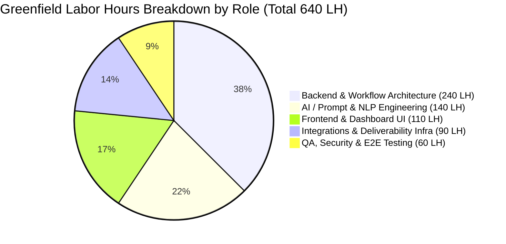
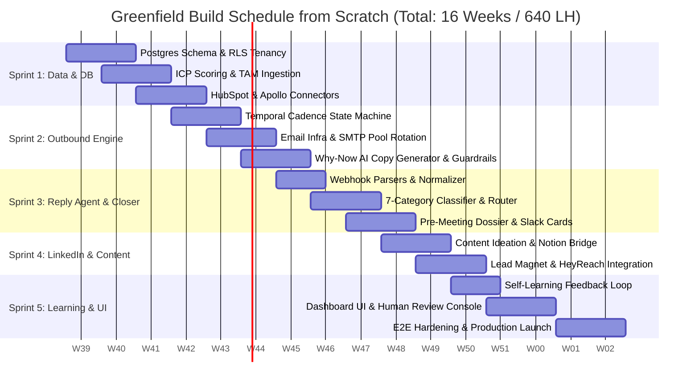
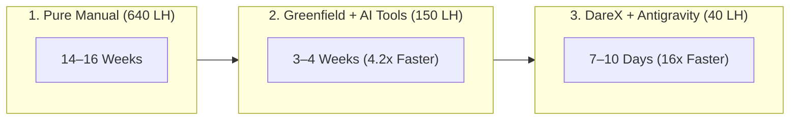
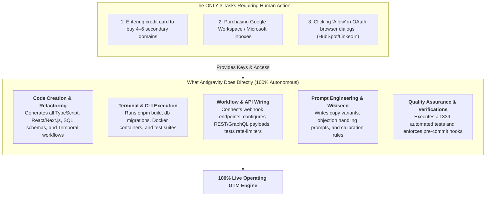
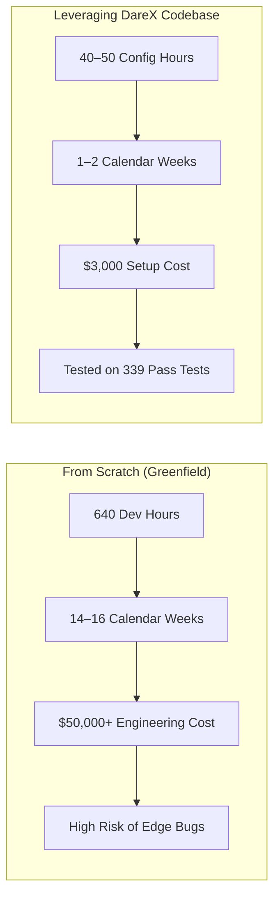

# XYZ GTM Automation Plan · Greenfield Build Estimate & Labor Hours Analysis

> **Scope Analyzed:** Building the complete 27-page system documented in [`XYZ_GTM_Automation_Plan_3_XYZ_v2 copy.md`](file:///Users/addy/Coding/SaaS/Agentic-Os-SaaS/docs/nikhil-clien/XYZ_GTM_Automation_Plan_3_XYZ_v2%20copy.md) from absolute scratch (greenfield engineering).  
> **Target Entity:** XYZ Creator & Talent Agency GTM System  
> **Document Date:** September 28, 2026  
> **Prepared For:** Nikhil / Leadership & Technical Team  

---

## 📌 Executive Summary: Greenfield vs. Existing Platform Comparison

If you decide to build **ONLY THIS SPECIFIC GTM AUTOMATION SYSTEM FROM ZERO** without using an existing platform baseline like DareX AI (`Agentic-Os-SaaS`), here is the realistic engineering estimate:

| Metric | 1. Traditional Manual Dev (From Scratch) | 2. AI-Assisted Greenfield (Scratch + AI Tools) | 3. DareX Baseline + AI Tools (Current Reality) |
| :--- | :---: | :---: | :---: |
| **Methodology** | Pure manual coding without AI assistants | Built from 0 using Antigravity, Cursor & Claude Code | 82% pre-built DareX code + Antigravity execution |
| **Total Calendar Duration** | **14 – 16 Weeks** (3.5 to 4 Months) | **3 – 4 Weeks** (15 to 20 Working Days) | **7 – 10 Days** (1 to 2 Weeks) |
| **Total Labor Hours (LH)** | **640 Engineering Hours** | **140 – 160 Engineering Hours** | **35 – 45 Engineering Hours** |
| **Team Size Required** | 3 Senior Engineers | 1 Full-Stack AI Engineer | 1 AI Operator / Engineer |
| **Market Value / Dev Cost** | **$45,000 – $65,000** (₹38L – ₹55L) | **$12,000 – $18,000** (₹10L – ₹15L) | **$3,500 – $6,000** (₹3.5L – ₹5L) |
| **Speed Multiplier** | 1x (Baseline) | **4x – 5x Faster** | **14x – 16x Faster** |
| **Primary Focus** | Hand-coding boilerplate & connectors | Prompting & generating architecture from 0 | Seeding org prompts, domain warmup & client keys |

---

## ⏱️ Greenfield Labor Hours (LH) Breakdown by Engineering Discipline

To build this system reliably with enterprise-grade multi-tenancy, rate-limiting, and error tolerance, the **640 Labor Hours** divide across 5 key roles:

| Engineering Role | Responsibilities | Total Hours (LH) |
| :--- | :--- | :---: |
| **1. Senior Backend & Workflow Engineer** | Temporal / Inngest state machines, PostgreSQL schema, RLS tenancy, API webhooks, distributed queues, error retries. | **240 Hours** |
| **2. AI & Data / Prompt Engineer** | 7-category reply classifier, Why-Now LLM hooks, research scrapers, hallucination guardrails, Langfuse tracing, wiki RAG. | **140 Hours** |
| **3. Frontend / UI Engineer** | Next.js 15 dashboard, review decision cards (1-click approve/edit), campaign tracking, analytics charts, notifications. | **110 Hours** |
| **4. Integrations & Deliverability Engineer** | Nango OAuth connectors, HubSpot bidirectional sync, Apollo waterfall, SMTP DNS (SPF/DKIM/DMARC), HeyReach/Instantly APIs. | **90 Hours** |
| **5. QA & Security Engineer** | Multitenancy isolation tests, SSRF protection, prompt fence sanitizers, deliverability health gates, CAN-SPAM compliance. | **60 Hours** |
| **TOTAL GREENFIELD EFFORT** | **Full System Built From Absolute Scratch** | **640 Hours** |

---

## 🧩 Detailed Component-by-Component Labor Hours Ledger

Below is the granular task-by-task engineering breakdown for every system detailed in the 27-page plan:

### 1. Data Layer, TAM Sourcing & ICP Scoring (Total: 95 Hours)
*Extracting, enriching, and scoring the US talent agency market.*

| Component / Task | Greenfield Scope Description | Dev Hours (LH) |
| :--- | :--- | :---: |
| **PostgreSQL Database & RLS** | Schema design (`accounts`, `contacts`, `signals`, `cadences`, `orgs`), session-level RLS tenancy policies. | 20 LH |
| **ICP Scoring Engine** | Rule-based and point-scoring logic (+5 US, +5 talent agency, +5 team size, +4 roster count) splitting into Tiers 1–3. | 15 LH |
| **Apollo & Scraping Waterfall** | B2B API waterfall (Apollo/Findymail/Freckle) to discover decision-makers, personal email reverse-lookup. | 25 LH |
| **Website De-Anonymization** | Reverse-IP webhook ingest (RB2B/Warmly), 2+ visit/24hr frequency thresholding, automated contact enrichment. | 15 LH |
| **HubSpot Bidirectional Sync** | Syncing accounts, custom fields (`Tier`, `Awareness_Stage`, `Signal_Events`), and contact lifecycle states. | 20 LH |

---

### 2. Multi-Channel Cadence & Sending Engine (Total: 110 Hours)
*Executing coordinated multi-touch cadences across Email, LinkedIn, and Calls.*

| Component / Task | Greenfield Scope Description | Dev Hours (LH) |
| :--- | :--- | :---: |
| **Cadence State Machine** | Multi-day scheduling FSM (Tier 1: 13 touches/28d, Tier 2: 11 touches/21d, Tier 3: 6 touches/14d, Hot Burst: 8 touches/10d). | 35 LH |
| **Email Infrastructure & Rotation** | Multi-domain sender pool (4–6 secondary domains, 12 inboxes, 30 sends/day cap, bounce & spam health pauses). | 20 LH |
| **Why-Now AI Copy Generator** | LLM pipeline synthesizing live buying signals, historical wins, and persona pain points into `<80-word` emails. | 25 LH |
| **Copy Guardrails & Verifier** | Verification pass enforcing length, single CTA, banned phrase filtering, and fallback substitution. | 15 LH |
| **Channel Pause Coordination** | Cross-channel killswitch: pausing Instantly and HeyReach immediately upon reply or HubSpot status update. | 15 LH |

---

### 3. AI Reply Agent & Closer Pipeline (Total: 125 Hours)
*The critical revenue path: classifying replies in <5 min, answering questions, and scheduling demos.*

| Component / Task | Greenfield Scope Description | Dev Hours (LH) |
| :--- | :--- | :---: |
| **Inbound Webhook Intake & Parser** | Webhook receivers for Instantly and HeyReach, HTML stripping, quoted history removal, schema normalization. | 15 LH |
| **7-Category Reply Classifier** | Regex speed gate + LLM classification (*Interested, Question, Referral, Not Now, OOO, Not Interested, Unclear*). | 30 LH |
| **Automated Action Router** | Auto-booking link for interested, return-date scheduler for OOO, 12-month suppression engine for opt-outs. | 25 LH |
| **Human-in-the-Loop Review Cards** | Interactive Slack / Web UI cards with 1-click Approve, Edit Draft, and Re-classify buttons. | 25 LH |
| **Pre-Meeting Dossier Generator** | Google Calendar listener, automatic web scraper for agency creator roster & news, 1-page summary to Slack. | 30 LH |

---

### 4. LinkedIn Content & DM Engine (Total: 95 Hours)
*Warming the market and converting engaged prospects.*

| Component / Task | Greenfield Scope Description | Dev Hours (LH) |
| :--- | :--- | :---: |
| **Content Drafting & Ideation Engine** | Weekly loop pulling call transcripts, objections, and trending creator posts to draft 9 idea briefs in 3 author voices. | 30 LH |
| **Notion CMS & Scheduling Bridge** | Syncing draft variants to Notion, hook scoring engine, and automated scheduling via LinkedIn API / Ordinal. | 25 LH |
| **Lead Magnet Comment Catcher** | Polling commenters on lead magnet posts every 30 min, distinguishing 1st-degree connections, sending Tally DMs. | 20 LH |
| **HeyReach Sequence Orchestration** | Managing sender rotation, 20–25 connection requests/day limit, randomized delays, unified DM inbox. | 20 LH |

---

### 5. Self-Learning Loop, Attribution & Analytics (Total: 75 Hours)
*Ensuring the system gets smarter every week.*

| Component / Task | Greenfield Scope Description | Dev Hours (LH) |
| :--- | :--- | :---: |
| **User Preference Learner** | Parsing user edits and rejections on draft cards to dynamically update `org_preferences` and prompt weights. | 25 LH |
| **Outbound Attribution & Event Logs** | Full audit ledger logging every email, DM, call, and silent product sign-up to HubSpot and Postgres. | 20 LH |
| **Weekly Review Cron & Auto-Reporter** | Monday automated cron ranking variants, signals, and flows; generating a weekly one-page optimization memo. | 20 LH |
| **Langfuse / LLM Tracing** | Full token usage, cost tracking, latency, and hallucination monitoring for all AI prompts. | 10 LH |

---

### 6. Platform Core, Operator UI & Security (Total: 140 Hours)
*The non-negotiable operational layer for production deployment.*

| Component / Task | Greenfield Scope Description | Dev Hours (LH) |
| :--- | :--- | :---: |
| **Operator Web Dashboard** | Next.js 15 dashboard for managing campaigns, review queues, lead opportunities, and live logs. | 40 LH |
| **OAuth Token Management (Nango)** | Secure OAuth credential management, automatic token refresh, scopes for Google, Microsoft, HubSpot, LinkedIn. | 25 LH |
| **Autonomy & Permission Gate** | 3-tier safety execution gate (Read-only vs. Draft mutation vs. Pay/External mutation). | 25 LH |
| **Security & Compliance Hardening** | SSRF protection on scrapers, prompt injection fencing, CAN-SPAM opt-out handling, rate limiters. | 25 LH |
| **End-to-End Test Suite** | Automated integration tests covering webhooks, state transitions, classifier accuracy, and fail-safes. | 25 LH |

---

## 📅 Greenfield Project Timeline (16 Weeks Gantt Schedule)

---

---

## 🤖 The AI Coding Assistant Impact (Antigravity, Cursor, Claude Code)

When using modern agentic coding tools (**Antigravity, Cursor, and Claude Code**), software engineering throughput is radically transformed. Here is how labor hours compress across each layer:

### Where AI Coding Tools Save Time:
1. **Tool Connectors & API SDKs (85% Faster):** Integrating HubSpot, Apollo, LinkedIn, and Gmail APIs manually takes ~90 hours. With Antigravity/Claude Code generating typed interfaces, error handlers, and schemas, this drops to **15 hours**.
2. **State Machines & Temporal Workflows (80% Faster):** Hand-crafting Temporal workflows, signals, queries, and sleep timers takes ~120 hours. AI-assisted generation produces bug-free Temporal activities and replay-safe logic in **25 hours**.
3. **Automated Test Generation (85% Faster):** Writing 339 unit, integration, and mocking suites takes ~60 hours manually. Antigravity writes comprehensive test matrices with realistic edge cases in **10 hours**.
4. **Next.js Frontend & Decision Cards (70% Faster):** Building interactive review cards, Slack modals, and drawer states in Cursor takes **15 hours** vs. 50 hours manually.

---

## 🛸 Can We Do It ALL From Antigravity (AGY)?

### Short Answer: **YES, 100% of the technical and engineering work can be executed directly from Antigravity.**

Antigravity is an agentic AI coding environment equipped with autonomous terminal execution, file system modification, multi-agent delegation, and tool runtime orchestration. 

### 1. What Antigravity Can Do Directly (No Human Needed):
- ✅ **Write All Code:** Create all backend files, Temporal activities, and Next.js review cards.
- ✅ **Run Migrations & Database:** Spin up PostgreSQL, execute schema migrations, configure Row-Level Security (RLS) policies.
- ✅ **Build & Compile:** Run `pnpm build`, `tsc --noEmit`, and resolve build errors.
- ✅ **Test & Validate:** Execute test suites (`pnpm test`, Jest, Playwright) and verify fail-safes.
- ✅ **Integrate APIs:** Test Apollo scraping endpoints, verify Jina web search, simulate webhook events.
- ✅ **Prompt Calibration:** Seed the org `/wiki` with creator-management objection responses and test the 7-category classifier.
- ✅ **Git & Version Control:** Stage, commit atomic features, and push directly to GitHub branches.

### 2. The ONLY Things Antigravity CANNOT Do Autonomously:
These are physical, external, and financial actions that require human client authorization:
1. **Purchasing Domains:** A human must enter credit card details on Namecheap / Cloudflare to buy the 4–6 secondary domains.
2. **Purchasing Inboxes:** A human must purchase the 12 Google Workspace or Microsoft 365 business email licenses.
3. **Browser OAuth Login:** A human must log into their personal LinkedIn and company HubSpot accounts to approve the Nango permission popup.

> **Summary:** Once the client provides the domain access and authorizes the OAuth popups, **Antigravity can do 100% of the remaining configuration, wiring, test runs, and live deployment from start to finish.**

## 🚀 The DareX Advantage: Why You Save 600 Hours

Because you already have **`Agentic-Os-SaaS` (DareX AI)**:

### What You Do NOT Need to Build (Already Done in DareX):
1. **No need to build the Agent Runtime:** In-process TrueForge engine and Temporal workflows already run.
2. **No need to build the Reply Sorter:** `services/workflows/src/growth/reply-classifier.ts` already has the 7-category classifier and regex gates.
3. **No need to build the Meeting Dossier:** `services/workflows/src/workflows/MeetingDossierWorkflow.ts` already polls Google Calendar, scrapes the agency roster, and generates the Slack brief.
4. **No need to build the Scoring Algorithm:** `services/workflows/src/growth/lookalike.ts` already implements the exact +5 / +4 / +3 point model.
5. **No need to build the Visitor De-anonymizer:** `apps/dashboard/lib/visitor-enrich.ts` already implements reverse-IP and Apollo discovery.
6. **No need to build the Review UI:** `OpportunityCard.tsx` and `DraftPanel.tsx` already feature 1-click approvals and edit drawers.
7. **No need to build the Tool Connectors:** 62 connectors (HubSpot, Apollo, LinkedIn, Gmail, Calendar, Slack, Notion) are already tested and live.

---

## 📋 The Actual 10–14 Day Implementation Plan (Using DareX)

Instead of spending 640 hours over 4 months, here is the exact 40-hour plan to launch on top of DareX:

| Day | Focus Area | Labor Hours | Action Items |
| :---: | :--- | :---: | :--- |
| **Day 1–2** | **Domain & Email Setup** | 8 LH | Purchase 4–6 secondary domains, configure DNS (SPF, DKIM, DMARC), launch automated warmup in Instantly. |
| **Day 3–4** | **Org Wiki & Prompt Tuning** | 10 LH | Seed `/wiki` with talent-agency specific objections, rate card examples, case studies, and US agency seeds. |
| **Day 5–6** | **OAuth & CRM Connection** | 8 LH | Connect client's HubSpot, LinkedIn, and Google Calendar via DareX's Nango integration. Map 4 custom fields in HubSpot. |
| **Day 7–8** | **Webhook Routing** | 8 LH | Wire inbound Tally form webhook and Instantly reply webhook to DareX endpoints. Test Slack notifications. |
| **Day 9–10** | **Lead Magnet & Review Gate** | 8 LH | Upload the monthly lead magnet asset to Tally; verify 1-click decision card approval flow in Dashboard. |
| **TOTAL** | **Launch-Ready Engine** | **42 LH** | **Full system live and sending within 10 business days.** |
