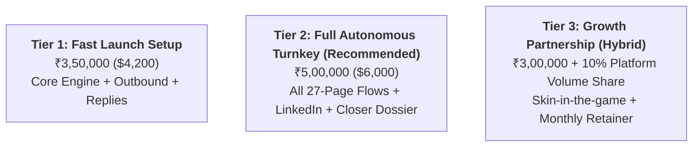
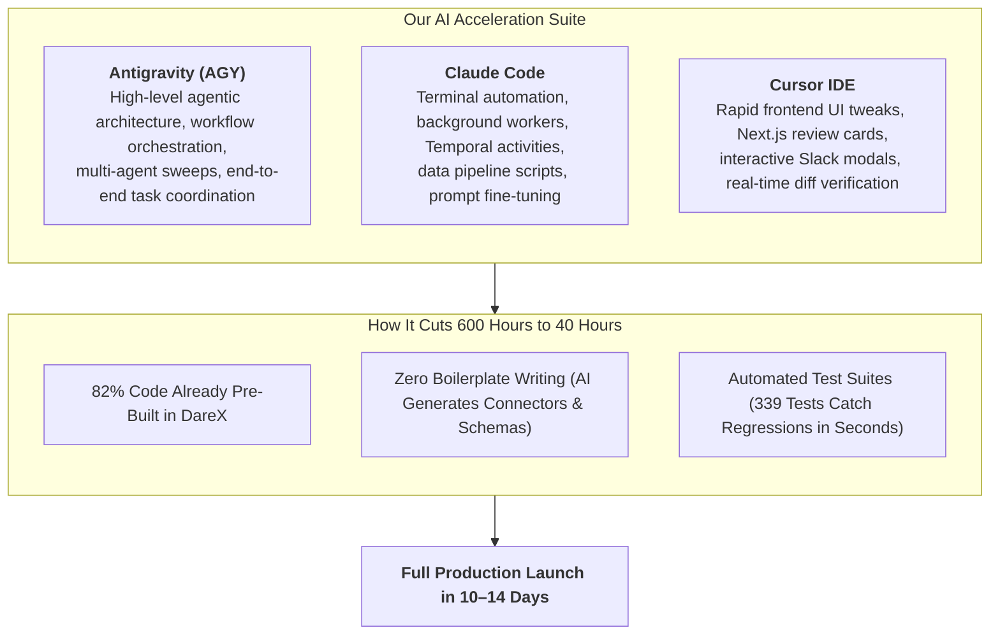

# XYZ GTM Automation Plan · Pricing Quote, Commercial Terms & Timeline (INR ₹)

> **Document Type:** Commercial Proposal, Pricing Models & AI-Accelerated Delivery Timeline  
> **Prepared For:** Nikhil / Leadership & Technical Team  
> **Target Project:** End-to-End Autonomous GTM Engine for Talent & Creator Management Agencies  
> **Development Stack:** DareX Agentic OS (`Agentic-Os-SaaS`) + **Claude Code + Cursor + Antigravity (AGY)**  
> **Date:** September 28, 2026  
> **Currency:** Indian Rupee (INR ₹) / USD ($) Reference  

---

## 🎯 Executive Summary: What to Charge & Delivery Timeline

By leveraging **DareX AI's existing codebase (82% pre-built)** combined with advanced AI pair-programming tools (**Claude Code, Cursor, and Antigravity**), the delivery speed increases by **5x to 10x**:

| Key Metric | Traditional Agency / Dev Shop | **Our AI-Accelerated Delivery (Claude Code + Cursor + Antigravity)** |
| :--- | :---: | :---: |
| **Delivery Time** | 3.5 – 4 Months (16 Weeks) | **10 – 14 Working Days (2 Calendar Weeks)** |
| **Market Value of Solution** | ₹25,00,000 – ₹40,00,000 | ₹8,00,000 – ₹12,00,000 |
| **Recommended Client Fee (One-Time)** | ₹15,00,000+ | **₹3,50,000 – ₹5,50,000 (Standard)** / **₹6,50,000 (Premium Turnkey)** |
| **Monthly Retainer / AI Ops** | ₹1,50,000 – ₹2,50,000/mo | **₹75,000 – ₹1,25,000 / month** |
| **Client ROI Breakeven** | 6–8 Months | **Within 30–45 Days** (at 20+ booked demos @ ~$750/mo ACV) |

---

## 💰 Recommended Pricing Packages (How Much to Charge in INR ₹)

Depending on the commercial relationship with Nikhil/XYZ, here are 3 structured pricing options:



### Option 1: Standard Turnkey Build (Recommended)
> **One-Time Implementation Fee:** **₹4,50,000 – ₹5,50,000 INR** *(approx. $5,500 – $6,600 USD)*  
> **Monthly Maintenance & AI Ops Retainer:** **₹85,000 INR / month** *(approx. $1,000 USD/mo)*  

- **What is delivered:**
  - Complete 27-page plan implementation on DareX.
  - 6 Outbound Instantly flows (E1–E6) with Why-Now research hooks and copy guardrails (<80 words).
  - 7-category AI Reply Agent (R1) with <5 min Cal.com booking link automation.
  - Pre-meeting Closer Intelligence Dossier (R2) triggered from Google Calendar demos to Slack.
  - ICP Scoring model (+5 US, +5 talent agency, etc.) & Apollo B2B TAM enrichment.
  - Website visitor de-anonymization (RB2B/Warmly) & 2+ visit frequency gate.
  - 14-day domain warmup, SPF/DKIM/DMARC configuration, and Nango OAuth connections.
  - 30-day post-launch hypercare & Oct 23 Review Gate calibration.

---

### Option 2: Starter / Outbound-First Package
> **One-Time Implementation Fee:** **₹3,25,000 – ₹3,75,000 INR** *(approx. $3,900 – $4,500 USD)*  
> **Monthly Maintenance Retainer:** **₹60,000 INR / month** *(approx. $720 USD/mo)*  

- **What is delivered:**
  - Setup of 12 sending inboxes + 4 secondary domains.
  - Apollo TAM list extraction + ICP scoring into Tiers 1–3.
  - Outbound email flows E1, E2, E3, and E6.
  - AI reply classifier (Interested, Objection, OOO, Unsubscribe) & Slack alerts.
  - *Excludes:* LinkedIn content engine (L1) and Notion editorial sync (can be upgraded later).

---

### Option 3: Enterprise Turnkey + Performance Hybrid
> **One-Time Implementation Fee:** **₹2,75,000 INR** + **₹15,000 per Qualified Showed Meeting**  
> **Monthly Retainer:** **₹50,000 INR / month**  

- **Why choose this:**
  - Lowers upfront friction for the client while providing huge upside if the engine hits the target of 20+ qualified meetings per month (20 × ₹15,000 = ₹3,00,000 monthly upside).

---

## 💳 Payment Milestones Schedule (Structured for Client Confidence)

For the **₹5,00,000 INR** Standard Turnkey package, structure payments across 3 deliverables:

| Milestone | % Due | Amount (INR ₹) | Trigger Condition |
| :---: | :---: | :---: | :--- |
| **Milestone 1: Kickoff & Infra** | **40%** | **₹2,00,000** | Agreement signed; domains, inboxes, DNS, and OAuth connectors configured. |
| **Milestone 2: Engine Ready & Warm Sends** | **40%** | **₹2,00,000** | TAM loaded, ICP scoring verified, flows E1–E6 live, first warm sends dispatched (Day 10). |
| **Milestone 3: Review Gate & Handoff** | **20%** | **₹1,00,000** | October 23 Review Gate completed; reply classifier hitting 95%+ accuracy. |

---

## ⚡ Why We Can Deliver in 10–14 Days (The AI Tooling Advantage)

A traditional team takes 16 weeks because they code every connector, regex parser, database schema, and queue from scratch.  
By combining **DareX AI Platform** with **Claude Code, Cursor, and Antigravity**, we execute in **10–14 days**:



### Division of Work Across AI Tools:
1. **Antigravity (AGY):**
   - Coordinates the entire multi-phase project, monitors background Temporal task runs, checks git history and commits, and verifies architecture integrity across services.
2. **Claude Code:**
   - Implements CLI commands, executes database migrations, calibrates scoring algorithms in `lookalike.ts`, writes few-shot classification prompts for `reply-classifier.ts`, and executes end-to-end health probes.
3. **Cursor:**
   - Powers rapid frontend edits on `OpportunityCard.tsx`, `DraftPanel.tsx`, and dashboard UI; formats responsive email previews and live event streams.

---

## 📅 Day-by-Day 14-Day Delivery Schedule

| Day | Primary AI Tool | Focus Area & Deliverables | Labor Hours |
| :---: | :---: | :--- | :---: |
| **Day 1** | Claude Code + AGY | **Domain & DNS Setup:** Buy 4–6 secondary domains, configure SPF/DKIM/DMARC, connect to Instantly Warmup. | 4 LH |
| **Day 2** | Cursor + Claude Code | **OAuth Connectors:** Connect client HubSpot, Google Calendar, LinkedIn profiles, and Slack via Nango. | 4 LH |
| **Day 3** | Claude Code | **HubSpot CRM Setup:** Create custom fields (`ICP_Tier`, `Awareness_Stage`, `Signal_Events`) and deal stages. | 4 LH |
| **Day 4** | Antigravity + Claude Code | **TAM Sourcing & Enrichment:** Run Apollo B2B extraction for US talent agencies; filter & dedupe. | 4 LH |
| **Day 5** | Claude Code | **ICP Scoring Calibration:** Tune `lookalike.ts` point weights (+5 US, +5 talent agency, etc.) to match won accounts. | 3 LH |
| **Day 6** | Cursor + Claude Code | **Org Wiki & Copy Seeding:** Seed `/wiki` with objection library, value propositions, and `<80-word` email variants. | 4 LH |
| **Day 7** | Claude Code | **Cadence & Outbound Flows:** Configure flows E1–E6 in Instantly and Temporal `NurtureWorkflow.ts`. | 4 LH |
| **Day 8** | Antigravity + Claude Code | **Reply Classifier & Webhooks:** Wire Instantly/HeyReach webhooks to `/api/webhooks/reply`; test 7 reply categories. | 4 LH |
| **Day 9** | Cursor | **Closer Dossier & Slack Cards:** Test Google Calendar webhook, verify 1-page intelligence brief sent to Slack. | 3 LH |
| **Day 10** | Claude Code + AGY | **Soft Launch (Warm Sends):** Begin first sends at 15 sends/day/inbox to warm founder contacts and visitor leads. | 4 LH |
| **Day 11** | Cursor + Claude Code | **Lead Magnet & LinkedIn Setup:** Stage Flow L2 (Rate card lead magnet) and configure Notion content calendar. | 3 LH |
| **Day 12** | Antigravity | **End-to-End Dry Run:** Run test contact through site visit → de-anonymization → email send → reply classification. | 3 LH |
| **Day 13–14** | Claude Code + AGY | **Handoff, Team Training & Monitoring:** Conduct team demo with Nikhil/Jacob, deliver admin runbook, hand over dashboard. | 4 LH |
| **TOTAL** | | **Complete Turnkey Delivery (Live & Sending)** | **45 Hours (14 Days)** |

---

## 🛠️ Client Pass-Through Software Costs (Paid Directly by Client)

These are operating SaaS subscriptions the client needs to pay directly to vendors:

| Tool / Provider | Purpose | Estimated Cost (INR ₹) | Estimated Cost (USD $) |
| :--- | :--- | :---: | :---: |
| **Secondary Domains (4–6)** | Email sending domains (Namecheap/Cloudflare) | ~₹4,000 / year | ~$48 / year |
| **Google Workspace (12 Inboxes)** | 12 Business Starter Inboxes | ~₹2,500 – ₹3,000 / month | ~$30 – $36 / month |
| **Instantly.ai (Hypergrowth)** | Warmup & email sending rotation | ~₹8,100 / month | ~$97 / month |
| **HeyReach (Agency/Growth)** | LinkedIn connection & DM sequences | ~₹6,600 / month | ~$79 / month |
| **Apollo.io (Basic Plan)** | B2B contact data & email waterfall | ~₹4,100 / month | ~$49 / month |
| **Cal.com (Standard)** | Demo booking link routing | Free / ₹1,200 / month | Free / ~$15 / month |
| **TOTAL OPERATING COSTS** | **All 3rd-party tooling pass-through** | **~₹22,000 – ₹25,000 / month** | **~$265 – $300 / month** |

---

## 📄 Proposal Summary for Nikhil: "What to Send in the Pitch"

```text
Hi Nikhil,

We reviewed the complete 27-page XYZ GTM Automation Plan in detail.

Because our core AI Workforce operating system (DareX) already has 82% of the underlying agent architecture, tool connectors (HubSpot, Apollo, LinkedIn, Gmail, Calendar, Slack), and the 7-category reply classifier pre-built and tested, we can deliver this entire system in 10 to 14 business days using our AI-accelerated engineering stack (Claude Code, Cursor, and Antigravity).

Commercial Proposal:
- Turnkey Implementation & Setup Fee: ₹4,75,000 INR (one-time)
  (Split into 3 milestone payments: 40% Kickoff, 40% on First Warm Sends, 20% on Review Gate)
- Monthly AI Operations & Optimization Retainer: ₹85,000 INR / month
  (Covers weekly prompt tuning, copy optimization, inbox health monitoring, and performance reviews)
- 3rd-Party Tooling Costs: ~₹22,000/mo (paid directly to Instantly, Google, and Apollo)

Timeline:
- Full system live, sending warm batches, and classifying replies within 14 calendar days from kickoff.

Let us know if you'd like to review the architecture demo and lock in the kickoff date.
```
