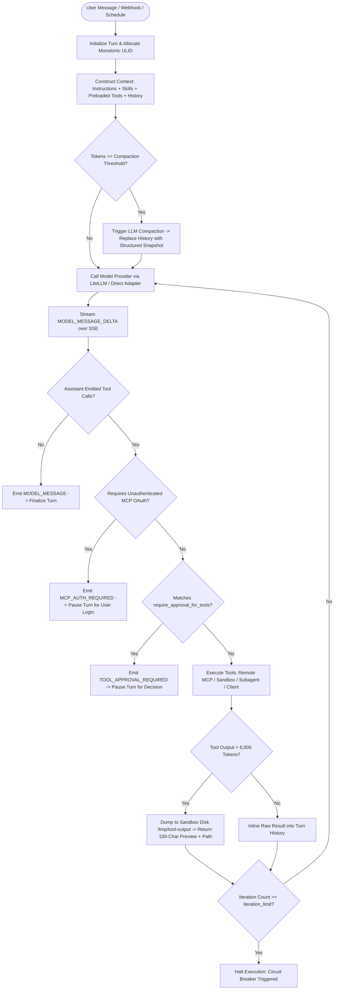
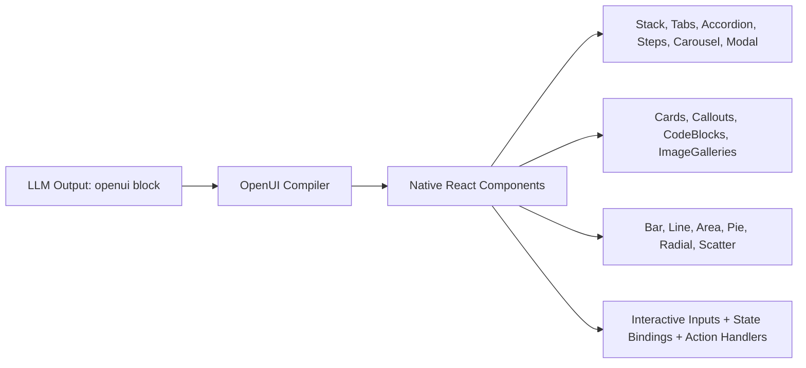

# TrueForge — Comprehensive Feature & Capability Reference

> **TrueForge** (by TrueFoundry) is an enterprise-grade, open-source agent harness — the runtime layer that wraps an LLM to turn it into an autonomous, stateful, safe, and cost-efficient agent.
> This document provides an exhaustive technical inventory of every system, algorithm, protocol, and package within TrueForge.

---

## Table of Contents

1. [Core Harness Loop & Execution Lifecycle](#1-core-harness-loop--execution-lifecycle)
2. [Event Stream Architecture & Wire Formats](#2-event-stream-architecture--wire-formats)
3. [Context Engineering & Token Optimization Engine](#3-context-engineering--token-optimization-engine)
   - [Dynamic Subagents & Multi-Threaded Execution](#a-dynamic-subagents--multi-threaded-execution)
   - [Programmatic Tool Calling / Code Mode](#b-programmatic-tool-calling--code-mode)
   - [Deferred Tool Loading & Meta-Tools](#c-deferred-tool-loading--meta-tools)
   - [Large Tool Response Offloading & Schema Inference](#d-large-tool-response-offloading--schema-inference)
   - [Context Compaction & Deep Structured Summarization](#e-context-compaction--deep-structured-summarization)
   - [Granular Token Breakdown & Cache Tracking](#f-granular-token-breakdown--cache-tracking)
4. [Model Context Protocol (MCP) Capabilities](#4-model-context-protocol-mcp-capabilities)
   - [Transports & Connection Lifecycles](#a-transports--connection-lifecycles)
   - [Authentication & In-Chat OAuth Flow](#b-authentication--in-chat-oauth-flow)
   - [Tool Selectors & Annotation Policy](#c-tool-selectors--annotation-policy)
   - [Human-in-the-Loop (HITL) Tool Approval](#d-human-in-the-loop-hitl-tool-approval)
   - [Shipped MCP Connectors Catalog](#e-shipped-mcp-connectors-catalog)
5. [Isolated Sandbox-as-a-Tool Architecture](#5-isolated-sandbox-as-a-tool-architecture)
   - [Server-Side Harness vs Sandbox Isolation](#a-server-side-harness-vs-sandbox-isolation)
   - [Daytona Provider & Snapshot Cloning](#b-daytona-provider--snapshot-cloning)
   - [In-Sandbox Code Execution & Shell Commands](#c-in-sandbox-code-execution--shell-commands)
   - [Secure File Downloads & Signed Tokens](#d-secure-file-downloads--signed-tokens)
   - [Process-Scoped Git Credentials](#e-process-scoped-git-credentials)
6. [Git-Backed Skills System](#6-git-backed-skills-system)
   - [Skill Structure & Progressive Disclosure](#a-skill-structure--progressive-disclosure)
   - [Sparse Cloning & Sandbox Mounting](#b-sparse-cloning--sandbox-mounting)
   - [Shipped Skills Catalog](#c-shipped-skills-catalog)
7. [Built-in Capabilities & Interaction Paradigms](#7-built-in-capabilities--interaction-paradigms)
   - [Clarifying Questions (`ask_user_question`)](#a-clarifying-questions-ask_user_question)
   - [Generative UI via OpenUI (20+ Interactive Components)](#b-generative-ui-via-openui-20-interactive-components)
   - [System Clock (`get_current_datetime`)](#c-system-clock-get_current_datetime)
8. [Automated Scheduling Engine (Cron & Triggers)](#8-automated-scheduling-engine-cron--triggers)
9. [Enterprise Persistence, Scalability & Infrastructure](#9-enterprise-persistence-scalability--infrastructure)
   - [Local Mode (SQLite) vs Hosted Mode (PostgreSQL + Redis)](#a-local-mode-sqlite-vs-hosted-mode-postgresql--redis)
   - [Cross-Replica Pub/Sub & Stream Peering](#b-cross-replica-pubsub--stream-peering)
   - [OIDC Authentication & Enterprise RBAC](#c-oidc-authentication--enterprise-rbac)
   - [Mutual TLS (mTLS) Security](#d-mutual-tls-mtls-security)
   - [OpenTelemetry Tracing & Session Metrics](#e-opentelemetry-tracing--session-metrics)
10. [Full Agent Configuration Specification](#10-full-agent-configuration-specification)
11. [Developer SDKs & Embeddable Frontends](#11-developer-sdks--embeddable-frontends)
12. [DevRev Enterprise Benchmark Results](#12-devrev-enterprise-benchmark-results)

---

## 1. Core Harness Loop & Execution Lifecycle

The TrueForge execution loop coordinates user instructions, prompt construction, model invocations, tool dispatching, approval pauses, and error recovery:



### Core Runtime Guarantees:
- **Resilient Multi-Turn State**: Turn history, tool executions, and intermediate outputs are saved in PostgreSQL (or SQLite). Browsers can refresh or reconnect without losing turn state.
- **Circuit Breaker Protection**: `iteration_limit` (1–1024, default 100) prevents runaway autonomous agent loops from exhausting budgets.
- **Granular Timeouts**: Turn timeouts (`SERVER_EXECUTION_TIMEOUT_SECONDS`), MCP call timeout (`MCP_REQUEST_TIMEOUT_MS`), and transport connect timeout (`MCP_CONNECT_TIMEOUT_MS`).
- **Distributed Turn Cancellation**: Calling `POST /api/v1/sessions/:session_id/turns/:turn_id/cancel` immediately broadcasts a cancellation signal across all replicas using Redis Pub/Sub, cleanly terminating executing child processes.

---

## 2. Event Stream Architecture & Wire Formats

TrueForge communicates with clients via Server-Sent Events (SSE). Every event is assigned a monotonically increasing ULID (`newEventId()`), ensuring deterministic client-side replay:

| Event Name | Wire Type Constant | Payload Schema & Purpose |
| :--- | :--- | :--- |
| **Model Message Delta** | `model.message.delta` | Real-time text token stream, incremental tool argument JSON fragments, and finish reason. |
| **Model Message** | `model.message` | Complete assistant turn response with role, text content, tool call IDs, and token usage breakdown. |
| **Tool Response** | `tool.response` | Output from an executed tool (JSON object, stdout text, or error message). |
| **Tool Approval Required** | `tool.approval_required` | Pauses turn: provides tool call IDs and arguments waiting for human confirmation (`Allow` or `Deny`). |
| **Tool Response Required** | `tool.response_required` | Pauses turn: requests client-side execution (e.g. interactive multi-choice question `ask_user_question`). |
| **User Tool Approval** | `user.tool_approval` | Submitted by client to unpause execution (`status: "allow"` or `status: "deny"` with feedback). |
| **User Tool Response** | `user.tool_response` | Submitted by client with output from client-side tool (e.g. user-selected option). |
| **MCP Auth Required** | `mcp.auth_required` | Pauses turn: sends OAuth login URL (`auth_url`) when a tool requires user authentication. |
| **MCP Initialize** | `mcp.initialize` | Emitted when MCP transports connect and handshake for the turn. |
| **Sandbox Created** | `sandbox.created` | Emitted when a Daytona compute sandbox is allocated for the session. |
| **Thread Created** | `thread.created` | Emitted when a dynamic subagent thread is spawned (includes parent thread ID, tool call ID, and role). |
| **Thread Done** | `thread.done` | Emitted when a subagent thread completes (`status: "done"` with final output or error). |
| **Context Overwrite** | `agent.context.overwrite` | Emitted when context compaction summarizes earlier conversation history. |

---

## 3. Context Engineering & Token Optimization Engine

Context bloat is the primary cause of degraded agent reasoning and astronomical API bills. TrueForge incorporates 6 algorithms to maintain a lean context window.

### A. Dynamic Subagents & Multi-Threaded Execution
- **Tool**: `create_sub_agent`
- **Mechanism**: The root agent creates dedicated child agents on demand:
  ```json
  {
    "name": "sales-lead-enricher",
    "input": "Search HubSpot for company Acme Corp, pull deal size, and verify LinkedIn domain. Return a 3-bullet summary."
  }
  ```
- **Context Isolation**: All intermediate tool calls, raw CRM payloads, and exploratory steps taken by the subagent remain in the child thread.
- **Parallelism**: Multiple subagents execute concurrently. The root agent waits for all subagents to finish and ingests only their concise markdown summaries.

### B. Programmatic Tool Calling / Code Mode
- **The Problem**: Querying 100 database records or emails and performing arithmetic in LLM prompts wastes 50,000+ tokens and leads to calculation errors.
- **The Solution**: The agent writes a Python script executed inside the sandbox:
  ```python
  import asyncio
  from mcp_client import call_tool

  async def main():
      leads = await call_tool("crm", "search_contacts", {"status": "open"})
      high_value = [l for l in leads if l.get("budget", 0) > 10000]
      print(f"Total High Value Leads: {len(high_value)}")
      for lead in high_value[:5]:
          print(f"- {lead['name']}: ${lead['budget']}")

  asyncio.run(main())
  ```
- **Result**: Zero raw lead records touch the LLM prompt. Only the printed stdout is returned to the model context.

### C. Deferred Tool Loading & Meta-Tools
- **Preload Policy (`preload: false`)**: Instead of dumping 60+ complete JSON schemas into every prompt, TrueForge injects only the tool names and server descriptions.
- **Meta-Discovery Tools**:
  1. `list_tools`: Discovers available tools on an MCP server.
  2. `get_tool_info`: Retrieves input and output schemas for a specific tool.
  3. `get_tool_output_schema`: Retrieves only the output schema (ideal for writing Code Mode scripts).
  4. `call_tool`: Invokes deferred tools dynamically.
- **Selective Preloading**: Frequently used tools (e.g. `send_whatsapp_message`) can be marked in `preload_tools` to bypass discovery.

### D. Large Tool Response Offloading & Schema Inference
- **Per-Response Guard**: If a single tool returns more than **6,000 tokens**, `LargeToolResponseProcessor` intercepts the payload.
- **Combined Guard**: If parallel tool calls exceed **10,000 tokens** combined, the largest results are written to `/tmp/tool-<id>-output` on the sandbox filesystem.
- **Context Preview**: Replaces the huge payload with a 100-character preview and the local file path.
- **Schema Discovery (`genson`)**: The agent inspects the file structure with `head -c 200 /tmp/file && genson /tmp/file` inside the sandbox, authoring a Python extraction script without blowing up its prompt window.

### E. Context Compaction & Deep Structured Summarization
- **Trigger**: Runs automatically when input tokens hit **80% of model capacity** or a configured ceiling (e.g. 50,000 tokens).
- **Structured Summary Architecture**: Generates a deep snapshot formatted inside `<analysis>` tags:
  - User's primary intent and unresolved requests.
  - Architecture decisions and business rules identified.
  - Files/entities created, read, or modified (with code summaries).
  - Errors encountered and how they were resolved.
  - Verbatim copies of all non-tool human messages.
  - Active pending tasks and the immediate next step.
- **Non-Destructive**: Emits `agent.context.overwrite`. Historical turns are never deleted from PostgreSQL/SQLite; they are simply compressed in the active working memory.

### F. Granular Token Breakdown & Cache Tracking
Every turn reports token consumption across 5 distinct buckets:
- `harness`: Framework prompts and system capability framing.
- `skills`: Tokens consumed by loaded Git skills.
- `instructions`: System instructions defined in the agent persona.
- `tool_definitions`: Active MCP schemas in the context window.
- `messages`: Cumulative conversational history.
- `cache_read_tokens` / `cache_write_tokens`: Prompt caching metrics for Anthropic, Gemini, and OpenAI.

---

## 4. Model Context Protocol (MCP) Capabilities

TrueForge is a full-featured MCP host supporting local and remote MCP tool servers with enterprise governance:

### A. Transports & Connection Lifecycles
- **Transports Supported**: `streamable-http` and Server-Sent Events (`sse`).
- **Automatic Fallback**: Probes `streamable-http` first, gracefully falling back to `sse` for legacy servers.
- **Session Preservation**: Maintains MCP `sessionId` across tool calls; automatically re-authenticates when sessions expire.
- **Distributed Tracing**: Automatically injects W3C `traceparent` headers into MCP requests.

### B. Authentication & In-Chat OAuth Flow
- **No Auth**: Internal microservices.
- **Header Auth**: Static Bearer tokens and API keys.
- **OAuth 2.0 with Dynamic Client Registration (DCR)**: TrueForge registers dynamically with OAuth providers, completes PKCE handshakes, and securely refreshes access tokens.
- **In-Chat Authorization**: If an MCP tool returns an auth error, TrueForge halts execution and emits `mcp.auth_required` with an `auth_url`. The user completes authentication via an in-chat popup; once verified, TrueForge automatically resumes the interrupted turn.

### C. Tool Selectors & Annotation Policy
Granular security controls per MCP server:
- `enable_tools`: Whitelist specific tools or tags (`@all`, `@read-only`, `@write`, `@destructive`).
- `disable_tools`: Blacklist dangerous actions.
- `preload_tools`: Preload specific schemas into system prompts.

### D. Human-in-the-Loop (HITL) Tool Approval
- Controlled via `require_approval_for_tools` (defaults to `["@write", "@destructive"]`).
- When triggered:
  1. Execution halts; TrueForge emits `tool.approval_required`.
  2. UI displays a confirmation modal with the tool name and formatted parameters.
  3. The user clicks **Allow** or **Deny** (with an optional explanation).
  4. Client emits `user.tool_approval`. If denied, the agent receives the denial reason and attempts a different strategy.

### E. Shipped MCP Connectors Catalog
Pre-packaged integrations in `mcp-catalog.yaml`:
- **Linear**: Manage issues and project backlogs.
- **Notion**: Read and write Notion workspace databases.
- **GitHub**: Pull requests, commits, issue tracking, CI checks.
- **Sentry**: Error event inspection and stack trace analysis.
- **Supabase**: Direct PostgreSQL inspection and migration tools.
- **Stripe**: Customer balances, invoice management, charges.
- **Jira / Confluence**: Enterprise ticket and document collaboration.
- **PostHog**: Funnel analysis and feature flag toggling.
- **Tavily / Exa / Bright Data**: Live web search, content scraping, and deep research.

---

## 5. Isolated Sandbox-as-a-Tool Architecture

### A. Server-Side Harness vs Sandbox Isolation
- **Harness Stays on Server**: The LLM reasoning loop, API keys, database credentials, and session state live securely on the TrueForge server.
- **On-Demand Compute**: Sandboxes are provisioned **only** when an agent invokes code execution or file manipulation tools. Conversational questions consume zero sandbox resources.

### B. Daytona Provider & Snapshot Cloning
- Uses [Daytona](https://www.daytona.io) for isolated execution environments.
- Provisions environments from a pre-built base image containing `python3`, `node`, `git`, `curl`, `jq`, and `genson`.
- Clones snapshots in sub-second latency; reuses sandboxes across multi-turn sessions with automatic idle teardown.

### C. In-Sandbox Code Execution & Shell Commands
- Tool: `sandbox`.
- Supports Bash scripts, Python, and Node.js.
- Security controls: path traversal blocking, sanitized base64 script delivery, and isolation from host network credentials.

### D. Secure File Downloads & Signed Tokens
- Tool config: `allow_file_downloads: true`.
- When an agent generates an artifact (e.g. `/tmp/quarterly_report.xlsx` or `chart.png`), TrueForge generates a cryptographically signed, expiring download token.
- Users can download files directly from the chat interface.

### E. Process-Scoped Git Credentials
- Injects ephemeral git credentials using `GIT_CONFIG_COUNT` environment variables.
- Git tokens are scoped to the active execution process and are never saved to global `~/.gitconfig` or written to disk.

---

## 6. Git-Backed Skills System

Skills are modular repositories containing domain knowledge, standard operating procedures, and helper scripts conforming to the `SKILL.md` format.

### A. Skill Structure & Progressive Disclosure
```text
customer-escalation-skill/
├── SKILL.md              # YAML frontmatter + core procedures
├── references/           # Refund thresholds, escalation matrices
│   └── refund-matrix.md
└── scripts/              # Executable verification scripts
    └── verify_order.py
```
- **Progressive Disclosure**: Only skill names and descriptions are loaded into the system prompt initially.
- Detailed procedures and reference files are mounted into context only when the agent determines the skill is needed.

### B. Sparse Cloning & Sandbox Mounting
- Skills are cloned sparsely into the sandbox at `/opt/tfy/skills/{name}`.
- Bundled Python and Bash helper scripts can be invoked directly inside the sandbox.

---

## 7. Built-in Capabilities & Interaction Paradigms

### A. Clarifying Questions (`ask_user_question`)
- Client-side tool that emits `tool.response_required`.
- Parameters:
  - `question`: Clear, ambiguous-resolution inquiry.
  - `options`: 0 to 5 choices (recommended choices prefixed with `(Recommended)`).
- Renders as an interactive card in the chat UI.
- Resumes execution upon receiving `user.tool_response`.

### B. Generative UI via OpenUI (20+ Interactive Components)
Agents can generate interactive UI blocks inside ````openui code snippets. TrueForge compiles and renders these into native interactive React widgets:



- **Layout**: `Stack`, `Tabs`, `Accordion`, `Steps`, `Carousel`, `Modal`, `Separator`.
- **Content**: `Card`, `CardHeader`, `Callout`, `TextCallout`, `CodeBlock`, `ImageGallery`, `TagBlock`.
- **Data Visualization**: `BarChart`, `HorizontalBarChart`, `LineChart`, `AreaChart`, `PieChart`, `RadialChart`, `ScatterChart`.
- **Data Tables**: Sortable, filterable tables with custom columns.
- **Forms & Reactive State**: `$variable` two-way bindings and `@ToAssistant` action dispatchers.

### C. System Clock (`get_current_datetime`)
- Provides current ISO-8601 UTC timestamp and epoch milliseconds, ensuring time-accurate scheduling and query filters.

---

## 8. Automated Scheduling Engine (Cron & Triggers)

TrueForge includes an enterprise background scheduler mounted at `/api/v1/schedules`:
- **Cron Expressions**: Standard 5-field syntax evaluated in any IANA time zone (e.g. `UTC`, `America/New_York`, `Asia/Kolkata`).
- **Interval Protection**: Enforces minimum trigger intervals (default: 1 hour) to avoid runaway executions.
- **Payloads**: Dispatches pre-configured user prompts to specified agents.
- **Execution Tracking**: Full history available via `GET /api/v1/schedules/:schedule_id/runs`.
- **Lifecycle Control**: Pause, resume, or trigger immediate runs.

---

## 9. Enterprise Persistence, Scalability & Infrastructure

### A. Local Mode (SQLite) vs Hosted Mode (PostgreSQL + Redis)
1. **Local Mode**:
   - Single process using SQLite (`~/.local/share/trueforge/trueforge.sqlite`).
   - Zero external dependencies; launches in seconds via `npx @truefoundry/trueforge`.
2. **Hosted Mode**:
   - **PostgreSQL**: Stores agents, sessions, turns, schedules, and raw event logs. Includes connection pooling (`DATABASE_POOL_MAX`) and statement timeouts.
   - **Redis**: Coordinates distributed event streaming, distributed locks, and cross-replica message delivery.

### B. Cross-Replica Pub/Sub & Stream Peering
- Multiple server replicas sit behind a load balancer.
- Events publish to Redis channels (`turn:<turn_id>:events`).
- Clients can connect to any replica to stream turns, submit tool approvals, or cancel turns executing on another node.

### C. OIDC Authentication & Enterprise RBAC
- Supports Okta, Google, Microsoft Entra ID, Auth0, Keycloak.
- Role mapping (`admin` vs `user`) via token claims.
- Domain restriction via `OIDC_ALLOWED_EMAILS`.

### D. Mutual TLS (mTLS) Security
- Enables end-to-end cryptographic verification between API gateways, replicas, and MCP sidecars (`TRUEFORGE_MTLS_ENABLED=true`).

### E. OpenTelemetry Tracing & Session Metrics
- End-to-end W3C distributed tracing across the harness loop, Daytona sandbox, and remote MCP servers.
- Built-in metrics API (`/api/internal/metrics`) tracking token consumption, latencies, and error rates over 30-day windows.

---

## 10. Full Agent Configuration Specification

Agents are defined declaratively via JSON or YAML:

```json
{
  "name": "enterprise-sales-representative",
  "description": "Qualifies inbound leads, coordinates CRM updates, and schedules demos.",
  "model": {
    "name": "claude-3-7-sonnet",
    "parameters": {
      "temperature": 0.2,
      "max_tokens": 4096,
      "top_p": 0.95
    }
  },
  "instructions": "You are Sarah, an Enterprise Sales Specialist for Acme Corp...",
  "mcp_servers": [
    {
      "name": "darex-connectors",
      "preload": false,
      "preload_tools": ["hubspot_search_contacts", "calendar_find_free_slots"],
      "enable_tools": ["@read-only", "hubspot_create_deal", "calendar_book_meeting"],
      "require_approval_for_tools": ["hubspot_create_deal", "calendar_book_meeting"]
    }
  ],
  "skills": [
    { "name": "lead-qualification-sop" }
  ],
  "config": {
    "sandbox": {
      "enabled": true,
      "allow_file_downloads": true
    },
    "dynamic_sub_agents": {
      "enabled": true
    },
    "ask_user_questions": {
      "enabled": true
    },
    "generative_ui": {
      "enabled": true
    },
    "context_management": {
      "compaction": {
        "enabled": true,
        "trigger": {
          "type": "input_tokens",
          "value": 50000
        }
      },
      "large_tool_response": {
        "enabled": true,
        "per_response_token_threshold": 6000,
        "combined_response_token_threshold": 10000,
        "preview_characters": 100
      }
    },
    "iteration_limit": 50
  }
}
```

---

## 11. Developer SDKs & Embeddable Frontends

### A. `@truefoundry/trueforge-sdk` (TypeScript Client)
```typescript
import { TrueForgeClient } from '@truefoundry/trueforge-sdk';

const client = new TrueForgeClient({
  baseUrl: 'http://localhost:8790',
  token: process.env.TRUEFORGE_API_KEY
});

// Create session
const session = await client.sessions.create({
  agent_name: 'enterprise-sales-representative'
});

// Stream turn
const stream = await client.sessions.turns.createStream(session.id, {
  content: 'Please summarize our 5 highest-value pending deals in HubSpot.'
});

for await (const event of stream) {
  if (event.type === 'model.message.delta') {
    process.stdout.write(event.delta.content ?? '');
  } else if (event.type === 'tool.approval_required') {
    console.log('Action requires approval:', event.tool_calls);
    await client.sessions.turns.submitApproval(session.id, event.id, {
      tool_call_id: event.tool_calls[0].id,
      approval: { status: 'allow' }
    });
  }
}
```

### B. `@truefoundry/trueforge-ui` (React Component SDK)
- Built on `@assistant-ui/react`.
- **Layouts**: `SidebarLayout`, `DrawerLayout`, `WidgetLayout`, `DockLayout`.
- **Themes**: `claude`, `chatgpt`, `gemini`, `truefoundry`.
- **Extensible**: Custom message renderers, approval dialogs, and generative UI viewers.

---

## 12. DevRev Enterprise Benchmark Results

Tested across 14 complex enterprise research scenarios (joining CRM, Jira, and Cloud Drive records):

| Framework & Model | Solved / 14 | Average Cost / Run | Tokens Consumed | Tool Calls |
| :--- | :---: | :---: | :---: | :---: |
| **Claude Managed Agents** (Opus 4.8) | 10.7 | $11.80 | 10.0M | 32 |
| **TrueForge** (Opus 4.8) | **10.7** | **$8.60** *(30% savings)* | **3.7M** *(63% reduction)* | **19** |
| **TrueForge** (GLM-5.2) | **11.7** | **$3.00** *(75% savings)* | **3.8M** | **19** |
| **deepagents** (Opus 4.8) | 10.0 | $21.20 | 16.5M | 40 |
| **deepagents** (GLM-5.2) | 12.0 | $9.10 | 11.9M | 40 |
