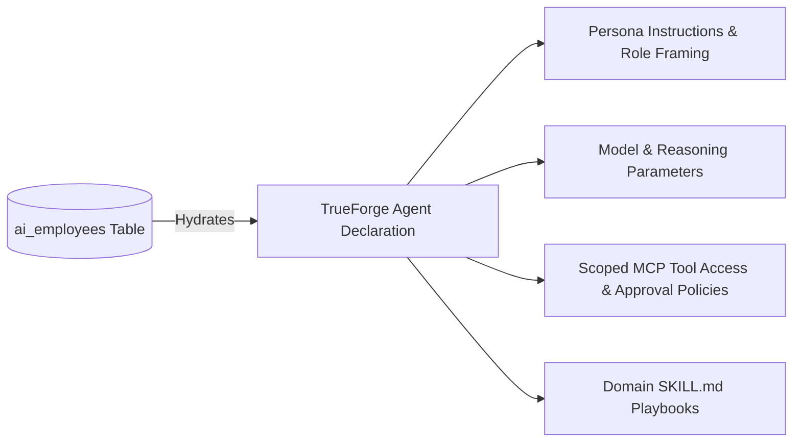
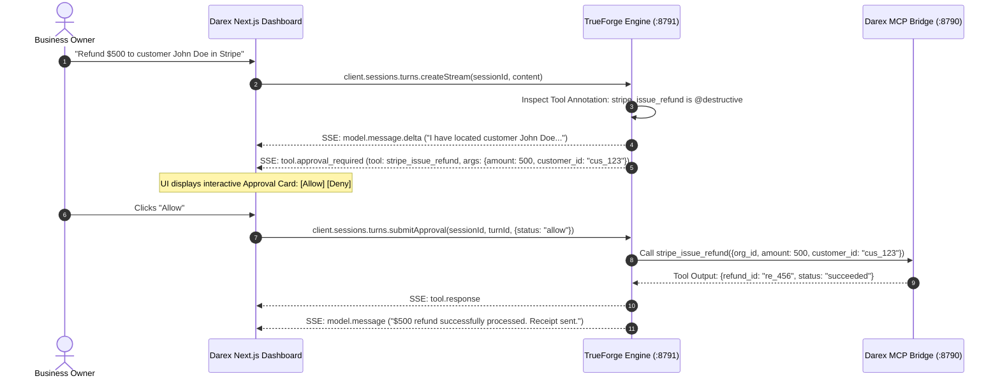
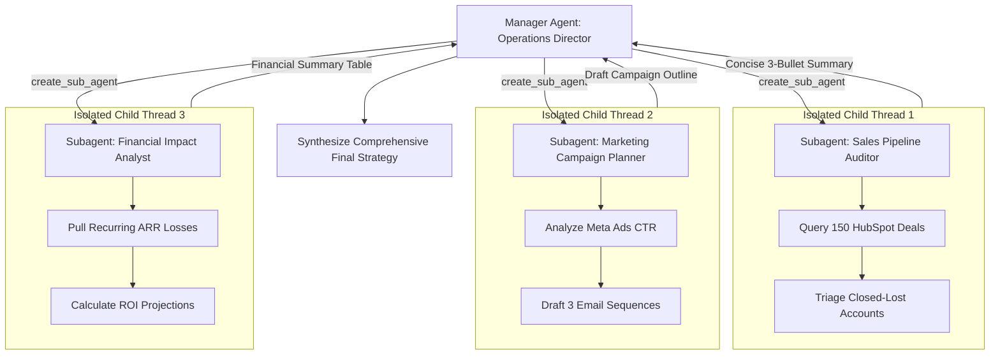

# TrueForge in Darex — Comprehensive Integration & Architecture Blueprint

> **Darex AI-Employee SaaS** uses **TrueForge** as its primary agent harness, execution loop, and tool orchestration runtime.
> This document details the exact architectural blueprint for how TrueForge powers all Darex operations: multi-tenant RLS data safety, AI employee personas, 62 connector tools via MCP, Temporal durable workflows, WhatsApp/Chatwoot inbound webhooks, HITL approvals, and OpenUI generative UI.

---

## 1. System Architecture Overview

```mermaid
flowchart TD
    subgraph ClientLayer["User & Customer Channels"]
        WebDashboard["Darex Next.js Dashboard (:3000)"]
        WhatsApp["WhatsApp Business (Meta Cloud API)"]
        Chatwoot["Chatwoot Multi-Channel Inbox"]
    end

    subgraph DashboardBackend["Darex App Server (apps/dashboard)"]
        AskAIAPI["/api/ask-ai (Plan-Confirm-Execute)"]
        WebhookAPI["/api/webhooks/whatsapp & chatwoot"]
        AgentAPI["/api/agent (Direct SDK Client)"]
        DBScoped["PostgreSQL Scoped Client (RLS Enforcement)"]
    end

    subgraph TemporalLayer["Durable Workflow Layer (services/workflows)"]
        TemporalServer["Temporal Cluster (:7233)"]
        Worker["Darex Temporal Worker"]
        AgentWorkflow["AutonomousAgentWorkflow"]
        CrewWorkflow["CrewWorkflow (Parent-Child)"]
    end

    subgraph TrueForgeHarness["TrueForge Runtime Harness (:8791 / :8790)"]
        TFServer["TrueForge Engine (packages/trueforge)"]
        ContextEngine["Context Engine (Compaction, Subagents, Code Mode)"]
        MCPHost["MCP Client & Protocol Host"]
        DaytonaSandbox["Daytona Sandbox Runtime"]
        TFPostgres["TrueForge Persistence (PostgreSQL + Redis)"]
    end

    subgraph DarexConnectors["Darex Connector & Tool Layer"]
        DarexMCPBridge["Darex MCP Server (:8790) - 62 Tools"]
        Nango["Nango OAuth Runtime (:3003)"]
        SaaSAPIs["Gmail / Calendar / HubSpot / Stripe / QuickBooks / Zoho"]
    end

    WebDashboard -->|SSE / REST| AskAIAPI
    WhatsApp -->|Inbound Webhook 200 OK| WebhookAPI
    Chatwoot -->|Inbound Webhook 200 OK| WebhookAPI
    WebhookAPI -->|Start Workflow| TemporalServer
    AskAIAPI -->|Direct Interactive Stream| TFServer
    TemporalServer --> Worker
    Worker --> AgentWorkflow
    AgentWorkflow -->|@truefoundry/trueforge-sdk| TFServer
    TFServer --> ContextEngine
    TFServer --> MCPHost
    TFServer --> DaytonaSandbox
    TFServer <--> TFPostgres
    MCPHost -->|Streamable HTTP / SSE| DarexMCPBridge
    DarexMCPBridge -->|Scoped DB Queries| DBScoped
    DarexMCPBridge -->|OAuth Proxy| Nango
    Nango --> SaaSAPIs
```

---

## 2. Replacing Atomic-Agent with TrueForge

### Why the Upgrade Was Made:
In Darex's earlier phases, an external `atomic-agent` service ran on port 8787. While functional for basic reasoning loops, it presented severe architectural limitations:
1. **Context Bloat & Token Degradation**: Atomic-agent accumulated full JSON responses from CRM queries, email scans, and analytics tools, exhausting context windows and inflating LLM costs.
2. **Brittle Tool Schema Preloading**: Every tool schema was passed in every turn, costing thousands of tokens before user questions were even processed.
3. **No Native HITL Approval Events**: Confirming dangerous actions required custom out-of-band state machines and custom `agent_plans` DB tables.
4. **No Native Dynamic Subagents**: Parallel multi-agent research required custom Temporal sub-workflows with fragile manual prompt synthesis.

### How TrueForge Fixes This:
TrueForge runs directly within our architecture as an open-source, TypeScript-native harness that natively provides:
- **Deferred Meta-Tool Discovery** (`preload: false`): Reduces prompt overhead by up to 70%.
- **Large Tool Offloading**: Payloads >6,000 tokens are saved to disk, returning a 100-character preview and schema.
- **Code Mode**: Agents write Python scripts to process CRM and billing data inside the sandbox, returning only computed aggregations.
- **Protocol-Level Approvals**: Emits `tool.approval_required` over SSE, pausing turns without custom state machines.
- **Dynamic Subagents**: Spawns isolated parallel subagents via `create_sub_agent` with zero parent context bloat.

---

## 3. Multi-Tenant RLS & Session Scoping

Darex is strictly multi-tenant. Every table has an `org_id` column protected by PostgreSQL Row Level Security (RLS). 

### The Security Contract:
1. **Never trust `org_id` in request bodies**: The tenant identity is resolved strictly from verified SuperTokens session cookies or cryptographic webhook signatures.
2. **Session Scoping in TrueForge**:
   - When creating a TrueForge session, Darex injects tenant context into session metadata:
     ```typescript
     const session = await trueForgeClient.sessions.create({
       agent_name: employeePersonaKey,
       metadata: {
         org_id: sessionOrgId,
         user_id: sessionUserId,
         employee_id: employeeId,
         channel: 'dashboard' // or 'whatsapp', 'chatwoot'
       }
     });
     ```
3. **MCP Tool Invocation Security**:
   - When TrueForge invokes tools on the Darex MCP Bridge (`mcp-bridge.ts`), it passes the authenticated session metadata.
   - The MCP bridge verifies that the requested action operates exclusively within `session.metadata.org_id`.
   - The bridge calls `getScopedClient(orgId)` which executes:
     ```sql
     SET LOCAL app.current_org_id = 'org_12345';
     ```
   - Even if the LLM hallucinated an invalid `org_id`, PostgreSQL RLS guarantees that no cross-tenant records can be read or modified.

---

## 4. Mapping Darex AI Employee Personas to TrueForge Agents

Darex provides 5 core AI Employee archetypes. In TrueForge, each employee is configured declaratively in `packages/trueforge/data/agents/`:



### Archetype 1: Sarah — Enterprise Sales Specialist
- **Role**: Inbound lead qualification, CRM enrichment, calendar scheduling.
- **Model**: `claude-3-7-sonnet` (temp: 0.2).
- **Tools**:
  - Preloaded: `hubspot_search_contacts`, `calendar_find_free_slots`.
  - Allowed: `hubspot_create_deal`, `hubspot_update_contact`, `calendar_book_meeting`, `whatsapp_send`, `web_search`.
  - Approvals Required: `hubspot_create_deal`, `calendar_book_meeting`.
- **Skills**: `b2b-qualification-framework`, `calendar-booking-sop`.

### Archetype 2: Alex — Customer Support Specialist
- **Role**: Multi-channel ticket triage, FAQ resolution, refund verification.
- **Model**: `gemini-2.5-pro` or `claude-3-5-haiku` (fast, cost-effective).
- **Tools**:
  - Preloaded: `chatwoot_get_conversation`, `knowledge_base_search`.
  - Allowed: `chatwoot_send_reply`, `stripe_get_customer`, `stripe_issue_refund`, `gmail_send`.
  - Approvals Required: `stripe_issue_refund` (`@destructive`).
- **Skills**: `customer-support-sop`, `refund-authorization-matrix`.

### Archetype 3: Maya — Growth & Marketing Specialist
- **Role**: Campaign drafting, ad metrics analytics, content generation.
- **Model**: `claude-3-7-sonnet` or `gpt-4o`.
- **Tools**:
  - Preloaded: `meta_ads_get_campaigns`, `google_analytics_query`.
  - Allowed: `meta_ads_update_budget`, `canva_create_asset`, `google_docs_create`, `web_extract`.
  - Approvals Required: `meta_ads_update_budget`.
- **Skills**: `ad-copywriting-framework`, `growth-analytics-sop`.

### Archetype 4: David — Operations & Billing Specialist
- **Role**: Invoice reconciliation, accounting, vendor follow-ups.
- **Model**: `claude-3-7-sonnet`.
- **Tools**:
  - Preloaded: `quickbooks_get_invoices`, `stripe_list_charges`.
  - Allowed: `quickbooks_create_invoice`, `zoho_books_sync`, `database_query`, `sandbox`.
  - Approvals Required: `quickbooks_create_invoice`, `stripe_create_charge`.
- **Code Mode**: Writes Python scripts inside Daytona sandbox to reconcile Stripe payouts against QuickBooks ledger entries.

### Archetype 5: Elena — Legal & Compliance Specialist
- **Role**: Contract review, NDA compliance, vendor terms validation.
- **Model**: `claude-3-7-sonnet` (reasoning: high).
- **Tools**:
  - Preloaded: `google_drive_search`, `leegality_get_document`.
  - Allowed: `leegality_send_for_signature`, `google_docs_read`, `workspace_file`.
  - Approvals Required: `leegality_send_for_signature`.
- **Skills**: `contract-clause-validation`, `nda-compliance-matrix`.

---

## 5. Connecting Darex's 62 Connector Tools via MCP

Darex includes 62 real connectors implemented in `services/workflows/src/mcp-bridge.ts`. TrueForge integrates with this bridge as a native MCP client:

### A. Connection Endpoint
- TrueForge connects to `http://localhost:8790/sse` (or inside Docker at `http://mcp-bridge:8790/sse`).
- Transport: Streamable HTTP with SSE fallback.

### B. Tool Annotation & Safety Mapping
Every Darex tool is annotated so TrueForge enforces governance automatically:

| Darex Tool Category | Examples | Annotation Tag | Approval Requirement |
| :--- | :--- | :--- | :--- |
| **Read / Query** | `gmail_fetch`, `hubspot_search`, `calendar_find_free_slots`, `db_query` | `@read-only` | Auto-executed without human intervention |
| **State Mutation** | `gmail_send`, `whatsapp_send`, `hubspot_update_contact`, `calendar_book_meeting` | `@write` | Emits `tool.approval_required` if configured |
| **Destructive / Financial** | `stripe_issue_refund`, `meta_ads_update_budget`, `database_write`, `delete_record` | `@destructive` | **Mandatory** human approval before execution |

### C. In-Chat OAuth Handshake
If an employee calls a tool for a connector that is disconnected (e.g. HubSpot):
1. The Darex MCP bridge returns an unauthenticated status code.
2. TrueForge halts execution and emits `mcp.auth_required` with the Nango OAuth connect URL.
3. The Darex chat UI pops up the Nango authorization window.
4. Once connected, TrueForge immediately resumes the paused turn and completes the customer's request.

---

## 6. Human-in-the-Loop (HITL) Plan-Confirm-Execute Flow

Darex uses a **Plan-Confirm-Execute** pattern for complex business requests. TrueForge enables this seamlessly:



If the user clicks **Deny** and types *"Wait, verify return tracking first"*, TrueForge transmits the feedback to the agent, which responds: *"Understood. Checking shipping status instead."*

---

## 7. Temporal Workflows & Durable Inbound Pipeline

For async channels like WhatsApp and Chatwoot, customer messages must **never drop**, even during service deployments.

### Inbound Architecture:
1. **WhatsApp Webhook Arrives**: `POST /api/webhooks/whatsapp`
2. **Fast 200 OK**: Message and thread are persisted to PostgreSQL; 200 OK returned to Meta within 300ms.
3. **Temporal Durable Execution**:
   - Webhook dispatches `AutonomousAgentWorkflow` on Temporal.
   - Temporal starts activity `ExecuteTrueForgeTurnActivity`.
   - Activity calls TrueForge client:
     ```typescript
     export async function executeTrueForgeTurnActivity(params: {
       orgId: string;
       conversationId: string;
       employeeId: string;
       userMessage: string;
     }): Promise<string> {
       const client = getTrueForgeClient();
       const session = await getOrCreateSession(client, params);
       
       const stream = await client.sessions.turns.createStream(session.id, {
         content: params.userMessage
       });

       let finalAnswer = '';
       for await (const event of stream) {
         if (event.type === 'model.message') {
           finalAnswer = event.message.content;
         }
       }
       return finalAnswer;
     }
     ```
4. **Resilience**: If the worker container crashes midway through reasoning, Temporal re-attaches to the running TrueForge session turn, avoiding duplicate executions.

---

## 8. Dynamic Multi-Agent Collaboration (Crew Upgrades)

Darex allows business owners to trigger multi-employee projects (e.g. *"Audit our Q3 sales pipeline and prepare a marketing re-engagement campaign"*).

### Legacy Approach:
A custom `CrewWorkflow` manually invoked 3 child workflows sequentially or in fixed batches, requiring complex JSON parsing and manual aggregation.

### TrueForge Dynamic Subagents:
The TrueForge Manager Agent natively calls `create_sub_agent`:



### Advantages for Darex:
1. **Parallel Execution**: Subagents execute simultaneously.
2. **Context Isolation**: The 150 raw HubSpot deals from Subagent 1 never enter the Manager's prompt context.
3. **Automatic Cost Reduction**: Reduces total tokens by 60–75%.

---

## 9. Daytona Sandboxed Execution & Code Mode

Darex previously used a rudimentary Docker container for code execution. TrueForge upgrades this to an isolated **Daytona** sandbox.

### Key Workflows Enabled:
1. **Heavy Data Analytics**:
   - When a user asks: *"Calculate our monthly churn rate across all Stripe subscriptions over the last 2 years"*, the agent writes a Python script.
   - Script uses `call_tool("stripe", "list_subscriptions")` inside the sandbox, runs `pandas`, and computes the exact percentage.
   - Prevents LLM hallucinated math and eliminates 40,000 tokens of raw subscription JSON.
2. **Downloadable Report Artifacts**:
   - The agent writes results to `/tmp/churn_analysis_2026.xlsx` or generates a Matplotlib `chart.png`.
   - TrueForge issues a cryptographically signed download URL.
   - The Darex chat feed displays a download button allowing the user to download the generated file directly.

---

## 10. Generative UI (OpenUI) in Darex Dashboard

Instead of wall-of-text markdown, TrueForge enables Darex AI employees to render interactive visual dashboards in chat using OpenUI:

```text
````openui
Stack([
  Card([
    CardHeader("Q3 Pipeline Health", "Live metrics from HubSpot CRM"),
    HorizontalBarChart([
      BarItem("Qualified Leads", 45, "#10b981"),
      BarItem("Demo Completed", 28, "#3b82f6"),
      BarItem("Negotiation", 12, "#f59e0b"),
      BarItem("Closed-Won", 8, "#6366f1")
    ]),
    Steps([
      StepsItem("Lead Triage", "Completed"),
      StepsItem("Follow-up Emails", "Dispatched (18 emails)"),
      StepsItem("Executive Sign-off", "Pending Approval")
    ])
  ])
], direction="vertical", gap="md")
````
```

Darex's Next.js dashboard compiles this block in real time, giving users an interactive, executive-ready experience.

---

## 11. Observability: OpenTelemetry & Langfuse

Darex uses Langfuse for LLM observability and cost tracking:
- TrueForge natively implements W3C OpenTelemetry distributed tracing (`traceparent` headers).
- By configuring `OTEL_EXPORTER_OTLP_ENDPOINT=http://langfuse-server:3000/api/public/otel`, all TrueForge turns, tool calls, token meters, and subagent forks are automatically recorded in Darex's Langfuse instance.
- Business owners can inspect token consumption and cost per tenant directly from the Darex **Insight** page.
