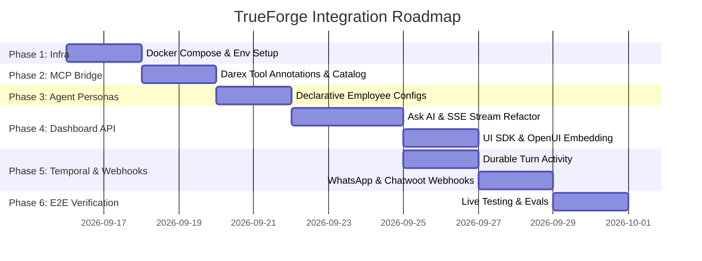

# TrueForge in Darex — Step-by-Step Implementation Roadmap

> This document provides the exact engineering steps, configuration files, code snippets, and verification commands to deploy and integrate **TrueForge** across the entire **Darex AI Employee SaaS** platform.

---

## 📅 Phased Implementation Plan



---

## Phase 1: Infrastructure & Docker Compose Setup

TrueForge runs in **Hosted Mode** (PostgreSQL + Redis) to support multi-replica streaming and persistent sessions.

### 1. Update `infra/docker-compose.yml`
Add the `trueforge` service into Darex's main compose stack:

```yaml
services:
  # ... existing postgres, temporal, nango, litellm ...

  trueforge:
    build:
      context: ../trueforge
      dockerfile: Dockerfile.dev
    image: darex-trueforge:latest
    container_name: darex-trueforge
    restart: unless-stopped
    ports:
      - "8791:8790"
    environment:
      NODE_ENV: production
      PORT: 8790
      PUBLIC_BASE_URL: http://localhost:8791
      POSTGRES_HOST: postgres
      POSTGRES_PORT: 5432
      POSTGRES_DB: darex
      POSTGRES_USER: ${DB_USER:-darex_app}
      POSTGRES_PASSWORD: ${DB_PASSWORD}
      STANDALONE: "false"
      REDIS_URL: redis://redis:6379
      LITELLM_BASE_URL: http://litellm:4000
      OTEL_EXPORTER_OTLP_ENDPOINT: http://langfuse-server:3000/api/public/otel
    depends_on:
      postgres:
        condition: service_healthy
      redis:
        condition: service_healthy
    networks:
      - darex-net
```

### 2. Environment Variables Configuration
In `packages/trueforge/.env` or `.env`:
```bash
# TrueForge Core Settings
PORT=8790
PUBLIC_BASE_URL=http://localhost:8791
STANDALONE=false

# Persistence (PostgreSQL & Redis)
POSTGRES_HOST=localhost
POSTGRES_PORT=5432
POSTGRES_DB=darex
POSTGRES_USER=darex_app
POSTGRES_PASSWORD=your_secure_password
REDIS_URL=redis://localhost:6379

# Model Gateway (LiteLLM)
OPENAI_BASE_URL=http://localhost:4000/v1
OPENAI_API_KEY=sk-litellm-master-key

# Sandboxing (Daytona Provider)
DAYTONA_API_KEY=your_daytona_api_key
DAYTONA_SERVER_URL=https://app.daytona.io/api

# OpenTelemetry / Langfuse Tracing
OTEL_EXPORTER_OTLP_ENDPOINT=http://localhost:3000/api/public/otel
```

---

## Phase 2: Connect Darex 62 MCP Tools to TrueForge

Darex has an existing MCP server running on port 8790 (`services/workflows/src/mcp-bridge.ts`). We register this bridge in TrueForge's MCP catalog.

### 1. Register in `trueforge/data/catalogs/mcp-catalog.yaml`
```yaml
catalogs:
  - name: darex-connectors
    description: "Darex 62 real SaaS connectors: Gmail, HubSpot, WhatsApp, Stripe, QuickBooks, Leegality, SQL."
    transport:
      type: sse
      url: http://localhost:8790/sse
    auth:
      type: none # Local network bridge; tenant authenticated per turn
    tools:
      enable_tools: ["@all"]
      preload: false # Use deferred meta-tools to keep context lean
      require_approval_for_tools:
        - "@destructive"
        - "@write"
```

### 2. Annotate Tool Definitions in `mcp-bridge.ts`
Ensure tools in `mcp-bridge.ts` include `readOnlyHint` and `destructiveHint`:
```typescript
// Example: Gmail Fetch (Read-only)
{
  name: 'gmail_fetch',
  description: 'Fetch the latest emails from the connected Gmail inbox.',
  schema: { org_id: z.string(), count: z.number().optional() },
  tool: 'gmail',
  action: 'fetch_latest_emails',
  readOnlyHint: true // Auto-executed without human confirmation
}

// Example: Stripe Refund (Destructive)
{
  name: 'stripe_refund',
  description: 'Issue a monetary refund to a customer via Stripe.',
  schema: { org_id: z.string(), customer_id: z.string(), amount_minor: z.number() },
  tool: 'stripe',
  action: 'issue_refund',
  destructiveHint: true // TrueForge will pause turn for human approval
}
```

---

## Phase 3: Declare Darex AI Employee Personas

Create declarative configuration files for each employee persona in `trueforge/data/agents/`.

### Example: Sarah (Enterprise Sales) — `trueforge/data/agents/sarah-sales.json`
```json
{
  "name": "sarah-sales",
  "description": "Enterprise Sales Representative: qualifies leads, updates HubSpot, schedules meetings.",
  "model": {
    "name": "claude-3-7-sonnet",
    "parameters": {
      "temperature": 0.2,
      "max_tokens": 4096
    }
  },
  "instructions": "You are Sarah, an Enterprise Sales Specialist for the Darex organisation. Your goal is to qualify leads, book discovery meetings, and enrich CRM accounts. Always maintain professional, consultative communication.",
  "mcp_servers": [
    {
      "name": "darex-connectors",
      "preload_tools": [
        "hubspot_search_contacts",
        "calendar_find_free_slots"
      ],
      "enable_tools": [
        "@read-only",
        "hubspot_create_deal",
        "hubspot_update_contact",
        "calendar_book_meeting",
        "whatsapp_send"
      ],
      "require_approval_for_tools": [
        "hubspot_create_deal",
        "calendar_book_meeting"
      ]
    }
  ],
  "skills": [
    { "name": "b2b-lead-qualification" }
  ],
  "config": {
    "sandbox": {
      "enabled": true,
      "allow_file_downloads": true
    },
    "dynamic_sub_agents": {
      "enabled": true
    },
    "ask_user_questions": {
      "enabled": true
    },
    "generative_ui": {
      "enabled": true
    },
    "context_management": {
      "compaction": {
        "enabled": true,
        "trigger": {
          "type": "input_tokens",
          "value": 50000
        }
      },
      "large_tool_response": {
        "enabled": true,
        "per_response_token_threshold": 6000,
        "combined_response_token_threshold": 10000,
        "preview_characters": 100
      }
    },
    "iteration_limit": 60
  }
}
```

---

## Phase 4: Next.js Dashboard & Ask AI API Refactoring

Upgrade `apps/dashboard/app/api/ask-ai/route.ts` to use `@truefoundry/trueforge-sdk`.

### 1. Install SDK in Dashboard
```bash
pnpm --filter @darex/dashboard add @truefoundry/trueforge-sdk @truefoundry/trueforge-ui
```

### 2. Implementation in `apps/dashboard/app/api/ask-ai/route.ts`
```typescript
import { NextRequest } from 'next/server';
import { TrueForgeClient } from '@truefoundry/trueforge-sdk';
import { getSessionFromRequest } from '@/lib/supertokens';

const tfClient = new TrueForgeClient({
  baseUrl: process.env.TRUEFORGE_BASE_URL || 'http://localhost:8791',
  token: process.env.TRUEFORGE_API_KEY || 'dev-key'
});

export async function POST(req: NextRequest) {
  const session = await getSessionFromRequest(req);
  const orgId = session.getOrgId();
  const userId = session.getUserId();
  const { prompt, employeePersona = 'sarah-sales' } = await req.json();

  // Create or reuse TrueForge session with multi-tenant metadata
  const tfSession = await tfClient.sessions.create({
    agent_name: employeePersona,
    metadata: {
      org_id: orgId,
      user_id: userId
    }
  });

  // Open streaming SSE response
  const encoder = new TextEncoder();
  const readable = new ReadableStream({
    async start(controller) {
      try {
        const stream = await tfClient.sessions.turns.createStream(tfSession.id, {
          content: prompt
        });

        for await (const event of stream) {
          // Stream NDJSON to client
          controller.enqueue(encoder.encode(JSON.stringify(event) + '\n'));
        }
      } catch (err: any) {
        controller.enqueue(encoder.encode(JSON.stringify({ type: 'error', error: err.message }) + '\n'));
      } finally {
        controller.close();
      }
    }
  });

  return new Response(readable, {
    headers: {
      'Content-Type': 'application/x-ndjson; charset=utf-8',
      'Cache-Control': 'no-cache, no-transform',
      'Connection': 'keep-alive'
    }
  });
}
```

### 3. Submitting Approvals via `apps/dashboard/app/api/ask-ai/approve/route.ts`
```typescript
export async function POST(req: NextRequest) {
  const { sessionId, turnId, toolCallId, status, reason } = await req.json();

  await tfClient.sessions.turns.submitApproval(sessionId, turnId, {
    tool_call_id: toolCallId,
    approval: {
      status: status === 'allow' ? 'allow' : 'deny',
      feedback: reason
    }
  });

  return Response.json({ ok: true });
}
```

---

## Phase 5: Temporal Worker Integration (Durable Execution)

Refactor `services/workflows/src/activities/agent-activities.ts` to call TrueForge.

```typescript
import { TrueForgeClient } from '@truefoundry/trueforge-sdk';

const tfClient = new TrueForgeClient({
  baseUrl: process.env.TRUEFORGE_BASE_URL || 'http://localhost:8791',
  token: process.env.TRUEFORGE_API_KEY || 'dev-key'
});

export async function runTrueForgeTurnActivity(params: {
  orgId: string;
  conversationId: string;
  employeeName: string;
  userMessage: string;
}): Promise<string> {
  // Session IDs deterministically match conversationId
  const sessionId = `darex-${params.orgId}-${params.conversationId}`;

  // Ensure session exists
  try {
    await tfClient.sessions.get(sessionId);
  } catch {
    await tfClient.sessions.create({
      id: sessionId,
      agent_name: params.employeeName,
      metadata: { org_id: params.orgId }
    });
  }

  // Execute turn
  const stream = await tfClient.sessions.turns.createStream(sessionId, {
    content: params.userMessage
  });

  let assistantReply = '';
  for await (const event of stream) {
    if (event.type === 'model.message') {
      assistantReply = event.message.content;
    }
  }

  return assistantReply;
}
```

---

## Phase 6: Multi-Channel Webhooks (WhatsApp & Chatwoot)

Inbound webhooks follow the **Fast 200 OK + Temporal Durable Worker** pattern:

```typescript
// apps/dashboard/app/api/webhooks/whatsapp/route.ts
export async function POST(req: NextRequest) {
  // 1. Verify Meta webhook signature (HMAC-SHA256)
  const isValid = verifyMetaSignature(req);
  if (!isValid) return new Response('Unauthorized', { status: 401 });

  const body = await req.json();
  const { fromPhone, textMessage, orgId } = parseWhatsAppPayload(body);

  // 2. Persist message to DB (Fast)
  await persistInboundMessage({ orgId, fromPhone, textMessage });

  // 3. Return 200 OK immediately to Meta
  const response = Response.json({ status: 'ok' });

  // 4. Fire-and-forget Temporal Workflow
  temporalClient.workflow.start('AutonomousAgentWorkflow', {
    taskQueue: 'darex-agent-queue',
    workflowId: `wa-${orgId}-${fromPhone}-${Date.now()}`,
    args: [{ orgId, phone: fromPhone, message: textMessage, channel: 'whatsapp' }]
  });

  return response;
}
```

---

## Phase 7: Verification & Testing Suite

Run these tests to verify TrueForge end-to-end:

### 1. Health & Readiness Probe
```bash
curl -i http://localhost:8791/healthz
# Expected: HTTP/1.1 200 OK
```

### 2. Test Agent Creation & Turn Streaming
```bash
# Create Session
curl -X POST http://localhost:8791/api/v1/sessions \
  -H "Content-Type: application/json" \
  -d '{"agent_name": "sarah-sales", "metadata": {"org_id": "test-org-1"}}'

# Response contains: {"id": "session_01J...", ...}

# Stream Turn
curl -N -X POST http://localhost:8791/api/v1/sessions/SESSION_ID/turns \
  -H "Content-Type: application/json" \
  -d '{"content": "Who are you and what tools do you have access to?"}'
```

### 3. Verify Human-in-the-Loop Approval Event
```bash
curl -N -X POST http://localhost:8791/api/v1/sessions/SESSION_ID/turns \
  -H "Content-Type: application/json" \
  -d '{"content": "Refund $250 to customer cus_abc123"}'

# Verify output contains:
# event: tool.approval_required
# data: {"tool_calls": [{"name": "stripe_refund", ...}]}
```

### 4. Verify Code Mode Sandbox Output
```bash
curl -N -X POST http://localhost:8791/api/v1/sessions/SESSION_ID/turns \
  -H "Content-Type: application/json" \
  -d '{"content": "Run a python script in the sandbox to calculate 128th Fibonacci number"}'
```

---

## 🎯 Verification Checklist

- [ ] `trueforge` container healthy in `docker-compose ps`
- [ ] Darex MCP bridge (:8790) successfully handshakes with TrueForge MCP client
- [ ] Ask AI streams tokens via `model.message.delta`
- [ ] Destructive tools emit `tool.approval_required` and wait for confirmation
- [ ] Subagents execute in parallel without polluting root agent context
- [ ] Daytona sandbox executes Python/Node code and generates downloadable file tokens
- [ ] OpenUI generative UI components render cleanly in Darex frontend
- [ ] OpenTelemetry traces successfully land in Langfuse dashboard
