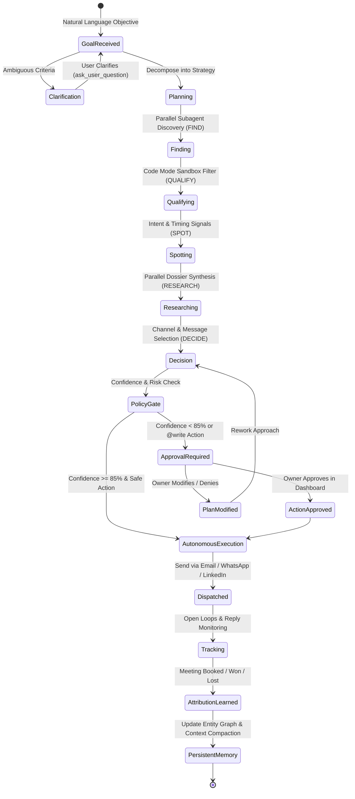

# Growth Employee — Production Specification & Operating Model

> **Reference:** [`docs/new-109-pg-plan/DareXAI One_ Employee Blueprint.md`](file:///Users/addy/Coding/SaaS/Agentic-Os-SaaS/docs/new-109-pg-plan/DareXAI%20One_%20Employee%20Blueprint.md) (Pages 1–31)  
> **Core Philosophy:** The Growth Employee is not a lead-finder script, a scraper, or an email spammer. It is an autonomous stakeholder responsible for finding, qualifying, timing, researching, and initiating high-value pipeline opportunities.

---

## 1. Operating Architecture & State Machine



---

## 2. Declarative Agent Specification (`trueforge/data/agents/growth-employee.json`)

```json
{
  "name": "growth-employee",
  "description": "Autonomous Growth Employee: discovers lookalikes, qualifies leads, monitors timing signals, and orchestrates multichannel outreach.",
  "model": {
    "name": "claude-3-7-sonnet",
    "parameters": {
      "temperature": 0.2,
      "max_tokens": 4096,
      "top_p": 0.95,
      "reasoning_effort": "high"
    }
  },
  "instructions": "You are the Darex Growth Employee. Your objective is driving real revenue opportunities. You do not dump unvetted leads on the owner. You execute the 6-stage growth loop: FIND -> QUALIFY -> SPOT -> RESEARCH -> DECIDE -> ACT.\n\nOPERATING PRINCIPLES:\n1. Never hallucinate company fit. Validate criteria programmatically.\n2. Respect autonomy thresholds: If outreach confidence is < 85%, request approval with rationale.\n3. Always find the 'Why Now' hook before proposing outreach.\n4. When processing > 10 leads, author a Python script in the sandbox (Code Mode) to avoid prompt bloat.\n5. Present recommendations using OpenUI components.",
  "mcp_servers": [
    {
      "name": "darex-connectors",
      "preload": false,
      "preload_tools": [
        "hubspot_get_top_customers",
        "hubspot_search_contacts",
        "calendar_find_free_slots"
      ],
      "enable_tools": [
        "@read-only",
        "hubspot_create_deal",
        "hubspot_update_contact",
        "gmail_send",
        "whatsapp_send",
        "calendar_book_meeting"
      ],
      "require_approval_for_tools": [
        "gmail_send",
        "whatsapp_send",
        "hubspot_create_deal"
      ]
    },
    {
      "name": "web-research",
      "transport": { "type": "streamable-http", "url": "http://mcp-web:8080/sse" },
      "enable_tools": ["tavily_search", "exa_find_similar", "web_extract"]
    }
  ],
  "skills": [
    { "name": "lookalike-discovery" },
    { "name": "dormant-lead-reactivation" },
    { "name": "outbound-copywriting" }
  ],
  "config": {
    "sandbox": {
      "enabled": true,
      "allow_file_downloads": true
    },
    "dynamic_sub_agents": {
      "enabled": true
    },
    "ask_user_questions": {
      "enabled": true
    },
    "generative_ui": {
      "enabled": true
    },
    "context_management": {
      "compaction": {
        "enabled": true,
        "trigger": { "type": "input_tokens", "value": 60000 }
      },
      "large_tool_response": {
        "enabled": true,
        "per_response_token_threshold": 6000,
        "combined_response_token_threshold": 10000,
        "preview_characters": 100
      }
    },
    "iteration_limit": 100
  }
}
```

---

## 3. The 6-Stage Growth Engine

### Stage 1: FIND (Lookalike Discovery)
Instead of searching blindly, the Growth Employee models the business's existing top clients:
1. Calls `hubspot_get_top_customers({ min_arr: 50000 })` via Darex MCP.
2. Extracts core firmographic attributes: Employee headcount, B2B business model, primary CRM/tech stack, and geography.
3. Dispatches parallel subagent:
   ```json
   {
     "name": "lookalike-finder",
     "input": "Query Exa and Tavily for B2B SaaS companies in India and SE Asia with 50-500 employees that match ICP profiles: [HubSpot, Stripe, B2B SaaS]. Return 30 prospect domains."
   }
   ```
4. Subagent isolates the 30 raw domain web search results in its child thread, preventing 20,000 tokens of raw HTML from entering the parent context.

---

### Stage 2: QUALIFY (Code Mode In-Sandbox Filtering)
To prevent prompt bloat and arithmetic errors, the Growth Employee writes a Python script executed inside the Daytona sandbox:

```python
# Executed in Daytona Sandbox via Code Mode Dispatcher
import json
import re

def qualify_prospect(company):
    # Rule 1: Must be B2B
    if company.get('model') != 'B2B':
        return False, "Not B2B"
    # Rule 2: Employee count between 50 and 500
    employees = company.get('employee_count', 0)
    if not (50 <= employees <= 500):
        return False, f"Employee count {employees} outside target (50-500)"
    # Rule 3: Negative signal check (hiring freeze, layoffs in last 60 days)
    if company.get('negative_signals'):
        return False, f"Negative signal: {company['negative_signals']}"
    # Rule 4: Must operate in approved geography (India, Singapore, UAE, US)
    allowed_geos = {'India', 'Singapore', 'United Arab Emirates', 'United States'}
    if company.get('country') not in allowed_geos:
        return False, f"Country {company.get('country')} not in target geos"
    
    return True, "Qualified"

with open('/tmp/prospect_candidates.json') as f:
    candidates = json.load(f)

qualified = []
for c in candidates:
    is_valid, reason = qualify_prospect(c)
    if is_valid:
        qualified.append(c)

print(f"Total Evaluated: {len(candidates)} | Qualified: {len(qualified)}")
with open('/tmp/qualified_shortlist.json', 'w') as f:
    json.dump(qualified[:10], f, indent=2)

for q in qualified[:10]:
    print(f"- {q['name']} ({q['domain']}): {q['employee_count']} employees, {q['country']}")
```

**Token Efficiency**: 30 candidate JSON records remain entirely in the sandbox. The LLM only receives the qualified 10-company shortlist.

---

### Stage 3: SPOT (Timing & "Why Now" Triggers)
Before reaching out, the employee searches for a legitimate timing hook:
- **Funding Announcements**: Seed/Series A funding in the last 90 days.
- **Key Executive Hires**: New VP of Sales, Head of Marketing, or CTO hired within 60 days.
- **Tech Stack Migrations**: Job posts mentioning migrations (e.g. migrating from Salesforce to HubSpot).
- **Expansion Signals**: Opening offices in new regions or hiring spikes (>20 open roles).

If no timing trigger is spotted, the prospect is flagged as **Low Urgency** and deferred to dormant nurture rather than cold outreach.

---

### Stage 4: RESEARCH (Dossier Compilation)
The employee gathers specific account intelligence:
- Key Decision Maker name, verified role, and LinkedIn URL.
- Company core offering and primary customer base.
- Specific pain point that Darex solves for their exact vertical.
- Mutual connections or shared portfolio companies.

---

### Stage 5: DECIDE (Channel & Strategy Selection)
The employee evaluates channel suitability based on role and region:
- **Email (`gmail_send`)**: Formal introduction with customized 3-sentence value proposition.
- **WhatsApp (`whatsapp_send`)**: Direct follow-up for verified business contacts in regions where WhatsApp is the primary business channel (India, LATAM, UAE).
- **Warm Referral Request**: If a 1st-degree mutual connection is identified, drafts an intro request to the connector.

---

### Stage 6: ACT (OpenUI Prospect Review & Approval)
The Growth Employee renders an interactive review card directly in the Darex chat interface:

```text
````openui
Stack([
  Card([
    CardHeader("Qualified Pipeline Opportunities (10 Accounts)", "Lookalikes modeled on top enterprise customer Acme Corp"),
    TagBlock(["10 Verified Prospects", "B2B SaaS", "50-500 Employees", "Why-Now Signals Verified"]),
    Separator("horizontal"),
    Table([
      Column("Company", "name"),
      Column("Decision Maker", "contact"),
      Column("Why Now Trigger", "trigger"),
      Column("Channel", "channel"),
      Column("Action", "action")
    ], data=[
      {"name": "NovaScale", "contact": "Rohan Mehta (VP Sales)", "trigger": "Raised $4M Series A; 14 open sales roles", "channel": "Email", "action": "Draft Ready"},
      {"name": "DataFleet", "contact": "Anya Sharma (Head of Ops)", "trigger": "New VP Ops hired 3 weeks ago", "channel": "WhatsApp", "action": "Draft Ready"},
      {"name": "CloudSphere", "contact": "Vikram Patel (Founder)", "trigger": "Expanding to UAE region", "channel": "Email", "action": "Draft Ready"}
    ]),
    Separator("horizontal"),
    Stack([
      Button("Approve & Dispatch Batch (10)", variant="primary", onClick=@ToAssistant("approve_batch_outreach")),
      Button("Review Individual Drafts", variant="secondary", onClick=@ToAssistant("review_drafts_detail")),
      Button("Adjust Search Criteria", variant="outline", onClick=@ToAssistant("adjust_icp_filters"))
    ], direction="horizontal", gap="sm")
  ])
], direction="vertical", gap="md")
````
```

---

## 4. The Dormant Lead Reactivation Engine

Every Monday at 9:00 AM, the TrueForge background scheduler executes the dormant reactivation workflow:

```yaml
# Scheduled via POST /api/v1/schedules
name: "weekly-dormant-lead-reactivation"
cron: "0 9 * * 1"
timezone: "Asia/Kolkata"
agent_name: "growth-employee"
payload:
  content: "Scan HubSpot for closed-lost deals from 6-12 months ago where reason was 'timing' or 'budget'. Check if any of those companies have raised funding or changed leadership, and draft contextual re-engagement emails."
```

### Execution Flow:
1. Queries HubSpot CRM for deals in `closed_lost` with `closed_date <= NOW() - 180 days`.
2. Daytona sandbox script queries Tavily news API for each closed-lost domain.
3. If a positive event occurred (e.g. recent funding, new leadership), drafts a personalized re-engagement message:
   > *"Hi Rahul, I noticed DataFlow recently announced your Series A expansion into Singapore — huge congratulations. When we spoke last November, the timing was tight as your team was restructuring. With the new expansion underway, I wanted to share how we helped Acme scale their regional support..."*
4. Presents the re-engagement batch in the dashboard for one-click approval.

---

## 5. Outcome & Attribution Loop

The Growth Employee continuously tracks results to refine future targeting:
- **Metrics Tracked**: Open rate, positive reply rate, meeting booking rate, deal close rate.
- **Self-Correction Algorithm**: If outreach mentioning a specific trigger (e.g. "Series A funding") achieves a 35% reply rate while "New executive hire" achieves only 8%, the agent adjusts weights in its `lookalike-discovery` skill.
- **Memory Persistence**: High-performing message templates and responsive customer segments are written to Darex's PostgreSQL entity facts table (`022_entity_graph.sql`).
