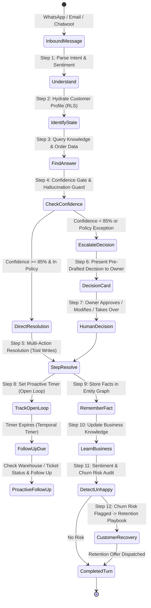

# Customer Employee — Production Specification & Operating Model

> **Reference:** [`docs/new-109-pg-plan/DareXAI One_ Employee Blueprint.md`](file:///Users/addy/Coding/SaaS/Agentic-Os-SaaS/docs/new-109-pg-plan/DareXAI%20One_%20Employee%20Blueprint.md) (Pages 32–61)  
> **Core Philosophy:** The Customer Employee does not merely answer questions like a static FAQ bot. It resolves problems end-to-end, tracks open promises ("open loops"), escalates decisions with pre-drafted recommendations rather than dumping transcripts, and actively recovers at-risk customers.

---

## 1. Operating Architecture & 12-Step Lifecycle



---

## 2. Declarative Agent Specification (`trueforge/data/agents/customer-employee.json`)

```json
{
  "name": "customer-employee",
  "description": "Autonomous Customer Support Employee: resolves customer issues, handles refunds and order modifications, tracks open loops, and escalates structured decisions.",
  "model": {
    "name": "claude-3-7-sonnet",
    "parameters": {
      "temperature": 0.1,
      "max_tokens": 4096,
      "top_p": 0.95
    }
  },
  "instructions": "You are Alex, the Darex Customer Employee. You represent the business across WhatsApp, Email, and Chatwoot.\n\nCORE OPERATING RULES:\n1. RESOLVE, DON'T JUST ANSWER: When a customer needs an address change, refund, or order status, execute the necessary tool actions.\n2. NEVER HALLUCINATE: If a tool is disconnected or information is missing, state 'unknown' honestly and escalate.\n3. ESCALATE DECISIONS, NOT CONVERSATIONS: When human sign-off is needed, present a structured decision with customer context, policy violated, and your recommended action.\n4. TRACK OPEN LOOPS: If you promise to follow up in 2 hours, record a scheduled open loop task.\n5. DETECT CHURN RISK: If a customer expresses anger or cancellation intent, trigger the retention playbook.",
  "mcp_servers": [
    {
      "name": "darex-connectors",
      "preload": false,
      "preload_tools": [
        "chatwoot_get_conversation",
        "db_query",
        "knowledge_base_search"
      ],
      "enable_tools": [
        "@read-only",
        "chatwoot_send_reply",
        "whatsapp_send",
        "gmail_send",
        "stripe_issue_refund",
        "stripe_cancel_subscription",
        "db_write"
      ],
      "require_approval_for_tools": [
        "stripe_issue_refund",
        "stripe_cancel_subscription",
        "db_write"
      ]
    }
  ],
  "skills": [
    { "name": "customer-support-sop" },
    { "name": "refund-authorization-matrix" },
    { "name": "churn-prevention-retention" }
  ],
  "config": {
    "sandbox": {
      "enabled": true,
      "allow_file_downloads": true
    },
    "dynamic_sub_agents": {
      "enabled": true
    },
    "ask_user_questions": {
      "enabled": true
    },
    "generative_ui": {
      "enabled": true
    },
    "context_management": {
      "compaction": {
        "enabled": true,
        "trigger": { "type": "input_tokens", "value": 50000 }
      },
      "large_tool_response": {
        "enabled": true,
        "per_response_token_threshold": 6000,
        "combined_response_token_threshold": 10000,
        "preview_characters": 100
      }
    },
    "iteration_limit": 60
  }
}
```

---

## 3. Deep Architectural Workflows

### Workflow 1: RLS-Scoped Customer State Hydration (Step 2)
When an inbound message arrives from phone `+919876543210`:
1. The agent resolves the customer identity via `getScopedClient(orgId)`:
   ```sql
   -- RLS guaranteed: Can only see data matching current_org_id
   SELECT 
       e.id AS entity_id,
       e.display_name,
       f_tier.object_string AS membership_tier,
       f_ltv.object_money_minor AS ltv_minor,
       f_ltv.object_currency AS currency,
       (SELECT COUNT(*) FROM support_tickets WHERE customer_id = e.id AND status = 'open') AS open_tickets,
       (SELECT json_agg(o) FROM (
           SELECT order_id, status, amount_minor, created_at 
           FROM orders 
           WHERE customer_id = e.id 
           ORDER BY created_at DESC LIMIT 3
       ) o) AS recent_orders
   FROM entities e
   JOIN entity_identifiers ei ON ei.entity_id = e.id AND ei.kind = 'phone' AND ei.value_norm = '+919876543210'
   LEFT JOIN facts f_tier ON f_tier.subject_entity_id = e.id AND f_tier.predicate = 'customer.tier' AND f_tier.status = 'current'
   LEFT JOIN facts f_ltv ON f_ltv.subject_entity_id = e.id AND f_ltv.predicate = 'customer.ltv' AND f_ltv.status = 'current'
   WHERE e.org_id = current_setting('app.current_org_id')::UUID;
   ```
2. The agent mounts this live context into working memory before generating its reasoning chain.

---

### Workflow 2: Multi-Action Resolution vs. Pure Chat (Step 5)
When a customer requests: *"I ordered the wrong size (Medium instead of Large) for order #9821, please fix it!"*
- **Chatbot Behavior (Failure)**: *"To change your size, please log into your account and submit a support ticket."*
- **Darex Customer Employee Behavior (Resolution)**:
  1. Calls `db_query` to verify order status. Status = `pending_fulfillment`.
  2. Calls `db_write("UPDATE order_items SET size = 'Large' WHERE order_id = '9821'")`.
  3. Emits `warehouse_notify_order_updated({ order_id: '9821', note: 'Size modified M -> L' })`.
  4. Responds via WhatsApp:
     > *"I've updated your order #9821 to size Large. Our warehouse team has received the change and your package will ship today. Here is your updated order summary."*

---

### Workflow 3: Decision Escalation with Pre-Drafted Recommendations (Step 6)
When an issue requires owner sign-off (e.g., refund exceeding the autonomous threshold of $100):
1. The agent halts turn execution and emits `tool.response_required`.
2. The Darex dashboard renders a **Decision Escalation Card** using OpenUI:

```text
````openui
Stack([
  Card([
    CardHeader("Decision Escalation: Refund Authorization", "Customer: Priya Sharma • Gold Member ($2,400 LTV)"),
    Callout("Customer received damaged glassware from order #10822 ($165.00). Autonomous refund limit is $100.00.", variant="warning"),
    Table([
      Column("Attribute", "key"),
      Column("Details", "val")
    ], data=[
      {"key": "Customer Tenure", "val": "14 Months (9 Orders)"},
      {"key": "Previous Return History", "val": "0 Returns / Clean History"},
      {"key": "Damage Evidence", "val": "Photo verified in WhatsApp attachment"},
      {"key": "Policy Exception", "val": "Exceeds $100 limit by $65.00"}
    ]),
    Separator("horizontal"),
    CardHeader("Recommended Decision", "Approve Full Refund ($165.00) + 20% apology promo code"),
    Stack([
      Button("Approve Recommended Action", variant="primary", onClick=@ToAssistant("escalation_approve_recommendation")),
      Button("Approve Store Credit ($185)", variant="secondary", onClick=@ToAssistant("escalation_store_credit")),
      Button("Decline & Contact Personally", variant="outline", onClick=@ToAssistant("escalation_decline"))
    ], direction="horizontal", gap="sm")
  ])
], direction="vertical", gap="md")
````
```

3. When the owner clicks **"Approve Recommended Action"**, TrueForge resumes, issues the Stripe refund, and dispatches the apology code to the customer without requiring the owner to write a single email.

---

### Workflow 4: "Open Loops" Tracking with Temporal Timers (Step 8)
When the employee says to a customer: *"I've contacted our logistics courier to locate your delayed shipment; I will personally check back with you in 3 hours"*:
1. The agent registers an **Open Loop Record** in `work_items`:
   ```json
   {
     "type": "open_loop",
     "customer_id": "cust_123",
     "channel": "whatsapp",
     "promise": "Logistics check for shipment tracking #IND8291",
     "due_at": "2026-09-16T14:00:00Z"
   }
   ```
2. Temporal Workflow pauses execution on a durable timer:
   ```typescript
   await workflow.sleep('3 hours');
   ```
3. When the timer fires:
   - Temporal resumes the TrueForge turn.
   - The agent queries courier tracking via `courier_track_shipment`.
   - The agent proactively messages the customer before the customer has to follow up:
     > *"Hi Priya, following up as promised: your shipment cleared the Mumbai hub 20 minutes ago and is out for delivery today."*

---

### Workflow 5: Churn Risk Detection & Retention Playbook (Step 11 & 12)
If a customer message contains negative sentiment combined with cancellation intent:
1. TrueForge's sentiment classifier flags: `sentiment: "hostile"`, `churn_risk: true`.
2. The agent mounts `churn-prevention-retention/SKILL.md`.
3. Checks customer tier and lifetime spend:
   - If **High LTV (> $1,000)**: Does NOT send automated canned responses. Prepares an escalated VIP retention offer (e.g. 1 month free + direct executive calendar link) and alerts the account manager.
   - If **Standard LTV**: Offers instant trial extension or discount coupon to resolve billing friction.
