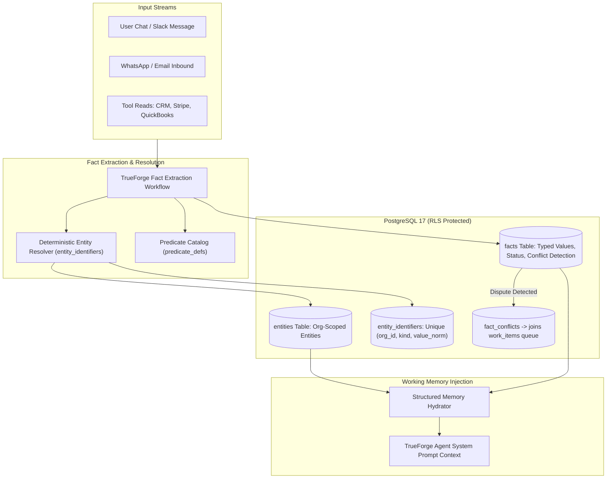

# Company Brain: Entity Graph & Memory Integration

> **Reference:** [`infra/db/migrations/022_entity_graph.sql`](file:///Users/addy/Coding/SaaS/Agentic-Os-SaaS/infra/db/migrations/022_entity_graph.sql) & [`docs/2-sept/21-spec-entity-graph.md`](file:///Users/addy/Coding/SaaS/Agentic-Os-SaaS/docs/2-sept/21-spec-entity-graph.md)  
> **Core Philosophy:** AI employees cannot rely on ephemeral vector embeddings or loose chat history for business truth. A company's memory must be deterministic, auditable, structured-first, and protected by PostgreSQL Row Level Security (RLS).

---

## 1. Architectural Model: Structured Facts Over Prose Embeddings



---

## 2. Database Schema Mechanics (`022_entity_graph.sql`)

### A. Non-Destructive Entity Disambiguation (`entities` & `entity_identifiers`)
Entities represent real-world business objects: Accounts, Contacts, Commitments, Obligations, Real Estate Listings.

- **Entity Model**:
  ```sql
  CREATE TABLE entities (
      id UUID PRIMARY KEY DEFAULT gen_random_uuid(),
      org_id UUID NOT NULL REFERENCES orgs(id) ON DELETE CASCADE,
      kind TEXT NOT NULL, -- 'contact', 'account', 'deal', 'listing'
      display_name TEXT NOT NULL,
      status TEXT NOT NULL DEFAULT 'active' CHECK (status IN ('active', 'merged', 'archived')),
      merged_into UUID REFERENCES entities(id),
      created_at TIMESTAMPTZ NOT NULL DEFAULT NOW()
  );
  ```
- **Deterministic Resolution (`entity_identifiers`)**:
  Prevents duplicate entities when a customer contacts across multiple channels:
  ```sql
  CREATE TABLE entity_identifiers (
      id UUID PRIMARY KEY DEFAULT gen_random_uuid(),
      org_id UUID NOT NULL REFERENCES orgs(id) ON DELETE CASCADE,
      entity_id UUID NOT NULL REFERENCES entities(id) ON DELETE CASCADE,
      kind TEXT NOT NULL, -- 'phone', 'email', 'domain', 'rera_id', 'gstin'
      value_norm TEXT NOT NULL, -- E.164 phone (+919876543210) or lowercased email
      is_primary BOOLEAN NOT NULL DEFAULT false,
      UNIQUE(org_id, kind, value_norm)
  );
  ```

---

### B. Typed Facts & Evidence Policy (`facts` Table)
Facts are atomic assertions about an entity. They are never loosely typed strings; they use typed storage columns:

```sql
CREATE TABLE facts (
    id UUID PRIMARY KEY DEFAULT gen_random_uuid(),
    org_id UUID NOT NULL REFERENCES orgs(id) ON DELETE CASCADE,
    subject_entity_id UUID NOT NULL REFERENCES entities(id) ON DELETE CASCADE,
    predicate TEXT NOT NULL REFERENCES predicate_defs(key),
    
    -- Typed Value Storage (Mutually Exclusive per Predicate Type)
    object_string TEXT,
    object_int BIGINT,
    object_money_minor BIGINT,   -- Money stored in minor units (e.g. cents, paise)
    object_currency VARCHAR(3),  -- Mandatory when object_money_minor is set
    object_boolean BOOLEAN,
    object_timestamp TIMESTAMPTZ,
    object_json JSONB,
    
    -- Evidence & Confidence
    confidence NUMERIC(4, 3) NOT NULL CHECK (confidence BETWEEN 0 AND 1),
    provenance_kind TEXT NOT NULL CHECK (provenance_kind IN ('tool_read', 'human_chat', 'document_extract', 'inferred')),
    provenance_source_id TEXT NOT NULL,
    extracted_by_prompt_hash VARCHAR(64) NOT NULL, -- Enables bulk retraction on prompt bugs
    
    -- Lifecycle State
    status TEXT NOT NULL DEFAULT 'current' CHECK (status IN ('current', 'superseded', 'retracted', 'disputed')),
    created_at TIMESTAMPTZ NOT NULL DEFAULT NOW()
);

-- Fast partial index: Queries only touch active truth
CREATE INDEX idx_facts_current ON facts(org_id, subject_entity_id, predicate) 
WHERE status = 'current';
```

---

## 3. Predicate Catalog & Validation Rules

Pre-seeded in `infra/db/seeds/predicate_defs.sql`:

| Predicate Key | Domain | Value Type | `requires_tool_evidence` | Description & Business Rule |
| :--- | :--- | :--- | :---: | :--- |
| `core.contact.phone` | Core B2B | `string` (E.164) | ❌ | Validated customer phone number. |
| `core.contact.email` | Core B2B | `string` | ❌ | Normalized customer email address. |
| `core.account.arr` | Core B2B | `money_minor` | ✅ | **Requires Tool Evidence**: Chat claim cannot set ARR; only Stripe/QuickBooks tool read applies. |
| `core.obligation.amount` | Billing | `money_minor` | ✅ | Outstanding balance; requires invoice tool read. |
| `re.listing.price` | Real Estate | `money_minor` | ✅ | Verified listing price. |
| `re.listing.rera_id` | Real Estate | `string` | ✅ | Government regulatory ID; requires deed/API read. |
| `customer.sentiment` | Support | `string` | ❌ | Latest customer sentiment score (`positive`, `neutral`, `hostile`). |
| `customer.tier` | Support | `string` | ❌ | Membership tier (`bronze`, `silver`, `gold`, `vip`). |

---

## 4. Structured Memory Retrieval into TrueForge

When a TrueForge turn starts, Darex hydrates structured facts directly into the agent's prompt memory using `services/workflows/src/memory/retrieve.ts`:

```typescript
// services/workflows/src/memory/retrieve.ts
import { getScopedClient } from '../db.js';

export interface RetrievedEntityMemory {
  entityId: string;
  displayName: string;
  kind: string;
  facts: Record<string, { value: any; confidence: number; source: string }>;
}

export async function retrieveEntityMemory(
  orgId: string,
  identifierKind: string,
  identifierValueNorm: string
): Promise<RetrievedEntityMemory | null> {
  const client = await getScopedClient(orgId);
  try {
    // 1. Resolve entity via deterministic identifier
    const entityRes = await client.query(
      `SELECT e.id, e.display_name, e.kind
       FROM entities e
       JOIN entity_identifiers ei ON ei.entity_id = e.id
       WHERE ei.org_id = current_setting('app.current_org_id')::UUID
         AND ei.kind = $1 AND ei.value_norm = $2
         AND e.status = 'active'
       LIMIT 1`,
      [identifierKind, identifierValueNorm]
    );

    if (entityRes.rowCount === 0) return null;
    const entity = entityRes.rows[0];

    // 2. Fetch all current facts
    const factsRes = await client.query(
      `SELECT f.predicate, f.provenance_kind, f.confidence,
              COALESCE(f.object_string, 
                       f.object_int::text, 
                       f.object_money_minor::text || ' ' || f.object_currency,
                       f.object_boolean::text,
                       f.object_timestamp::text,
                       f.object_json::text) AS formatted_val
       FROM facts f
       WHERE f.org_id = current_setting('app.current_org_id')::UUID
         AND f.subject_entity_id = $1
         AND f.status = 'current'`,
      [entity.id]
    );

    const facts: Record<string, any> = {};
    for (const row of factsRes.rows) {
      facts[row.predicate] = {
        value: row.formatted_val,
        confidence: parseFloat(row.confidence),
        source: row.provenance_kind
      };
    }

    return {
      entityId: entity.id,
      displayName: entity.display_name,
      kind: entity.kind,
      facts
    };
  } finally {
    client.release();
  }
}

// Format memory block for TrueForge system instructions
export function formatRetrievedFactsBlock(memory: RetrievedEntityMemory | null): string {
  if (!memory) return '';

  const lines = [
    `\n=== VERIFIED COMPANY BRAIN FACTS (Deterministic Truth) ===`,
    `Entity: ${memory.displayName} (${memory.kind} • ID: ${memory.entityId})`
  ];

  for (const [pred, data] of Object.entries(memory.facts)) {
    lines.push(`- ${pred}: ${data.value} (Confidence: ${Math.round(data.confidence * 100)}% via ${data.source})`);
  }
  lines.push(`=== END VERIFIED FACTS (Do NOT re-derive or contradict these) ===\n`);

  return lines.join('\n');
}
```

---

## 5. Fact Conflicts & WorkItem Escalation

If a user states in chat: *"Our company ARR is $2,000,000"*, but QuickBooks tool read reports `$850,000`:
1. The predicate `core.account.arr` requires tool evidence (`requires_tool_evidence = true`).
2. TrueForge detects the contradiction:
   - Does NOT overwrite the verified tool fact.
   - Inserts a new row into `fact_conflicts`:
     ```sql
     INSERT INTO fact_conflicts (
         org_id, entity_id, predicate, current_fact_id, competing_fact_id, status
     ) VALUES (
         $orgId, $entityId, 'core.account.arr', $currentFactId, $newFactId, 'pending_review'
     );
     ```
3. Creates a **Needs Attention** task in Darex's `work_items` table.
4. The Operations Employee presents the discrepancy to the business owner during the morning run for resolution.
