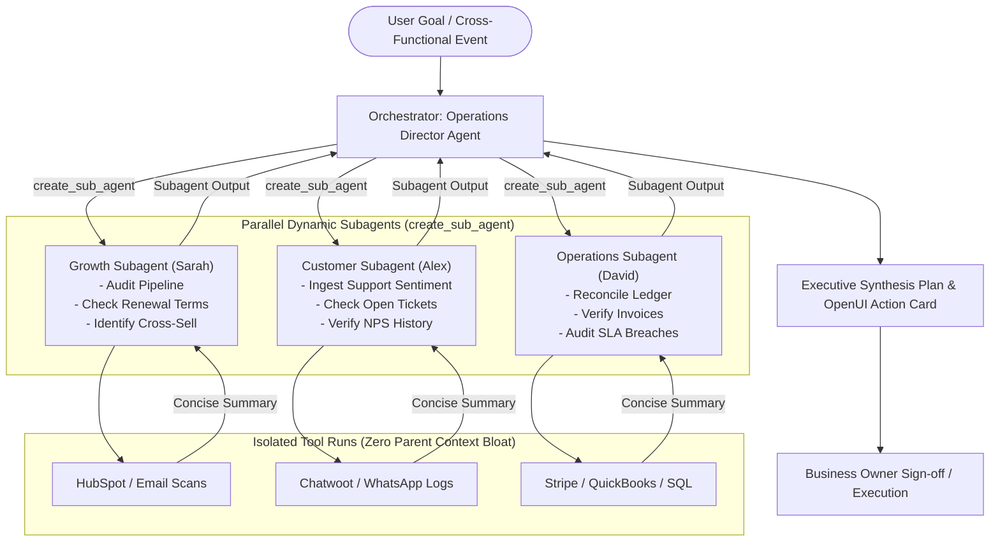
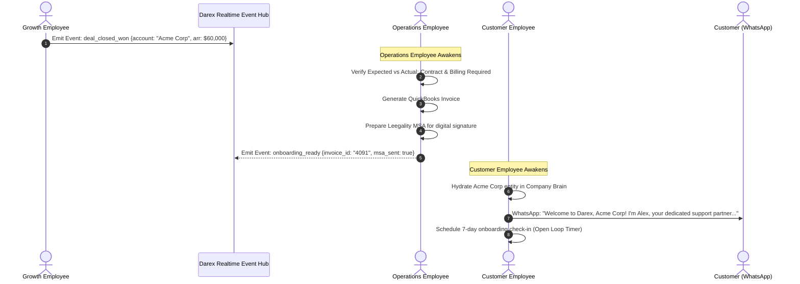

# Multi-Employee Collaboration, Crews & Subagents

> **Reference:** [`docs/new-109-pg-plan/DareXAI One_ Employee Blueprint.md`](file:///Users/addy/Coding/SaaS/Agentic-Os-SaaS/docs/new-109-pg-plan/DareXAI%20One_%20Employee%20Blueprint.md) & [`services/workflows/src/workflows/crew-workflow.ts`](file:///Users/addy/Coding/SaaS/Agentic-Os-SaaS/services/workflows/src/workflows/crew-workflow.ts)  
> **Core Philosophy:** Real business work does not happen in silos. When an enterprise deal closes, sales hands off to operations, operations bills, and customer success onboards. Darex models multi-employee collaboration using TrueForge's native **Dynamic Subagents** and **Crew Orchestration**.

---

## 1. Multi-Employee Collaboration Architecture



---

## 2. Real-World Cross-Functional Scenarios

### Scenario 1: Enterprise Deal Close & Seamless Customer Onboarding



---

### Scenario 2: Churn Prevention Triad

When an enterprise customer expresses dissatisfaction in support:
1. **Detection (Alex - Customer Employee)**:
   - Identifies hostile sentiment in WhatsApp conversation.
   - Detects customer spend is $3,500/month (Enterprise tier).
   - Halts routine bot replies; creates an urgent `churn_risk` event.
2. **Audit & Analysis (David - Operations Employee)**:
   - Spawns subagent to inspect the account's operational history.
   - Discovers that 3 API outages affected their account last week and a refund request was delayed 48 hours.
3. **Contract & Commercial Strategy (Sarah - Growth Employee)**:
   - Reviews contract renewal date (renews in 60 days).
   - Recommends a proactive concession: 1 month free credit ($3,500) + service SLA upgrade.
4. **Unified Executive Escalation**:
   - The Orchestrator combines these findings into a single executive dashboard card with a pre-drafted retention offer for the business owner to approve in one click.

---

## 3. Implementation: Dynamic Subagents in TrueForge

Instead of writing complex custom state machines, the Orchestrator invokes TrueForge's native `create_sub_agent` tool:

```typescript
// Example Orchestrator prompt executing a cross-functional audit
const userPrompt = "Prepare an Executive Account Review for Acme Corp before tomorrow's executive review call.";

// The Orchestrator's LLM emits 3 parallel tool calls:
[
  {
    name: "create_sub_agent",
    arguments: {
      name: "acme-growth-review",
      input: "Review Acme Corp's account in HubSpot: pull contract start date, current ARR, expansion opportunities, and last sales note. Return a 3-bullet markdown summary."
    }
  },
  {
    name: "create_sub_agent",
    arguments: {
      name: "acme-support-review",
      input: "Review Acme Corp's support history in Chatwoot: list all tickets in the last 90 days, average resolution time, and current customer sentiment. Return a 3-bullet summary."
    }
  },
  {
    name: "create_sub_agent",
    arguments: {
      name: "acme-operations-review",
      input: "Check Stripe and QuickBooks for Acme Corp: verify all invoices are paid, check for overdue balances, and confirm billing health. Return a 3-bullet summary."
    }
  }
]
```

### Context Isolation Advantage:
- Subagent 1 queries 40 historical deal stages.
- Subagent 2 reads 15 support transcripts.
- Subagent 3 scans 12 PDF invoices.
- **Zero raw transcripts or invoices enter the root Orchestrator prompt**.
- Only the three 3-bullet summaries return to the Orchestrator, cutting prompt tokens from **85,000** down to **4,200**.

---

## 4. Safety Guardrails & Crew Governance

1. **Subagent Concurrency Limit**: Maximum **3 concurrent subagents** running in parallel (`CREW_MAX_CHILDREN = 3`). Prevents runaway API costs.
2. **Iteration Circuit Breaker**: Every child subagent has an `iteration_limit = 20`. If an agent cannot answer within 20 tool iterations, it halts and reports partial progress.
3. **Write Tool Isolation**: Subagents are instantiated with **`@read-only`** tool permissions by default. Any mutating tool (`@write` or `@destructive`) requires root agent orchestration and explicit human authorization.
4. **Dead-Letter Recovery**: If one subagent fails or hits a tool timeout, the Orchestrator does not crash; it notes the failure in its audit log and completes synthesis with data from the remaining subagents.
