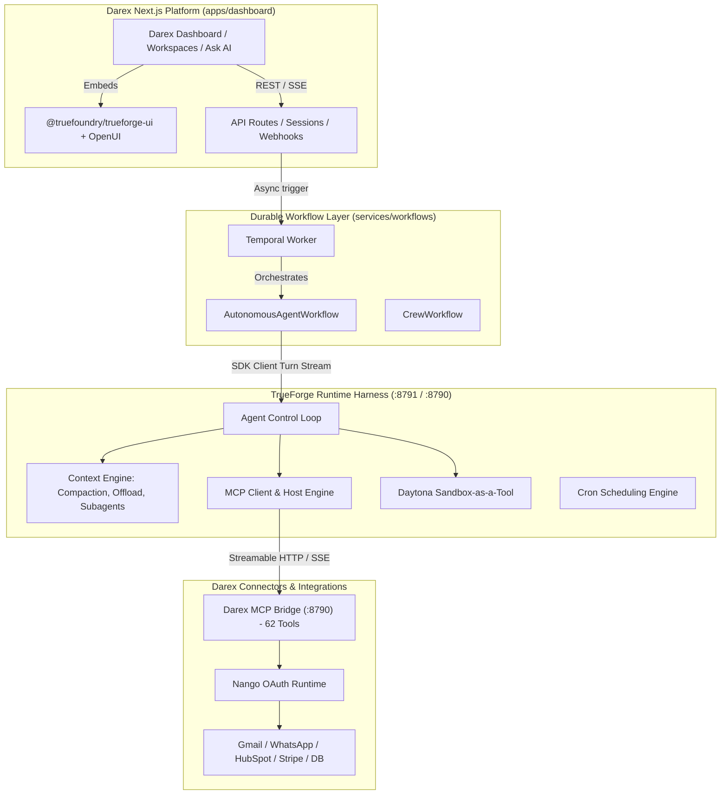

# TrueForge for Darex AI Employees — Master Blueprint

> **Darex AI Employee SaaS** leverages **TrueForge** as its core agent harness and execution engine. 
> This documentation suite provides an exhaustive technical inventory of all TrueForge features and an end-to-end blueprint for using TrueForge to power all Darex workflows, multi-channel AI employees, MCP connectors, sandboxed execution, and dashboard experiences.

---

## 🗺️ Documentation Directory

| Document | Description |
| :--- | :--- |
| **[01-trueforge-features-deepdive.md](./01-trueforge-features-deepdive.md)** | Exhaustive, technical inventory of all TrueForge features: harness loop, event streaming wire formats, context engineering (subagents, Code Mode, deferred tools, large response offloading, compaction), MCP server host, Daytona sandboxing, Git skills, OpenUI generative UI, cron scheduling, and SDKs. |
| **[02-darex-integration-strategy.md](./02-darex-integration-strategy.md)** | Strategic architectural guide detailing how TrueForge replaces/augments the agent runtime to do all of Darex's work: multi-tenant RLS isolation, employee persona definitions, wiring 62 MCP connector tools, Temporal workflow coordination, WhatsApp/Chatwoot inbound webhooks, HITL approvals, and OpenUI dashboards. |
| **[03-implementation-roadmap.md](./03-implementation-roadmap.md)** | Practical, step-by-step engineering roadmap: Docker Compose infra setup, MCP bridge integration, client SDK integration in Next.js, Temporal activity refactoring, UI SDK embedding, testing, and production verification. |
| **[04-blueprint-feature-matrix-and-integration.md](./04-blueprint-feature-matrix-and-integration.md)** | 1:1 Blueprint-to-TrueForge Feature Mapping: 63 operational capabilities mapped across Growth, Customer, and Operations Employees with 🟢, 🟡, 🔴 readiness status, end-to-end sequence diagrams, OpenUI escalation cards, and verification test matrices. |
| **[05-growth-employee-production-spec.md](./05-growth-employee-production-spec.md)** | In-Depth Growth Employee Specification: Complete 6-stage growth loop (FIND, QUALIFY, SPOT, RESEARCH, DECIDE, ACT), Code Mode Python filtering, lookalike discovery subagents, dormant lead reactivation cron, and OpenUI prospect review tables. |
| **[06-customer-employee-production-spec.md](./06-customer-employee-production-spec.md)** | In-Depth Customer Employee Specification: 12-step support lifecycle, RLS customer profile hydration, multi-action resolution, pre-drafted Decision Escalation cards in OpenUI, "open loops" proactive follow-up with Temporal timers, and churn recovery playbooks. |
| **[07-operations-employee-production-spec.md](./07-operations-employee-production-spec.md)** | In-Depth Operations Employee Specification: Expected vs. Actual Discrepancy Engine, 8:00 AM Morning Operations Run, inquiry deduplication with entity graph, in-sandbox cross-system billing reconciliation (Stripe vs. QuickBooks), meeting prep dossiers, and explainability audit logs. |
| **[08-unified-runtime-and-deployment-guide.md](./08-unified-runtime-and-deployment-guide.md)** | Production Code & Deployment Guide: Refactored 62-tool MCP Bridge (`mcp-bridge.ts`), Next.js streaming API routes, WhatsApp webhook Fast 200 OK handlers, Temporal worker durable activities, OpenTelemetry/Langfuse tracing, and Docker Compose config. |
| **[09-company-brain-entity-graph-memory.md](./09-company-brain-entity-graph-memory.md)** | Company Brain & Memory Integration: Connecting TrueForge to Darex's deterministic Entity Graph (`022_entity_graph.sql`), non-destructive disambiguation, typed facts engine, tool evidence verification, and structured-first prompt hydration. |
| **[10-multi-employee-collaboration-and-crews.md](./10-multi-employee-collaboration-and-crews.md)** | Multi-Employee Collaboration & Crew Orchestration: Cross-functional handoffs (deal close to onboarding, churn prevention triad), native `create_sub_agent` parallel execution, zero context bloat, concurrency limits, and circuit breaker governance. |
| **[harness-research.md](./harness-research.md)** | State-of-the-Art Agent Harness & Runtime Research: Industry taxonomy (Framework vs. Runtime vs. Harness), **Category 0: Darex Blueprint-Native AI Employee Stack & Deterministic Company Brain**, **Category S-Tier Direct-Twins: Enterprise SaaS Core Infrastructure (Twenty CRM, Chatwoot, Novu, Lago, Infisical, Defog, Documenso, Formbricks, Plane, OpenBB, LibreChat, MindsDB, PostHog, Appsmith, ToolJet, Airbyte)**, plus **144 open-source options analyzed across 35 functional categories** (TrueForge, Deep Agents, OpenHands, Goose, Mastra, Letta, Extism Wasm, gVisor, Firecracker, Microsoft Orleans, Dapr, ProtoActor, TerminusDB, TypeDB, Kùzu Graph, LanceDB, SuperAGI, OpenClaw, DeepEval, DSPy MIPROv2, Temporal Nexus, Temporal, Restate, Hatchet, Microsoft GraphRAG, LightRAG, Fast-GraphRAG, RAGFlow, Composio, Arcade MCP, Activepieces, n8n, Inngest, Trigger.dev, Rivet, Keep, NeMo Guardrails, Guardrails AI, Llama Guard, Lakera Guard, GAIA, WorkArena, WebArena, BFCL, BAML, Instructor, AgentOps, Promptfoo, Agent Protocol, CoALA, vLLM, Ollama, Voyager, Mem0, Cognee, Zep/Graphiti, DSPy, OSWorld, UI-TARS, ToolBench, etc.), comprehensive 12-dimension comparison matrix, 8 "Hidden Gems" deep dives, and production TypeScript code implementations for the 3 AI employees. |

---

## 💡 Executive Summary: What is TrueForge & Why Darex Uses It

**Darex** is a multi-tenant AI-employee SaaS where business owners "hire" specialized AI employees (Sales, Support, Marketing, Operations, Legal) to automate work across connected tools (WhatsApp, Gmail, Calendar, HubSpot, Stripe, SQL databases).

**TrueForge** (by TrueFoundry) is an open-source agent harness designed specifically to solve the hardest problems of running autonomous LLM agents in production:



### Why TrueForge Replaces & Supercharges Atomic-Agent in Darex:

1. **Eliminates Context Bloat**:
   - Standard agents send massive JSON responses (e.g., 50 CRM leads or 100 emails) directly into LLM prompt memory, blowing up token costs and causing hallucinations.
   - TrueForge's **Large Tool Response Offloading** moves responses >6,000 tokens to sandbox disk, sending only a 100-character preview and schema to the model.
   - **Code Mode (Programmatic Tool Calling)** lets agents write Python/Node scripts in the sandbox to process data locally, returning only computed aggregations.

2. **Native Model Context Protocol (MCP)**:
   - Darex already built a 62-tool MCP bridge (`services/workflows/src/mcp-bridge.ts`). TrueForge natively connects to this bridge via Streamable HTTP/SSE, automatically discovering tools, handling OAuth handshakes, and enforcing security policies.

3. **Built-in Human-In-The-Loop (HITL) Governance**:
   - Darex requires confirmation before dangerous actions (sending mass emails, issuing refunds, modifying CRM pipelines).
   - TrueForge natively intercepts `@write` and `@destructive` tools, emits `tool.approval_required` events, and pauses execution until authorized by a user.

4. **Dynamic Subagents & Parallel Execution**:
   - Darex's multi-agent crew execution can now run natively via TrueForge's `create_sub_agent` tool. Subagent turns execute in parallel with isolated context windows, preventing intermediate tool calls from polluting the manager's memory.

5. **Daytona Sandboxed Execution**:
   - Replaces Darex's rudimentary Docker sandbox with an enterprise-grade, snapshot-cloned Daytona sandbox supporting secure file downloads, Python/Node runtimes, and process-scoped Git credentials.

6. **Interactive Generative UI (OpenUI)**:
   - TrueForge compiles ````openui code blocks into 20+ interactive components (charts, accordions, step progress bars, data tables, modals), allowing Darex AI employees to render interactive visual widgets in chat.

7. **Production Multi-Replica Persistence**:
   - Operates in Hosted Mode using PostgreSQL and Redis Pub/Sub, guaranteeing turn cancellation, stream peering, and zero message loss across scaled replicas.

---

## 🚀 Quick Reference Architecture Comparison

| Capability | Darex Legacy (Atomic-Agent) | Darex with TrueForge Harness |
| :--- | :--- | :--- |
| **Agent Runtime** | External single-container binary (`:8787`) | TrueForge TypeScript server (`packages/trueforge`) with full source control |
| **Context Management** | Plain message buffer; prone to token limits | Automatic compaction, deep `<analysis>` snapshots, disk offloading |
| **Tool Execution** | SSE bridge to external atomic-agent loop | Native MCP host supporting Streamable HTTP, SSE, OAuth DCR, and meta-tools |
| **Code Execution** | Custom HTTP Docker container (`infra/docker/sandbox`) | Isolated Daytona sandbox with snapshot cloning & signed artifact downloads |
| **Human Approvals** | Hand-rolled `agent_plans` table and custom UI cards | Protocol-native `tool.approval_required` & `user.tool_approval` SSE events |
| **Multi-Agent** | Custom Temporal `CrewWorkflow` with manual JSON parsing | Native `create_sub_agent` tool with context isolation & parallel threads |
| **UI Components** | Markdown text + custom plan confirmation badges | `@truefoundry/trueforge-ui` + OpenUI 20+ generative UI components |
| **Scheduled Tasks** | Custom cron scripts | Native TrueForge Cron engine with IANA time zones & run history |
| **Observability** | Custom hand-rolled Langfuse HTTP batch client | OpenTelemetry W3C distributed tracing + Langfuse native ingestion |

---

## 📖 How to Read This Documentation

1. For complete specifications of all TrueForge runtime capabilities, context algorithms, and configuration schemas, read **[01-trueforge-features-deepdive.md](./01-trueforge-features-deepdive.md)**.
2. To understand how Darex's multi-tenant RLS, 62 connector tools, Temporal workflows, and AI employees map to TrueForge, read **[02-darex-integration-strategy.md](./02-darex-integration-strategy.md)**.
3. For step-by-step instructions on updating Docker Compose, configuring Darex AI employee agents, and refactoring API routes, follow **[03-implementation-roadmap.md](./03-implementation-roadmap.md)**.
