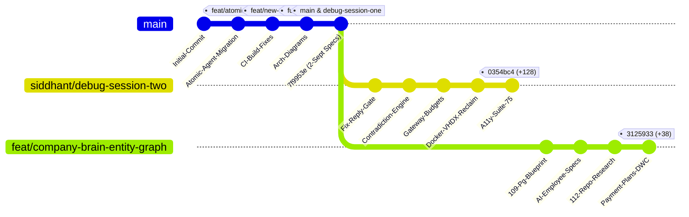
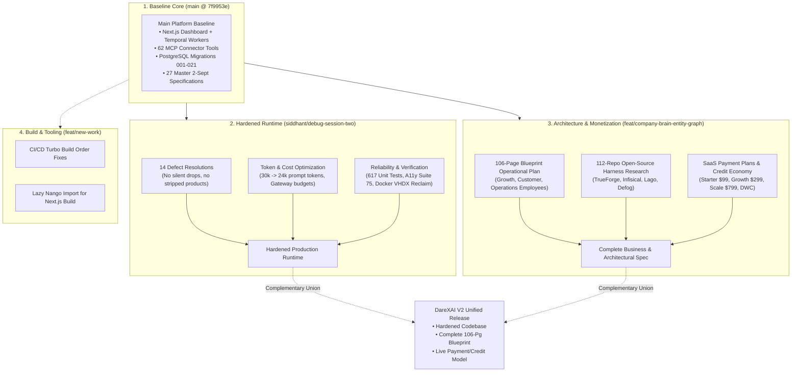
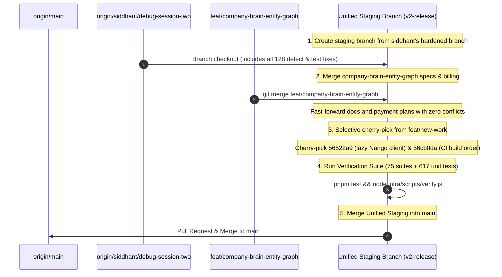

# DareXAI Repository: Branch History, Lineage & Connection Master Guide

> **Document Path:** `docs/updates/branch-history-and-connections.md`  
> **Source Synthesis:** Full Git DAG audit, commit logs, file diffs across all 7 local & remote tracking branches, and session reports.  
> **Current Workspace Branch:** `feat/company-brain-entity-graph`  
> **Repository Remote:** `https://github.com/DarexAI-AI-Startup/Agentic-Os-SaaS.git`  
> **Date:** September 19, 2026

---

## 1. Executive Summary & Repository Topology

The `DarexAI-AI-Startup/Agentic-Os-SaaS` repository tracks the evolution of the DareXAI Agentic Operating System. Across August and September 2026, work progressed through several distinct evolutionary waves:

1. **Phase 0–5 Platform Genesis (Early Aug 2026):** Foundation of multi-tenant Next.js dashboard, Temporal workflows, database migrations `001–021`, and transition to `atomic-agent` via MCP bridge.
2. **Master Architecture Baseline (Sep 2, 2026):** Solidification of `main` at commit `7f9953e`, incorporating the 27-document `docs/2-sept/` master specification suite, threat model, and known-issues register. (Snapshotted as `debug-session-one`).
3. **Session 2 Hardening & Defect Elimination (Sep 2–6, 2026):** Branch `siddhant/debug-session-two` branched off `7f9953e` to resolve 14 critical defect patterns ("failures reported as facts"), reduce token footprint, add gateway budget caps, restore keyboard a11y, and build disk reclamation tooling (128 commits ahead of `main`).
4. **Blueprint Operationalization & Monetization (Sep 8–19, 2026):** Branch `feat/company-brain-entity-graph` branched off `7f9953e` to operationalize the 106-page blueprint (`docs/new-109-pg-plan/`), conduct 112-repo open-source agent harness research, and design the SaaS payment plans and Work Credit economy (38 commits ahead of `main`).



---

## 2. Master Branch Comparison Matrix

| Branch Name | Tip Commit | Last Modified | Primary Author | Ahead / Behind `main` | Core Mission & Contents | Status |
|---|---|:---:|---|:---:|---|---|
| **`main`** | `7f9953e` | 02-Sep-2026 | addygeek | `0` / `0` | Production baseline; 27 master specs (`docs/2-sept/`), core SaaS code, migrations `001–021`, logging fixes. | **Active Production Base** |
| **`debug-session-one`** | `7f9953e` | 02-Sep-2026 | addygeek | `0` / `0` | Snapshot marking the conclusion of Session 1 debugging, threat models, and known-issues registration. | **Aligned with `main`** |
| **`siddhant/debug-session-two`** | `0354bc4` | 06-Sep-2026 | Siddhant Damre | **`+128`** / `0` | **Deep Hardening & Verification:** 14 defect resolutions, keyboard accessibility, Docker VHDX compaction, gateway budget caps, contradiction detection, 617 tests. | **Critical Ahead Branch** |
| **`feat/company-brain-entity-graph`** *(Current)* | `3125933` | 19-Sep-2026 | addygeek | **`+38`** / `0` | **Blueprint & Monetization:** 106-page blueprint synthesis (`docs/new-109-pg-plan/`), 112-repo harness research, master Payment Plans & Credit architecture (`payment-plans.md`). | **Active Feature Branch** |
| **`feat/new-work`** | `1f7c798` | 13-Aug-2026 | Vishal Kumar | `+6` / `-79` | **CI/CD & Environment:** Lazy Nango connector client, Turbo build ordering in CI, `.env.example`, admin branch protection scripts. | **Pending Review / Stale** |
| **`feat/atomic-agent-integration`** | `99b5f04` | 13-Aug-2026 | addygeek | `0` / `-77` | Milestone migration from legacy LangGraph/Hermes to `atomic-agent` (:8787) via SSE MCP bridge (:8790). | **Historical / Merged into `main`** |
| **`future-scope`** | `0b2933d` | 14-Aug-2026 | addygeek | `0` / `-29` | 20+ architectural system diagrams, Docker Compose topology, stats API fix. | **Historical / Merged into `main`** |

---

## 3. Deep-Dive: Branch Lineage, Changes & Assets

---

### 3.1 `main` & `debug-session-one`
* **Commit:** `7f9953e` — *docs: add known-issues register and index the new specs*
* **Date:** September 2, 2026 | **Author:** addygeek
* **Lineage Role:** Common ancestor for both active ahead branches (`siddhant/debug-session-two` and `feat/company-brain-entity-graph`).

#### Key Artifacts & Capabilities:
1. **The 27 Master Specifications (`docs/2-sept/` — 6,935 lines):**
   * Comprehensive enterprise documentation: Product Overview (`01`), System Architecture (`03`), Company Brain Blueprint (`04`), Workforce and Packs (`05`), Integrations & Actions (`06`), Memory (`07`), Governance (`08`), Roadmap (`10`), Business Model (`11`), Data Model Reference (`14`), Workflow Catalog (`15`), API Surface (`16`), Ops Runbook (`17`), Specs for Entity Graph (`21`), Proactivity (`22`), Procedures (`23`), Autonomy Ladder (`24`), Threat Model (`25`), and Known Issues (`26`).
2. **Core Production Stack:**
   * Full Next.js 14 Dashboard (`apps/dashboard/`) with App Router and SuperTokens authentication.
   * Temporal Workers (`services/workflows/`) orchestrating `AutonomousAgentWorkflow` and `CrewWorkflow`.
   * 62 MCP Connector tool executors (`services/workflows/src/tool-executor.ts`) with per-tenant allowlists.
   * Database migrations `001–021` with Row Level Security (RLS) enforcement.
3. **Session 1 Bug Fixes:**
   * Fixed swallowed errors in plan updates, rollbacks, and Langfuse tracing (`3c82918`).
   * Fixed Langfuse Redis socket timeout killing idle queue connections (`855b646`).

---

### 3.2 `siddhant/debug-session-two`
* **Commit:** `0354bc4` — *feat(dashboard): make the dashboard usable without a mouse, and gate it*
* **Date:** September 6, 2026 | **Author:** Siddhant Damre
* **Relation to `main`:** **Ahead by 128 commits** | Behind by 0.
* **Core Focus:** Eliminating silent failures, tightening tenant security, optimizing token consumption, and dashboard accessibility.

#### Comprehensive Breakdown of Changes:
1. **The 14 Major Defect Resolutions (`docs/6-sept/00-session-report.md`):**
   * **Defect 1 (Reply Gate Stripping Catalog Items):** The regex filter `\w+\s+table\b` (intended to catch leaked SQL tables like `billing_invoices table`) was matching and deleting sentences describing furniture (e.g. "dining table", "coffee table"). Resolved with context-aware boundary validation.
   * **Defect 2 (Silence After Interim Acknowledgements):** If a child agent crashed or returned `success: false`, the customer was left in perpetual silence. Added deterministic exit supervision and fallback apologies.
   * **Defect 3 ("Found Nothing" vs. "Could Not Look"):** Previously, an API outage returned `[]`, causing the agent to falsely tell the user "you have no emails" rather than "inbox unreachable". Now cleanly separates errors from empty states.
   * **Defect 4 (Contradiction Detection):** When two internal business records contradict each other, RAG flags it as a conflict citing both documents rather than averaging numbers or guessing.
   * **Defect 5 (Unit-Less Comparison):** Currency and metric comparisons now strictly compare like units (e.g. INR vs USD, Days vs Hours).
   * **Defect 6 (Temporal Grounding):** Platform-supplied dates are treated as ground truth evidence, anchoring queries to the message timestamp.
   * **Defect 7 (Workspace Identity Grounding):** Injected tenant business profile into the agent turn context so the employee knows its own company name and domain.
   * **Defect 8 (Standard Evaluation Alignment):** Aligned evaluation suites with actual production business rules.
   * **Defect 9 (Operator Screen Clarity):** Simplified dashboard views for non-technical business owners.
   * **Defect 10 (Vendor Outage Document Safety):** Prevented temporary vendor 500s from triggering accidental document purging in vector memory.
   * **Defect 11 (Canned Reply Tenant Leak False Positive):** Fixed canned greeting evaluations that were misflagged as cross-tenant data leaks.
   * **Defect 12 (Prompt Token Optimization):** Streamlined system prompts, reducing turn overhead from **30,022 to 23,949 tokens** (~20% prompt cost reduction).
   * **Defect 13 (Expanded Evaluation Personas):** Expanded test harness from 8 rigid unit assertions to 8 realistic customer operational profiles.
   * **Defect 14 (Machine Environment Bug):** WSL2/Docker virtual disk bloat fixed via PowerShell compaction.
2. **Infrastructure & Accessibility:**
   * `infra/scripts/reclaim-docker-disk.ps1`: Compaction script returning 66.7 GB of host disk space.
   * `:focus-visible` keyboard accessibility rule in `globals.css` across 39 components.
   * New gate suite 75 (`infra/scripts/check-accessibility.js`).
3. **Gateway & Cost Controls:**
   * Enforced per-tenant token and cost budgets directly at the LiteLLM gateway (`742f9d3`).
   * Zero-key internet web search and deep research fallback tools (`c25ab35`).

---

### 3.3 `feat/company-brain-entity-graph` (Current Branch)
* **Commit:** `3125933` — *docs(billing): add SaaS payment plans, credit economics, and feature monetization spec*
* **Date:** September 19, 2026 | **Author:** addygeek
* **Relation to `main`:** **Ahead by 38 commits** | Behind by 0.
* **Core Focus:** Synthesizing the 106-Page Blueprint into operational architecture, researching 112 agent harnesses, and establishing SaaS monetization.

#### Comprehensive Breakdown of Changes:
1. **Master SaaS Payment Plans & Credit Architecture:**
   * Created [`docs/new-109-pg-plan/payment/payment-plans.md`](file:///Users/addy/Coding/SaaS/Agentic-Os-SaaS/docs/new-109-pg-plan/payment/payment-plans.md) (40KB):
     * The Three-Pillar Economic Engine: Platform Base + Fleet Slots + Work Credits.
     * 4 Core Subscription Tiers: Starter ($99 / ₹7,999), Growth ($299 / ₹24,999 - Flagship), Scale ($799 / ₹64,999), Enterprise ($2,499+ / ₹1,99,999+).
     * The DareXAI Work Credit (DWC) Burn Schedule: 1 DWC ≈ 1 action or 1,000 fast tokens.
     * Unit economics proving >80% sustained gross margins ($241 net profit on $299 plan).
     * Dual payment rail integration: Stripe (USD) and Razorpay (INR with 18% GST).
2. **109-Page Blueprint Operational Plan (`docs/new-109-pg-plan/`):**
   * `00_executive_summary_and_vision.md`: Paradigms of AI employees vs chatbots and workflow builders.
   * `01_growth_employee.md`: Deep spec for ICP scraping, lookalike hunter, intent detection, stale lead reviver.
   * `02_customer_employee.md`: 12-step resolution engine, open-loop SLA tracking, decision brief escalation.
   * `03_operations_employee.md`: Expected vs. Actual state discrepancy engine, morning triage, data hygiene.
   * `04_shared_integrations_and_connect.md`: Multi-channel ingestion and cross-system tool bindings.
   * `05_state_machines_and_data_models.md`: Temporal workflow state machines and database entities.
   * `06_gap_analysis_and_what_is_missing.md`: Systematic technical gap audit against the blueprint.
3. **Open-Source Agent Harness Research (`docs/truforge/harness-research.md`):**
   * Exhaustive research across 112 open-source agent repositories and enterprise harnesses.
   * Category S-Tier Direct-Twins analysis (TrueForge runtime, Infisical token vaulting, Lago usage-based pricing, Defog SQL AST validation, Formbricks CSAT).

---

### 3.4 `feat/new-work`
* **Commit:** `1f7c798` — *included .env.example*
* **Date:** August 13, 2026 | **Author:** Vishal Kumar
* **Relation to `main`:** Ahead by 6 commits | Behind by 79 commits.
* **Core Focus:** CI/CD pipeline reliability, environment configuration, and branch governance.

#### Key Changes:
* `56522a9`: Made Nango connector client lazy so `next build` does not fail when `NANGO_SECRET_KEY` is absent during static build/import time.
* `f844ad9`: Swapped interactive `next lint` with non-blocking Prettier check in GitHub Actions.
* `56cb0da`: Added pre-build step ensuring `@darex/connectors` and `@darex/workflows` build `dist/` before dashboard typechecks run.
* `004da7b`: Resolved pnpm version conflict in GitHub Actions.
* `76b9f3f`: Added admin branch-protection setup scripts and merge-gating documentation.
* `1f7c798`: Added `.env.example`.

---

### 3.5 `feat/atomic-agent-integration` (Historical)
* **Commit:** `99b5f04` — *docs added for current and future working*
* **Date:** August 13, 2026 | **Author:** addygeek
* **Relation to `main`:** Ahead by 0 | Behind by 77 commits.
* **Summary:** The critical architectural transition branch that replaced the legacy LangGraph/Hermes setup with external `atomic-agent` (v0.1.72) and the SSE MCP Bridge (`:8790`). Fully merged into `main`.

---

### 3.6 `future-scope` (Historical)
* **Commit:** `0b2933d` — *fix: resolve syntax errors in stats endpoint*
* **Date:** August 14, 2026 | **Author:** addygeek
* **Relation to `main`:** Ahead by 0 | Behind by 29 commits.
* **Summary:** Added 20+ mermaid system architecture diagrams across `docs/current-working/` and fixed syntax errors in `/api/analytics/stats`. Fully merged into `main`.

---

## 4. How the Branches Connect & How They Fit Together



### 4.1 Structural Synergy: The Two Lead Branches
The two forward branches (`siddhant/debug-session-two` and `feat/company-brain-entity-graph`) are **almost entirely orthogonal and complementary**:

1. **`siddhant/debug-session-two` modified runtime code and test suites:**
   * Edits in `apps/dashboard/app/globals.css`, `apps/dashboard/app/layout.tsx`.
   * Edits in `services/workflows/src/` (tool executors, prompt builders, reply gates).
   * Script additions in `infra/scripts/` (`check-accessibility.js`, `reclaim-docker-disk.ps1`).
   * Documentation in `docs/6-sept/`.
2. **`feat/company-brain-entity-graph` created new specification domains:**
   * New files in `docs/new-109-pg-plan/` (`00` through `06`).
   * New files in `docs/new-109-pg-plan/payment/` (`payment-plans.md`).
   * New files in `docs/truforge/` (`harness-research.md`).
   * Documentation in `docs/updates/`.

Because they touched non-overlapping files and share the exact same clean merge-base (`7f9953e`), **they can be merged together with virtually zero code conflict**.

---

## 5. Recommended Reconciliation & Merge Roadmap

To unify the entire repository into a single release branch:



### Actionable Merge Commands (When Ready):
```bash
# 1. Create a unified integration branch based on Siddhant's hardened code
git checkout -b release/unified-v2 origin/siddhant/debug-session-two

# 2. Merge the blueprint, harness research, and payment plans
git merge origin/feat/company-brain-entity-graph -m "merge: integrate blueprint specs, harness research, and payment plans"

# 3. Cherry-pick useful CI build order fix from Vishal's branch
git cherry-pick 56522a9 56cb0da

# 4. Verify test suite and typechecks
pnpm test
pnpm --filter @darex/dashboard exec tsc --noEmit
pnpm --filter @darex/workflows exec tsc --noEmit
```
